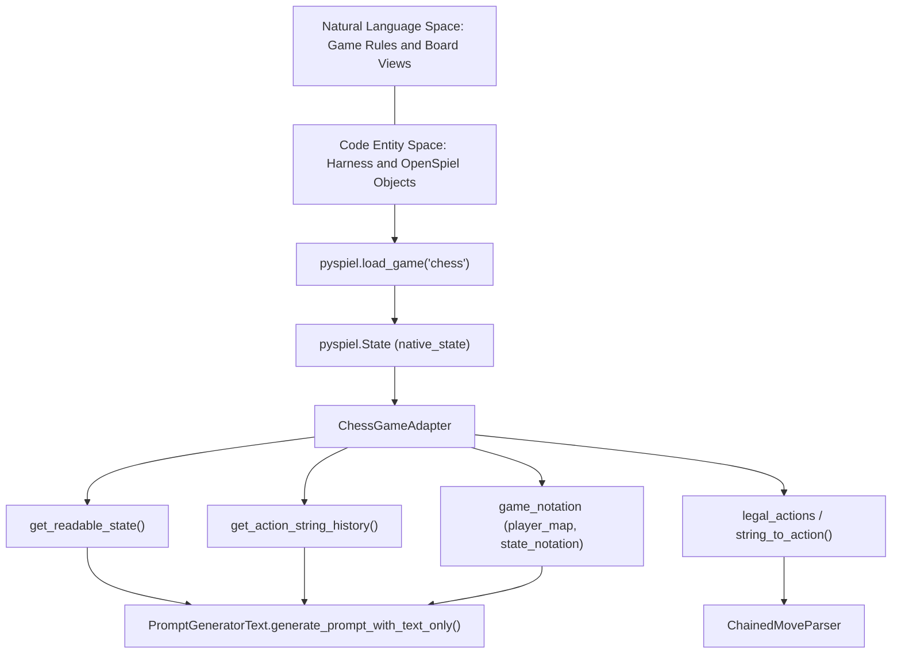
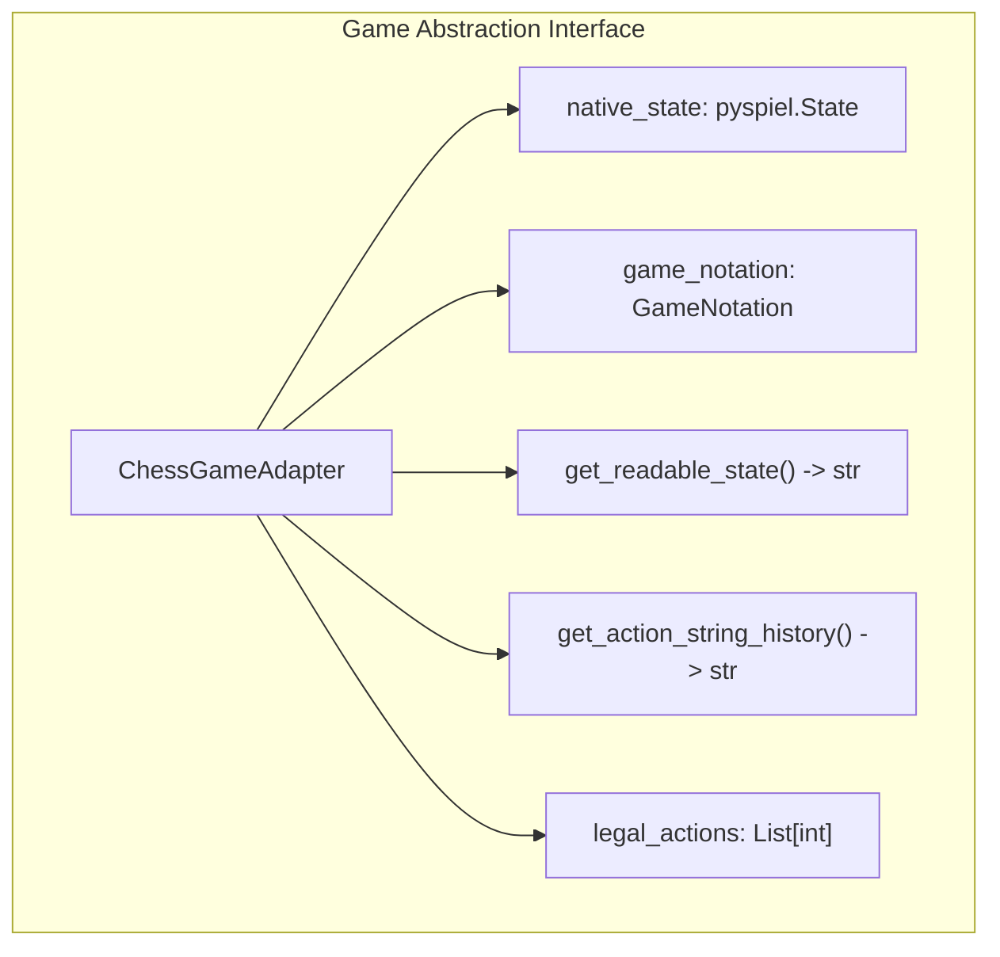
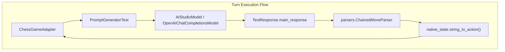

<!-- source: DeepWiki mcp.deepwiki.com · repo google-deepmind/game_arena · page 3.1 Game Abstraction Layer · fetched 2026-10-26 -->

# Game Abstraction Layer

<details>
<summary>Relevant source files</summary>

The following files were used as context for generating this wiki page:

- [README.md](README.md)
- [game_arena/harness/harness_demo.py](game_arena/harness/harness_demo.py)

</details>


The **Game Abstraction Layer** serves as the structural bridge between the underlying game engine—specifically Google's [OpenSpiel](https://github.com/google-deepmind/open_spiel)—and the higher-level components of the Game Arena harness, such as prompt generators, model callers, move parsers, and sampling loops [README.md:63-76](), [game_arena/harness/harness_demo.py:52-133]().

This page details how game adapters (such as `ChessGameAdapter`) encapsulate `pyspiel` states, manage game notations, format readable board states, track move histories, and expose standardized interfaces consumed by prompts and parsers [game_arena/harness/harness_demo.py:53-93]().

---

## 1. Architecture and OpenSpiel State Wrapping

OpenSpiel provides native game logic, state management, rule validation, and canonical state representations (such as Forsyth-Edwards Notation for chess) [README.md:65-76](). However, interacting directly with raw `pyspiel.State` objects across diverse LLM prompting modules and parsers leads to tight coupling. The game abstraction layer introduces adapter classes (e.g., `ChessGameAdapter`) that wrap `pyspiel.State` and expose unified helper properties.


*Figure 1: Architectural bridge from OpenSpiel native state through `ChessGameAdapter` to prompt generation and parsing.*

Sources: [README.md:63-76](), [game_arena/harness/harness_demo.py:52-133]()

---

## 2. Core Adapter Interfaces

Game adapters encapsulate the underlying OpenSpiel state (`native_state`) and provide uniform methods for state inspection, move history tracking, and action conversions [game_arena/harness/harness_demo.py:52-93]().

### Key Responsibilities of Game Adapters
- **State Initialization**: Loading the game via `pyspiel.load_game()` and instantiating initial states `pyspiel_game.new_initial_state()` [game_arena/harness/harness_demo.py:53-54]().
- **Notation Mapping**: Exposing notation definitions (e.g., Standard Algebraic Notation (SAN), FEN) and mapping player integer IDs to readable names via `player_map` [README.md:74-76](), [game_arena/harness/harness_demo.py:88-92]().
- **Readable State Formatting**: Providing human- and LLM-friendly text representations of the current board via `get_readable_state()` [game_arena/harness/harness_demo.py:86]().
- **Move History Tracking**: Extracting past moves as action string sequences via `get_action_string_history()` [game_arena/harness/harness_demo.py:87]().


*Figure 2: Core properties and methods exposed by game adapters.*

Sources: [README.md:63-88](), [game_arena/harness/harness_demo.py:52-133]()

---

## 3. Readable State and Notation Interfaces

Prompts generated for LLMs require clear representations of the current game board and rules. The game abstraction layer supports multiple notation layers:

1. **Canonical State Notation**: Standardized strings such as FEN for chess, maintaining complete state information required by game rules [README.md:74-76]().
2. **Readable Board Strings**: Formatted text representations obtained via adapter methods (`get_readable_state()`) that make spatial relationships obvious to language models [game_arena/harness/harness_demo.py:86]().
3. **Move History**: Accumulated move sequences (`get_action_string_history()`) providing context on prior turns, defaulting to `"None"` when history is empty [game_arena/harness/harness_demo.py:87]().

```python
# Typical pattern for extracting adapter variables for prompt substitutions
prompt_substitutions = {
    "readable_state_str": chess_adapter.get_readable_state(),
    "move_history": chess_adapter.get_action_string_history() or "None",
    "player_name": chess_adapter.game_notation.player_map[
        chess_adapter.native_state.current_player()
    ],
    "move_notation": chess_adapter.game_notation.move_notation,
    "notation": chess_adapter.game_notation.state_notation,
}
```

Sources: [README.md:74-88](), [game_arena/harness/harness_demo.py:82-93]()

---

## 4. Integration with Prompts and Parsers

The game abstraction layer feeds directly into prompt generators and move validation parsers during each turn of the game loop [game_arena/harness/harness_demo.py:74-133]().


*Figure 3: Data flow from game adapter state through prompt generation, model response, parser chaining, and back to state application.*

Sources: [README.md:78-151](), [game_arena/harness/harness_demo.py:74-133]()

---

## 5. Summary of Adapter-Driven Components

| Component / Function | Code Entity / Module | Role in Abstraction Layer |
| :--- | :--- | :--- |
| **Game Adapter** | `chess_game.ChessGameAdapter` | Wraps `pyspiel.State`, providing readable states and notation maps [game_arena/harness/harness_demo.py:55-56](). |
| **Prompt Generator** | `prompt_generation.PromptGeneratorText` | Consumes adapter strings to build structured prompts [game_arena/harness/harness_demo.py:59-97](). |
| **Move Parser** | `parsers.ChainedMoveParser` | Combines rule-based and soft-matching parsers (`chess_parsers.ChessSoftParser`) to interpret model output against adapter legal actions [game_arena/harness/harness_demo.py:70-71, 116-124](). |
| **State Mutator** | `native_state.apply_action()` | Applies parsed actions converted via `string_to_action()` back into OpenSpiel [game_arena/harness/harness_demo.py:131-133](). |

Sources: [README.md:63-151](), [game_arena/harness/harness_demo.py:19-133]()

---

