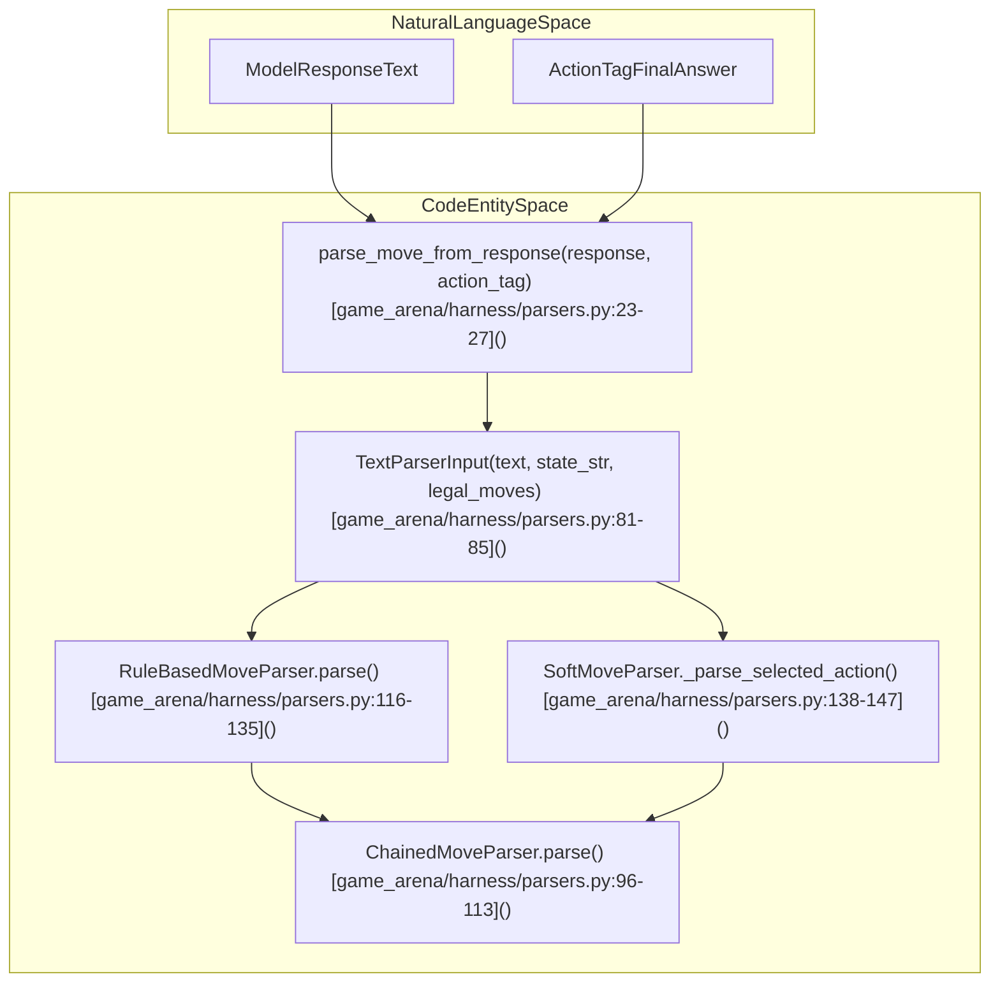
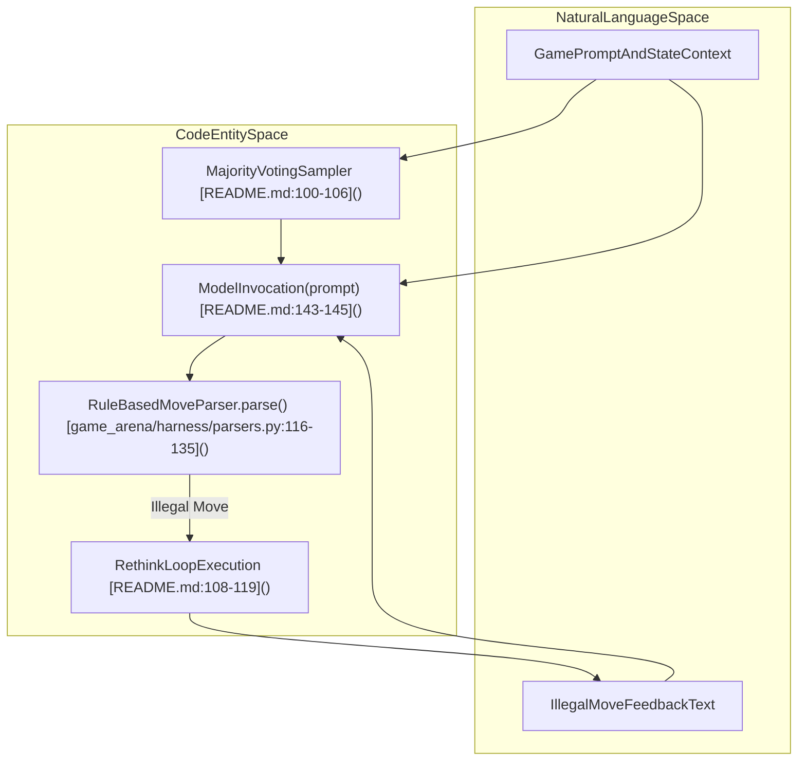

<!-- source: DeepWiki mcp.deepwiki.com · repo google-deepmind/game_arena · page 3.2 Supported Games · fetched 2026-10-26 -->

# Supported Games

Relevant source files

The following files were used as context for generating this wiki page:

- [README.md](README.md)
- [game_arena/harness/parsers.py](game_arena/harness/parsers.py)

This page details the per-game packages and abstractions under the harness (`harness/games`), covering chess, go, connect_four, tic_tac_toe, and poker. It examines how individual game implementations (`game.py`), move parsers, prompt templates, rethink loops, and game-specific agents integrate with the core orchestration platform.

## Game Package Architecture and Environment Integration

The harness relies on OpenSpiel to track game states, provide legal moves, and execute actions [README.md:65-72](). Game-specific packages structure the interaction by mapping canonical representations (such as FEN for chess or ASCII grids for board games) into textual prompts and parsing responses back into OpenSpiel actions [README.md:74-76]().

Sources: [README.md:65-76]()

## Parsing Systems and Move Extraction

Models emit free-form text or structured responses that must be extracted and validated against legal moves. The parsing system provides base classes and functions in `game_arena/harness/parsers.py` to handle rule-based extraction, text cleaning, and soft-matching [README.md:121-133]().

### Parser Components and Data Flow

Sources: [game_arena/harness/parsers.py:23-168]()

The `RuleBasedMoveParser` extracts text following tags like `Final Answer:` using `parse_move_from_response` [game_arena/harness/parsers.py:23-66](), cleaning markdown formatting, bounding boxes, and whitespace [README.md:126-127](). The `SoftMoveParser` validates inputs against `TextParserInput` fields (`state_str`, `legal_moves`, `player_number`) to ensure selected actions fall within valid game moves [game_arena/harness/parsers.py:138-168]().

Sources: [game_arena/harness/parsers.py:23-168](), [README.md:126-127]()

## Prompt Templates and Generation

Prompt templates construct the context provided to player models [README.md:78-81](). Prompts incorporate the current game state (in canonical notation or alternative text/visual representations), move history, and legal moves [README.md:80-88](). Basic prompt templates reside in `harness/prompts.py` and are assembled via `harness/prompt_generation.py` [README.md:90-91]().

Sources: [README.md:78-91]()

## Rethink Loops and Sampling Strategies

When models produce illegal moves or formatting errors, sampling strategies intervene [README.md:97-99](). Two primary mechanisms are supported:
- **Majority Voting**: Parallel sampling enforcing self-consistency across multiple simultaneous model calls [README.md:100-106]().
- **Rethinking**: Sequential sampling where an illegal move triggers a follow-up prompt containing rule-based feedback or correction instructions [README.md:108-119]().

### Sampling and Rethink Execution Flow

Sources: [README.md:100-119](), [game_arena/harness/parsers.py:116-135]()

## Game-Specific Agents and Integration

Per-game packages coordinate game rules, state renderers, and agent behaviors. Agents receive observations from OpenSpiel and format actions into strings compatible with game-specific parsers [README.md:70-76](). Model generation relies on SDK implementations (`harness/model_generation_sdk.py`) or HTTP APIs (`harness/model_generation_http.py`), wrapped with retry and timing logic [README.md:143-151]().

Sources: [README.md:70-76](), [README.md:143-151]()

---

