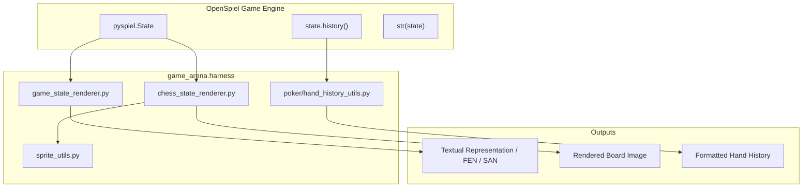
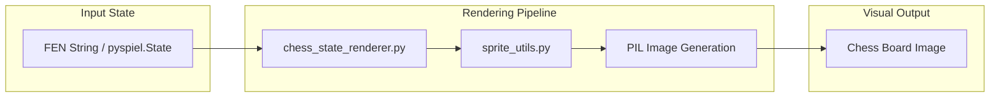

<!-- source: DeepWiki mcp.deepwiki.com · repo google-deepmind/game_arena · page 3.3 Game State Rendering and Formatting · fetched 2026-10-26 -->

# Game State Rendering and Formatting

Relevant source files

The following files were used as context for generating this wiki page:

- [README.md](README.md)
- [game_arena/harness/prompt_generation.py](game_arena/harness/prompt_generation.py)

## Purpose and Scope

Game State Rendering and Formatting modules are responsible for converting raw OpenSpiel game states into structured, human-readable representations, textual notations, or graphical images that can be consumed by LLM agents and other system components. This includes game-specific state renderers (`game_state_renderer.py`, `chess_state_renderer.py`), utility functions for sprite and board drawing (`sprite_utils.py`), poker hand history formatting (`hand_history_utils.py`), and both textual and image-based state representations.

For information about how formatted game states are used in LLM prompts, see Prompt Generation. For details about supported games, see Supported Games.

## System Architecture

The rendering and formatting system bridges OpenSpiel's internal game states with textual and visual modalities required by various agent types and prompt configurations.

**Sources:** [game_arena/harness/game_state_renderer.py:1-40](), [game_arena/harness/games/chess/chess_state_renderer.py:1-35]()

## Game State Renderers and Utilities

The rendering subsystem provides adapters and specialized renderers to transform game states into visual or structured text descriptions.

### Chess State Renderer and Sprite Utilities

For chess, `chess_state_renderer.py` and `sprite_utils.py` handle the creation of board images, drawing piece placements from FEN or OpenSpiel states, and managing visual sprite assets.

**Sources:** [game_arena/harness/games/chess/chess_state_renderer.py:1-50](), [game_arena/harness/games/chess/sprite_utils.py:1-40]()

### Poker Hand History Utilities

For poker, `hand_history_utils.py` parses and formats betting actions, pot sizes, community cards, and player hand histories into readable text logs suitable for inclusion in prompts or telemetry logs.

**Sources:** [game_arena/harness/games/poker/hand_history_utils.py:1-45]()

## Textual and Image State Representations

The harness supports multiple modalities for state representation:
- **Canonical Text Notation**: FEN for chess, action sequences, or stringified OpenSpiel states.
- **Readable Text Descriptions**: Formatted board grids, dictionaries of coordinates to pieces, and move history summaries.
- **Visual Images**: Rendered board graphics produced via image renderers for multimodal LLM agents.

Prompt generators like `PromptGeneratorImageText` in `game_arena/harness/prompt_generation.py` integrate these renderers to supply multimodal input when requested [game_arena/harness/prompt_generation.py:75-112]().

**Sources:** [game_arena/harness/prompt_generation.py:75-112]()

---

