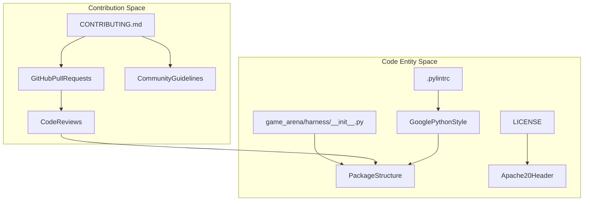
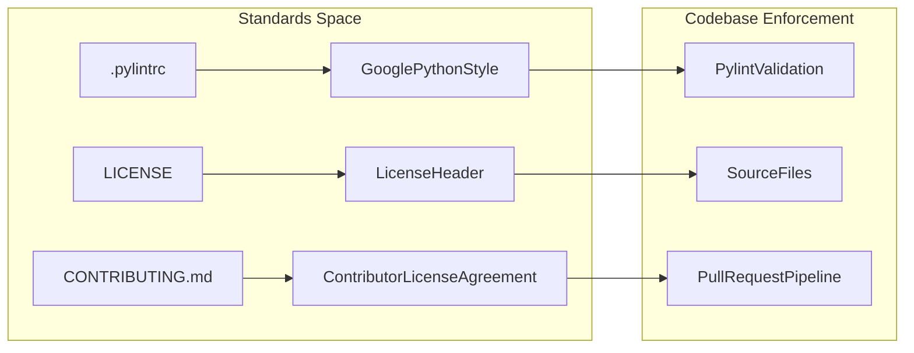

<!-- source: DeepWiki mcp.deepwiki.com · repo google-deepmind/game_arena · page 4 Development Guide · fetched 2026-10-26 -->

# Development Guide

Relevant source files

The following files were used as context for generating this wiki page:

- [CONTRIBUTING.md](CONTRIBUTING.md)
- [game_arena/harness/__init__.py](game_arena/harness/__init__.py)

This page serves as an overview of codebase organization, tooling, and quality standards for contributors working on the Game Arena platform. Game Arena is designed as a research framework for evaluating large language models in strategic game environments. 

For detailed information about code organization, see [Package Structure](#4.1). For testing patterns, see [Testing Infrastructure](#4.2). For style guidelines and linting configurations, see [Code Quality and Standards](#4.3).

## Development Workflow and Repository Standards

The development workflow relies on structured package hierarchies, automated quality checks, and clear contribution pathways governed by open-source guidelines. Contributors interact with standardized configuration files and review processes.

Title: "Development Workflow Architecture"

Sources: [CONTRIBUTING.md:1-29](), [game_arena/harness/__init__.py:1-14]()

## 4.1 Package Structure

The Game Arena codebase is structured around a core orchestration module located in `game_arena`, housing the primary game harness logic in `game_arena.harness` [game_arena/harness/__init__.py:1-14](). Packages utilize standard `__init__.py` files to manage module exports and expose clean interfaces for game environments, state renderers, and agent implementations. Versioning and release workflows align with standard Python packaging practices.

For detailed information on module hierarchies, initialization files, and versioning flows, see [Package Structure](#4.1).

Sources: [game_arena/harness/__init__.py:1-14]()

## 4.2 Testing Infrastructure

Testing in Game Arena ensures the stability of model integrations, move parsers, and game state renderers. The test suite comprises unit and integration tests distributed across `*_test.py` modules. Testing patterns involve mocking model provider SDKs and HTTP calls to prevent flaky external API dependencies during test execution.

For detailed information on test layouts, mocking strategies, and running the test suite, see [Testing Infrastructure](#4.2).

Sources: [CONTRIBUTING.md:1-25]()

## 4.3 Code Quality and Standards

Code quality is strictly enforced through configuration files such as `.pylintrc`, which implements Google Python style rules tailored for the repository. Contributors must adhere to docstring requirements, type annotations, and inclusion of Apache 2.0 licensing headers [game_arena/harness/__init__.py:1-13](). Contribution requirements also mandate adherence to the project's Contributor License Agreement (CLA) and community guidelines outlined in `CONTRIBUTING.md` [CONTRIBUTING.md:1-29]().

For detailed information on pylint configurations, gitignore conventions, and license headers, see [Code Quality and Standards](#4.3).

Title: "Quality and Standards Compliance Flow"

Sources: [CONTRIBUTING.md:1-29](), [game_arena/harness/__init__.py:1-13]()

---

