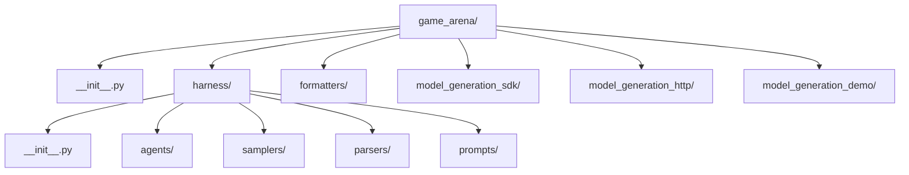
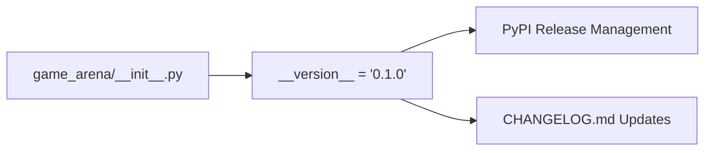
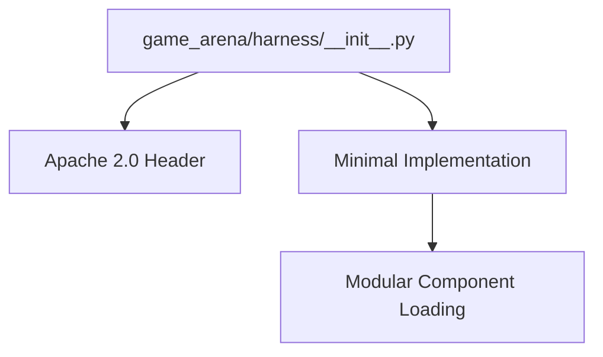
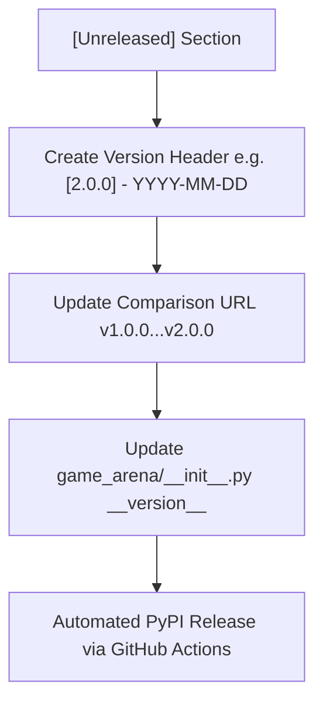
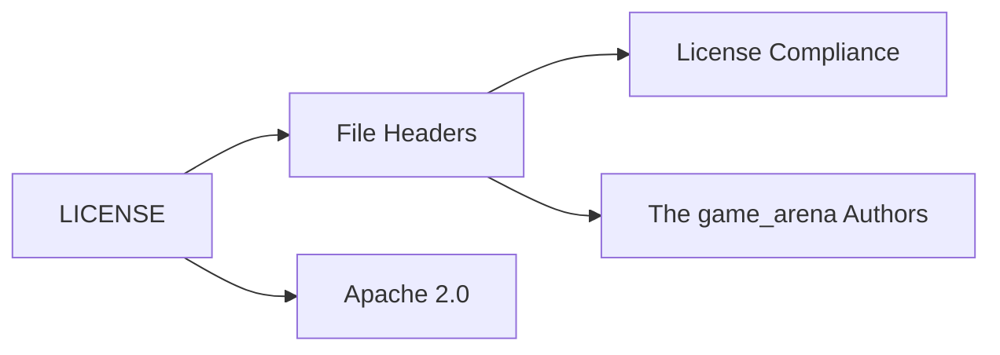

<!-- source: DeepWiki mcp.deepwiki.com · repo google-deepmind/game_arena · page 4.1 Package Structure · fetched 2026-10-26 -->

# Package Structure

Relevant source files

The following files were used as context for generating this wiki page:

- [CHANGELOG.md](CHANGELOG.md)
- [game_arena/__init__.py](game_arena/__init__.py)
- [game_arena/harness/__init__.py](game_arena/harness/__init__.py)

This document covers the organization of the Game Arena codebase, including package hierarchy, module initialization, versioning, release flow, and the relationship between different subsystems. For information about testing organization and test structure, see [Testing Infrastructure](#4.2). For details about coding standards and development practices, see [Code Quality and Standards](#4.3).

Sources: [game_arena/__init__.py:1-19](), [game_arena/harness/__init__.py:1-14]()

## Overview

Game Arena is organized as a Python package with a clear hierarchical structure that separates concerns across different functional areas. The main package `game_arena` contains several subsystems that work together to orchestrate LLM interactions with game environments.

Sources: [game_arena/__init__.py:1-19]()

## Main Package Structure

The codebase follows a modular architecture with distinct packages for different functional areas:

### Package Hierarchy

Sources: [game_arena/__init__.py:1-19](), [game_arena/harness/__init__.py:1-14]()

### Core Subsystems

The package structure reflects the major functional areas of the Game Arena system:

| Package | Purpose | Key Components |
|---------|---------|----------------|
| `harness/` | Core orchestration system | Agents, samplers, parsers, prompts |
| `formatters/` | Game state formatting | Go formatters, state representations |
| `model_generation_sdk/` | SDK-based model integrations | Google AI Studio, OpenAI, Anthropic |
| `model_generation_http/` | HTTP-based model integrations | Together.AI, xAI |
| `model_generation_demo/` | Testing and validation | Model testing, demonstrations |

Sources: [game_arena/__init__.py:1-19](), [game_arena/harness/__init__.py:1-14]()

## Package Initialization and Versioning

### Main Package Initialization

The main `game_arena` package initialization defines the version string used for PyPI releases and package metadata [game_arena/__init__.py:17-19]().

The main package initialization serves several key functions:
- **Version Management**: Defines `__version__ = '0.1.0'` which is parsed during automated releases [game_arena/__init__.py:19]().
- **API Entry Point**: Provides the base namespace for the `game_arena` library [game_arena/__init__.py:15-15]().
- **License Declaration**: Includes standard Apache 2.0 copyright and licensing headers [game_arena/__init__.py:1-14]().

Sources: [game_arena/__init__.py:1-19]()

### Harness Subsystem Initialization

The `game_arena/harness` package initialization contains copyright headers and establishes the subsystem boundary [game_arena/harness/__init__.py:1-14]().

Sources: [game_arena/harness/__init__.py:1-14]()

## Release and Changelog Flow

Game Arena follows the Keep a Changelog standard (`https://keepachangelog.com/`) as outlined in `CHANGELOG.md` [CHANGELOG.md:5-5]().

### Release Process
1. **Changelog Update**: Move notes from `[Unreleased]` into a new version header entry (e.g., `## [0.1.0] - 2022-01-01`) [CHANGELOG.md:15-16]().
2. **Version Bump**: Update `__version__` in `game_arena/__init__.py` [game_arena/__init__.py:17-19]() and update comparison link anchors at the bottom of `CHANGELOG.md` [CHANGELOG.md:17-21]().
3. **Automated Publishing**: Pushing a new version tag triggers automated PyPI releases via GitHub Actions (`pypi-github-auto-release`) [CHANGELOG.md:9-10]().

Sources: [CHANGELOG.md:1-31](), [game_arena/__init__.py:17-19]()

## Licensing and Compliance

All source files include standardized Apache 2.0 license headers:

Sources: [game_arena/__init__.py:1-14](), [game_arena/harness/__init__.py:1-14]()

---

