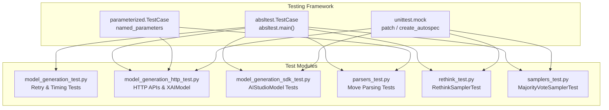
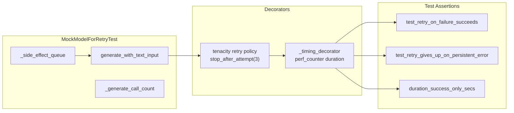
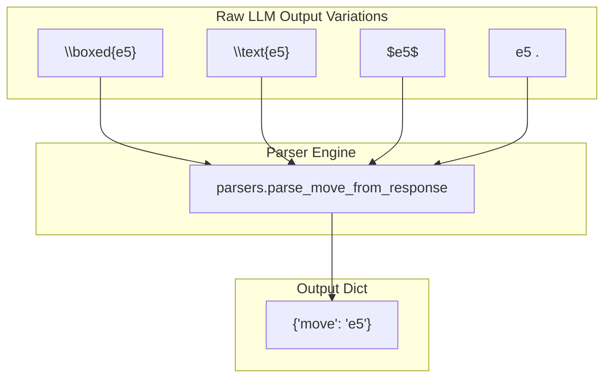
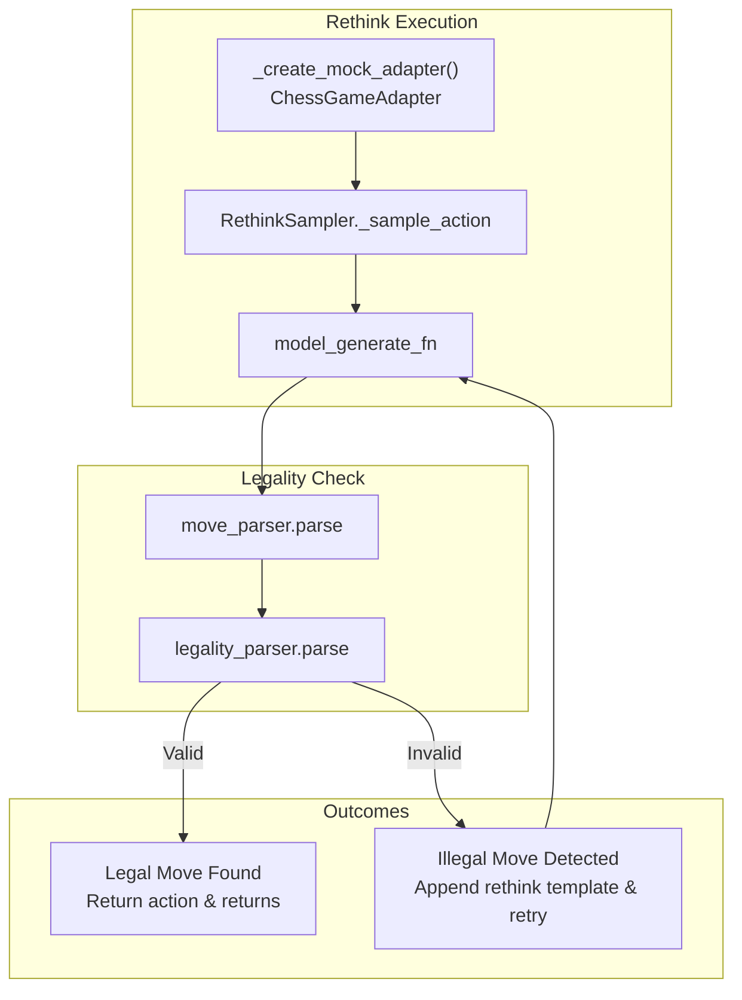

<!-- source: DeepWiki mcp.deepwiki.com · repo google-deepmind/game_arena · page 4.2 Testing Infrastructure · fetched 2026-10-26 -->

# Testing Infrastructure

Relevant source files

The following files were used as context for generating this wiki page:

- [game_arena/harness/model_generation_http_test.py](game_arena/harness/model_generation_http_test.py)
- [game_arena/harness/model_generation_sdk_test.py](game_arena/harness/model_generation_sdk_test.py)
- [game_arena/harness/model_generation_test.py](game_arena/harness/model_generation_test.py)
- [game_arena/harness/parsers_test.py](game_arena/harness/parsers_test.py)
- [game_arena/harness/rethink_test.py](game_arena/harness/rethink_test.py)
- [game_arena/harness/samplers_test.py](game_arena/harness/samplers_test.py)

This page documents the testing infrastructure used across Game Arena (`*_test.py` modules), detailing the test layout, mock strategies for model providers (HTTP, SDK, and base implementations), parser validation patterns, and sampler/rethink verification flows.

For information about code quality standards and linting configuration, see [Code Quality and Standards](#4.3).

## Test Framework and Organization

Game Arena uses Google's `absltest` framework as the primary testing harness, combining standard Python `unittest` assertions with `absl.testing.parameterized` for input variations and `unittest.mock` for isolating external dependencies [game_arena/harness/model_generation_http_test.py:22-23](), [game_arena/harness/model_generation_sdk_test.py:24](), [game_arena/harness/model_generation_test.py:19](), [game_arena/harness/parsers_test.py:19-20](), [game_arena/harness/rethink_test.py:19](), [game_arena/harness/samplers_test.py:20]().

### Core Testing Components

| Component | Purpose | Framework |
|-----------|---------|-----------|
| Unit & Integration Tests | Test individual harness classes and end-to-end components | `absltest.TestCase` [game_arena/harness/model_generation_test.py:63]() |
| Parameterized Tests | Execute test logic across multiple input variations | `parameterized.TestCase` [game_arena/harness/model_generation_http_test.py:29](), [game_arena/harness/parsers_test.py:23]() |
| Mock Objects & Autospecs | Simulate external SDKs, APIs, and game states | `unittest.mock` [game_arena/harness/model_generation_http_test.py:120](), [game_arena/harness/model_generation_sdk_test.py:39](), [game_arena/harness/rethink_test.py:32-43]() |

Title: "Testing Framework Architecture"

Sources: [game_arena/harness/model_generation_http_test.py:22-120](), [game_arena/harness/model_generation_test.py:19-63](), [game_arena/harness/parsers_test.py:19-23](), [game_arena/harness/rethink_test.py:19-33](), [game_arena/harness/samplers_test.py:18-26]()

---

## Model Generation Testing

Model generation tests span base classes, HTTP REST integrations, and SDK wrappers, verifying robust error handling, retry behaviors, timing decorators, and response serialization.

### Base Mechanics: Retries and Timing
`model_generation_test.py` defines `MockModelForRetryTest`, a subclass of `model_generation.Model`, which injects controlled side effects into generation calls to test tenacity-based retries and performance timing metrics [game_arena/harness/model_generation_test.py:28-61]().

Title: "Model Retry and Timing Flow"

Sources: [game_arena/harness/model_generation_test.py:28-164]()

### HTTP and SDK Model Testing
HTTP and SDK integrations are tested with strict mocking of external HTTP posts and client SDK constructors.
* **`model_generation_http_test.py`**: Validates DeepSeek thought-tag separation (`separate_main_response_and_thoughts`), multimodal image-text payload creation (`_create_image_text_content`), and `XAIModel` reasoning payload handling via `@mock.patch('requests.post', spec=True)` [game_arena/harness/model_generation_http_test.py:31-219]().
* **`model_generation_sdk_test.py`**: Tests `AIStudioModel` generation with text inputs, structured thoughts, and error propagation, mocking `google_genai.Client` [game_arena/harness/model_generation_sdk_test.py:36-196]().

Sources: [game_arena/harness/model_generation_http_test.py:31-219](), [game_arena/harness/model_generation_sdk_test.py:36-196](), [game_arena/harness/model_generation_test.py:27-164]()

---

## Move Parser Testing

The move parser test suite (`parsers_test.py`) verifies that `parsers.parse_move_from_response` correctly extracts moves from unstructured model responses containing markdown formatting, LaTeX wrappers, and whitespace variations [game_arena/harness/parsers_test.py:15-152]().

### Parser Input Variations

| Test Case | Raw Response Structure | Expected Parsed Move |
|-----------|------------------------|----------------------|
| `test_trailing_newline` | Response ending with newlines after `Final Answer: e5` | `e5` [game_arena/harness/parsers_test.py:25-39]() |
| `test_trailing_whitespace` | Response with extra trailing spaces | `e5` [game_arena/harness/parsers_test.py:41-61]() |
| `test_single_backslash_boxed_answer` | `Final Answer: \boxed{e5}` | `e5` [game_arena/harness/parsers_test.py:63-76]() |
| `test_double_backslash_boxed_answer` | `Final Answer: \\boxed{e5}` | `e5` [game_arena/harness/parsers_test.py:78-91]() |
| `test_latex_dollar_sign_answer` | `Final Answer: $e5$` | `e5` [game_arena/harness/parsers_test.py:123-136]() |
| `test_space_and_period_at_end` | `Final Answer: e5 .` | `e5` [game_arena/harness/parsers_test.py:138-152]() |

Title: "Parser Extraction Logic"

Sources: [game_arena/harness/parsers_test.py:23-152]()

---

## Sampler and Rethink Testing

Samplers and environment-recovery loops are tested via `samplers_test.py` and `rethink_test.py`, ensuring robust majority-vote tallying, tie-breaking, and illegal-move retry triggers [game_arena/harness/rethink_test.py:71-187](), [game_arena/harness/samplers_test.py:26-186]().

### Majority Voting and Rethink Execution Flow
* **`samplers_test.py`**: Tests `MajorityVoteSampler` and `MajorityVoteMultimodalSampler` across clear majorities, vote ties (using fixed random seeds), empty responses, and image payloads [game_arena/harness/samplers_test.py:26-186]().
* **`rethink_test.py`**: Tests `chess_rethink.RethinkSampler` using mock game adapters (`_create_mock_adapter`) to simulate first-try successes, single/multiple illegal move rethinks, and environment feedback integration (`RETHINK_WITH_ENV`) [game_arena/harness/rethink_test.py:32-187]().

Title: "Rethink Sampler Decision Tree"

Sources: [game_arena/harness/rethink_test.py:32-187](), [game_arena/harness/samplers_test.py:26-186]()

---

