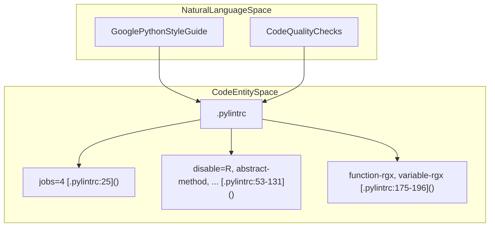
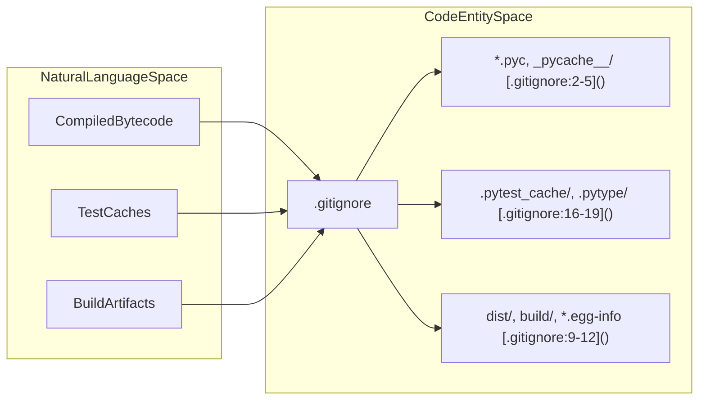

<!-- source: DeepWiki mcp.deepwiki.com · repo google-deepmind/game_arena · page 4.3 Code Quality and Standards · fetched 2026-10-26 -->

# Code Quality and Standards

Relevant source files

The following files were used as context for generating this wiki page:

- [.gitignore](.gitignore)
- [.pylintrc](.pylintrc)
- [LICENSE](LICENSE)

This page documents the code quality standards, linting configuration, licensing terms, and repository conventions used in the `game_arena` codebase. It covers the tools and configurations that ensure consistent, maintainable code across the project.

## Code Style Standards

The codebase adheres to the Google Python Style Guide, enforced via `.pylintrc` [.pylintrc:1-6]().

### Naming Conventions

The project enforces specific naming patterns for different code elements as defined in `.pylintrc`:

| Element Type | Pattern | Code Entity / Example |
|--------------|---------|-----------------------|
| Functions | `snake_case` or `CamelCase` | `parse_move()`, `ChessLLMAgent` [.pylintrc:176]() |
| Variables | `snake_case` | `game_state`, `legal_moves` [.pylintrc:179]() |
| Constants | `UPPER_SNAKE_CASE` | `DEFAULT_TIMEOUT`, `MAX_RETRIES` [.pylintrc:182]() |
| Classes | `PascalCase` | `MoveParser`, `ChessLLMAgent` [.pylintrc:196]() |
| Attributes | `snake_case` | `_game_state`, `legal_moves` [.pylintrc:185]() |

**Sources**: [.pylintrc:175-196]()

---

## Linting Configuration

### Pylint Setup

The project uses Pylint with a comprehensive configuration (`.pylintrc`) designed to uphold best practices from the Google Python Style Guide [.pylintrc:1-8](). It uses 4 parallel jobs for multi-process analysis [.pylintrc:25]() and excludes third-party modules [.pylintrc:11]().

Title: Linting and Quality Configuration Space

### Disabled Checks and Adaptations

To reduce noise while preserving high-value checks, the configuration disables refactoring messages (`R`), legacy Python compatibility warnings, and specific built-in function warnings [.pylintrc:53-131](). Key disabled items include `abstract-method`, `import-error`, `missing-function-docstring`, and `no-member` [.pylintrc:54,80,91,97]().

**Sources**: [.pylintrc:1-196]()

---

## Version Control Exclusions

### Gitignore Conventions

The repository maintains cleanliness by ignoring compiled Python files, build artifacts, IDE configurations, and testing caches via `.gitignore` [.gitignore:1-29]().

Title: Repository Exclusions Space

**Sources**: [.gitignore:1-29]()

---

## Licensing

The project is distributed under the Apache License 2.0, ensuring open-source usability, patent grants, and contribution terms.

- **Copyright & Terms**: Defined in `LICENSE`, covering terms for use, reproduction, and distribution [.LICENSE:1-126]().
- **Contributions**: Subject to standard Apache 2.0 grant of copyright and patent licenses [.LICENSE:67-88]().

**Sources**: [LICENSE:1-126]()

---

