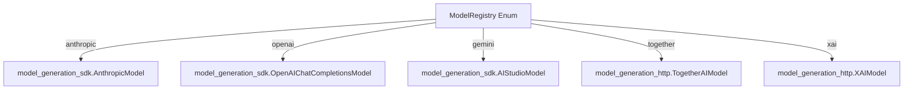
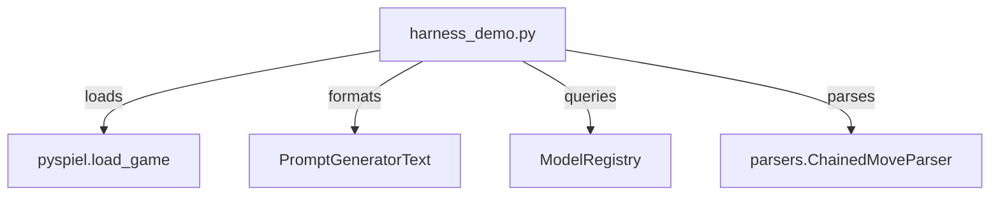
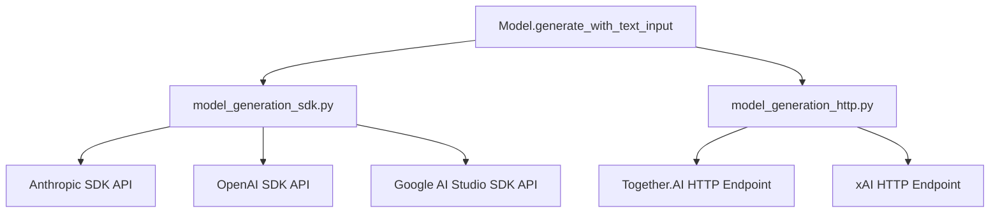

<!-- source: DeepWiki mcp.deepwiki.com · repo google-deepmind/game_arena · page 5 Reference · fetched 2026-10-26 -->

# Reference

Relevant source files

The following files were used as context for generating this wiki page:

- [game_arena/harness/model_registry.py](game_arena/harness/model_registry.py)

## Purpose and Scope

This page serves as the parent overview for reference material in the `game_arena` codebase. It provides a high-level summary of the model registry, demonstration scripts, and provider integration details. 

As a parent page, this document introduces core reference subsystems and directs readers to dedicated child pages for deep technical specifications, configuration parameters, and execution walkthroughs.

Sources: [game_arena/harness/model_registry.py:15-125]()

---

## 5.1 Model Registry

The `ModelRegistry` enum (`game_arena/harness/model_registry.py`) centralizes model definitions, version identifiers, and provider mappings for the platform [game_arena/harness/model_registry.py:23-41](). It maps natural language model names to specific client implementations located in `model_generation_sdk.py` and `model_generation_http.py` via its `build()` method [game_arena/harness/model_registry.py:19-20]().

For detailed information on registered models, configuration options, model aliases, and instructions on how to add new models, see [Model Registry](#5.1).

Sources: [game_arena/harness/model_registry.py:23-125]()

---

## 5.2 Demo Scripts and Examples

The platform includes executable demonstration scripts—such as `harness_demo.py` and `model_generation_demo.py`—that illustrate how to instantiate game states, run prompt generators, invoke model providers, and parse responses into valid OpenSpiel actions.

For complete step-by-step walkthroughs, flag definitions, and expected outputs for these demos, see [Demo Scripts and Examples](#5.2).

Sources: [game_arena/harness/harness_demo.py:59-137]()

---

## 5.3 HTTP and SDK Integration Details

Model interactions are split across official SDK wrappers and direct HTTP implementations to handle diverse provider APIs. These integrations manage streaming options, reasoning budgets, parallel execution attempts, and error recovery protocols.

For provider-specific request/response structures, options mapping, error handling strategies, and troubleshooting tips, see [HTTP and SDK Integration Details](#5.3).

Sources: [game_arena/harness/model_registry.py:42-125]()

---

