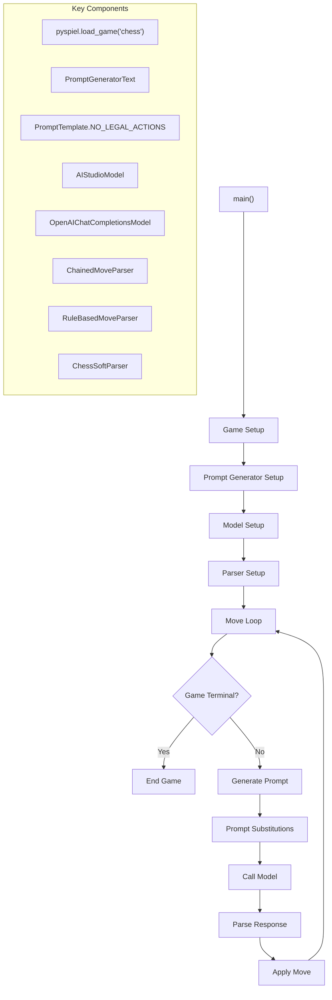
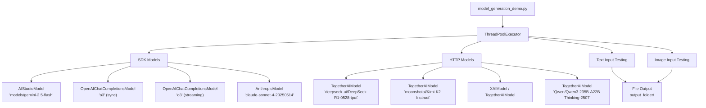

<!-- source: DeepWiki mcp.deepwiki.com · repo google-deepmind/game_arena · page 5.2 Demo Scripts and Examples · fetched 2026-10-26 -->

# Demo Scripts and Examples

<details>
<summary>Relevant source files</summary>

The following files were used as context for generating this wiki page:

- [game_arena/harness/harness_demo.py](game_arena/harness/harness_demo.py)
- [game_arena/harness/model_generation_demo.py](game_arena/harness/model_generation_demo.py)

</details>


This document provides a comprehensive guide to the demonstration scripts available in Game Arena, showing practical usage of the platform's core components and integration patterns.

The demos serve as both learning tools for understanding the system architecture and functional examples for developing new integrations. For detailed information about individual system components demonstrated here, see Core Architecture, Model Integration, and Parsing System.

## Available Demo Scripts

Game Arena includes two primary demonstration scripts that showcase different aspects of the platform:

| Demo Script | Purpose | Key Components |
|-------------|---------|----------------|
| `harness_demo.py` | Complete game playing pipeline | Game state, prompt generation, model calling, parsing |
| `model_generation_demo.py` | Model provider testing and validation | Multiple LLM providers, concurrent testing, error handling |

## Harness Demo: Complete System Integration

The `harness_demo.py` script demonstrates the full Game Arena pipeline by orchestrating a chess game between two LLM players. This demo shows how all core components work together in a realistic game scenario.

### Demo Flow Architecture



Sources: [game_arena/harness/harness_demo.py:51-135]()

### Configuration Options

The harness demo supports several command-line configuration options using `absl.flags`:

[game_arena/harness/harness_demo.py:32-48]()

```bash
# Run 5 moves with custom models
python harness_demo.py --num_moves=5 --gemini_model=gemini-2.5-flash --openai_model=gpt-4.1
```

### Parser Strategy Selection

The demo showcases chained parsing combining rule-based extraction with game-specific soft-matching:

[game_arena/harness/harness_demo.py:70-72]()

- **Chained Parser**: Uses `parsers.ChainedMoveParser` with `parsers.RuleBasedMoveParser` followed by `chess_parsers.ChessSoftParser`.

### Prompt Generation Pattern

The demo shows comprehensive prompt construction using game-specific substitutions derived from `chess_game.ChessGameAdapter`:

[game_arena/harness/harness_demo.py:82-98]()

Key substitution variables include:
- `readable_state_str`: Human-readable game state via `chess_adapter.get_readable_state()`
- `move_history`: Previous moves in the game via `chess_adapter.get_action_string_history()`
- `player_name`: Current player identifier from `chess_adapter.game_notation.player_map`
- `move_notation`: Expected move format (`chess_adapter.game_notation.move_notation`)
- `notation`: State representation format (`chess_adapter.game_notation.state_notation`)

Sources: [game_arena/harness/harness_demo.py:1-137]()

## Model Generation Demo: Provider Testing Framework

The `model_generation_demo.py` script provides a comprehensive testing framework for validating different LLM providers and their capabilities.

### Model Provider Architecture



Sources: [game_arena/harness/model_generation_demo.py:36-198]()

### Multimodal Testing Capabilities

The demo supports both text-only and multimodal inputs:

[game_arena/harness/model_generation_demo.py:117-152]()

- **Text Input**: Chess position with Forsyth-Edwards Notation (FEN) and explicit move request via `model_generation.ModelTextInput`.
- **Image Input**: Chess puzzle image loaded via `importlib.resources` with visual analysis request via `model_generation.ModelImageTextInput`.

### Model Configuration Examples

The demo showcases various model configurations:

[game_arena/harness/model_generation_demo.py:154-198]()

Key configuration patterns:
- **Streaming vs Sync**: Setting `api_options={"stream": True}` or `{"stream": False}`.
- **API Options**: Timeouts, parallel attempts, and thinking token budgets.
- **Model Options**: Limits such as `max_tokens` and reasoning/thinking parameters.

### Output Management

Results are systematically written to files for analysis via `write_to_file`:

[game_arena/harness/model_generation_demo.py:76-115]()

Output includes:
- Model input details (prompts, system instructions, images)
- Response timing information via `datetime.timedelta`
- Full model responses or dataclass serialization

Sources: [game_arena/harness/model_generation_demo.py:1-352]()

## Usage Patterns and Integration Examples

### Basic Game Playing Setup

Both demos demonstrate the standard pattern for setting up game playing with LLMs:

1. **Initialize Game Environment**: Use `pyspiel.load_game()` to create game instances [game_arena/harness/harness_demo.py:53-56]().
2. **Configure Prompt Generation**: Set up `prompt_generation.PromptGeneratorText` with appropriate templates [game_arena/harness/harness_demo.py:59-60]().
3. **Initialize Models**: Create model instances with provider-specific SDK or HTTP classes [game_arena/harness/harness_demo.py:63-68]().
4. **Set Up Parsing**: Configure chained parsing strategies based on reliability requirements [game_arena/harness/harness_demo.py:70-72]().
5. **Execute Game Loop**: Iterate through moves with proper validation and state application [game_arena/harness/harness_demo.py:74-133]().

### Error Handling Patterns

The demos showcase robust error handling:

- Graceful termination when `parser_output` is `None` [game_arena/harness/harness_demo.py:125-126]().
- Exception catching and tracing during multi-model concurrent execution runs.

### Model Provider Integration

The demos illustrate how to integrate different model providers:

- **SDK-based**: Direct integration using `model_generation_sdk.AIStudioModel`, `model_generation_sdk.OpenAIChatCompletionsModel`, and `model_generation_sdk.AnthropicModel` [game_arena/harness/model_generation_demo.py:156-192]().
- **HTTP-based**: Custom HTTP integrations via `model_generation_http.TogetherAIModel` [game_arena/harness/model_generation_demo.py:174-196]().

Sources: [game_arena/harness/harness_demo.py:51-137](), [game_arena/harness/model_generation_demo.py:117-198]()

## Key Learning Outcomes

These demonstration scripts teach several important concepts:

1. **System Integration**: How Game Arena components work together in practice.
2. **Error Resilience**: Patterns for handling unparseable or illegal LLM responses.
3. **Model Diversity**: Support for multiple LLM providers with different API options.
4. **Parsing Strategies**: Trade-offs between rule-based extraction and soft-matching.
5. **Concurrent Testing**: Efficient validation of multiple model providers using thread pools.
6. **Configuration Management**: Best practices for structuring prompts and model parameters.

Sources: [game_arena/harness/harness_demo.py:1-137](), [game_arena/harness/model_generation_demo.py:1-352]()

---

