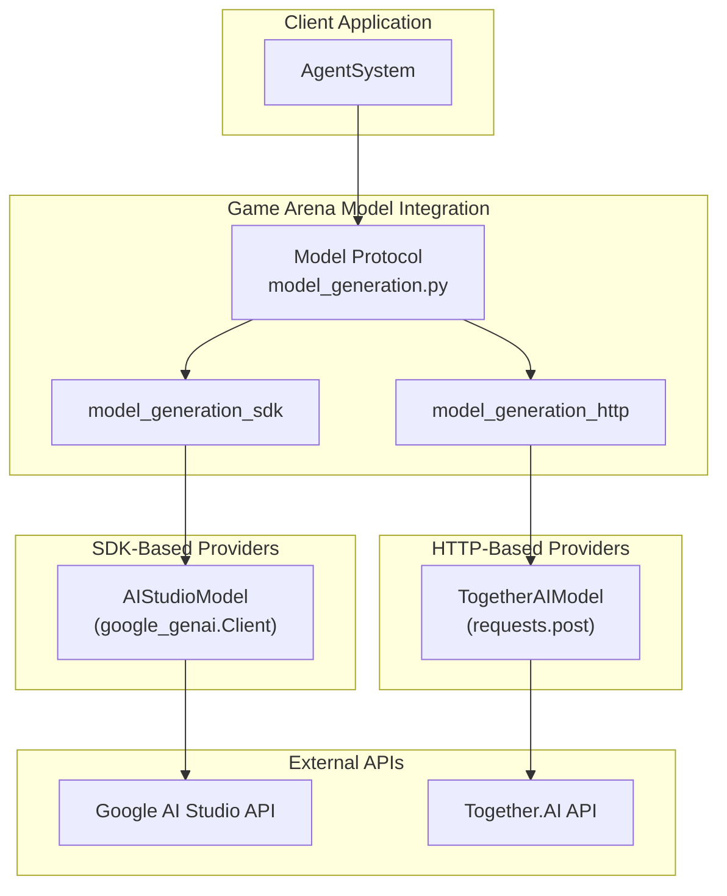
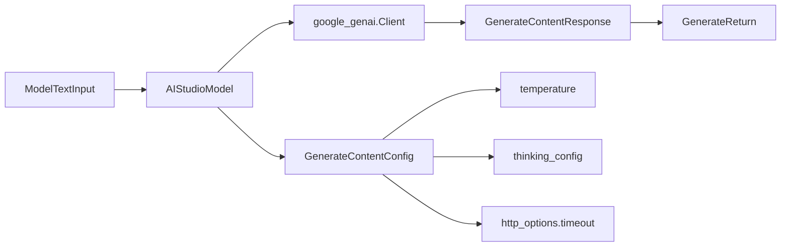
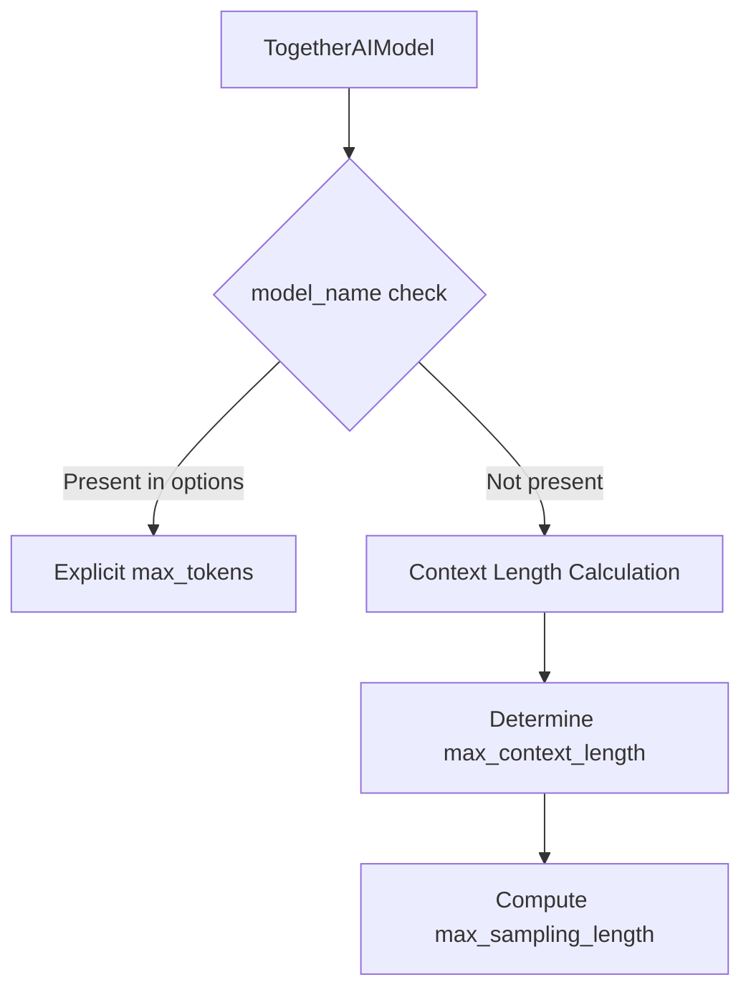
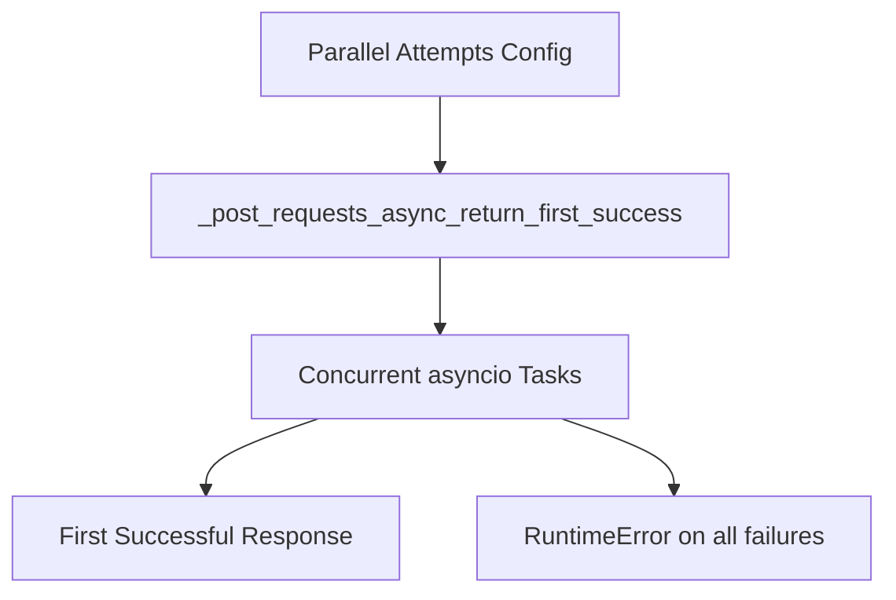
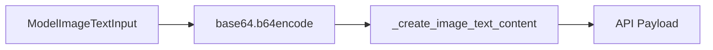

<!-- source: DeepWiki mcp.deepwiki.com · repo google-deepmind/game_arena · page 5.3 HTTP and SDK Integration Details · fetched 2026-10-26 -->

# HTTP and SDK Integration Details

Relevant source files

The following files were used as context for generating this wiki page:

- [game_arena/harness/model_generation.py](game_arena/harness/model_generation.py)
- [game_arena/harness/model_generation_http.py](game_arena/harness/model_generation_http.py)
- [game_arena/harness/model_generation_sdk.py](game_arena/harness/model_generation_sdk.py)

This document provides technical reference information for model provider integrations in Game Arena, covering both SDK-based and HTTP-based approaches for connecting to different LLM providers `[game_arena/harness/model_generation.py:15-18](), [game_arena/harness/model_generation_http.py:15-16](), [game_arena/harness/model_generation_sdk.py:15-16]()`. It details API configurations, request/response formats, error handling mechanisms, and provider-specific implementation details.

For information about the high-level model integration architecture, see [Supported Games](#3.2). For details about the model registry and available models, see [Model Registry](#6.1).

## Integration Architecture Overview

Game Arena supports two primary integration approaches for connecting to LLM providers: `[game_arena/harness/model_generation.py:144-207](), [game_arena/harness/model_generation_http.py:66](), [game_arena/harness/model_generation_sdk.py:76]()`

Diagram: Model Integration Architecture

Sources: `[game_arena/harness/model_generation.py:144-207](), [game_arena/harness/model_generation_http.py:66-204](), [game_arena/harness/model_generation_sdk.py:76-190]()`

## SDK Integration Details

SDK integrations use official client libraries from model providers, offering robust error handling and structured configuration classes `[game_arena/harness/model_generation_sdk.py:15-34]()`.

### AIStudioModel (Google AI Studio)

The `AIStudioModel` class integrates with Google's AI Studio API using the `google_genai.Client` `[game_arena/harness/model_generation_sdk.py:76-92]()`:

Diagram: AIStudioModel Data Flow

Key configuration options handled by `AIStudioModel`:
- `temperature`: Controls response randomness `[game_arena/harness/model_generation_sdk.py:112]()`
- `thinking_budget`: Maximum reasoning tokens for supported models `[game_arena/harness/model_generation_sdk.py:118]()`
- `include_thoughts`: Whether to include reasoning in response `[game_arena/harness/model_generation_sdk.py:117]()`
- `http_options.timeout`: Request timeout in milliseconds `[game_arena/harness/model_generation_sdk.py:106-110]()`

Sources: `[game_arena/harness/model_generation_sdk.py:76-190]()`

## HTTP Integration Details

HTTP integrations use direct REST API calls with custom implementations for provider-specific features and context length management `[game_arena/harness/model_generation_http.py:15-31]()`.

### TogetherAIModel

Provides access to models hosted on the Together.AI platform with custom context length resolution and fallback parameters `[game_arena/harness/model_generation_http.py:66-143]()`:

Diagram: TogetherAIModel Processing

Sources: `[game_arena/harness/model_generation_http.py:66-204]()`

## Asynchronous Request Handling

HTTP integrations include support for parallel execution attempts to improve reliability under high load `[game_arena/harness/model_generation_http.py:158-179]()`:

Diagram: Asynchronous Request Handling

Sources: `[game_arena/harness/model_generation_http.py:158-179]()`

## Configuration Management

### Model Options vs API Options

Game Arena distinguishes between model-level behavior and API transport configurations via the `Model` protocol `[game_arena/harness/model_generation.py:144-166]()`:

| Type | Purpose | Examples |
|------|---------|----------|
| `model_options` | Model behavior parameters | `temperature`, `max_tokens`, `thinking_budget`, `top_k`, `top_p` `[game_arena/harness/model_generation.py:158-159](), [game_arena/harness/model_generation_http.py:114-152]()` |
| `api_options` | Client/transport settings | `stream`, `timeout`, `include_thoughts`, `parallel_attempts` `[game_arena/harness/model_generation.py:160-161](), [game_arena/harness/model_generation_http.py:158-166]()` |

Sources: `[game_arena/harness/model_generation.py:144-166](), [game_arena/harness/model_generation_http.py:114-166]()`

### Multimodal Input Handling

All integrations support both text-only and image+text inputs through `ModelTextInput` and `ModelImageTextInput` classes `[game_arena/harness/model_generation.py:37-49](), [game_arena/harness/model_generation_http.py:33-63]()`:

Diagram: Multimodal Input Handling

Image handling details:
- Images are base64-encoded `[game_arena/harness/model_generation_http.py:37-39]()`
- MIME types are preserved in data URLs `[game_arena/harness/model_generation_http.py:40-47]()`
- Supports preceding and following text formatting around images `[game_arena/harness/model_generation_http.py:48-63]()`

Sources: `[game_arena/harness/model_generation.py:37-49](), [game_arena/harness/model_generation_http.py:33-63]()`

## Error Handling and Troubleshooting

### Retry Mechanics and Decorators

Game Arena decorates model generation methods with automatic retry logic (`_retry_decorator`) and execution timing (`_timing_decorator`) `[game_arena/harness/model_generation.py:81-140]()`:

- **Retry Condition**: Catches general exceptions excluding `DoNotRetryError` subclasses (such as `UnsupportedCapabilityError`) `[game_arena/harness/model_generation.py:99-132]()`.
- **Backoff Strategy**: Uses random exponential backoff with a maximum delay window `[game_arena/harness/model_generation.py:134-140]()`.

Sources: `[game_arena/harness/model_generation.py:81-140]()`

### Token Usage Tracking

Models return standard usage metadata encapsulated in `GenerateReturn` `[game_arena/harness/model_generation.py:51-65]()`:
- `generation_tokens` `[game_arena/harness/model_generation.py:59]()`
- `prompt_tokens` `[game_arena/harness/model_generation.py:60]()`
- `reasoning_tokens` `[game_arena/harness/model_generation.py:61]()`
- `total_tokens` `[game_arena/harness/model_generation.py:62]()`

Sources: `[game_arena/harness/model_generation.py:51-65](), [game_arena/harness/model_generation_sdk.py:138-146]()`

---

