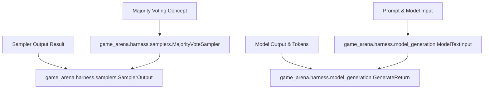
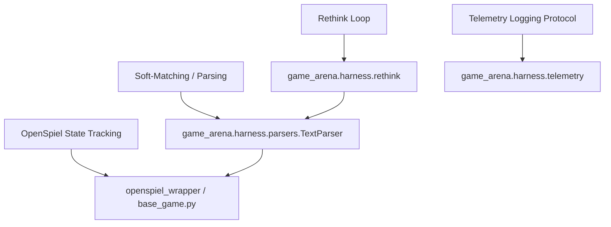

<!-- source: DeepWiki mcp.deepwiki.com · repo google-deepmind/game_arena · page 6 Glossary · fetched 2026-10-26 -->

# Glossary

<details>
<summary>Relevant source files</summary>

The following files were used as context for generating this wiki page:

- [README.md](README.md)
- [game_arena/harness/model_generation.py](game_arena/harness/model_generation.py)
- [game_arena/harness/samplers.py](game_arena/harness/samplers.py)

</details>


## Purpose and Scope

This page provides exact technical definitions for codebase-specific terms, data structures, protocols, and architectural concepts used throughout the Game Arena harness. Each entry links to the underlying implementation files and classes, bridging conceptual terminology with the codebase's entity space.

---

## 1. Core Concepts & Notations

### OpenSpiel
An open-source framework for reinforcement learning in games developed by Google DeepMind, used by Game Arena as the core game environment backend (`[README.md:65-72]()`). OpenSpiel manages game state transitions, rule verification, player turns, and canonical state representations.

### FEN (Forsyth-Edwards Notation)
A standard notation for describing a particular board position of a chess game. The harness uses FEN as a canonical text-based game state representation passed to LLM prompts (`[README.md:74-76]()`).

### SAN (Standard Algebraic Notation)
The standard method for recording and describing chess moves. Parsers in the harness attempt to interpret model outputs as SAN strings and resolve them into valid game actions (`[README.md:132-139]()`).

Sources: `[README.md:65-76]`, `[README.md:132-139]()`

---

## 2. Execution & Control Flow Terms

### Majority Voting
A parallel sampling technique implemented in `[game_arena/harness/samplers.py:68-161]()` to enforce self-consistency and reduce illegal move rates. The model is queried multiple times in parallel for the same prompt, responses are parsed, and the most frequent valid action is selected (`[README.md:100-106]()`).

### Rethink
A sequential sampling loop implemented to give models an opportunity to recover from illegal moves (`[README.md:108-120]()`). When a model outputs an illegal move, it receives a subsequent prompt—optionally appended with error feedback—to generate a corrected, legal move.

### Soft-matching
A fuzzy parsing and action-matching mechanism implemented in `[game_arena/harness/parsers.py]()` (referenced in `[README.md:132-139]()`) that maps slightly malformed or non-strict model move strings to legal game actions, handling ambiguities or extraneous formatting.

Sources: `[README.md:100-139]`, `[game_arena/harness/samplers.py:68-161]()`

---

## 3. Data Structures & Core Types

### GenerateReturn
A frozen dataclass decorated with `dataclasses_json` that standardizes model response payloads, raw text outputs, internal reasoning thoughts, token counts, and execution metrics (`[game_arena/harness/model_generation.py:53-64]()`).

```python
@dataclasses_json.dataclass_json
@dataclasses.dataclass(frozen=True, kw_only=True)
class GenerateReturn:
  main_response: str
  main_response_and_thoughts: str
  request_for_logging: dict[str, Any] | None = None
  response_for_logging: dict[str, Any] | None = None
  generation_tokens: int | None = None
  prompt_tokens: int | None = None
  reasoning_tokens: int | None = None
  total_tokens: int | None = None
  duration_success_only_secs: int | None = None
```

### ModelTextInput / ModelImageTextInput
Dataclasses encapsulating input prompts and optional system instructions or multimodal image payloads sent to model generation backends (`[game_arena/harness/model_generation.py:38-49]()`).

### SamplerOutput
A dataclass representing the unified output of a sampler, containing the chosen action, extracted strings, matched moves, raw generation returns, and auxiliary metrics like frequency counts (`[game_arena/harness/samplers.py:36-45]()`).

### KaggleSpielAction
A type specification used to map Kaggle platform action inputs and outputs into OpenSpiel-compatible format requirements.

Sources: `[game_arena/harness/model_generation.py:38-64]`, `[game_arena/harness/samplers.py:36-45]()`

---

## 4. Infrastructure & Telemetry

### Telemetry Exporter
A logging protocol and export mechanism (`[game_arena/harness/telemetry.py]`) that collects structured key-value telemetry data across game turns, model calls, and harness orchestrations.

Sources: `[game_arena/harness/telemetry.py]()`

---

## 5. Architecture Mapping Diagrams

### Diagram 1: Natural Language Space to Code Entity Space (Sampling & Generation)


Sources: `[game_arena/harness/model_generation.py:38-64]`, `[game_arena/harness/samplers.py:36-161]()`

### Diagram 2: Natural Language Space to Code Entity Space (Game State & Parsing)


Sources: `[README.md:65-145]`, `[game_arena/harness/samplers.py]()`