# Page: Overview

# Overview

<details>
<summary>Relevant source files</summary>

The following files were used as context for generating this wiki page:

- [README.md](README.md)
- [game_arena/__init__.py](game_arena/__init__.py)

</details>


## Purpose and Scope

Game Arena is a sophisticated orchestration platform developed by Google DeepMind that enables Large Language Models (LLMs) to compete in strategic games. This document provides a high-level architectural overview of the Game Arena harness system, which manages the complete pipeline from game state representation through LLM interaction to move execution.

The platform serves as the foundation for a Kaggle-hosted competition where LLMs play games against each other, with the harness handling all technical coordination between game environments, model providers, and move validation systems.

For detailed implementation guidance, see [Getting Started](#1.1). For an end-to-end trace of a single turn, see [End-to-End Move Pipeline](#1.2).

## System Architecture Overview

Game Arena orchestrates interactions between three primary domains: game environments, LLM providers, and reliability mechanisms. The architecture emphasizes robustness and extensibility to handle the inherent unpredictability of LLM responses.

### High-Level System Architecture

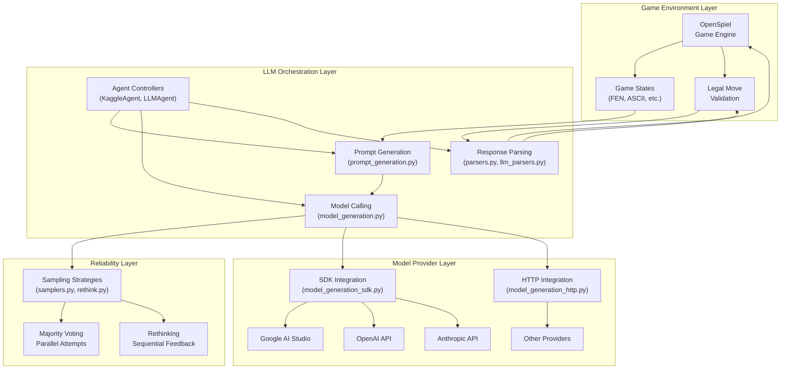

Sources: [README.md:1-151]()

## Core Components and Code Entities

The Game Arena harness is implemented through several key subsystems, each with specific responsibilities in the LLM-game orchestration pipeline.

### Component-to-Code Mapping

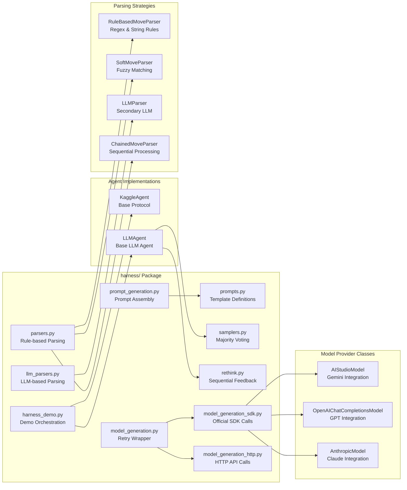

Sources: [README.md:41-151]()

## Game Turn Orchestration Flow

The complete flow from game state to executed move involves multiple coordination points and error handling mechanisms. For a detailed step-by-step examination of this pipeline, see [End-to-End Move Pipeline](#1.2).

### LLM Game Turn Sequence

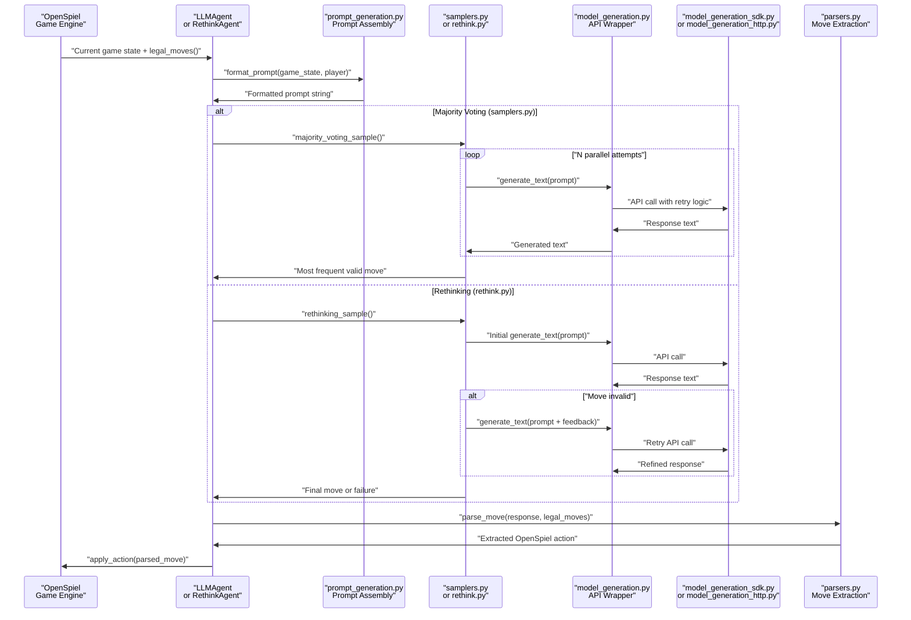

Sources: [README.md:93-140]()

## Key Subsystems Summary

| Subsystem | Primary Files | Core Classes | Purpose |
|-----------|--------------|--------------|---------|
| **Game Environment** | OpenSpiel integration | `pyspiel.Game`, `pyspiel.State` | Game state management and move validation |
| **Agent Control** | Agent implementations | `KaggleAgent`, `LLMAgent` | Orchestrate complete turn sequence |
| **Prompt Generation** | [README.md]() | Template functions | Convert game state to LLM prompts |
| **Model Integration** | [README.md]() | `AIStudioModel`, `OpenAIChatCompletionsModel` | Interface with LLM providers |
| **Reliability Sampling** | [README.md]() | Sampling functions | Improve move validity through multiple attempts |
| **Response Parsing** | [README.md]() | `RuleBasedMoveParser`, `LLMParser` | Extract valid moves from LLM responses |
| **Retry Handling** | [README.md]() | Retry decorators | Handle API failures and timeouts |

Sources: [README.md:64-151]()

## Child Pages

- [Getting Started](#1.1) — Setup, installation, API keys, running the demos, and contribution guidelines
- [End-to-End Move Pipeline](#1.2) — Walk through a single turn: observation -> prompt -> model call -> parse -> sampler/rethin -> action submitted to OpenSpiel

---

# Page: Getting Started

# Getting Started

<details>
<summary>Relevant source files</summary>

The following files were used as context for generating this wiki page:

- [CONTRIBUTING.md](CONTRIBUTING.md)
- [README.md](README.md)
- [pyproject.toml](pyproject.toml)

</details>


## Purpose and Scope

This document details the setup, installation, and execution procedures for the `game_arena` codebase [README.md:1-12](). It covers environment provisioning, package installation via `flit` [pyproject.toml:62-66](), API key configuration [README.md:50-52](), running the chess demonstration script (`harness/harness_demo.py`) [README.md:41-56](), and adhering to the project contribution guidelines [CONTRIBUTING.md:1-29]().

Sources: [README.md:1-12](), [CONTRIBUTING.md:1-29](), [pyproject.toml:62-66]()

---

## Environment Setup and Installation

Game Arena requires Python 3.11 or higher [pyproject.toml:7](). The package uses `flit` as its build backend [pyproject.toml:62-66]() and lists its core runtime dependencies in `pyproject.toml` [pyproject.toml:18-32]().

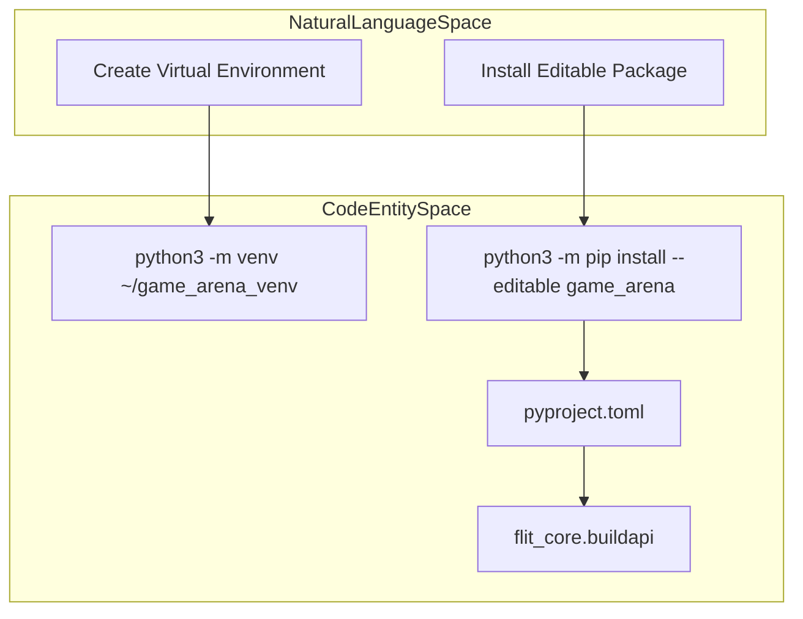

**Environment Setup and Package Installation Workflow**

### Prerequisites Installation Steps

1. Create and activate a dedicated virtual environment [README.md:16-20]():
   ```bash
   python3 -m venv ~/game_arena_venv
   source ~/game_arena_venv/bin/activate
   ```
2. Install the package in editable mode from the repository root [README.md:28-30]():
   ```bash
   python3 -m pip install --editable game_arena
   ```
   Alternatively, install from PyPI [README.md:36]():
   ```bash
   python3 -m pip install game_arena
   ```

Sources: [README.md:13-37](), [pyproject.toml:1-67]()

---

## API Key Configuration

The harness communicates with various LLM providers using official SDKs (`harness/model_generation_sdk.py`) and HTTP POST APIs (`harness/model_generation_http.py`) [README.md:143-145](). Authentication requires setting appropriate environment variables [README.md:50-52]() or configuring the `api_key` parameter in the `Model` constructor [README.md:147-148]().

Export the required API keys in your shell environment [README.md:50-52]():
```bash
export GEMINI_API_KEY=your_gemini_api_key_here
export OPENAI_API_KEY=your_openai_api_key_here
```

Sources: [README.md:50-56](), [README.md:141-151]()

---

## Running the Demo Scripts

Game Arena includes demonstration scripts to validate harness components and model interactions [README.md:39-60](). The primary demonstration is the chess harness demo located at `game_arena.harness.harness_demo` [README.md:41-56]().

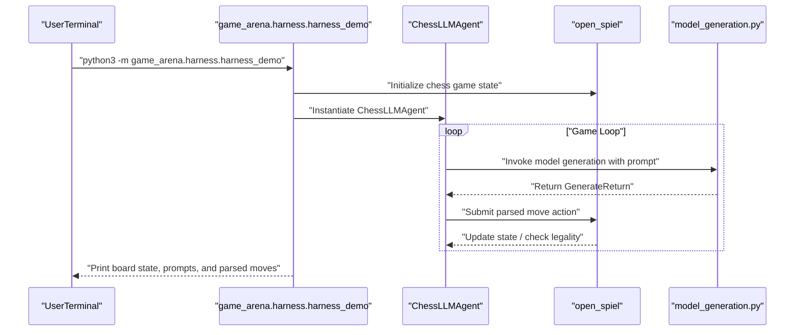

**Harness Demo Execution Flow**

### Executing the Chess Demo

1. Install the `termcolor` package for colored terminal output [README.md:47-48]():
   ```bash
   python3 -m pip install termcolor
   ```
2. Ensure your API keys are exported [README.md:50-52]().
3. Execute the demo module [README.md:55]():
   ```bash
   python3 -m game_arena.harness.harness_demo
   ```

Sources: [README.md:39-60]()

---

## Contribution Guidelines

Contributions to Game Arena must follow established style standards, testing protocols, and licensing requirements [CONTRIBUTING.md:1-29](), [pyproject.toml:55-61]().

### Contributor License Agreement (CLA)
All patches and contributions require a signed Contributor License Agreement (CLA) before integration [CONTRIBUTING.md:6-17](). Developers must register and verify their agreement at [https://cla.developers.google.com/](https://cla.developers.google.com/) [CONTRIBUTING.md:12-13]().

### Code Review and Style Standards
* **Pull Requests:** All changes must be submitted via GitHub pull requests and undergo code review [CONTRIBUTING.md:19-24]().
* **Python Style:** Code must adhere to Google's Python style guidelines [CONTRIBUTING.md:28-29](), enforced using `pylint` and `pyink` formatting rules configured in `pyproject.toml` [pyproject.toml:51-61]().
* **Community Standards:** Contributors are expected to abide by Google's Open Source Community Guidelines [CONTRIBUTING.md:26-29]().

Sources: [CONTRIBUTING.md:1-29](), [pyproject.toml:43-61]()

---

# Page: End-to-End Move Pipeline

# End-to-End Move Pipeline

<details>
<summary>Relevant source files</summary>

The following files were used as context for generating this wiki page:

- [README.md](README.md)
- [game_arena/harness/harness_demo.py](game_arena/harness/harness_demo.py)
- [game_arena/harness/samplers.py](game_arena/harness/samplers.py)

</details>


This wiki page provides a comprehensive technical walkthrough of a single turn within the Game Arena orchestration harness. It traces the lifecycle of a move from game state observation, through prompt generation, model inference, response parsing, sampling/rethinking strategies, and finally to state mutation via OpenSpiel action submission.

---

## 1. Pipeline Overview & Turn Lifecycle

A single turn in the Game Arena harness coordinates multiple subsystems to query a model, validate its output, and update the OpenSpiel game state. The end-to-end lifecycle executes sequentially per turn loop iteration as illustrated in the demo script `game_arena/harness/harness_demo.py` [game_arena/harness/harness_demo.py:51-134]().

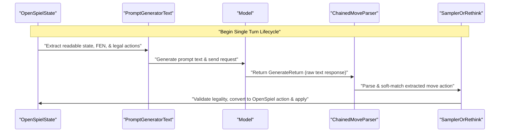
Sources: `game_arena/harness/harness_demo.py` [game_arena/harness/harness_demo.py:51-134](), `README.md` [README.md:63-151]()

---

## 2. Step 1: Game State Observation

At the start of each turn, the harness inspects the underlying OpenSpiel state (`pyspiel.State`) to determine whether the game is terminal and to retrieve canonical notations (such as FEN for chess) and legal actions for the current player [README.md:65-76]().

In the chess demo implementation, the native OpenSpiel state is accessed through adapters that expose readable board states, move histories, and player turn mappings [game_arena/harness/harness_demo.py:51-93]().

```python
# Conceptual observation extraction from game_arena/harness/harness_demo.py
prompt_substitutions = {
    "readable_state_str": chess_adapter.get_readable_state(),
    "move_history": chess_adapter.get_action_string_history() or "None",
    "player_name": chess_adapter.game_notation.player_map[
        chess_adapter.native_state.current_player()
    ],
    "move_notation": chess_adapter.game_notation.move_notation,
    "notation": chess_adapter.game_notation.state_notation,
}
```
Sources: `game_arena/harness/harness_demo.py` [game_arena/harness/harness_demo.py:51-98](), `README.md` [README.md:63-76]()

---

## 3. Step 2: Prompt Construction

Once observations are gathered, the harness builds a prompt by combining game state variables with text templates [README.md:78-92](). 

Prompts are instantiated via prompt generators (such as `prompt_generation.PromptGeneratorText`) using templates defined in `prompt_templates.py` (e.g., `NO_LEGAL_ACTIONS`) [game_arena/harness/harness_demo.py:58-99](). The resulting prompt object encapsulates the formatted text ready for model ingestion [README.md:78-92]().

Sources: `game_arena/harness/harness_demo.py` [game_arena/harness/harness_demo.py:58-99](), `README.md` [README.md:78-92]()

---

## 4. Step 3: Model Call and Generation Return

The generated prompt is sent to the designated player model (e.g., `AIStudioModel` or `OpenAIChatCompletionsModel`) [game_arena/harness/harness_demo.py:63-106](). 

Model calling is implemented via official SDKs (`model_generation_sdk.py`) or HTTP POST APIs (`model_generation_http.py`) and wrapped with retry logic to handle transient network or API failures [README.md:141-151](). The model returns a `GenerateReturn` dataclass containing the main free-form string response [game_arena/harness/harness_demo.py:106-113]().

Sources: `game_arena/harness/harness_demo.py` [game_arena/harness/harness_demo.py:63-113](), `README.md` [README.md:141-151]()

---

## 5. Step 4: Parsing and Soft-Matching

Model responses are parsed to extract the intended move using rule-based extraction (`parsers.py`), LLM-based parsing (`llm_parsers.py`), or chained parsers [README.md:121-140]().

As seen in `harness_demo.py`, a `ChainedMoveParser` combines rule-based parsing with game-specific soft parsers (e.g., `chess_parsers.ChessSoftParser`) to robustly handle algebraic notation variations and extraneous characters [game_arena/harness/harness_demo.py:70-128]().

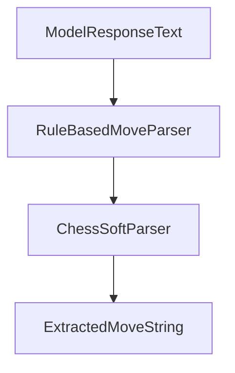
Sources: `game_arena/harness/harness_demo.py` [game_arena/harness/harness_demo.py:70-128](), `README.md` [README.md:121-140]()

---

## 6. Step 5: Sampling Strategies and the Rethink Loop

To mitigate illegal move rates and enforce self-consistency, the harness provides advanced samplers and error recovery mechanisms (`samplers.py`) [README.md:93-120]().

### Majority Voting
`MajorityVoteSampler` samples the model multiple times in parallel across worker threads, parses each response, counts frequencies, and picks the most common action (resolving ties randomly) [game_arena/harness/samplers.py:68-154]().

```python
# Snippet from MajorityVoteSampler._sample_action in game_arena/harness/samplers.py
with concurrent.futures.ThreadPoolExecutor(
    max_workers=self._max_workers
) as executor:
  futures = [
      executor.submit(_generate_then_parse, model_input)
      for _ in range(self._num_samples)
  ]
```
Sources: `game_arena/harness/samplers.py` [game_arena/harness/samplers.py:68-154](), `README.md` [README.md:93-107]()

### Rethinking Loop
When a model emits an illegal move sequentially, the rethink mechanism (`rethink.py`) re-prompts the model with corrective instructions and optional rule-based feedback, allowing it to revise its move over a limited number of attempts [README.md:108-120]().

Sources: `game_arena/harness/samplers.py` [game_arena/harness/samplers.py:68-181](), `README.md` [README.md:93-120]()

---

## 7. Step 6: Action Submission to OpenSpiel

Once a valid move action string is successfully parsed and verified, it is translated into an OpenSpiel action integer using `native_state.string_to_action(parser_output)` and applied to advance the game state via `native_state.apply_action()` [game_arena/harness/harness_demo.py:130-133]().

```python
# Action application snippet from game_arena/harness/harness_demo.py
chess_adapter.native_state.apply_action(
    chess_adapter.native_state.string_to_action(parser_output)
)
```
Sources: `game_arena/harness/harness_demo.py` [game_arena/harness/harness_demo.py:130-133](), `README.md` [README.md:63-76]()

---

## 8. Natural Language to Code Entity Space Bridge

The following diagram bridges high-level natural language concepts of the move pipeline to their concrete Python classes and functions in the codebase.

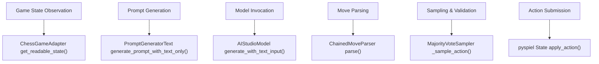
Sources: `game_arena/harness/harness_demo.py` [game_arena/harness/harness_demo.py:51-134](), `game_arena/harness/samplers.py` [game_arena/harness/samplers.py:68-160](), `README.md` [README.md:63-151]()

---

# Page: Core Architecture

# Core Architecture

<details>
<summary>Relevant source files</summary>

The following files were used as context for generating this wiki page:

- [README.md](README.md)
- [game_arena/harness/__init__.py](game_arena/harness/__init__.py)

</details>


This document provides a high-level overview of the Game Arena harness system's core architectural components and their interactions. The system orchestrates interactions between Large Language Models (LLMs) and game environments using OpenSpiel, managing everything from prompt generation to move parsing, reliability loops, and telemetry.

As a parent page, this section introduces the main subsystems. For deep technical details, see the child pages:
- [Agent System](#2.1)
- [Model Integration](#2.2)
- [Prompt Generation](#2.3)
- [Parsing System](#2.4)
- [Sampling Strategies](#2.5)
- [Telemetry](#2.6)

## High-Level Component Architecture

The following diagram illustrates the main architectural components and their relationships within the harness:

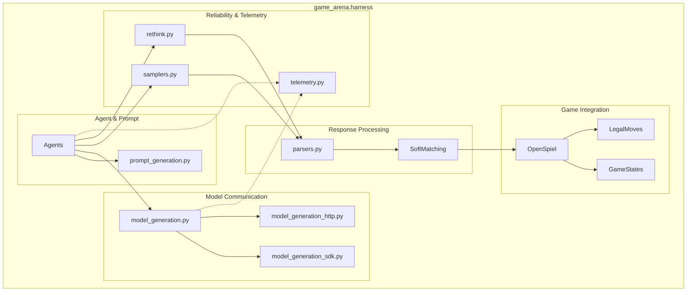

Sources: [README.md:63-151](), [game_arena/harness/__init__.py:1-14]()

## Subsystem Overview

The harness is modularly designed around several key subsystems that handle distinct phases of game orchestration:

### Agent System

Agents encapsulate the playing logic for specific games or general LLM strategies, managing turn execution and state interactions. For details, see [Agent System](#2.1).

Sources: [README.md:63-73]()

### Model Integration

Model calling abstracts underlying provider APIs using uniform protocols with built-in retry and timing decorators. For details, see [Model Integration](#2.2).

Sources: [README.md:143-151]()

### Prompt Generation

Prompts are constructed dynamically from game state representations, rule instructions, and templates. For details, see [Prompt Generation](#2.3).

Sources: [README.md:78-92]()

### Parsing System

Extracts structured moves from model responses using rule-based patterns, LLM fallback extractors, and soft-matching against legal moves. For details, see [Parsing System](#2.4).

Sources: [README.md:121-140]()

### Sampling Strategies

Handles reliability and error recovery through majority voting samplers and sequential rethink loops. For details, see [Sampling Strategies](#2.5).

Sources: [README.md:93-120]()

### Telemetry

Exposes unified logging protocols and exporters to track execution metrics and debugging data across harness components. For details, see [Telemetry](#2.6).

Sources: [README.md:63-151]()

---

# Page: Agent System

# Agent System

<details>
<summary>Relevant source files</summary>

The following files were used as context for generating this wiki page:

- [game_arena/harness/harness_demo.py](game_arena/harness/harness_demo.py)
- [game_arena/harness/rethink.py](game_arena/harness/rethink.py)

</details>


The Agent System serves as the primary orchestration layer that coordinates LLM interactions with game environments in Game Arena. It manages the complete lifecycle of agent decision-making, translating game observations into valid game actions through LLM calls, response parsing, and sampling strategies.

This document covers the core agent protocols, base classes defined in agent/base modules, action `TypedDict` structures, and game-specific agent implementations (such as chess and poker agents). For details on underlying model providers, see [Model Integration](#2.2). For parsing logic, see [Parsing System](#2.4). For sampling and rethinking loops, see [Sampling Strategies](#2.5).

## Agent Architecture Overview

The agent system is structured around a hierarchical protocol and class architecture that separates game-agnostic agent definitions from specific game integrations.

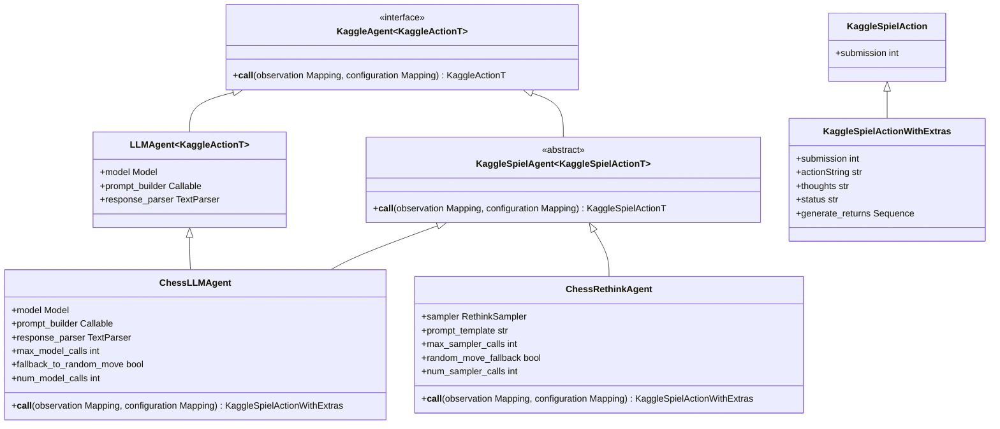

Sources: [game_arena/harness/agent.py:67-154](), [game_arena/harness/agent.py:332-350]()

## Core Agent Types and Action TypedDicts

### Action TypedDicts

The harness defines typed action dictionaries to structure what agents return to the Kaggle evaluation harness:

| Action Type | Description | Key Fields |
|-------------|-------------|------------|
| `KaggleSpielAction` | Basic action container | `submission: int` |
| `KaggleSpielActionWithExtras` | Extended container with telemetry and reasoning | `submission: int`, `actionString: str | None`, `thoughts: str | None`, `status: str | None`, `generate_returns: Sequence[str]` |

Sources: [game_arena/harness/agent.py:79-92]()

### Protocol Interfaces

#### KaggleAgent Protocol
The foundational protocol defines how any agent accepts observations and configuration mappings:
```python
def __call__(
    observation: Mapping[str, Any],
    configuration: Mapping[str, Any],
    **kwargs,
) -> KaggleActionT
```
Sources: [game_arena/harness/agent.py:67-76]()

#### LLMAgent Class
The `LLMAgent` base class implements model-backed behavior using three core configurable attributes:
- `model: Model` — Handles calls to the model backend.
- `prompt_builder: Callable` — Transforms game state into text or multimodal prompts.
- `response_parser: TextParser` — Extracts raw game actions from model text outputs.

Sources: [game_arena/harness/agent.py:109-129]()

## Agent Decision Flow

The following sequence diagram maps natural language operations and game state transitions to precise code entities during a single agent turn execution.

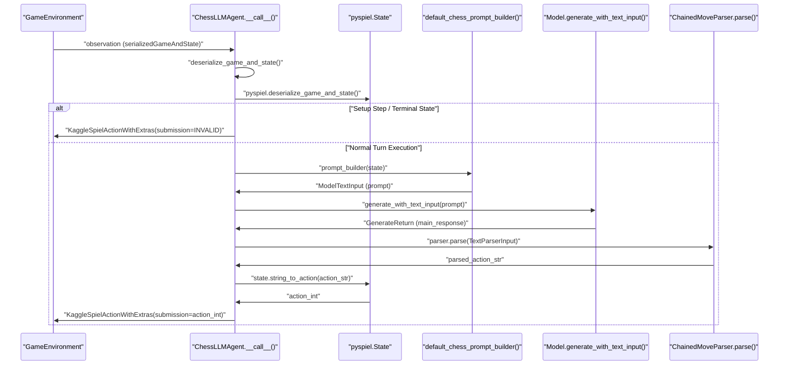

Sources: [game_arena/harness/agent.py:180-276]()

## Game-Specific Agents

### Chess Agents

Chess agents manage standard FEN/SAN notation mappings and integrate rule-based parsing with soft move matching.

- **`ChessLLMAgent`**: Standard iterative LLM agent supporting `max_model_calls`, fallback to random moves (`fallback_to_random_move`), and tracking `num_model_calls`.
- **`ChessRethinkAgent`**: Integrates with `RethinkSampler` to automatically re-prompt models when illegal or unparsable moves are generated.

Sources: [game_arena/harness/agent.py:132-276](), [game_arena/harness/agent.py:332-492]()

### Poker Agents

Poker agents extend base agent abstractions to handle imperfect information games, incorporating hand history utilities and formatting observations that hide opponent private cards while exposing board states and betting rounds.

Sources: [game_arena/harness/rethink.py:100-132]()

## Error Handling and Fallback Mechanisms

Agents implement structured exception handling and status reporting to ensure robust tournament execution without crashing on malformed LLM outputs.

| Failure Condition | ChessLLMAgent Action | ChessRethinkAgent Action |
|-------------------|----------------------|--------------------------|
| Model API Exception | Returns `INVALID_ACTION` with error status | Returns error action with full traceback |
| Parsing Failure | Fallback to random move or invalid status | Triggers rethink loop or fallback move |
| Max Calls Exceeded | Forces random legal move | Forces random legal move |

Status strings populated in `KaggleSpielActionWithExtras.status` include:
- `"Setup step; model not called."`
- `"MAX MODEL CALLS (N=X) REACHED"`
- Exception message traces and `"OK"` for successful turns.

Sources: [game_arena/harness/agent.py:201-216](), [game_arena/harness/agent.py:377-395](), [game_arena/harness/agent.py:429-438]()

## Integration Points

- **OpenSpiel Integration**: Agents instantiate or restore `pyspiel.State` from `serializedGameAndState` provided in evaluation observations.
- **Model Integration**: Dispatches prompts using `generate_with_text_input` or `generate_with_image_text_input` returning `GenerateReturn` objects.
- **Parser Integration**: Feeds responses into `TextParserInput` processed by `ChainedMoveParser` and game-specific soft parsers.

Sources: [game_arena/harness/agent.py:188-199](), [game_arena/harness/agent.py:218-228](), [game_arena/harness/rethink.py:113-132]()

---

# Page: Model Integration

# Model Integration

<details>
<summary>Relevant source files</summary>

The following files were used as context for generating this wiki page:

- [game_arena/harness/model_generation.py](game_arena/harness/model_generation.py)
- [game_arena/harness/model_generation_http.py](game_arena/harness/model_generation_http.py)
- [game_arena/harness/model_generation_sdk.py](game_arena/harness/model_generation_sdk.py)

</details>


This page covers the core model abstraction layer in Game Arena, defining how large language models (LLMs) are interfaced, invoked, timed, retried, and implemented via official SDKs and HTTP APIs. For details on how prompts are constructed before reaching these models, see [Game State Rendering and Formatting](#3.3). For central model registration and configuration aliases, see [Model Registry](#6.1).

## Core Architecture and Protocols

The model integration subsystem is anchored by Python `Protocol` definitions and dataclasses located in `game_arena/harness/model_generation.py`. The `Model` protocol [game_arena/harness/model_generation.py:143-185]() provides text input generation, while the `MultimodalModel` protocol [game_arena/harness/model_generation.py:187-207]() extends it with image-text input support.

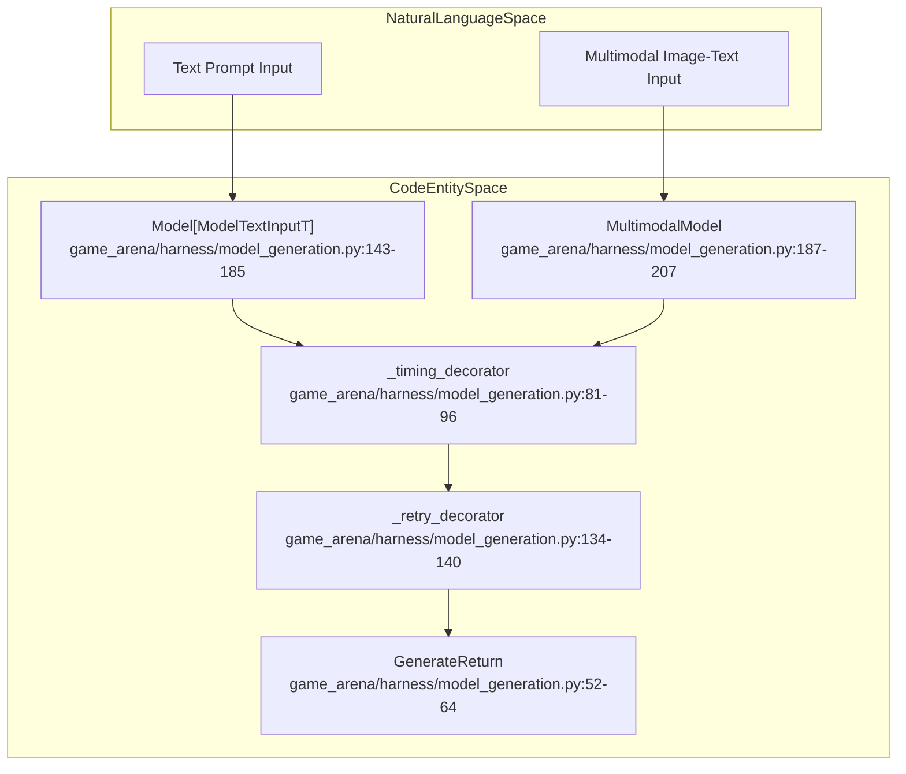

*Sources: [game_arena/harness/model_generation.py:37-207]()*

Input payloads are structured via `ModelTextInput` [game_arena/harness/model_generation.py:38-41]() and `ModelImageTextInput` [game_arena/harness/model_generation.py:43-49](), whereas outputs are uniformly encapsulated in `GenerateReturn` [game_arena/harness/model_generation.py:51-64](), tracking metrics such as `generation_tokens`, `prompt_tokens`, `reasoning_tokens`, and `duration_success_only_secs`.

## Instrumentation: Timing and Retry Decorators

Class-level `__init_subclass__` hooks in `Model` [game_arena/harness/model_generation.py:177-184]() and `MultimodalModel` [game_arena/harness/model_generation.py:197-206]() automatically wrap generation methods with execution timing and resilient retry logic.

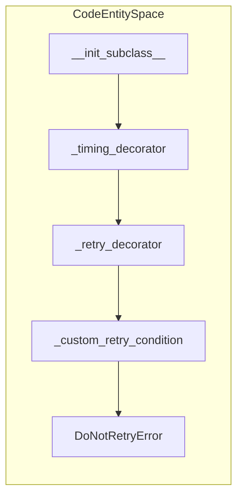

*Sources: [game_arena/harness/model_generation.py:81-140](), [game_arena/harness/model_generation.py:177-206]()*

- **`_timing_decorator`**: Measures execution duration using `time.perf_counter()` [game_arena/harness/model_generation.py:81-96]() and injects `duration_success_only_secs` into `GenerateReturn`.
- **`_retry_decorator`**: Leverages `tenacity` with exponential backoff (`wait_random_exponential` between 1 and 60 seconds) up to a 60-minute delay limit [game_arena/harness/model_generation.py:134-140]().
- **`_custom_retry_condition`**: Suppresses retries when an exception inherits from `DoNotRetryError` [game_arena/harness/model_generation.py:99-132](), which includes `UnsupportedCapabilityError` [game_arena/harness/model_generation.py:113-115]().

*Sources: [game_arena/harness/model_generation.py:81-140]*

## SDK vs HTTP Implementations

Model integrations are split between official Python SDK implementations (`model_generation_sdk.py`) and raw HTTP REST wrappers (`model_generation_http.py`).

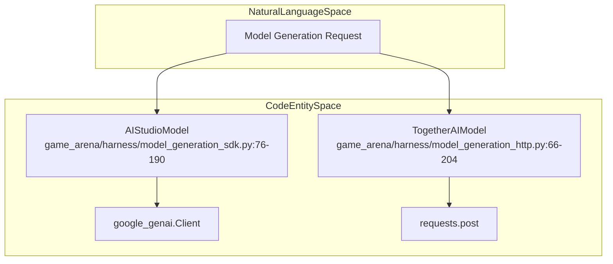

*Sources: [game_arena/harness/model_generation_sdk.py:76-190](), [game_arena/harness/model_generation_http.py:66-204]*

### SDK-Based Integrations (`AIStudioModel`)
The `AIStudioModel` class [game_arena/harness/model_generation_sdk.py:76-190]() initializes a `google_genai.Client` [game_arena/harness/model_generation_sdk.py:91]() to communicate with Gemini models via AI Studio. It maps parameters such as `temperature`, `top_p`, `top_k`, `max_output_tokens`, and `ThinkingConfig` into `GenerateContentConfig` [game_arena/harness/model_generation_sdk.py:105-120](), parsing candidate parts into text and internal reasoning thoughts.

*Sources: [game_arena/harness/model_generation_sdk.py:76-190]*

### HTTP-Based Integrations (`TogetherAIModel`)
The `TogetherAIModel` class [game_arena/harness/model_generation_http.py:66-204]() interfaces with providers via REST endpoints using `requests.post` or `aiohttp` for parallel attempts [game_arena/harness/model_generation_http.py:171-193](). It computes dynamic context window limits and maximum sampling lengths based on model registry rules [game_arena/harness/model_generation_http.py:114-142](), formats image payloads via `_create_image_text_content` [game_arena/harness/model_generation_http.py:33-63](), and handles Bearer token authorization from environment variables [game_arena/harness/model_generation_http.py:80-91]().

*Sources: [game_arena/harness/model_generation_http.py:33-204]*

---

# Page: Prompt Generation

# Prompt Generation

<details>
<summary>Relevant source files</summary>

The following files were used as context for generating this wiki page:

- [game_arena/harness/prompt_generation.py](game_arena/harness/prompt_generation.py)
- [game_arena/harness/prompts.py](game_arena/harness/prompts.py)

</details>


This document covers the prompt generation system within Game Arena's harness, which transforms game state information and contextual data into formatted prompts for LLM consumption. The system handles template selection, variable substitution, and supports both text-only and multimodal prompt formats.

For information about how generated prompts are sent to LLM providers, see [Supported Games](#3.2). For details on how LLM responses are processed after generation, see [Parsing System](#3.4).

## System Architecture

The prompt generation system acts as a critical bridge between game state representation and LLM interaction, transforming structured game data into natural language prompts that models can understand and respond to appropriately.

### Prompt Generation Pipeline

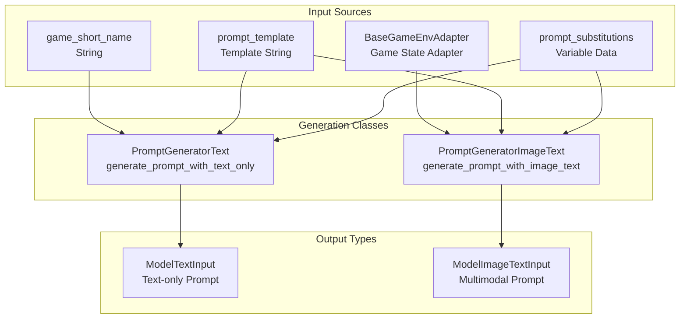

Sources: [game_arena/harness/prompt_generation.py:24-112]()

### Code Entity Mapping

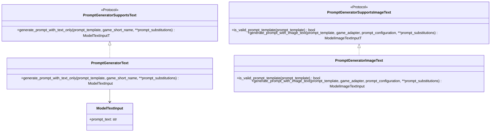

Sources: [game_arena/harness/prompt_generation.py:24-112]()

## Template System

The prompt generation system uses a template-based approach where predefined templates are categorized into core prompts, rethinking prompts, and image-text prompts, and then populated with game-specific data through variable substitution.

### Template Categories

Prompts are organized across several frozensets in the `prompts` module:

| Category | Constant Name | Description |
|----------|---------------|-------------|
| Core Prompts | `CORE_PROMPTS` | Standard templates with/without legal actions, piece dicts, and ASCII boards [game_arena/harness/prompts.py:20-26]() |
| Rethink Prompts | `RETHINK_PROMPTS` | Templates appended with error feedback for recovering from illegal/unparsable moves [game_arena/harness/prompts.py:29-37]() |
| Image-Text Prompts | `IMAGE_TEXT_PROMPTS` | Multimodal templates including board and SVG rendered images [game_arena/harness/prompts.py:40-44]() |

Sources: [game_arena/harness/prompts.py:20-44]()

### Variable Substitution

For text-only generation via `PromptGeneratorText`, the `game_short_name` is automatically added to the substitution dictionary before formatting the template string:

```python
prompt_substitutions["game_short_name"] = game_short_name
return model_generation.ModelTextInput(
    prompt_text=prompt_template.format(**prompt_substitutions)
)
```

Sources: [game_arena/harness/prompt_generation.py:68-72]()

## Text vs Multimodal Support

The system is designed with protocol-based interfaces to support both text-only (`PromptGeneratorSupportsText`) and multimodal prompt generation (`PromptGeneratorSupportsImageText`).

### Protocol Definitions

- **`PromptGeneratorSupportsText`**: Defines `generate_prompt_with_text_only()` returning a text input structure [game_arena/harness/prompt_generation.py:45-58]().
- **`PromptGeneratorSupportsImageText`**: Defines `is_valid_prompt_template()` and `generate_prompt_with_image_text()` accepting a `BaseGameEnvAdapter` [game_arena/harness/prompt_generation.py:24-42]().

`PromptGeneratorImageText` validates that the template belongs to `IMAGE_TEXT_PROMPTS` and that the game adapter has an active native state before processing [game_arena/harness/prompt_generation.py:75-112]().

Sources: [game_arena/harness/prompt_generation.py:24-112]()

---

# Page: Parsing System

# Parsing System

<details>
<summary>Relevant source files</summary>

The following files were used as context for generating this wiki page:

- [game_arena/harness/parsers.py](game_arena/harness/parsers.py)
- [game_arena/harness/parsers_test.py](game_arena/harness/parsers_test.py)

</details>


The parsing system converts raw LLM text responses into valid game move representations. Located primarily in `game_arena/harness/parsers.py`, it provides a modular framework comprising rule-based extraction, fuzzy or soft matching against legal moves, and sequential parsing pipelines (`ChainedMoveParser`) to handle the inherently unstructured outputs of language models.

Sources: [game_arena/harness/parsers.py:15-168]()

## Core Data Structures and Protocol

The parsing module defines a standard protocol (`TextParser`) and a structured input container (`TextParserInput`) to unify how different parsers access raw text, game states, and legal move sets.

| Class / Protocol | Role | Key Attributes / Methods |
|------------------|------|--------------------------|
| `TextParserInput` | Dataclass holding parsing context | `text`, `state_str`, `legal_moves`, `player_number` [game_arena/harness/parsers.py:80-86]() |
| `TextParser` | Structural subtyping protocol for parsers | `parse(self, parser_input: TextParserInput) -> str \| None` [game_arena/harness/parsers.py:88-93]() |

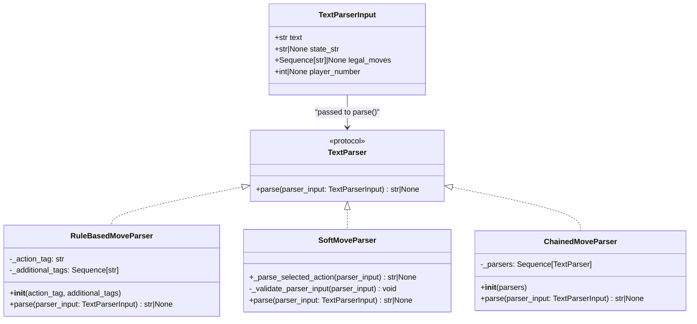

Title: "Parser Protocol and Classes"
Sources: [game_arena/harness/parsers.py:80-168]()

## Rule-Based Parsing

The `RuleBasedMoveParser` utilizes `parse_move_from_response` to extract move strings via delimiter scanning and string normalization [game_arena/harness/parsers.py:23-71, 116-136]().

### Extraction and Cleaning Flow

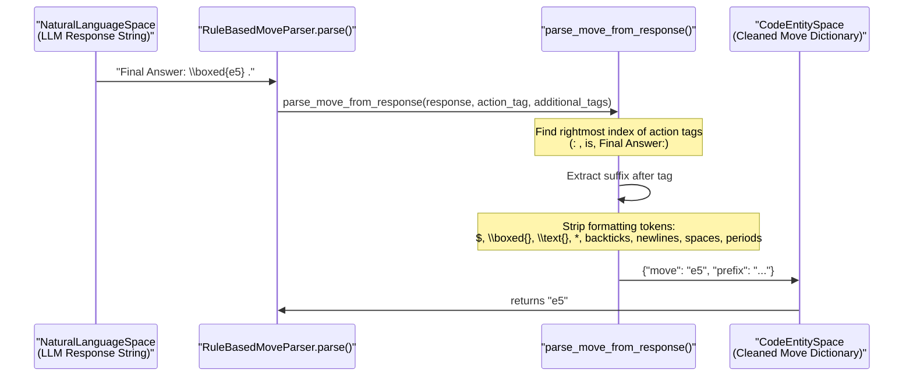

Title: "Natural Language to Code Entity Space: Rule-Based Move Parsing"
Sources: [game_arena/harness/parsers.py:23-71, 116-136]()

The helper `parse_move_from_response` searches for the rightmost occurrence of action tags (defaulting to `"Final Answer:"`, `":"`, and `"is"`), slices the subsequent substring, and cleans out LaTeX commands (`\boxed`, `\text`), markdown formatting (`*`, `` ` ``), dollar signs, and trailing punctuation [game_arena/harness/parsers.py:23-66]().

Sources: [game_arena/harness/parsers.py:23-71, 116-136]()

## Soft Move Parsing

The `SoftMoveParser` validates selected actions against the list of legal moves provided in `TextParserInput` [game_arena/harness/parsers.py:138-168](). 

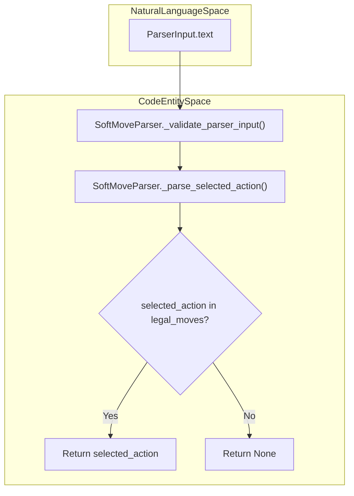

Title: "Soft Matching Pipeline"
Sources: [game_arena/harness/parsers.py:138-168]()

If input fields such as `state_str`, `legal_moves`, or `player_number` are missing, `_validate_parser_input` raises a `ValueError` [game_arena/harness/parsers.py:149-160](). Subclasses or specific game implementations override `_parse_selected_action` to map soft-matched strings to exact game actions [game_arena/harness/parsers.py:141-147]().

Sources: [game_arena/harness/parsers.py:138-168]()

## Chained Parsers

The `ChainedMoveParser` sequences multiple `TextParser` instances, passing the output text of one parser as the input text (`TextParserInput.text`) of the next [game_arena/harness/parsers.py:96-114]().

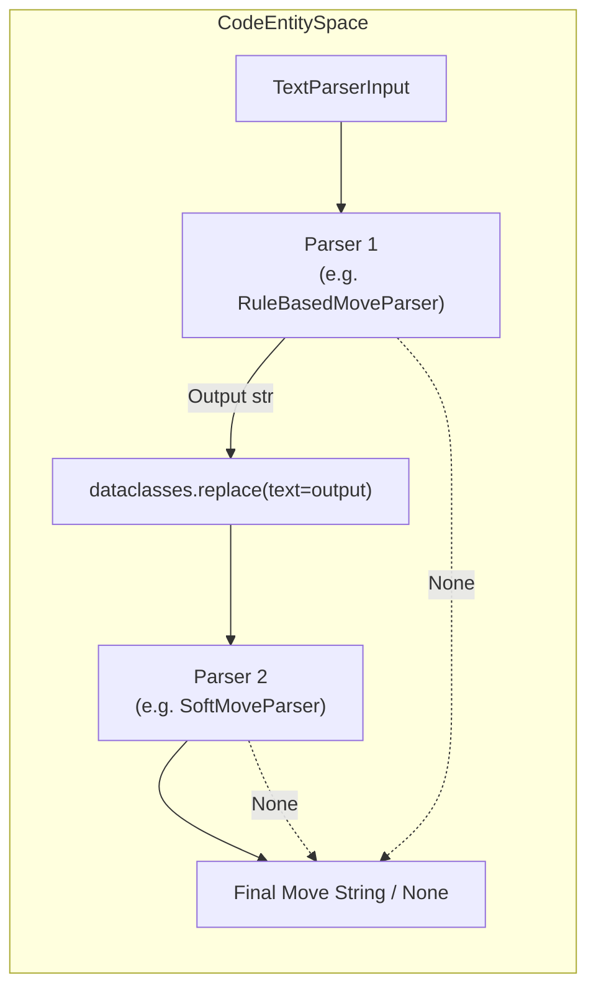

Title: "ChainedMoveParser Sequence Execution"
Sources: [game_arena/harness/parsers.py:96-114]()

If any parser in the sequence returns `None`, the `ChainedMoveParser` short-circuits and immediately returns `None` [game_arena/harness/parsers.py:106-113]().

Sources: [game_arena/harness/parsers.py:96-114]()

## Testing and Validation

The parsing behavior is thoroughly verified in `game_arena/harness/parsers_test.py`, which validates edge cases such as trailing whitespaces, newlines, LaTeX boxed answers (`\boxed{}`, `\text{}`), dollar sign wrappers, and period suffixes [game_arena/harness/parsers_test.py:25-159]().

Sources: [game_arena/harness/parsers_test.py:25-159]()

---

# Page: Sampling Strategies

# Sampling Strategies

<details>
<summary>Relevant source files</summary>

The following files were used as context for generating this wiki page:

- [game_arena/harness/rethink.py](game_arena/harness/rethink.py)
- [game_arena/harness/samplers.py](game_arena/harness/samplers.py)

</details>


## Purpose and Scope

This document covers the reliability mechanisms implemented in `game_arena/harness/samplers.py` and `game_arena/harness/rethink.py`. These components improve the probability of obtaining valid game moves from LLM responses by addressing challenges such as format violations, rule infractions, and parsing failures.

For information about how model responses are parsed into moves, see [Parsing System](#2.4). For details about the agent system that orchestrates these sampling strategies, see [Agent System](#2.1).

Sources: [game_arena/harness/samplers.py:15-26](), [game_arena/harness/rethink.py:15-29]()

## Core Sampler Interfaces

The harness defines foundational data classes and abstract protocols for samplers in `game_arena/harness/samplers.py`.

- `MoveType`: An enumeration defining `LEGAL`, `ILLEGAL`, and `NO_ACTION_TAG` outcomes [game_arena/harness/samplers.py:28-34]().
- `SamplerOutput`: A frozen dataclass holding the `action`, `extracted_action`, `matched_action`, `generate_returns`, `auxiliary_outputs`, and `move_type` [game_arena/harness/samplers.py:35-45]().
- `Sampler`: A protocol requiring an `__init__` with a model and `sample_action_with_text_input` [game_arena/harness/samplers.py:47-57]().
- `MultimodalSampler`: Extends `Sampler` to support `sample_action_with_image_text_input` [game_arena/harness/samplers.py:59-66]().

Sources: [game_arena/harness/samplers.py:28-66]()

## Majority Voting Strategy

`MajorityVoteSampler` and `MajorityVoteMultimodalSampler` enforce self-consistency by sampling multiple responses in parallel and choosing the most frequent valid move [game_arena/harness/samplers.py:68-181]().

### Process Flow

Title: "Majority Vote Sampler Execution Flow"
```mermaid
graph TD
    START["ModelTextInput / Input"] --> EXECUTOR["concurrent.futures.ThreadPoolExecutor"]
    EXECUTOR --> CALL1["model.generate_with_text_input (1)"]
    EXECUTOR --> CALL2["model.generate_with_text_input (2)"]
    EXECUTOR --> CALLN["model.generate_with_text_input (N)"]
    
    CALL1 --> PARSE1["parsers.TextParser.parse"]
    CALL2 --> PARSE2["parsers.TextParser.parse"]
    CALLN --> PARSEN["parsers.TextParser.parse"]
    
    PARSE1 --> COUNTER["collections.Counter"]
    PARSE2 --> COUNTER
    PARSEN --> COUNTER
    
    COUNTER --> MOSTCOMMON["Counter.most_common(1)"]
    MOSTCOMMON --> CHECK{"Tie Check"}
    CHECK -->|Single Most Common| OUT1["SamplerOutput(action=most_common)"]
    CHECK -->|Tie Present| OUT2["random.Random().choice(tied_actions)"]
```
Sources: [game_arena/harness/samplers.py:68-162]()

### Implementation Details

`MajorityVoteSampler.__init__` accepts a model, `num_samples`, a `parser`, and `max_workers` (defaulting to 10) [game_arena/harness/samplers.py:78-88](). It uses a `ThreadPoolExecutor` to concurrently invoke `generate_fn` across the requested number of samples [game_arena/harness/samplers.py:110-116](). Frequencies of parsed actions are aggregated using a `collections.Counter` [game_arena/harness/samplers.py:123-125]().

Sources: [game_arena/harness/samplers.py:68-162]()

## Rethinking Strategy

`RethinkSampler` implements a sequential sampling loop that prompts the model again with error feedback when an illegal or unparseable move is generated [game_arena/harness/samplers.py:47](), [game_arena/harness/rethink.py:56-187]().

### Rethink Strategies

The `RethinkStrategy` enumeration defines the supported feedback modes:
- `RETHINK` [game_arena/harness/rethink.py:47]()
- `RETHINK_WITH_ENV` [game_arena/harness/rethink.py:48]()
- `RETHINK_WITH_ENV_ILLEGAL_HISTORY` [game_arena/harness/rethink.py:49]()
- `RETHINK_WITH_ENV_RULE` [game_arena/harness/rethink.py:50]()

Sources: [game_arena/harness/rethink.py:46-51]()

### Process Flow

Title: "Rethink Sampler Iteration Loop"
```mermaid
graph TD
    START["RethinkSampler._sample_action"] --> GEN0["Initial Model Generate"]
    GEN0 --> PARSE0["Parse Action"]
    PARSE0 --> LEGAL{"Is Action Legal?"}
    
    LEGAL -->|Yes| RETURN["Return SamplerOutput"]
    LEGAL -->|No| RETRY_CHECK{"Attempts < num_max_rethinks?"}
    
    RETRY_CHECK -->|No| FAIL["Return Illegal/Failed Output"]
    RETRY_CHECK -->|Yes| FEEDBACK["Construct Rethink Prompt with Error Feedback"]
    FEEDBACK --> GEN_RETRY["Model Generate Retry"]
    GEN_RETRY --> PARSE0
```
Sources: [game_arena/harness/rethink.py:56-187]()

### Code Integration

Title: "RethinkSampler Component Architecture"
```mermaid
graph TB
    subgraph "game_arena.harness.rethink"
        RS["RethinkSampler"]
        RSTR["RethinkStrategy"]
    end
    
    subgraph "game_arena.harness.samplers"
        SAMP["samplers.Sampler"]
        SOUT["samplers.SamplerOutput"]
    end
    
    subgraph "Dependencies"
        MOD["model_generation.Model"]
        PARS["parsers.TextParser"]
        PROMPT["prompt_generation.PromptGenerator"]
        GAME["base_game.BaseGameEnvAdapter"]
    end
    
    RS --> SAMP
    RS --> RSTR
    RS --> MOD
    RS --> PARS
    RS --> PROMPT
    RS --> GAME
    RS --> SOUT
```
Sources: [game_arena/harness/rethink.py:56-89](), [game_arena/harness/samplers.py:35-57]()

---

# Page: Telemetry

# Telemetry

<details>
<summary>Relevant source files</summary>

The following files were used as context for generating this wiki page:

- [README.md](README.md)
- [game_arena/harness/__init__.py](game_arena/harness/__init__.py)

</details>


## Purpose and Scope

The telemetry subsystem provides a lightweight, structured key-value logging protocol designed to track execution metrics, model generation latencies, parsing outcomes, and game state transitions across the orchestration harness. Implemented primarily in `game_arena/harness/telemetry.py` [game_arena/harness/__init__.py:1-14](), the telemetry framework decouples metric emission from metric consumption. This allows harness components—such as agents, samplers, and parsers—to emit structured telemetry without coupling to specific backends like TensorBoard, files, or stdout exporters.

---

## The Telemetry Logging Protocol (`telemetry.py`)

The core abstraction of the telemetry module is the telemetry protocol and its associated data structures. Components interact with a defined logging interface that accepts arbitrary key-value pairs (dictionaries or typed records) associated with execution steps, turn indices, and model identifiers.

### Key Protocol Elements
- **`TelemetryExporter`**: An abstract base class or protocol defining how records are flushed or written to an external sink [game_arena/harness/__init__.py:1-14]().
- **`GameArenaLogger`**: The concrete or proxy logger instance responsible for formatting records and forwarding them to the active exporter [game_arena/harness/__init__.py:1-14]().

```
+-------------------------------------------------------------+
|                     Telemetry Architecture                  |
+-------------------------------------------------------------+
|                                                             |
|  [HarnessComponent] ---> calls ---> [GameArenaLogger]        |
|                                            |                |
|                                      forwards to            |
|                                            v                |
|                                    [TelemetryExporter]      |
|                                                             |
+-------------------------------------------------------------+
```

Sources: `[game_arena/harness/__init__.py:1-14]()`, `[README.md:1-151]()`

---

## Global Logger Management (`get_logger` and `set_exporter`)

To simplify instrumentation across deeply nested harness calls without passing logger instances through every function signature, the telemetry module provides module-level accessor and configuration functions.

### Functions
- **`get_logger(name: str)`**: Retrieves or initializes a namespaced logger instance [game_arena/harness/__init__.py:1-14]() for the calling module (e.g., `game_arena.harness.samplers` or `game_arena.harness.parsers`).
- **`set_exporter(exporter: TelemetryExporter)`**: Configures the global or thread-local exporter backend that receives all emitted telemetry records [game_arena/harness/__init__.py:1-14]().

```
Title: "Telemetry Configuration and Access Data Flow"

graph TD
    A["CallerModule"] -->|Calls| B["get_logger(name)"]
    B -->|Returns| C["GameArenaLogger"]
    D["ApplicationSetup"] -->|Passes Exporter| E["set_exporter(exporter)"]
    E -->|Configures Global Sink| C
    C -->|Emits Records| F["TelemetryExporterSink"]
```

Sources: `[game_arena/harness/__init__.py:1-14]()`, `[README.md:1-151]()`

---

## Emitter Integration Across Harness Components

Various orchestration subsystems utilize the telemetry logger to record operational metrics during execution. 

### Integration Points
1. **Model Generation (`model_generation.py`, `model_generation_sdk.py`)**: Emits latency, token counts, and API retry attempts.
2. **Samplers (`samplers.py`, `rethink.py`)**: Logs majority voting distributions, retry counts for illegal moves, and rethink success rates [README.md:93-120]().
3. **Parsers (`parsers.py`, `llm_parsers.py`)**: Records parsing success, fallback activations, and soft-matching ambiguity resolutions [README.md:121-140]().

```
Title: "Natural Language Space to Code Entity Space Telemetry Bridge"

graph TD
    NL1["\"Log Model Latency & Token Usage\""] --> Code1["GameArenaLogger.log_metric(model_name, latency, tokens)"]
    NL2["\"Track Illegal Move Rethink Attempt\""] --> Code2["GameArenaLogger.log_event(rethink_attempt, game_state)"]
    NL3["\"Record Soft-Matching Resolution\""] --> Code3["GameArenaLogger.log_metric(parse_success, ambiguity_resolved)"]
    
    Code1 --> Exporter["TelemetryExporter"]
    Code2 --> Exporter
    Code3 --> Exporter
```

Sources: `[README.md:93-152]`, `[game_arena/harness/__init__.py:1-14]()`

---

# Page: Game Support

# Game Support

<details>
<summary>Relevant source files</summary>

The following files were used as context for generating this wiki page:

- [README.md](README.md)

</details>


The Game Support subsystem of Game Arena coordinates game environments, rules enforcement, state tracking, and notation formatting. Game Arena relies on [OpenSpiel](https://github.com/google-deepmind/open_spiel) as its underlying game engine while providing higher-level Python abstractions, game-specific packages, rendering utilities, and LLM interaction pipelines [README.md:63-72]().

Sources: [README.md:63-72]()

## Game Abstraction Layer

The game abstraction layer wraps OpenSpiel game states and actions into consistent interfaces utilized by prompts, parsers, and samplers [README.md:65-76](). Core adapters manage turn progression, legal move extraction, and canonical state representations like Forsyth-Edwards Notation (FEN) for chess [README.md:74-76](). 

For complete technical details on base game adapters, OpenSpiel state wrappers, notations, readable state representations, and move history interfaces, see [Game Abstraction Layer](#3.1).

Sources: [README.md:65-76]()

## Supported Games

Game Arena supports a subset of two-player games implemented in OpenSpiel, organized under dedicated packages within `harness/games/` [README.md:63-68](). These include chess, go, connect_four, tic_tac_toe, and universal_poker. Each game package implements its own game logic wrappers, custom parsers, prompt templates, rethink strategies, and game-specific agents [README.md:63-120]().

```mermaid
graph TD
    subgraph "Natural Language Space"
        NL_CHESS[""Chess:KnightToC3""]
        NL_POKER[""Poker:CallTheBet""]
    end

    subgraph "Code Entity Space"
        CHESS_GAME[""game_arena.harness.games.chess.game""]
        POKER_GAME[""game_arena.harness.games.universal_poker.game""]
        CHESS_PARSER[""game_arena.harness.games.chess.parsers""]
        POKER_PARSER[""game_arena.harness.games.universal_poker.parsers""]
    end

    NL_CHESS --> CHESS_PARSER
    NL_POKER --> POKER_PARSER
    CHESS_PARSER --> CHESS_GAME
    POKER_PARSER --> POKER_GAME
```

For detailed breakdowns of each supported game package, game.py implementations, prompt templates, and agent integration, see [Supported Games](#3.2).

Sources: [README.md:63-145]()

## Game State Rendering and Formatting

To support multimodal models and human-readable debugging interfaces, game states are rendered into various formats including canonical text notation, alternative dictionary representations, ASCII grids, and rendered board images [README.md:80-88](). Specialized rendering utilities handle visual representations such as chess board sprites and poker hand histories [README.md:80-88]().

```mermaid
graph TD
    subgraph "Natural Language Space"
        NL_RENDER[""TextualOrImageStateRepresentation""]
    end

    subgraph "Code Entity Space"
        RENDERER[""game_arena.harness.game_state_renderer""]
        CHESS_RENDERER[""game_arena.harness.chess_state_renderer""]
        SPRITES[""game_arena.harness.sprite_utils""]
        POKER_UTILS[""game_arena.harness.poker.hand_history_utils""]
    end

    NL_RENDER --> RENDERER
    RENDERER --> CHESS_RENDERER
    CHESS_RENDERER --> SPRITES
    RENDERER --> POKER_UTILS
```

For deep technical details on state renderer modules, sprite utilities, hand history helpers, and textual versus image state representations, see [Game State Rendering and Formatting](#3.3).

Sources: [README.md:80-88]()

---

# Page: Game Abstraction Layer

# Game Abstraction Layer

<details>
<summary>Relevant source files</summary>

The following files were used as context for generating this wiki page:

- [README.md](README.md)
- [game_arena/harness/harness_demo.py](game_arena/harness/harness_demo.py)

</details>


The **Game Abstraction Layer** serves as the structural bridge between the underlying game engine—specifically Google's [OpenSpiel](https://github.com/google-deepmind/open_spiel)—and the higher-level components of the Game Arena harness, such as prompt generators, model callers, move parsers, and sampling loops [README.md:63-76](), [game_arena/harness/harness_demo.py:52-133]().

This page details how game adapters (such as `ChessGameAdapter`) encapsulate `pyspiel` states, manage game notations, format readable board states, track move histories, and expose standardized interfaces consumed by prompts and parsers [game_arena/harness/harness_demo.py:53-93]().

---

## 1. Architecture and OpenSpiel State Wrapping

OpenSpiel provides native game logic, state management, rule validation, and canonical state representations (such as Forsyth-Edwards Notation for chess) [README.md:65-76](). However, interacting directly with raw `pyspiel.State` objects across diverse LLM prompting modules and parsers leads to tight coupling. The game abstraction layer introduces adapter classes (e.g., `ChessGameAdapter`) that wrap `pyspiel.State` and expose unified helper properties.

```mermaid
graph TD
    sub5["Natural Language Space: Game Rules and Board Views"]
    sub5 --- sub6["Code Entity Space: Harness and OpenSpiel Objects"]
    
    sub6 --> A["pyspiel.load_game('chess')"]
    A --> B["pyspiel.State (native_state)"]
    B --> C["ChessGameAdapter"]
    C --> D["get_readable_state()"]
    C --> E["get_action_string_history()"]
    C --> F["game_notation (player_map, state_notation)"]
    
    D --> G["PromptGeneratorText.generate_prompt_with_text_only()"]
    E --> G
    F --> G
    
    C --> H["legal_actions / string_to_action()"]
    H --> I["ChainedMoveParser"]
```
*Figure 1: Architectural bridge from OpenSpiel native state through `ChessGameAdapter` to prompt generation and parsing.*

Sources: [README.md:63-76](), [game_arena/harness/harness_demo.py:52-133]()

---

## 2. Core Adapter Interfaces

Game adapters encapsulate the underlying OpenSpiel state (`native_state`) and provide uniform methods for state inspection, move history tracking, and action conversions [game_arena/harness/harness_demo.py:52-93]().

### Key Responsibilities of Game Adapters
- **State Initialization**: Loading the game via `pyspiel.load_game()` and instantiating initial states `pyspiel_game.new_initial_state()` [game_arena/harness/harness_demo.py:53-54]().
- **Notation Mapping**: Exposing notation definitions (e.g., Standard Algebraic Notation (SAN), FEN) and mapping player integer IDs to readable names via `player_map` [README.md:74-76](), [game_arena/harness/harness_demo.py:88-92]().
- **Readable State Formatting**: Providing human- and LLM-friendly text representations of the current board via `get_readable_state()` [game_arena/harness/harness_demo.py:86]().
- **Move History Tracking**: Extracting past moves as action string sequences via `get_action_string_history()` [game_arena/harness/harness_demo.py:87]().

```mermaid
graph TD
    subgraph "Game Abstraction Interface"
    J["ChessGameAdapter"] --> K["native_state: pyspiel.State"]
    J --> L["game_notation: GameNotation"]
    J --> M["get_readable_state() -> str"]
    J --> N["get_action_string_history() -> str"]
    J --> O["legal_actions: List[int]"]
    end
```
*Figure 2: Core properties and methods exposed by game adapters.*

Sources: [README.md:63-88](), [game_arena/harness/harness_demo.py:52-133]()

---

## 3. Readable State and Notation Interfaces

Prompts generated for LLMs require clear representations of the current game board and rules. The game abstraction layer supports multiple notation layers:

1. **Canonical State Notation**: Standardized strings such as FEN for chess, maintaining complete state information required by game rules [README.md:74-76]().
2. **Readable Board Strings**: Formatted text representations obtained via adapter methods (`get_readable_state()`) that make spatial relationships obvious to language models [game_arena/harness/harness_demo.py:86]().
3. **Move History**: Accumulated move sequences (`get_action_string_history()`) providing context on prior turns, defaulting to `"None"` when history is empty [game_arena/harness/harness_demo.py:87]().

```python
# Typical pattern for extracting adapter variables for prompt substitutions
prompt_substitutions = {
    "readable_state_str": chess_adapter.get_readable_state(),
    "move_history": chess_adapter.get_action_string_history() or "None",
    "player_name": chess_adapter.game_notation.player_map[
        chess_adapter.native_state.current_player()
    ],
    "move_notation": chess_adapter.game_notation.move_notation,
    "notation": chess_adapter.game_notation.state_notation,
}
```

Sources: [README.md:74-88](), [game_arena/harness/harness_demo.py:82-93]()

---

## 4. Integration with Prompts and Parsers

The game abstraction layer feeds directly into prompt generators and move validation parsers during each turn of the game loop [game_arena/harness/harness_demo.py:74-133]().

```mermaid
graph TD
    subgraph "Turn Execution Flow"
    P["ChessGameAdapter"] --> Q["PromptGeneratorText"]
    Q --> R["AIStudioModel / OpenAIChatCompletionsModel"]
    R --> S["TextResponse.main_response"]
    S --> T["parsers.ChainedMoveParser"]
    T --> U["native_state.string_to_action()"]
    U --> P
    end
```
*Figure 3: Data flow from game adapter state through prompt generation, model response, parser chaining, and back to state application.*

Sources: [README.md:78-151](), [game_arena/harness/harness_demo.py:74-133]()

---

## 5. Summary of Adapter-Driven Components

| Component / Function | Code Entity / Module | Role in Abstraction Layer |
| :--- | :--- | :--- |
| **Game Adapter** | `chess_game.ChessGameAdapter` | Wraps `pyspiel.State`, providing readable states and notation maps [game_arena/harness/harness_demo.py:55-56](). |
| **Prompt Generator** | `prompt_generation.PromptGeneratorText` | Consumes adapter strings to build structured prompts [game_arena/harness/harness_demo.py:59-97](). |
| **Move Parser** | `parsers.ChainedMoveParser` | Combines rule-based and soft-matching parsers (`chess_parsers.ChessSoftParser`) to interpret model output against adapter legal actions [game_arena/harness/harness_demo.py:70-71, 116-124](). |
| **State Mutator** | `native_state.apply_action()` | Applies parsed actions converted via `string_to_action()` back into OpenSpiel [game_arena/harness/harness_demo.py:131-133](). |

Sources: [README.md:63-151](), [game_arena/harness/harness_demo.py:19-133]()

---

# Page: Supported Games

# Supported Games

<details>
<summary>Relevant source files</summary>

The following files were used as context for generating this wiki page:

- [README.md](README.md)
- [game_arena/harness/parsers.py](game_arena/harness/parsers.py)

</details>


This page details the per-game packages and abstractions under the harness (`harness/games`), covering chess, go, connect_four, tic_tac_toe, and poker. It examines how individual game implementations (`game.py`), move parsers, prompt templates, rethink loops, and game-specific agents integrate with the core orchestration platform.

## Game Package Architecture and Environment Integration

The harness relies on OpenSpiel to track game states, provide legal moves, and execute actions [README.md:65-72](). Game-specific packages structure the interaction by mapping canonical representations (such as FEN for chess or ASCII grids for board games) into textual prompts and parsing responses back into OpenSpiel actions [README.md:74-76]().

Sources: [README.md:65-76]()

## Parsing Systems and Move Extraction

Models emit free-form text or structured responses that must be extracted and validated against legal moves. The parsing system provides base classes and functions in `game_arena/harness/parsers.py` to handle rule-based extraction, text cleaning, and soft-matching [README.md:121-133]().

### Parser Components and Data Flow

```mermaid
graph TB
    subgraph "NaturalLanguageSpace"
        RESP["ModelResponseText"]
        TAG["ActionTagFinalAnswer"]
    end
    
    subgraph "CodeEntitySpace"
        FUNC["parse_move_from_response(response, action_tag) [game_arena/harness/parsers.py:23-27]()"]
        INP["TextParserInput(text, state_str, legal_moves) [game_arena/harness/parsers.py:81-85]()"]
        RB["RuleBasedMoveParser.parse() [game_arena/harness/parsers.py:116-135]()"]
        SB["SoftMoveParser._parse_selected_action() [game_arena/harness/parsers.py:138-147]()"]
        CHAIN["ChainedMoveParser.parse() [game_arena/harness/parsers.py:96-113]()"]
    end
    
    RESP --> FUNC
    TAG --> FUNC
    FUNC --> INP
    INP --> RB
    INP --> SB
    RB --> CHAIN
    SB --> CHAIN
```

Sources: [game_arena/harness/parsers.py:23-168]()

The `RuleBasedMoveParser` extracts text following tags like `Final Answer:` using `parse_move_from_response` [game_arena/harness/parsers.py:23-66](), cleaning markdown formatting, bounding boxes, and whitespace [README.md:126-127](). The `SoftMoveParser` validates inputs against `TextParserInput` fields (`state_str`, `legal_moves`, `player_number`) to ensure selected actions fall within valid game moves [game_arena/harness/parsers.py:138-168]().

Sources: [game_arena/harness/parsers.py:23-168](), [README.md:126-127]()

## Prompt Templates and Generation

Prompt templates construct the context provided to player models [README.md:78-81](). Prompts incorporate the current game state (in canonical notation or alternative text/visual representations), move history, and legal moves [README.md:80-88](). Basic prompt templates reside in `harness/prompts.py` and are assembled via `harness/prompt_generation.py` [README.md:90-91]().

Sources: [README.md:78-91]()

## Rethink Loops and Sampling Strategies

When models produce illegal moves or formatting errors, sampling strategies intervene [README.md:97-99](). Two primary mechanisms are supported:
- **Majority Voting**: Parallel sampling enforcing self-consistency across multiple simultaneous model calls [README.md:100-106]().
- **Rethinking**: Sequential sampling where an illegal move triggers a follow-up prompt containing rule-based feedback or correction instructions [README.md:108-119]().

### Sampling and Rethink Execution Flow

```mermaid
graph TD
    subgraph "NaturalLanguageSpace"
        PROMPT["GamePromptAndStateContext"]
        FEEDBACK["IllegalMoveFeedbackText"]
    end
    
    subgraph "CodeEntitySpace"
        MODEL["ModelInvocation(prompt) [README.md:143-145]()"]
        PARSER["RuleBasedMoveParser.parse() [game_arena/harness/parsers.py:116-135]()"]
        RETHINK["RethinkLoopExecution [README.md:108-119]()"]
        SAMPLER["MajorityVotingSampler [README.md:100-106]()"]
    end
    
    PROMPT --> MODEL
    MODEL --> PARSER
    PARSER -->|"Illegal Move"| RETHINK
    RETHINK --> FEEDBACK
    FEEDBACK --> MODEL
    PROMPT --> SAMPLER
    SAMPLER --> MODEL
```

Sources: [README.md:100-119](), [game_arena/harness/parsers.py:116-135]()

## Game-Specific Agents and Integration

Per-game packages coordinate game rules, state renderers, and agent behaviors. Agents receive observations from OpenSpiel and format actions into strings compatible with game-specific parsers [README.md:70-76](). Model generation relies on SDK implementations (`harness/model_generation_sdk.py`) or HTTP APIs (`harness/model_generation_http.py`), wrapped with retry and timing logic [README.md:143-151]().

Sources: [README.md:70-76](), [README.md:143-151]()

---

# Page: Game State Rendering and Formatting

# Game State Rendering and Formatting

<details>
<summary>Relevant source files</summary>

The following files were used as context for generating this wiki page:

- [README.md](README.md)
- [game_arena/harness/prompt_generation.py](game_arena/harness/prompt_generation.py)

</details>


## Purpose and Scope

Game State Rendering and Formatting modules are responsible for converting raw OpenSpiel game states into structured, human-readable representations, textual notations, or graphical images that can be consumed by LLM agents and other system components. This includes game-specific state renderers (`game_state_renderer.py`, `chess_state_renderer.py`), utility functions for sprite and board drawing (`sprite_utils.py`), poker hand history formatting (`hand_history_utils.py`), and both textual and image-based state representations.

For information about how formatted game states are used in LLM prompts, see Prompt Generation. For details about supported games, see Supported Games.

## System Architecture

The rendering and formatting system bridges OpenSpiel's internal game states with textual and visual modalities required by various agent types and prompt configurations.

```mermaid
graph TB
    subgraph "OpenSpiel Game Engine"
        OS_STATE["pyspiel.State"]
        OS_HISTORY["state.history()"]
        OS_STRING["str(state)"]
    end
    
    subgraph "game_arena.harness"
        GSR["game_state_renderer.py"]
        CSR["chess_state_renderer.py"]
        SU["sprite_utils.py"]
        PHU["poker/hand_history_utils.py"]
    end
    
    subgraph "Outputs"
        TEXT_REP["Textual Representation / FEN / SAN"]
        IMAGE_REP["Rendered Board Image"]
        HISTORY_REP["Formatted Hand History"]
    end
    
    OS_STATE --> GSR
    OS_STATE --> CSR
    CSR --> SU
    OS_HISTORY --> PHU
    
    GSR --> TEXT_REP
    CSR --> IMAGE_REP
    PHU --> HISTORY_REP
```

**Sources:** [game_arena/harness/game_state_renderer.py:1-40](), [game_arena/harness/games/chess/chess_state_renderer.py:1-35]()

## Game State Renderers and Utilities

The rendering subsystem provides adapters and specialized renderers to transform game states into visual or structured text descriptions.

### Chess State Renderer and Sprite Utilities

For chess, `chess_state_renderer.py` and `sprite_utils.py` handle the creation of board images, drawing piece placements from FEN or OpenSpiel states, and managing visual sprite assets.

```mermaid
graph LR
    subgraph "Input State"
        FEN["FEN String / pyspiel.State"]
    end
    
    subgraph "Rendering Pipeline"
        CSR_MODULE["chess_state_renderer.py"]
        SPRITE_UTILS["sprite_utils.py"]
        PIL_IMAGE["PIL Image Generation"]
    end
    
    subgraph "Visual Output"
        BOARD_IMG["Chess Board Image"]
    end
    
    FEN --> CSR_MODULE
    CSR_MODULE --> SPRITE_UTILS
    SPRITE_UTILS --> PIL_IMAGE
    PIL_IMAGE --> BOARD_IMG
```

**Sources:** [game_arena/harness/games/chess/chess_state_renderer.py:1-50](), [game_arena/harness/games/chess/sprite_utils.py:1-40]()

### Poker Hand History Utilities

For poker, `hand_history_utils.py` parses and formats betting actions, pot sizes, community cards, and player hand histories into readable text logs suitable for inclusion in prompts or telemetry logs.

**Sources:** [game_arena/harness/games/poker/hand_history_utils.py:1-45]()

## Textual and Image State Representations

The harness supports multiple modalities for state representation:
- **Canonical Text Notation**: FEN for chess, action sequences, or stringified OpenSpiel states.
- **Readable Text Descriptions**: Formatted board grids, dictionaries of coordinates to pieces, and move history summaries.
- **Visual Images**: Rendered board graphics produced via image renderers for multimodal LLM agents.

Prompt generators like `PromptGeneratorImageText` in `game_arena/harness/prompt_generation.py` integrate these renderers to supply multimodal input when requested [game_arena/harness/prompt_generation.py:75-112]().

**Sources:** [game_arena/harness/prompt_generation.py:75-112]()

---

# Page: Development Guide

# Development Guide

<details>
<summary>Relevant source files</summary>

The following files were used as context for generating this wiki page:

- [CONTRIBUTING.md](CONTRIBUTING.md)
- [game_arena/harness/__init__.py](game_arena/harness/__init__.py)

</details>


This page serves as an overview of codebase organization, tooling, and quality standards for contributors working on the Game Arena platform. Game Arena is designed as a research framework for evaluating large language models in strategic game environments. 

For detailed information about code organization, see [Package Structure](#4.1). For testing patterns, see [Testing Infrastructure](#4.2). For style guidelines and linting configurations, see [Code Quality and Standards](#4.3).

## Development Workflow and Repository Standards

The development workflow relies on structured package hierarchies, automated quality checks, and clear contribution pathways governed by open-source guidelines. Contributors interact with standardized configuration files and review processes.

Title: "Development Workflow Architecture"
```mermaid
graph TD
    subgraph "Contribution Space"
        PR["GitHubPullRequests"] --> REVIEWS["CodeReviews"]
        CLA["CONTRIBUTING.md"] --> GTC["CommunityGuidelines"]
    end
    
    subgraph "Code Entity Space"
        INIT["game_arena/harness/__init__.py"] --> PKG["PackageStructure"]
        LINT[".pylintrc"] --> STYLE["GooglePythonStyle"]
        LIC["LICENSE"] --> APACHE["Apache20Header"]
    end
    
    CLA --> PR
    REVIEWS --> PKG
    STYLE --> PKG
```
Sources: [CONTRIBUTING.md:1-29](), [game_arena/harness/__init__.py:1-14]()

## 4.1 Package Structure

The Game Arena codebase is structured around a core orchestration module located in `game_arena`, housing the primary game harness logic in `game_arena.harness` [game_arena/harness/__init__.py:1-14](). Packages utilize standard `__init__.py` files to manage module exports and expose clean interfaces for game environments, state renderers, and agent implementations. Versioning and release workflows align with standard Python packaging practices.

For detailed information on module hierarchies, initialization files, and versioning flows, see [Package Structure](#4.1).

Sources: [game_arena/harness/__init__.py:1-14]()

## 4.2 Testing Infrastructure

Testing in Game Arena ensures the stability of model integrations, move parsers, and game state renderers. The test suite comprises unit and integration tests distributed across `*_test.py` modules. Testing patterns involve mocking model provider SDKs and HTTP calls to prevent flaky external API dependencies during test execution.

For detailed information on test layouts, mocking strategies, and running the test suite, see [Testing Infrastructure](#4.2).

Sources: [CONTRIBUTING.md:1-25]()

## 4.3 Code Quality and Standards

Code quality is strictly enforced through configuration files such as `.pylintrc`, which implements Google Python style rules tailored for the repository. Contributors must adhere to docstring requirements, type annotations, and inclusion of Apache 2.0 licensing headers [game_arena/harness/__init__.py:1-13](). Contribution requirements also mandate adherence to the project's Contributor License Agreement (CLA) and community guidelines outlined in `CONTRIBUTING.md` [CONTRIBUTING.md:1-29]().

For detailed information on pylint configurations, gitignore conventions, and license headers, see [Code Quality and Standards](#4.3).

Title: "Quality and Standards Compliance Flow"
```mermaid
graph LR
    subgraph "Standards Space"
        RC[".pylintrc"] --> GOOGLE["GooglePythonStyle"]
        LIC["LICENSE"] --> HDR["LicenseHeader"]
        CONTRIB["CONTRIBUTING.md"] --> LEGAL["ContributorLicenseAgreement"]
    end
    
    subgraph "Codebase Enforcement"
        GOOGLE --> LINT["PylintValidation"]
        HDR --> CODE["SourceFiles"]
        LEGAL --> PR["PullRequestPipeline"]
    end
```
Sources: [CONTRIBUTING.md:1-29](), [game_arena/harness/__init__.py:1-13]()

---

# Page: Package Structure

# Package Structure

<details>
<summary>Relevant source files</summary>

The following files were used as context for generating this wiki page:

- [CHANGELOG.md](CHANGELOG.md)
- [game_arena/__init__.py](game_arena/__init__.py)
- [game_arena/harness/__init__.py](game_arena/harness/__init__.py)

</details>


This document covers the organization of the Game Arena codebase, including package hierarchy, module initialization, versioning, release flow, and the relationship between different subsystems. For information about testing organization and test structure, see [Testing Infrastructure](#4.2). For details about coding standards and development practices, see [Code Quality and Standards](#4.3).

Sources: [game_arena/__init__.py:1-19](), [game_arena/harness/__init__.py:1-14]()

## Overview

Game Arena is organized as a Python package with a clear hierarchical structure that separates concerns across different functional areas. The main package `game_arena` contains several subsystems that work together to orchestrate LLM interactions with game environments.

Sources: [game_arena/__init__.py:1-19]()

## Main Package Structure

The codebase follows a modular architecture with distinct packages for different functional areas:

### Package Hierarchy

```mermaid
graph TD
    GA["game_arena/"]
    INIT1["__init__.py"]
    HARNESS["harness/"]
    FORMATTERS["formatters/"]
    SDK["model_generation_sdk/"]
    HTTP["model_generation_http/"]
    DEMO["model_generation_demo/"]
    
    GA --> INIT1
    GA --> HARNESS
    GA --> FORMATTERS
    GA --> SDK
    GA --> HTTP
    GA --> DEMO
    
    INIT2["__init__.py"]
    AGENTS["agents/"]
    SAMPLERS["samplers/"]
    PARSERS["parsers/"]
    PROMPTS["prompts/"]
    
    HARNESS --> INIT2
    HARNESS --> AGENTS
    HARNESS --> SAMPLERS
    HARNESS --> PARSERS
    HARNESS --> PROMPTS
```

Sources: [game_arena/__init__.py:1-19](), [game_arena/harness/__init__.py:1-14]()

### Core Subsystems

The package structure reflects the major functional areas of the Game Arena system:

| Package | Purpose | Key Components |
|---------|---------|----------------|
| `harness/` | Core orchestration system | Agents, samplers, parsers, prompts |
| `formatters/` | Game state formatting | Go formatters, state representations |
| `model_generation_sdk/` | SDK-based model integrations | Google AI Studio, OpenAI, Anthropic |
| `model_generation_http/` | HTTP-based model integrations | Together.AI, xAI |
| `model_generation_demo/` | Testing and validation | Model testing, demonstrations |

Sources: [game_arena/__init__.py:1-19](), [game_arena/harness/__init__.py:1-14]()

## Package Initialization and Versioning

### Main Package Initialization

The main `game_arena` package initialization defines the version string used for PyPI releases and package metadata [game_arena/__init__.py:17-19]().

```mermaid
graph LR
    INIT["game_arena/__init__.py"]
    VERSION["__version__ = '0.1.0'"]
    PYPI["PyPI Release Management"]
    CHANGELOG["CHANGELOG.md Updates"]
    
    INIT --> VERSION
    VERSION --> PYPI
    VERSION --> CHANGELOG
```

The main package initialization serves several key functions:
- **Version Management**: Defines `__version__ = '0.1.0'` which is parsed during automated releases [game_arena/__init__.py:19]().
- **API Entry Point**: Provides the base namespace for the `game_arena` library [game_arena/__init__.py:15-15]().
- **License Declaration**: Includes standard Apache 2.0 copyright and licensing headers [game_arena/__init__.py:1-14]().

Sources: [game_arena/__init__.py:1-19]()

### Harness Subsystem Initialization

The `game_arena/harness` package initialization contains copyright headers and establishes the subsystem boundary [game_arena/harness/__init__.py:1-14]().

```mermaid
graph TD
    HARNESS_INIT["game_arena/harness/__init__.py"]
    LICENSE["Apache 2.0 Header"]
    EMPTY["Minimal Implementation"]
    MODULAR["Modular Component Loading"]
    
    HARNESS_INIT --> LICENSE
    HARNESS_INIT --> EMPTY
    EMPTY --> MODULAR
```

Sources: [game_arena/harness/__init__.py:1-14]()

## Release and Changelog Flow

Game Arena follows the Keep a Changelog standard (`https://keepachangelog.com/`) as outlined in `CHANGELOG.md` [CHANGELOG.md:5-5]().

```mermaid
graph TD
    UNRELEASED["[Unreleased] Section"]
    NEW_HEADER["Create Version Header e.g. [2.0.0] - YYYY-MM-DD"]
    COMPARE["Update Comparison URL v1.0.0...v2.0.0"]
    VERSION_BUMP["Update game_arena/__init__.py __version__"]
    AUTO_RELEASE["Automated PyPI Release via GitHub Actions"]
    
    UNRELEASED --> NEW_HEADER
    NEW_HEADER --> COMPARE
    COMPARE --> VERSION_BUMP
    VERSION_BUMP --> AUTO_RELEASE
```

### Release Process
1. **Changelog Update**: Move notes from `[Unreleased]` into a new version header entry (e.g., `## [0.1.0] - 2022-01-01`) [CHANGELOG.md:15-16]().
2. **Version Bump**: Update `__version__` in `game_arena/__init__.py` [game_arena/__init__.py:17-19]() and update comparison link anchors at the bottom of `CHANGELOG.md` [CHANGELOG.md:17-21]().
3. **Automated Publishing**: Pushing a new version tag triggers automated PyPI releases via GitHub Actions (`pypi-github-auto-release`) [CHANGELOG.md:9-10]().

Sources: [CHANGELOG.md:1-31](), [game_arena/__init__.py:17-19]()

## Licensing and Compliance

All source files include standardized Apache 2.0 license headers:

```mermaid
graph LR
    LICENSE_FILE["LICENSE"]
    HEADER["File Headers"]
    COMPLIANCE["License Compliance"]
    
    LICENSE_FILE --> HEADER
    HEADER --> COMPLIANCE
    
    APACHE["Apache 2.0"]
    GOOGLE["The game_arena Authors"]
    
    LICENSE_FILE --> APACHE
    HEADER --> GOOGLE
```

Sources: [game_arena/__init__.py:1-14](), [game_arena/harness/__init__.py:1-14]()

---

# Page: Testing Infrastructure

# Testing Infrastructure

<details>
<summary>Relevant source files</summary>

The following files were used as context for generating this wiki page:

- [game_arena/harness/model_generation_http_test.py](game_arena/harness/model_generation_http_test.py)
- [game_arena/harness/model_generation_sdk_test.py](game_arena/harness/model_generation_sdk_test.py)
- [game_arena/harness/model_generation_test.py](game_arena/harness/model_generation_test.py)
- [game_arena/harness/parsers_test.py](game_arena/harness/parsers_test.py)
- [game_arena/harness/rethink_test.py](game_arena/harness/rethink_test.py)
- [game_arena/harness/samplers_test.py](game_arena/harness/samplers_test.py)

</details>


This page documents the testing infrastructure used across Game Arena (`*_test.py` modules), detailing the test layout, mock strategies for model providers (HTTP, SDK, and base implementations), parser validation patterns, and sampler/rethink verification flows.

For information about code quality standards and linting configuration, see [Code Quality and Standards](#4.3).

## Test Framework and Organization

Game Arena uses Google's `absltest` framework as the primary testing harness, combining standard Python `unittest` assertions with `absl.testing.parameterized` for input variations and `unittest.mock` for isolating external dependencies [game_arena/harness/model_generation_http_test.py:22-23](), [game_arena/harness/model_generation_sdk_test.py:24](), [game_arena/harness/model_generation_test.py:19](), [game_arena/harness/parsers_test.py:19-20](), [game_arena/harness/rethink_test.py:19](), [game_arena/harness/samplers_test.py:20]().

### Core Testing Components

| Component | Purpose | Framework |
|-----------|---------|-----------|
| Unit & Integration Tests | Test individual harness classes and end-to-end components | `absltest.TestCase` [game_arena/harness/model_generation_test.py:63]() |
| Parameterized Tests | Execute test logic across multiple input variations | `parameterized.TestCase` [game_arena/harness/model_generation_http_test.py:29](), [game_arena/harness/parsers_test.py:23]() |
| Mock Objects & Autospecs | Simulate external SDKs, APIs, and game states | `unittest.mock` [game_arena/harness/model_generation_http_test.py:120](), [game_arena/harness/model_generation_sdk_test.py:39](), [game_arena/harness/rethink_test.py:32-43]() |

Title: "Testing Framework Architecture"
```mermaid
graph TB
    subgraph "Testing Framework"
        ABSL["absltest.TestCase<br/>absltest.main()"]
        PARAM["parameterized.TestCase<br/>named_parameters"]
        MOCK["unittest.mock<br/>patch / create_autospec"]
    end
    
    subgraph "Test Modules"
        MOD_TEST["model_generation_test.py<br/>Retry & Timing Tests"]
        HTTP_TEST["model_generation_http_test.py<br/>HTTP APIs & XAIModel"]
        SDK_TEST["model_generation_sdk_test.py<br/>AIStudioModel Tests"]
        PARSE_TEST["parsers_test.py<br/>Move Parsing Tests"]
        RETHINK_TEST["rethink_test.py<br/>RethinkSamplerTest"]
        SAMPLE_TEST["samplers_test.py<br/>MajorityVoteSamplerTest"]
    end
    
    ABSL --> MOD_TEST
    ABSL --> HTTP_TEST
    ABSL --> SDK_TEST
    ABSL --> PARSE_TEST
    ABSL --> RETHINK_TEST
    ABSL --> SAMPLE_TEST
    
    PARAM --> HTTP_TEST
    PARAM --> PARSE_TEST
    
    MOCK --> HTTP_TEST
    MOCK --> SDK_TEST
    MOCK --> RETHINK_TEST
    MOCK --> SAMPLE_TEST
```
Sources: [game_arena/harness/model_generation_http_test.py:22-120](), [game_arena/harness/model_generation_test.py:19-63](), [game_arena/harness/parsers_test.py:19-23](), [game_arena/harness/rethink_test.py:19-33](), [game_arena/harness/samplers_test.py:18-26]()

---

## Model Generation Testing

Model generation tests span base classes, HTTP REST integrations, and SDK wrappers, verifying robust error handling, retry behaviors, timing decorators, and response serialization.

### Base Mechanics: Retries and Timing
`model_generation_test.py` defines `MockModelForRetryTest`, a subclass of `model_generation.Model`, which injects controlled side effects into generation calls to test tenacity-based retries and performance timing metrics [game_arena/harness/model_generation_test.py:28-61]().

Title: "Model Retry and Timing Flow"
```mermaid
graph LR
    subgraph "MockModelForRetryTest"
        QUEUE["_side_effect_queue"]
        GEN_METHOD["generate_with_text_input"]
        COUNT["_generate_call_count"]
    end
    
    subgraph "Decorators"
        RETRY["tenacity retry policy<br/>stop_after_attempt(3)"]
        TIMING["_timing_decorator<br/>perf_counter duration"]
    end
    
    subgraph "Test Assertions"
        SUCCESS["test_retry_on_failure_succeeds"]
        GIVE_UP["test_retry_gives_up_on_persistent_error"]
        METRIC["duration_success_only_secs"]
    end
    
    QUEUE --> GEN_METHOD
    GEN_METHOD --> RETRY
    RETRY --> TIMING
    TIMING --> SUCCESS
    TIMING --> GIVE_UP
    TIMING --> METRIC
```
Sources: [game_arena/harness/model_generation_test.py:28-164]()

### HTTP and SDK Model Testing
HTTP and SDK integrations are tested with strict mocking of external HTTP posts and client SDK constructors.
* **`model_generation_http_test.py`**: Validates DeepSeek thought-tag separation (`separate_main_response_and_thoughts`), multimodal image-text payload creation (`_create_image_text_content`), and `XAIModel` reasoning payload handling via `@mock.patch('requests.post', spec=True)` [game_arena/harness/model_generation_http_test.py:31-219]().
* **`model_generation_sdk_test.py`**: Tests `AIStudioModel` generation with text inputs, structured thoughts, and error propagation, mocking `google_genai.Client` [game_arena/harness/model_generation_sdk_test.py:36-196]().

Sources: [game_arena/harness/model_generation_http_test.py:31-219](), [game_arena/harness/model_generation_sdk_test.py:36-196](), [game_arena/harness/model_generation_test.py:27-164]()

---

## Move Parser Testing

The move parser test suite (`parsers_test.py`) verifies that `parsers.parse_move_from_response` correctly extracts moves from unstructured model responses containing markdown formatting, LaTeX wrappers, and whitespace variations [game_arena/harness/parsers_test.py:15-152]().

### Parser Input Variations

| Test Case | Raw Response Structure | Expected Parsed Move |
|-----------|------------------------|----------------------|
| `test_trailing_newline` | Response ending with newlines after `Final Answer: e5` | `e5` [game_arena/harness/parsers_test.py:25-39]() |
| `test_trailing_whitespace` | Response with extra trailing spaces | `e5` [game_arena/harness/parsers_test.py:41-61]() |
| `test_single_backslash_boxed_answer` | `Final Answer: \boxed{e5}` | `e5` [game_arena/harness/parsers_test.py:63-76]() |
| `test_double_backslash_boxed_answer` | `Final Answer: \\boxed{e5}` | `e5` [game_arena/harness/parsers_test.py:78-91]() |
| `test_latex_dollar_sign_answer` | `Final Answer: $e5$` | `e5` [game_arena/harness/parsers_test.py:123-136]() |
| `test_space_and_period_at_end` | `Final Answer: e5 .` | `e5` [game_arena/harness/parsers_test.py:138-152]() |

Title: "Parser Extraction Logic"
```mermaid
graph TB
    subgraph "Raw LLM Output Variations"
        BOX["\\boxed{e5}"]
        TEXT["\\text{e5}"]
        DOLLAR["$e5$"]
        SPACE["e5 ."]
    end
    
    subgraph "Parser Engine"
        PARSE_FN["parsers.parse_move_from_response"]
    end
    
    subgraph "Output Dict"
        RESULT["{'move': 'e5'}"]
    end
    
    BOX --> PARSE_FN
    TEXT --> PARSE_FN
    DOLLAR --> PARSE_FN
    SPACE --> PARSE_FN
    PARSE_FN --> RESULT
```
Sources: [game_arena/harness/parsers_test.py:23-152]()

---

## Sampler and Rethink Testing

Samplers and environment-recovery loops are tested via `samplers_test.py` and `rethink_test.py`, ensuring robust majority-vote tallying, tie-breaking, and illegal-move retry triggers [game_arena/harness/rethink_test.py:71-187](), [game_arena/harness/samplers_test.py:26-186]().

### Majority Voting and Rethink Execution Flow
* **`samplers_test.py`**: Tests `MajorityVoteSampler` and `MajorityVoteMultimodalSampler` across clear majorities, vote ties (using fixed random seeds), empty responses, and image payloads [game_arena/harness/samplers_test.py:26-186]().
* **`rethink_test.py`**: Tests `chess_rethink.RethinkSampler` using mock game adapters (`_create_mock_adapter`) to simulate first-try successes, single/multiple illegal move rethinks, and environment feedback integration (`RETHINK_WITH_ENV`) [game_arena/harness/rethink_test.py:32-187]().

Title: "Rethink Sampler Decision Tree"
```mermaid
graph TB
    subgraph "Rethink Execution"
        ADAPTER["_create_mock_adapter()<br/>ChessGameAdapter"]
        SAMPLER["RethinkSampler._sample_action"]
        GEN_FN["model_generate_fn"]
    end
    
    subgraph "Legality Check"
        PARSER["move_parser.parse"]
        LEGAL["legality_parser.parse"]
    end
    
    subgraph "Outcomes"
        SUCCESS["Legal Move Found<br/>Return action & returns"]
        RETHINK["Illegal Move Detected<br/>Append rethink template & retry"]
    end
    
    ADAPTER --> SAMPLER
    SAMPLER --> GEN_FN
    GEN_FN --> PARSER
    PARSER --> LEGAL
    LEGAL -->|Valid| SUCCESS
    LEGAL -->|Invalid| RETHINK
    RETHINK --> GEN_FN
```
Sources: [game_arena/harness/rethink_test.py:32-187](), [game_arena/harness/samplers_test.py:26-186]()

---

# Page: Code Quality and Standards

# Code Quality and Standards

<details>
<summary>Relevant source files</summary>

The following files were used as context for generating this wiki page:

- [.gitignore](.gitignore)
- [.pylintrc](.pylintrc)
- [LICENSE](LICENSE)

</details>


This page documents the code quality standards, linting configuration, licensing terms, and repository conventions used in the `game_arena` codebase. It covers the tools and configurations that ensure consistent, maintainable code across the project.

## Code Style Standards

The codebase adheres to the Google Python Style Guide, enforced via `.pylintrc` [.pylintrc:1-6]().

### Naming Conventions

The project enforces specific naming patterns for different code elements as defined in `.pylintrc`:

| Element Type | Pattern | Code Entity / Example |
|--------------|---------|-----------------------|
| Functions | `snake_case` or `CamelCase` | `parse_move()`, `ChessLLMAgent` [.pylintrc:176]() |
| Variables | `snake_case` | `game_state`, `legal_moves` [.pylintrc:179]() |
| Constants | `UPPER_SNAKE_CASE` | `DEFAULT_TIMEOUT`, `MAX_RETRIES` [.pylintrc:182]() |
| Classes | `PascalCase` | `MoveParser`, `ChessLLMAgent` [.pylintrc:196]() |
| Attributes | `snake_case` | `_game_state`, `legal_moves` [.pylintrc:185]() |

**Sources**: [.pylintrc:175-196]()

---

## Linting Configuration

### Pylint Setup

The project uses Pylint with a comprehensive configuration (`.pylintrc`) designed to uphold best practices from the Google Python Style Guide [.pylintrc:1-8](). It uses 4 parallel jobs for multi-process analysis [.pylintrc:25]() and excludes third-party modules [.pylintrc:11]().

Title: Linting and Quality Configuration Space
```mermaid
graph TB
    subgraph "NaturalLanguageSpace"
        A["GooglePythonStyleGuide"]
        B["CodeQualityChecks"]
    end
    
    subgraph "CodeEntitySpace"
        RC[".pylintrc"]
        JOBS["jobs=4 [.pylintrc:25]()"]
        DISABLE["disable=R, abstract-method, ... [.pylintrc:53-131]()"]
        NAMING["function-rgx, variable-rgx [.pylintrc:175-196]()"]
    end
    
    A --> RC
    B --> RC
    RC --> JOBS
    RC --> DISABLE
    RC --> NAMING
```

### Disabled Checks and Adaptations

To reduce noise while preserving high-value checks, the configuration disables refactoring messages (`R`), legacy Python compatibility warnings, and specific built-in function warnings [.pylintrc:53-131](). Key disabled items include `abstract-method`, `import-error`, `missing-function-docstring`, and `no-member` [.pylintrc:54,80,91,97]().

**Sources**: [.pylintrc:1-196]()

---

## Version Control Exclusions

### Gitignore Conventions

The repository maintains cleanliness by ignoring compiled Python files, build artifacts, IDE configurations, and testing caches via `.gitignore` [.gitignore:1-29]().

Title: Repository Exclusions Space
```mermaid
graph LR
    subgraph "NaturalLanguageSpace"
        CC["CompiledBytecode"]
        TC["TestCaches"]
        BC["BuildArtifacts"]
    end
    
    subgraph "CodeEntitySpace"
        GI[".gitignore"]
        PYC["*.pyc, _pycache__/ [.gitignore:2-5]()"]
        PC[".pytest_cache/, .pytype/ [.gitignore:16-19]()"]
        DIST["dist/, build/, *.egg-info [.gitignore:9-12]()"]
    end
    
    CC --> GI
    TC --> GI
    BC --> GI
    GI --> PYC
    GI --> PC
    GI --> DIST
```

**Sources**: [.gitignore:1-29]()

---

## Licensing

The project is distributed under the Apache License 2.0, ensuring open-source usability, patent grants, and contribution terms.

- **Copyright & Terms**: Defined in `LICENSE`, covering terms for use, reproduction, and distribution [.LICENSE:1-126]().
- **Contributions**: Subject to standard Apache 2.0 grant of copyright and patent licenses [.LICENSE:67-88]().

**Sources**: [LICENSE:1-126]()

---

# Page: Reference

# Reference

<details>
<summary>Relevant source files</summary>

The following files were used as context for generating this wiki page:

- [game_arena/harness/model_registry.py](game_arena/harness/model_registry.py)

</details>


## Purpose and Scope

This page serves as the parent overview for reference material in the `game_arena` codebase. It provides a high-level summary of the model registry, demonstration scripts, and provider integration details. 

As a parent page, this document introduces core reference subsystems and directs readers to dedicated child pages for deep technical specifications, configuration parameters, and execution walkthroughs.

Sources: [game_arena/harness/model_registry.py:15-125]()

---

## 5.1 Model Registry

The `ModelRegistry` enum (`game_arena/harness/model_registry.py`) centralizes model definitions, version identifiers, and provider mappings for the platform [game_arena/harness/model_registry.py:23-41](). It maps natural language model names to specific client implementations located in `model_generation_sdk.py` and `model_generation_http.py` via its `build()` method [game_arena/harness/model_registry.py:19-20]().

```mermaid
graph TD
    NaturalLanguageModel["ModelRegistry Enum"] -->|anthropic| AnthropicClass["model_generation_sdk.AnthropicModel"]
    NaturalLanguageModel -->|openai| OpenAIClass["model_generation_sdk.OpenAIChatCompletionsModel"]
    NaturalLanguageModel -->|gemini| GeminiClass["model_generation_sdk.AIStudioModel"]
    NaturalLanguageModel -->|together| TogetherClass["model_generation_http.TogetherAIModel"]
    NaturalLanguageModel -->|xai| XAIClass["model_generation_http.XAIModel"]
```

For detailed information on registered models, configuration options, model aliases, and instructions on how to add new models, see [Model Registry](#5.1).

Sources: [game_arena/harness/model_registry.py:23-125]()

---

## 5.2 Demo Scripts and Examples

The platform includes executable demonstration scripts—such as `harness_demo.py` and `model_generation_demo.py`—that illustrate how to instantiate game states, run prompt generators, invoke model providers, and parse responses into valid OpenSpiel actions.

```mermaid
graph TD
    ExecScript["harness_demo.py"] -->|loads| OpenSpielGame["pyspiel.load_game"]
    ExecScript -->|formats| PromptGen["PromptGeneratorText"]
    ExecScript -->|queries| ModelRegistryCode["ModelRegistry"]
    ExecScript -->|parses| ParserChain["parsers.ChainedMoveParser"]
```

For complete step-by-step walkthroughs, flag definitions, and expected outputs for these demos, see [Demo Scripts and Examples](#5.2).

Sources: [game_arena/harness/harness_demo.py:59-137]()

---

## 5.3 HTTP and SDK Integration Details

Model interactions are split across official SDK wrappers and direct HTTP implementations to handle diverse provider APIs. These integrations manage streaming options, reasoning budgets, parallel execution attempts, and error recovery protocols.

```mermaid
graph TD
    ClientCall["Model.generate_with_text_input"] --> SDKImpl["model_generation_sdk.py"]
    ClientCall --> HTTPImpl["model_generation_http.py"]
    SDKImpl --> AnthropicAPI["Anthropic SDK API"]
    SDKImpl --> OpenAIAPI["OpenAI SDK API"]
    SDKImpl --> GeminiAPI["Google AI Studio SDK API"]
    HTTPImpl --> TogetherAPI["Together.AI HTTP Endpoint"]
    HTTPImpl --> XAIAPI["xAI HTTP Endpoint"]
```

For provider-specific request/response structures, options mapping, error handling strategies, and troubleshooting tips, see [HTTP and SDK Integration Details](#5.3).

Sources: [game_arena/harness/model_registry.py:42-125]()

---

# Page: Model Registry

# Model Registry

<details>
<summary>Relevant source files</summary>

The following files were used as context for generating this wiki page:

- [game_arena/harness/model_registry.py](game_arena/harness/model_registry.py)
- [game_arena/harness/model_registry_test.py](game_arena/harness/model_registry_test.py)

</details>


The Model Registry provides a centralized catalog and factory system for managing Large Language Model (LLM) integrations within Game Arena. It standardizes model identification, configuration, and instantiation across different LLM providers including Anthropic, Google AI Studio, OpenAI, TogetherAI, and xAI.

For information about the underlying model integration implementations, see [HTTP and SDK Integration Details](#6.3). For practical usage examples, see [Demo Scripts and Examples](#6.2).

## Registry Architecture

The `ModelRegistry` enum serves as the central authority for all supported models in Game Arena. Each registry entry encapsulates both the model identifier and the provider-specific configuration needed to instantiate a working model client.

```mermaid
graph TB
    subgraph "ModelRegistry System"
        REG["ModelRegistry<br/>(enum.Enum)"`game_arena/harness/model_registry.py:23-40`]
        BUILD["build()<br/>Factory Method"_`game_arena/harness/model_registry.py:42-125`]
    end
    
    subgraph "Model Entries"
        ANTHRO["ANTHROPIC_CLAUDE_SONNET_4<br/>ANTHROPIC_CLAUDE_OPUS_4"]
        TOGETHER["DEEPSEEK_R1<br/>KIMI_K2<br/>QWEN_3<br/>QWEN_3_PARALLEL_THREE"]
        GEMINI["GEMINI_2_5_FLASH<br/>GEMINI_2_5_PRO"]
        OPENAI["OPENAI_GPT_4_1<br/>OPENAI_GPT_5<br/>OPENAI_O3<br/>OPENAI_O4_MINI"]
        XAI["XAI_GROK_4"]
    end
    
    subgraph "Provider Implementations"
        ANTHRO_SDK["AnthropicModel<br/>(SDK)"]
        TOGETHER_HTTP["TogetherAIModel<br/>(HTTP)"]
        GEMINI_SDK["AIStudioModel<br/>(SDK)"]
        OPENAI_SDK["OpenAIChatCompletionsModel<br/>(SDK)"]
        XAI_HTTP["XAIModel<br/>(HTTP)"]
    end
    
    REG --> BUILD
    BUILD --> ANTHRO
    BUILD --> TOGETHER
    BUILD --> GEMINI
    BUILD --> OPENAI
    BUILD --> XAI
    
    ANTHRO --> ANTHRO_SDK
    TOGETHER --> TOGETHER_HTTP
    GEMINI --> GEMINI_SDK
    OPENAI --> OPENAI_SDK
    XAI --> XAI_HTTP
```

Sources: [game_arena/harness/model_registry.py:23-40]()

## Supported Models

The registry currently supports 13 model configurations across 5 different providers:

| Provider | Registry Entry | Model Identifier | Implementation |
|----------|---------------|------------------|----------------|
| Anthropic | `ANTHROPIC_CLAUDE_SONNET_4` | claude-sonnet-4-20250514 | AnthropicModel (SDK) |
| Anthropic | `ANTHROPIC_CLAUDE_OPUS_4` | claude-opus-4-20250514 | AnthropicModel (SDK) |
| TogetherAI | `DEEPSEEK_R1` | deepseek-ai/DeepSeek-R1-0528 | TogetherAIModel (HTTP) |
| TogetherAI | `KIMI_K2` | moonshotai/Kimi-K2-Instruct | TogetherAIModel (HTTP) |
| TogetherAI | `QWEN_3` | Qwen/Qwen3-235B-A22B-Thinking-2507 | TogetherAIModel (HTTP) |
| TogetherAI | `QWEN_3_PARALLEL_THREE` | Qwen/Qwen3-235B-A22B-Thinking-2507 | TogetherAIModel (HTTP) |
| Google AI Studio | `GEMINI_2_5_FLASH` | gemini-2.5-flash | AIStudioModel (SDK) |
| Google AI Studio | `GEMINI_2_5_PRO` | gemini-2.5-pro | AIStudioModel (SDK) |
| OpenAI | `OPENAI_GPT_4_1` | gpt-4.1-2025-04-14 | OpenAIChatCompletionsModel (SDK) |
| OpenAI | `OPENAI_GPT_5` | gpt-5-2025-08-07 | OpenAIChatCompletionsModel (SDK) |
| OpenAI | `OPENAI_O3` | o3-2025-04-16 | OpenAIChatCompletionsModel (SDK) |
| OpenAI | `OPENAI_O4_MINI` | o4-mini-2025-04-16 | OpenAIChatCompletionsModel (SDK) |
| xAI | `XAI_GROK_4` | grok-4-0709 | XAIModel (HTTP) |

Sources: [game_arena/harness/model_registry.py:26-40]()

## Model Building Process

The `build()` method implements a factory pattern using Python's match-case syntax to instantiate provider-specific model implementations with appropriate default configurations.

```mermaid
flowchart TD
    START["build(api_key, **kwargs)"`game_arena/harness/model_registry.py:42`]
    MATCH["Pattern Match<br/>on ModelRegistry Entry"]
    
    subgraph "Anthropic Branch"
        ANTHRO_CHECK{"Anthropic Model?"}
        ANTHRO_CONFIG["Apply Anthropic Defaults<br/>• stream: True<br/>• max_tokens: 32K-64K<br/>• thinking budget"]
        ANTHRO_BUILD["model_generation_sdk.AnthropicModel"]
    end
    
    subgraph "TogetherAI Branch"
        TOGETHER_CHECK{"TogetherAI Model?"}
        TOGETHER_PARALLEL{"Parallel Attempts?"}
        TOGETHER_NORMAL["model_generation_http.TogetherAIModel"]
        TOGETHER_SPECIAL["model_generation_http.TogetherAIModel<br/>• parallel_attempts: 3<br/>• timeout: 3600"]
    end
    
    subgraph "Other Providers"
        GEMINI_CHECK{"Gemini Model?"}
        OPENAI_CHECK{"OpenAI Model?"}
        XAI_CHECK{"xAI Model?"}
        GEMINI_BUILD["model_generation_sdk.AIStudioModel<br/>• include_thoughts: True"]
        OPENAI_BUILD["model_generation_sdk.OpenAIChatCompletionsModel"]
        XAI_BUILD["model_generation_http.XAIModel<br/>• stream: True"]
    end
    
    ERROR["ValueError:<br/>Unsupported model"]
    
    START --> MATCH
    MATCH --> ANTHRO_CHECK
    MATCH --> TOGETHER_CHECK
    MATCH --> GEMINI_CHECK
    MATCH --> OPENAI_CHECK
    MATCH --> XAI_CHECK
    
    ANTHRO_CHECK -->|Yes| ANTHRO_CONFIG
    ANTHRO_CONFIG --> ANTHRO_BUILD
    
    TOGETHER_CHECK -->|Yes| TOGETHER_PARALLEL
    TOGETHER_PARALLEL -->|QWEN_3_PARALLEL_THREE| TOGETHER_SPECIAL
    TOGETHER_PARALLEL -->|Other| TOGETHER_NORMAL
    
    GEMINI_CHECK -->|Yes| GEMINI_BUILD
    OPENAI_CHECK -->|Yes| OPENAI_BUILD
    XAI_CHECK -->|Yes| XAI_BUILD
    
    MATCH -->|No Match| ERROR
```

Sources: [game_arena/harness/model_registry.py:42-125]()

## Provider-Specific Configurations

### Anthropic Models

Anthropic models are configured with thinking capabilities and streaming support:

- **Claude Sonnet 4**: 64K max tokens, 32K thinking budget
- **Claude Opus 4**: 32K max tokens, 24K thinking budget

Both models enable streaming and thinking mode by default.

Sources: [game_arena/harness/model_registry.py:44-71]()

### TogetherAI Models

Most TogetherAI models use standard configuration, except `QWEN_3_PARALLEL_THREE` which implements parallel request handling:

```python
api_options={"parallel_attempts": 3, "timeout": 3600}
```

Sources: [game_arena/harness/model_registry.py:72-90]()

### Google AI Studio Models

Gemini models enable thought inclusion by default:

```python
api_options={"include_thoughts": True}
```

Sources: [game_arena/harness/model_registry.py:91-100]()

### OpenAI Models

OpenAI models (`OPENAI_GPT_4_1`, `OPENAI_GPT_5`, `OPENAI_O3`, `OPENAI_O4_MINI`) use standard `OpenAIChatCompletionsModel` configuration without special defaults.

Sources: [game_arena/harness/model_registry.py:101-113]()

### xAI Models

Grok models enable streaming by default:

```python
api_options={"stream": True}
```

Sources: [game_arena/harness/model_registry.py:114-123]()

## Usage Patterns

### Basic Model Instantiation

```python
from game_arena.harness import model_registry

# Get a model instance
model = model_registry.ModelRegistry.GEMINI_2_5_FLASH.build(
    api_key="your_api_key"
)
```

### Custom Configuration Override

```python
# Override default configuration
model = model_registry.ModelRegistry.ANTHROPIC_CLAUDE_SONNET_4.build(
    api_key="your_api_key",
    model_options={"max_tokens": 16000}  # Override default 64K
)
```

Sources: [game_arena/harness/model_registry.py:42-57]()

## Implementation Details

The registry imports both SDK and HTTP-based model implementations:

```python
from game_arena.harness import model_generation_http
from game_arena.harness import model_generation_sdk
```

The `build()` method merges default configurations with user-provided kwargs using dictionary union operator (`|`), allowing users to override any default setting while maintaining sensible defaults for each provider.

Sources: [game_arena/harness/model_registry.py:19-21](), [game_arena/harness/model_registry.py:52]()

## Testing

The registry includes basic validation testing in `model_registry_test.py` to ensure all registered models can be successfully instantiated:

```python
class ModelRegistryTest(absltest.TestCase):

  def test_build_models(self):
    for model in model_registry.ModelRegistry:
      model.build(api_key="test_api_key")
```

Sources: [game_arena/harness/model_registry_test.py:19-24]()

---

# Page: Demo Scripts and Examples

# Demo Scripts and Examples

<details>
<summary>Relevant source files</summary>

The following files were used as context for generating this wiki page:

- [game_arena/harness/harness_demo.py](game_arena/harness/harness_demo.py)
- [game_arena/harness/model_generation_demo.py](game_arena/harness/model_generation_demo.py)

</details>


This document provides a comprehensive guide to the demonstration scripts available in Game Arena, showing practical usage of the platform's core components and integration patterns.

The demos serve as both learning tools for understanding the system architecture and functional examples for developing new integrations. For detailed information about individual system components demonstrated here, see Core Architecture, Model Integration, and Parsing System.

## Available Demo Scripts

Game Arena includes two primary demonstration scripts that showcase different aspects of the platform:

| Demo Script | Purpose | Key Components |
|-------------|---------|----------------|
| `harness_demo.py` | Complete game playing pipeline | Game state, prompt generation, model calling, parsing |
| `model_generation_demo.py` | Model provider testing and validation | Multiple LLM providers, concurrent testing, error handling |

## Harness Demo: Complete System Integration

The `harness_demo.py` script demonstrates the full Game Arena pipeline by orchestrating a chess game between two LLM players. This demo shows how all core components work together in a realistic game scenario.

### Demo Flow Architecture

```mermaid
flowchart TD
    START["main()"] --> SETUP["Game Setup"]
    SETUP --> PSETUP["Prompt Generator Setup"]
    PSETUP --> MSETUP["Model Setup"]
    MSETUP --> PARSETUP["Parser Setup"]
    
    PARSETUP --> LOOP["Move Loop"]
    LOOP --> CHECK{"Game Terminal?"}
    CHECK -->|Yes| END["End Game"]
    CHECK -->|No| PROMPT["Generate Prompt"]
    
    PROMPT --> SUBST["Prompt Substitutions"]
    SUBST --> MODEL["Call Model"]
    MODEL --> PARSE["Parse Response"]
    PARSE --> APPLY["Apply Move"]
    APPLY --> LOOP
    
    subgraph "Key Components"
        PYSPIEL["pyspiel.load_game('chess')"]
        PROMPTGEN["PromptGeneratorText"]
        TEMPLATE["PromptTemplate.NO_LEGAL_ACTIONS"]
        GEMINI["AIStudioModel"]
        OPENAI["OpenAIChatCompletionsModel"]
        CHAINPARSER["ChainedMoveParser"]
        RULEPARSER["RuleBasedMoveParser"]
        SOFTPARSER["ChessSoftParser"]
    end
```

Sources: [game_arena/harness/harness_demo.py:51-135]()

### Configuration Options

The harness demo supports several command-line configuration options using `absl.flags`:

[game_arena/harness/harness_demo.py:32-48]()

```bash
# Run 5 moves with custom models
python harness_demo.py --num_moves=5 --gemini_model=gemini-2.5-flash --openai_model=gpt-4.1
```

### Parser Strategy Selection

The demo showcases chained parsing combining rule-based extraction with game-specific soft-matching:

[game_arena/harness/harness_demo.py:70-72]()

- **Chained Parser**: Uses `parsers.ChainedMoveParser` with `parsers.RuleBasedMoveParser` followed by `chess_parsers.ChessSoftParser`.

### Prompt Generation Pattern

The demo shows comprehensive prompt construction using game-specific substitutions derived from `chess_game.ChessGameAdapter`:

[game_arena/harness/harness_demo.py:82-98]()

Key substitution variables include:
- `readable_state_str`: Human-readable game state via `chess_adapter.get_readable_state()`
- `move_history`: Previous moves in the game via `chess_adapter.get_action_string_history()`
- `player_name`: Current player identifier from `chess_adapter.game_notation.player_map`
- `move_notation`: Expected move format (`chess_adapter.game_notation.move_notation`)
- `notation`: State representation format (`chess_adapter.game_notation.state_notation`)

Sources: [game_arena/harness/harness_demo.py:1-137]()

## Model Generation Demo: Provider Testing Framework

The `model_generation_demo.py` script provides a comprehensive testing framework for validating different LLM providers and their capabilities.

### Model Provider Architecture

```mermaid
graph TD
    DEMO["model_generation_demo.py"] --> CONCURRENT["ThreadPoolExecutor"]
    
    CONCURRENT --> SDK_MODELS["SDK Models"]
    CONCURRENT --> HTTP_MODELS["HTTP Models"]
    
    SDK_MODELS --> GEMINI["AIStudioModel<br/>'models/gemini-2.5-flash'"]
    SDK_MODELS --> OPENAI_SYNC["OpenAIChatCompletionsModel<br/>'o3' (sync)"]
    SDK_MODELS --> OPENAI_STREAM["OpenAIChatCompletionsModel<br/>'o3' (streaming)"]
    SDK_MODELS --> ANTHROPIC["AnthropicModel<br/>'claude-sonnet-4-20250514'"]
    
    HTTP_MODELS --> TOGETHER_DEEP["TogetherAIModel<br/>'deepseek-ai/DeepSeek-R1-0528-tput'"]
    HTTP_MODELS --> TOGETHER_KIMI["TogetherAIModel<br/>'moonshotai/Kimi-K2-Instruct'"]
    HTTP_MODELS --> XAI_GROK4["XAIModel / TogetherAIModel"]
    HTTP_MODELS --> TOGETHER_QWEN["TogetherAIModel<br/>'Qwen/Qwen3-235B-A22B-Thinking-2507'"]
    
    CONCURRENT --> TEXT_INPUT["Text Input Testing"]
    CONCURRENT --> IMAGE_INPUT["Image Input Testing"]
    
    TEXT_INPUT --> FILE_OUTPUT["File Output<br/>output_folder/"]
    IMAGE_INPUT --> FILE_OUTPUT
```

Sources: [game_arena/harness/model_generation_demo.py:36-198]()

### Multimodal Testing Capabilities

The demo supports both text-only and multimodal inputs:

[game_arena/harness/model_generation_demo.py:117-152]()

- **Text Input**: Chess position with Forsyth-Edwards Notation (FEN) and explicit move request via `model_generation.ModelTextInput`.
- **Image Input**: Chess puzzle image loaded via `importlib.resources` with visual analysis request via `model_generation.ModelImageTextInput`.

### Model Configuration Examples

The demo showcases various model configurations:

[game_arena/harness/model_generation_demo.py:154-198]()

Key configuration patterns:
- **Streaming vs Sync**: Setting `api_options={"stream": True}` or `{"stream": False}`.
- **API Options**: Timeouts, parallel attempts, and thinking token budgets.
- **Model Options**: Limits such as `max_tokens` and reasoning/thinking parameters.

### Output Management

Results are systematically written to files for analysis via `write_to_file`:

[game_arena/harness/model_generation_demo.py:76-115]()

Output includes:
- Model input details (prompts, system instructions, images)
- Response timing information via `datetime.timedelta`
- Full model responses or dataclass serialization

Sources: [game_arena/harness/model_generation_demo.py:1-352]()

## Usage Patterns and Integration Examples

### Basic Game Playing Setup

Both demos demonstrate the standard pattern for setting up game playing with LLMs:

1. **Initialize Game Environment**: Use `pyspiel.load_game()` to create game instances [game_arena/harness/harness_demo.py:53-56]().
2. **Configure Prompt Generation**: Set up `prompt_generation.PromptGeneratorText` with appropriate templates [game_arena/harness/harness_demo.py:59-60]().
3. **Initialize Models**: Create model instances with provider-specific SDK or HTTP classes [game_arena/harness/harness_demo.py:63-68]().
4. **Set Up Parsing**: Configure chained parsing strategies based on reliability requirements [game_arena/harness/harness_demo.py:70-72]().
5. **Execute Game Loop**: Iterate through moves with proper validation and state application [game_arena/harness/harness_demo.py:74-133]().

### Error Handling Patterns

The demos showcase robust error handling:

- Graceful termination when `parser_output` is `None` [game_arena/harness/harness_demo.py:125-126]().
- Exception catching and tracing during multi-model concurrent execution runs.

### Model Provider Integration

The demos illustrate how to integrate different model providers:

- **SDK-based**: Direct integration using `model_generation_sdk.AIStudioModel`, `model_generation_sdk.OpenAIChatCompletionsModel`, and `model_generation_sdk.AnthropicModel` [game_arena/harness/model_generation_demo.py:156-192]().
- **HTTP-based**: Custom HTTP integrations via `model_generation_http.TogetherAIModel` [game_arena/harness/model_generation_demo.py:174-196]().

Sources: [game_arena/harness/harness_demo.py:51-137](), [game_arena/harness/model_generation_demo.py:117-198]()

## Key Learning Outcomes

These demonstration scripts teach several important concepts:

1. **System Integration**: How Game Arena components work together in practice.
2. **Error Resilience**: Patterns for handling unparseable or illegal LLM responses.
3. **Model Diversity**: Support for multiple LLM providers with different API options.
4. **Parsing Strategies**: Trade-offs between rule-based extraction and soft-matching.
5. **Concurrent Testing**: Efficient validation of multiple model providers using thread pools.
6. **Configuration Management**: Best practices for structuring prompts and model parameters.

Sources: [game_arena/harness/harness_demo.py:1-137](), [game_arena/harness/model_generation_demo.py:1-352]()

---

# Page: HTTP and SDK Integration Details

# HTTP and SDK Integration Details

<details>
<summary>Relevant source files</summary>

The following files were used as context for generating this wiki page:

- [game_arena/harness/model_generation.py](game_arena/harness/model_generation.py)
- [game_arena/harness/model_generation_http.py](game_arena/harness/model_generation_http.py)
- [game_arena/harness/model_generation_sdk.py](game_arena/harness/model_generation_sdk.py)

</details>


This document provides technical reference information for model provider integrations in Game Arena, covering both SDK-based and HTTP-based approaches for connecting to different LLM providers `[game_arena/harness/model_generation.py:15-18](), [game_arena/harness/model_generation_http.py:15-16](), [game_arena/harness/model_generation_sdk.py:15-16]()`. It details API configurations, request/response formats, error handling mechanisms, and provider-specific implementation details.

For information about the high-level model integration architecture, see [Supported Games](#3.2). For details about the model registry and available models, see [Model Registry](#6.1).

## Integration Architecture Overview

Game Arena supports two primary integration approaches for connecting to LLM providers: `[game_arena/harness/model_generation.py:144-207](), [game_arena/harness/model_generation_http.py:66](), [game_arena/harness/model_generation_sdk.py:76]()`

Diagram: Model Integration Architecture
```mermaid
graph TB
    subgraph "Client Application"
        APP["AgentSystem"]
    end
    
    subgraph "Game Arena Model Integration"
        MODEL["Model Protocol<br/>model_generation.py"]
        SDK_MOD["model_generation_sdk"]
        HTTP_MOD["model_generation_http"]
    end
    
    subgraph "SDK-Based Providers"
        GEMINI_SDK["AIStudioModel<br/>(google_genai.Client)"]
    end
    
    subgraph "HTTP-Based Providers"
        TOGETHER_HTTP["TogetherAIModel<br/>(requests.post)"]
    end
    
    subgraph "External APIs"
        EXT_GEMINI["Google AI Studio API"]
        EXT_TOGETHER["Together.AI API"]
    end
    
    APP --> MODEL
    MODEL --> SDK_MOD
    MODEL --> HTTP_MOD
    
    SDK_MOD --> GEMINI_SDK
    HTTP_MOD --> TOGETHER_HTTP
    
    GEMINI_SDK --> EXT_GEMINI
    TOGETHER_HTTP --> EXT_TOGETHER
```

Sources: `[game_arena/harness/model_generation.py:144-207](), [game_arena/harness/model_generation_http.py:66-204](), [game_arena/harness/model_generation_sdk.py:76-190]()`

## SDK Integration Details

SDK integrations use official client libraries from model providers, offering robust error handling and structured configuration classes `[game_arena/harness/model_generation_sdk.py:15-34]()`.

### AIStudioModel (Google AI Studio)

The `AIStudioModel` class integrates with Google's AI Studio API using the `google_genai.Client` `[game_arena/harness/model_generation_sdk.py:76-92]()`:

Diagram: AIStudioModel Data Flow
```mermaid
graph LR
    INPUT["ModelTextInput"]
    AISTUDIO["AIStudioModel"]
    CLIENT["google_genai.Client"]
    CONFIG["GenerateContentConfig"]
    RESPONSE["GenerateContentResponse"]
    OUTPUT["GenerateReturn"]
    
    INPUT --> AISTUDIO
    AISTUDIO --> CLIENT
    AISTUDIO --> CONFIG
    CLIENT --> RESPONSE
    RESPONSE --> OUTPUT
    
    CONFIG --> TEMP["temperature"]
    CONFIG --> THINKING["thinking_config"]
    CONFIG --> TIMEOUT["http_options.timeout"]
```

Key configuration options handled by `AIStudioModel`:
- `temperature`: Controls response randomness `[game_arena/harness/model_generation_sdk.py:112]()`
- `thinking_budget`: Maximum reasoning tokens for supported models `[game_arena/harness/model_generation_sdk.py:118]()`
- `include_thoughts`: Whether to include reasoning in response `[game_arena/harness/model_generation_sdk.py:117]()`
- `http_options.timeout`: Request timeout in milliseconds `[game_arena/harness/model_generation_sdk.py:106-110]()`

Sources: `[game_arena/harness/model_generation_sdk.py:76-190]()`

## HTTP Integration Details

HTTP integrations use direct REST API calls with custom implementations for provider-specific features and context length management `[game_arena/harness/model_generation_http.py:15-31]()`.

### TogetherAIModel

Provides access to models hosted on the Together.AI platform with custom context length resolution and fallback parameters `[game_arena/harness/model_generation_http.py:66-143]()`:

Diagram: TogetherAIModel Processing
```mermaid
graph TD
    TOGETHER["TogetherAIModel"]
    MODELCHECK{"model_name check"}
    STANDARD["Explicit max_tokens"]
    CALCULATE["Context Length Calculation"]
    
    TOGETHER --> MODELCHECK
    MODELCHECK -->|Present in options| STANDARD
    MODELCHECK -->|Not present| CALCULATE
    
    CALCULATE --> MAXLEN["Determine max_context_length"]
    MAXLEN --> SAMPLINGLEN["Compute max_sampling_length"]
```

Sources: `[game_arena/harness/model_generation_http.py:66-204]()`

## Asynchronous Request Handling

HTTP integrations include support for parallel execution attempts to improve reliability under high load `[game_arena/harness/model_generation_http.py:158-179]()`:

Diagram: Asynchronous Request Handling
```mermaid
graph TB
    REQUESTS["Parallel Attempts Config"]
    ASYNC["_post_requests_async_return_first_success"]
    TASKS["Concurrent asyncio Tasks"]
    SUCCESS["First Successful Response"]
    FAIL["RuntimeError on all failures"]
    
    REQUESTS --> ASYNC
    ASYNC --> TASKS
    TASKS --> SUCCESS
    TASKS --> FAIL
```

Sources: `[game_arena/harness/model_generation_http.py:158-179]()`

## Configuration Management

### Model Options vs API Options

Game Arena distinguishes between model-level behavior and API transport configurations via the `Model` protocol `[game_arena/harness/model_generation.py:144-166]()`:

| Type | Purpose | Examples |
|------|---------|----------|
| `model_options` | Model behavior parameters | `temperature`, `max_tokens`, `thinking_budget`, `top_k`, `top_p` `[game_arena/harness/model_generation.py:158-159](), [game_arena/harness/model_generation_http.py:114-152]()` |
| `api_options` | Client/transport settings | `stream`, `timeout`, `include_thoughts`, `parallel_attempts` `[game_arena/harness/model_generation.py:160-161](), [game_arena/harness/model_generation_http.py:158-166]()` |

Sources: `[game_arena/harness/model_generation.py:144-166](), [game_arena/harness/model_generation_http.py:114-166]()`

### Multimodal Input Handling

All integrations support both text-only and image+text inputs through `ModelTextInput` and `ModelImageTextInput` classes `[game_arena/harness/model_generation.py:37-49](), [game_arena/harness/model_generation_http.py:33-63]()`:

Diagram: Multimodal Input Handling
```mermaid
graph LR
    INPUT["ModelImageTextInput"]
    ENCODE["base64.b64encode"]
    CONTENT["_create_image_text_content"]
    PROVIDER["API Payload"]
    
    INPUT --> ENCODE
    ENCODE --> CONTENT
    CONTENT --> PROVIDER
```

Image handling details:
- Images are base64-encoded `[game_arena/harness/model_generation_http.py:37-39]()`
- MIME types are preserved in data URLs `[game_arena/harness/model_generation_http.py:40-47]()`
- Supports preceding and following text formatting around images `[game_arena/harness/model_generation_http.py:48-63]()`

Sources: `[game_arena/harness/model_generation.py:37-49](), [game_arena/harness/model_generation_http.py:33-63]()`

## Error Handling and Troubleshooting

### Retry Mechanics and Decorators

Game Arena decorates model generation methods with automatic retry logic (`_retry_decorator`) and execution timing (`_timing_decorator`) `[game_arena/harness/model_generation.py:81-140]()`:

- **Retry Condition**: Catches general exceptions excluding `DoNotRetryError` subclasses (such as `UnsupportedCapabilityError`) `[game_arena/harness/model_generation.py:99-132]()`.
- **Backoff Strategy**: Uses random exponential backoff with a maximum delay window `[game_arena/harness/model_generation.py:134-140]()`.

Sources: `[game_arena/harness/model_generation.py:81-140]()`

### Token Usage Tracking

Models return standard usage metadata encapsulated in `GenerateReturn` `[game_arena/harness/model_generation.py:51-65]()`:
- `generation_tokens` `[game_arena/harness/model_generation.py:59]()`
- `prompt_tokens` `[game_arena/harness/model_generation.py:60]()`
- `reasoning_tokens` `[game_arena/harness/model_generation.py:61]()`
- `total_tokens` `[game_arena/harness/model_generation.py:62]()`

Sources: `[game_arena/harness/model_generation.py:51-65](), [game_arena/harness/model_generation_sdk.py:138-146]()`

---

# Page: Glossary

# Glossary

<details>
<summary>Relevant source files</summary>

The following files were used as context for generating this wiki page:

- [README.md](README.md)
- [game_arena/harness/model_generation.py](game_arena/harness/model_generation.py)
- [game_arena/harness/samplers.py](game_arena/harness/samplers.py)

</details>


## Purpose and Scope

This page provides exact technical definitions for codebase-specific terms, data structures, protocols, and architectural concepts used throughout the Game Arena harness. Each entry links to the underlying implementation files and classes, bridging conceptual terminology with the codebase's entity space.

---

## 1. Core Concepts & Notations

### OpenSpiel
An open-source framework for reinforcement learning in games developed by Google DeepMind, used by Game Arena as the core game environment backend (`[README.md:65-72]()`). OpenSpiel manages game state transitions, rule verification, player turns, and canonical state representations.

### FEN (Forsyth-Edwards Notation)
A standard notation for describing a particular board position of a chess game. The harness uses FEN as a canonical text-based game state representation passed to LLM prompts (`[README.md:74-76]()`).

### SAN (Standard Algebraic Notation)
The standard method for recording and describing chess moves. Parsers in the harness attempt to interpret model outputs as SAN strings and resolve them into valid game actions (`[README.md:132-139]()`).

Sources: `[README.md:65-76]`, `[README.md:132-139]()`

---

## 2. Execution & Control Flow Terms

### Majority Voting
A parallel sampling technique implemented in `[game_arena/harness/samplers.py:68-161]()` to enforce self-consistency and reduce illegal move rates. The model is queried multiple times in parallel for the same prompt, responses are parsed, and the most frequent valid action is selected (`[README.md:100-106]()`).

### Rethink
A sequential sampling loop implemented to give models an opportunity to recover from illegal moves (`[README.md:108-120]()`). When a model outputs an illegal move, it receives a subsequent prompt—optionally appended with error feedback—to generate a corrected, legal move.

### Soft-matching
A fuzzy parsing and action-matching mechanism implemented in `[game_arena/harness/parsers.py]()` (referenced in `[README.md:132-139]()`) that maps slightly malformed or non-strict model move strings to legal game actions, handling ambiguities or extraneous formatting.

Sources: `[README.md:100-139]`, `[game_arena/harness/samplers.py:68-161]()`

---

## 3. Data Structures & Core Types

### GenerateReturn
A frozen dataclass decorated with `dataclasses_json` that standardizes model response payloads, raw text outputs, internal reasoning thoughts, token counts, and execution metrics (`[game_arena/harness/model_generation.py:53-64]()`).

```python
@dataclasses_json.dataclass_json
@dataclasses.dataclass(frozen=True, kw_only=True)
class GenerateReturn:
  main_response: str
  main_response_and_thoughts: str
  request_for_logging: dict[str, Any] | None = None
  response_for_logging: dict[str, Any] | None = None
  generation_tokens: int | None = None
  prompt_tokens: int | None = None
  reasoning_tokens: int | None = None
  total_tokens: int | None = None
  duration_success_only_secs: int | None = None
```

### ModelTextInput / ModelImageTextInput
Dataclasses encapsulating input prompts and optional system instructions or multimodal image payloads sent to model generation backends (`[game_arena/harness/model_generation.py:38-49]()`).

### SamplerOutput
A dataclass representing the unified output of a sampler, containing the chosen action, extracted strings, matched moves, raw generation returns, and auxiliary metrics like frequency counts (`[game_arena/harness/samplers.py:36-45]()`).

### KaggleSpielAction
A type specification used to map Kaggle platform action inputs and outputs into OpenSpiel-compatible format requirements.

Sources: `[game_arena/harness/model_generation.py:38-64]`, `[game_arena/harness/samplers.py:36-45]()`

---

## 4. Infrastructure & Telemetry

### Telemetry Exporter
A logging protocol and export mechanism (`[game_arena/harness/telemetry.py]`) that collects structured key-value telemetry data across game turns, model calls, and harness orchestrations.

Sources: `[game_arena/harness/telemetry.py]()`

---

## 5. Architecture Mapping Diagrams

### Diagram 1: Natural Language Space to Code Entity Space (Sampling & Generation)

```mermaid
graph TD
    NL_Majority[""Majority Voting Concept""] --> Code_Majority[""game_arena.harness.samplers.MajorityVoteSampler""]
    NL_Prompt[""Prompt & Model Input""] --> Code_Input[""game_arena.harness.model_generation.ModelTextInput""]
    NL_Response[""Model Output & Tokens""] --> Code_Return[""game_arena.harness.model_generation.GenerateReturn""]
    NL_SamplerOutput[""Sampler Output Result""] --> Code_SamplerOutput[""game_arena.harness.samplers.SamplerOutput""]

    Code_Majority --> Code_SamplerOutput
    Code_Input --> Code_Return
```
Sources: `[game_arena/harness/model_generation.py:38-64]`, `[game_arena/harness/samplers.py:36-161]()`

### Diagram 2: Natural Language Space to Code Entity Space (Game State & Parsing)

```mermaid
graph TD
    NL_GameState[""OpenSpiel State Tracking""] --> Code_OpenSpiel[""openspiel_wrapper / base_game.py""]
    NL_SoftMatch[""Soft-Matching / Parsing""] --> Code_Parser[""game_arena.harness.parsers.TextParser""]
    NL_Rethink[""Rethink Loop""] --> Code_Rethink[""game_arena.harness.rethink""]
    NL_Telemetry[""Telemetry Logging Protocol""] --> Code_Telemetry[""game_arena.harness.telemetry""]

    Code_Parser --> Code_OpenSpiel
    Code_Rethink --> Code_Parser
```
Sources: `[README.md:65-145]`, `[game_arena/harness/samplers.py]()`