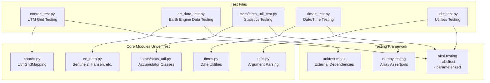
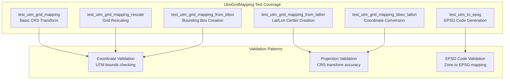
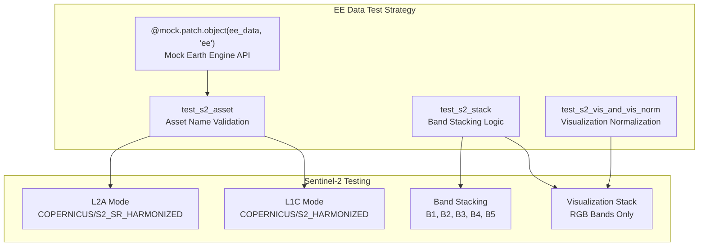
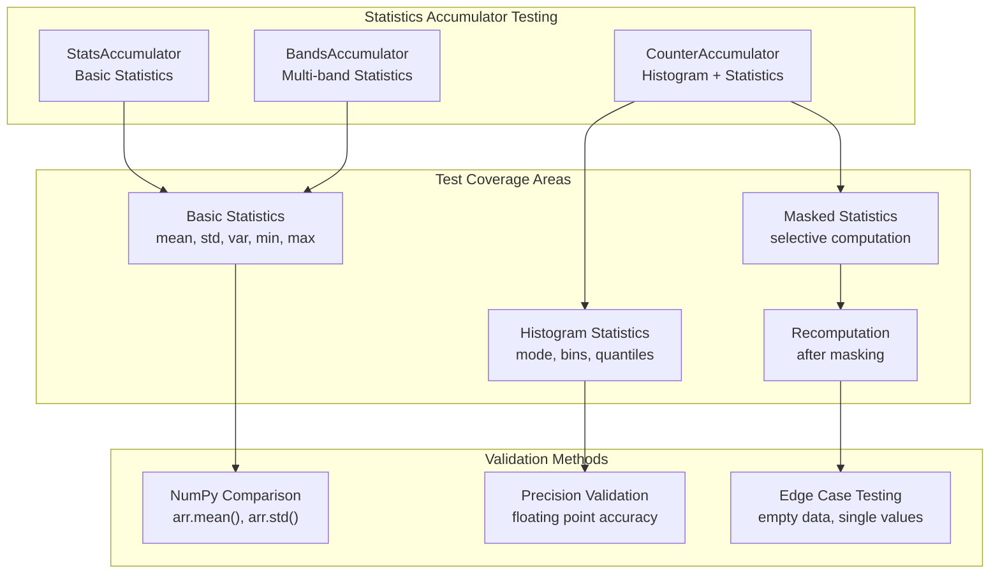
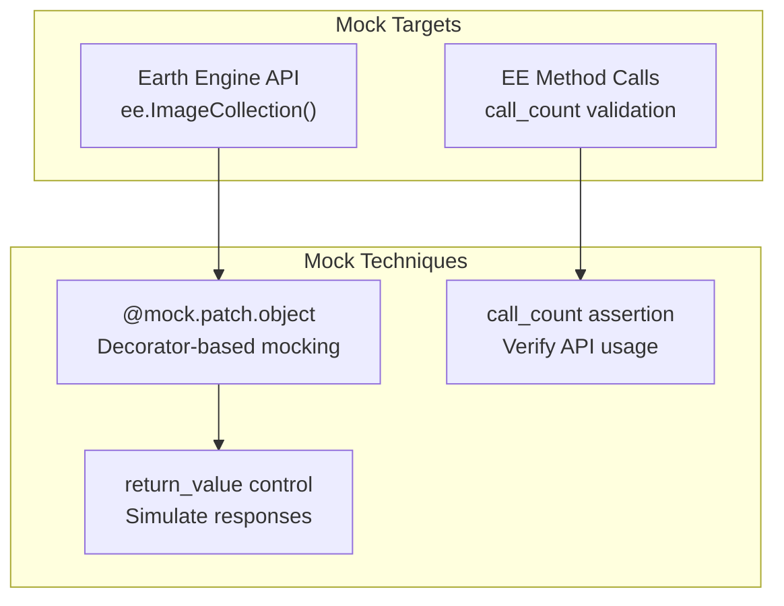

<!-- source: DeepWiki mcp.deepwiki.com · repo google-deepmind/geeflow · page 10 Development and Testing · fetched 2026-10-26 -->

# Development and Testing

<details>
<summary>Relevant source files</summary>

The following files were used as context for generating this wiki page:

- [geeflow/coords_test.py](geeflow/coords_test.py)
- [geeflow/ee_data_test.py](geeflow/ee_data_test.py)
- [geeflow/stats/stats_util_test.py](geeflow/stats/stats_util_test.py)
- [geeflow/times_test.py](geeflow/times_test.py)
- [geeflow/utils_test.py](geeflow/utils_test.py)

</details>


This page covers the testing infrastructure, development patterns, and testing methodologies used in GeoFlow. It provides guidance for developers contributing to the codebase and explains the testing approach for the core modules.

For information about the overall system architecture, see [Core Architecture](#3). For details about specific modules being tested, see [Data Sources and Processing](#5) and [Utilities and Helpers](#8).

## Testing Framework and Structure

GeoFlow uses the Abseil Testing framework (`absl.testing`) as its primary testing infrastructure. The test suite is organized to mirror the main module structure, with comprehensive unit tests for core functionality.

### Test Organization



**Sources:** [geeflow/coords_test.py:1-91](), [geeflow/ee_data_test.py:1-58](), [geeflow/stats/stats_util_test.py:1-191](), [geeflow/times_test.py:1-67](), [geeflow/utils_test.py:1-78]()

### Test Execution Patterns

All test files follow a consistent structure using the Abseil testing framework:

| Test File | Primary Test Class | Key Features |
|-----------|-------------------|--------------|
| `coords_test.py` | `CoordsTest` | Parameterized UTM zone testing, coordinate transformation validation |
| `ee_data_test.py` | `EeDataTest` | Earth Engine mocking, data processing validation |
| `stats_util_test.py` | `StatsUtilTest` | Statistical accumulator testing, numerical precision validation |
| `times_test.py` | `TimesTest` | Date format handling, timezone conversion testing |
| `utils_test.py` | `CommonTest` | Argument parsing validation, type checking |

## Core Module Testing Patterns

### Coordinate System Testing

The `coords_test.py` module extensively tests the `UtmGridMapping` class, which is central to GeoFlow's spatial coordinate handling:



Key testing patterns include:
- **Parameterized testing** for multiple UTM zones: `("18N", "EPSG:32618"), ("10C", "EPSG:32710")`
- **Numerical precision validation** using `numpy.testing.assert_allclose`
- **Error condition testing** for invalid coordinate ranges

**Sources:** [geeflow/coords_test.py:23-87]()

### Earth Engine Data Testing

The `ee_data_test.py` module tests Earth Engine integration with careful mocking to avoid external dependencies:



The testing approach uses:
- **Mock patching** to isolate Earth Engine dependencies: `@mock.patch.object(ee_data, "ee")`
- **Parameterized testing** for different Sentinel-2 modes
- **Array shape validation** for band stacking operations
- **Value range validation** for visualization normalization

**Sources:** [geeflow/ee_data_test.py:25-54]()

### Statistics System Testing

The `stats_util_test.py` provides comprehensive testing for the statistics accumulator classes:



Key testing features:
- **Statistical accuracy validation** against NumPy reference implementations
- **Masking and recomputation testing** for selective statistics
- **Histogram quantile computation** with custom `hist_quantile` function
- **Multi-accumulator management** through `BandsAccumulator`

**Sources:** [geeflow/stats/stats_util_test.py:21-187]()

## Testing Utilities and Patterns

### Parameterized Testing

GeoFlow extensively uses parameterized tests to cover multiple scenarios efficiently:

```python
@parameterized.parameters(
    ("18N", "EPSG:32618"),
    ("10C", "EPSG:32710"), 
    ("49S", "EPSG:32649"),
    ("9m", "EPSG:32709"),
)
def test_utm_to_epsg(self, utm_zone, expected_epsg):
```

This pattern is used across:
- **UTM zone testing** in `coords_test.py`
- **Date format testing** in `times_test.py` 
- **Sentinel-2 mode testing** in `ee_data_test.py`
- **Accumulator type testing** in `stats_util_test.py`

### Mock Strategy for External Dependencies

External dependencies are systematically mocked to ensure test isolation:



**Sources:** [geeflow/ee_data_test.py:29-34]()

### Numerical Testing Patterns

For numerical computations, GeoFlow uses precise validation methods:

| Validation Type | Method | Use Case |
|----------------|--------|----------|
| Exact equality | `self.assertEqual()` | Integer values, discrete categories |
| Floating point | `np.testing.assert_allclose()` | Coordinate transformations |
| Approximate equality | `self.assertAlmostEqual()` | Statistical computations |
| Range validation | `self.assertLessEqual()` | Normalized values (0-1 range) |

## Development Workflow Integration

### Test Execution

Tests are designed to run independently using the standard Python test execution pattern:

```bash
python -m absl.testing.absltest geeflow.coords_test
python -m absl.testing.absltest geeflow.ee_data_test
python -m absl.testing.absltest geeflow.stats.stats_util_test
```

### Continuous Integration Considerations

The test suite is structured to support automated testing environments:

- **No external dependencies** through comprehensive mocking
- **Deterministic results** with fixed random seeds where applicable
- **Fast execution** through isolated unit tests
- **Clear failure reporting** using descriptive assertion messages

**Sources:** [geeflow/coords_test.py:89-91](), [geeflow/ee_data_test.py:56-58](), [geeflow/stats/stats_util_test.py:189-191](), [geeflow/times_test.py:65-67](), [geeflow/utils_test.py:76-78]()

## Testing Best Practices

Based on the existing test patterns, GeoFlow follows these testing principles:

1. **Comprehensive parameterization** for testing multiple scenarios
2. **External dependency isolation** through systematic mocking
3. **Numerical precision validation** using appropriate tolerance levels
4. **Edge case coverage** including empty data and boundary conditions
5. **Reference implementation comparison** against well-established libraries like NumPy

The testing infrastructure provides a solid foundation for maintaining code quality and ensuring reliable functionality across GeoFlow's core modules.