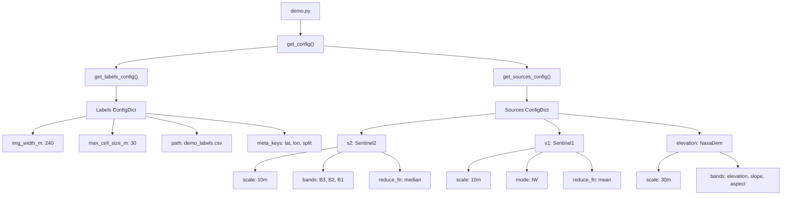
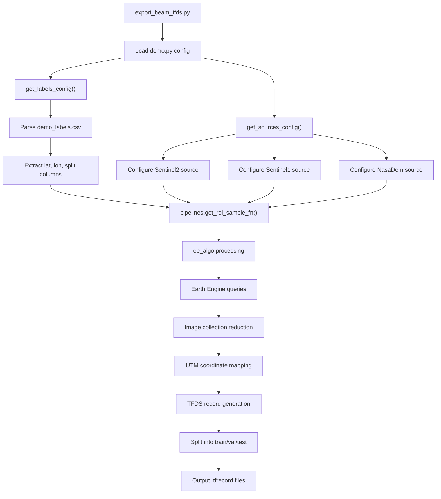
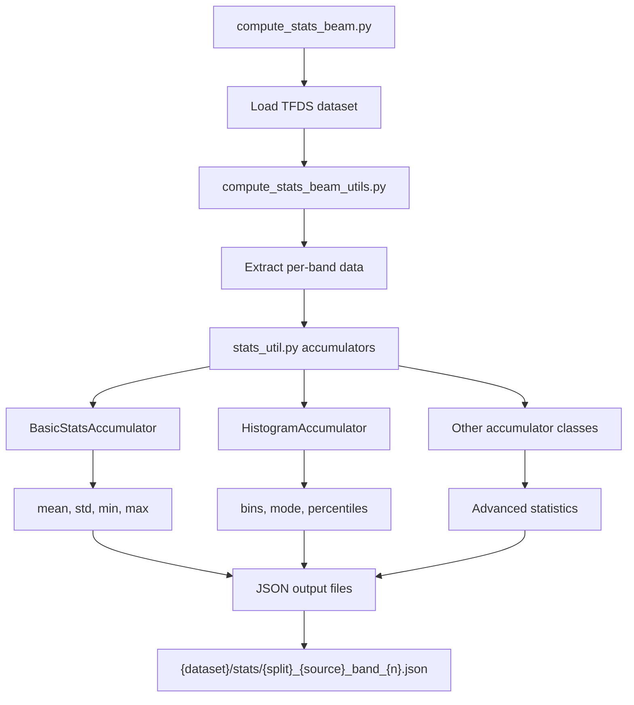

<!-- source: DeepWiki mcp.deepwiki.com · repo google-deepmind/geeflow · page 2 Getting Started · fetched 2026-10-26 -->

# Getting Started

<details>
<summary>Relevant source files</summary>

The following files were used as context for generating this wiki page:

- [README.md](README.md)
- [geeflow/configs/public/demo.py](geeflow/configs/public/demo.py)

</details>


## Purpose and Scope

This page provides a quick start guide for using GeoFlow to generate your first geospatial dataset. It covers installation, running the demo configuration, and understanding the output structure. For detailed information about configuration options, see [Configuration System](#6). For comprehensive architecture details, see [Core Architecture](#3).

## Prerequisites

Before starting with GeoFlow, ensure you have:

1. **Google Cloud Platform Account**: GeoFlow uses Google Earth Engine, which requires a GCP account
2. **Earth Engine Access**: You need to be authenticated with Google Earth Engine
3. **Python Environment**: Python 3.8+ with virtual environment capabilities

### Earth Engine Authentication

You must authenticate with Google Earth Engine and have access to a GCP project. Verify your setup by running:

```python
import ee
ee.Authenticate()
print(ee.String("Hello from GeeFlow!").getInfo())
```

## Installation

Clone the repository and set up the Python environment:

```bash
git clone https://github.com/google-deepmind/geeflow
cd geeflow
python -m venv .venv
source .venv/bin/activate
pip install -e .
cd geeflow
```

Set up your environment variables:

```bash
export OUTDIR="/tmp/tfds"
export EE_PROJECT="YOUR_GCP_PROJECT_ID"  # Replace with your GCP Project ID
```

Sources: [README.md:206-224]()

## Running Your First Dataset Export

GeoFlow includes a demo configuration that demonstrates the basic workflow. The demo uses the configuration defined in [geeflow/configs/public/demo.py]() to extract sample data from multiple Earth Engine sources.

### Demo Configuration Overview



**Demo Configuration Workflow**

Sources: [geeflow/configs/public/demo.py:66-71]()

### Execute the Demo Pipeline

Run the complete dataset export pipeline:

```bash
python -m geeflow.export_beam_tfds \
--config_path=configs/public/demo.py:labels_path=data/demo_labels.csv,num=20 \
--tfds_name=demo:1.0.0 --output_dir=$OUTDIR --logtostderr --running_mode=direct \
--splits=train,val,test --ee_project=$EE_PROJECT --file_format="tfrecord" -- \
--direct_num_workers=4 --direct_running_mode=multi_threading
```

### Pipeline Execution Flow



**Dataset Export Pipeline Flow**

Sources: [README.md:250-262](), [geeflow/export_beam_tfds.py:161-174]()

## Understanding the Output

After successful execution, your output directory will contain:

```
/tmp/tfds/demo/
├── demo/
│   └── 1.0.0/
│       ├── dataset_info.json
│       ├── demo-test.tfrecord-00000-of-00001
│       ├── demo-train.tfrecord-00000-of-00001
│       ├── demo-val.tfrecord-00000-of-00001
│       └── features.json
└── extracted/  # Temporary processing directory
```

### Output Files Description

| File | Purpose |
|------|---------|
| `dataset_info.json` | TFDS metadata including schema and split information |
| `demo-{split}.tfrecord-*` | TensorFlow record files containing the actual dataset |
| `features.json` | Feature schema definition for the dataset |
| `extracted/` | Temporary directory used during Apache Beam processing |

Each TFDS record contains:
- **Geospatial imagery**: Multi-spectral data from Sentinel-2, SAR data from Sentinel-1, elevation data from NASA DEM
- **Spatial metadata**: Latitude, longitude, UTM coordinates
- **Label information**: Any additional columns specified in `meta_keys`

Sources: [README.md:270-283]()

## Computing Statistics

After generating the dataset, compute comprehensive statistics for each data source:

```bash
python -m geeflow.stats.compute_stats_beam --tfds_name=demo \
--split=test,train,val --data_dir=$OUTDIR -- \
--direct_num_workers=4 --direct_running_mode=multi_threading --no_pipeline_type_check
```

### Statistics Processing Flow



**Statistics Computation Pipeline**

### Example Statistics Output

The statistics pipeline generates detailed metrics for each band:

```json
{
  "bins_iqr": 316.0,
  "bins_iqr_std": 234.24759080800592,
  "bins_mad": 155.0,
  "bins_mad_std": 229.803,
  "bins_mean": 557.5357349537037,
  "bins_median": 420.5,
  "bins_std": 506.70404309973185,
  "max": 4252.0,
  "mean": 557.7291508427372,
  "min": 90.5,
  "mode": 249,
  "n": 13824,
  "n_masked": 0,
  "sample_std": 506.67234659545005,
  "sample_var": 256716.86680453984,
  "std": 506.6540204413037,
  "sum": 7710047.78125,
  "total": 7710047.78125,
  "var": 256698.296429337
}
```

Sources: [README.md:285-322](), [geeflow/stats/compute_stats_beam.py:174-176]()

## Apache Beam Configuration

Both pipelines use Apache Beam for distributed processing. Key configuration options:

| Parameter | Purpose |
|-----------|---------|
| `--running_mode=direct` | Run locally using DirectRunner |
| `--direct_num_workers=4` | Number of parallel workers |
| `--direct_running_mode=multi_threading` | Threading mode for local execution |
| `--no_pipeline_type_check` | Disable strict type checking (statistics only) |

For production deployments, you can use other Beam runners like Dataflow for Google Cloud processing.

Sources: [README.md:264-268]()

## Next Steps

After successfully running the demo:

1. **Explore Configuration**: Learn about customizing data sources and processing options in [Configuration System](#6)
2. **Understand Architecture**: Deep dive into the system design in [Core Architecture](#3)  
3. **Add Data Sources**: Explore the available Earth Engine datasets in [Earth Engine Datasets](#5.1)
4. **Scale Up**: Learn about production deployment patterns in [Main Pipelines](#4)
5. **Custom Processing**: Implement custom algorithms using [Data Processing Algorithms](#5.2)

The demo configuration provides a foundation that you can extend with:
- Additional Earth Engine data sources
- Custom temporal sampling strategies  
- Different spatial resolutions
- Custom label datasets
- Advanced processing algorithms

Sources: [README.md:50-148]()

---

