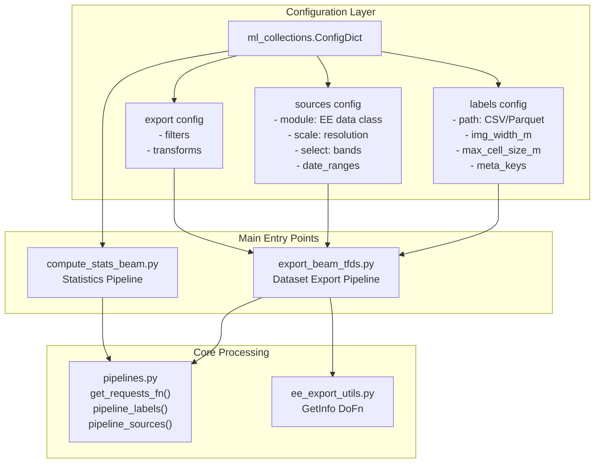
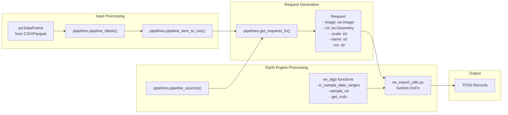
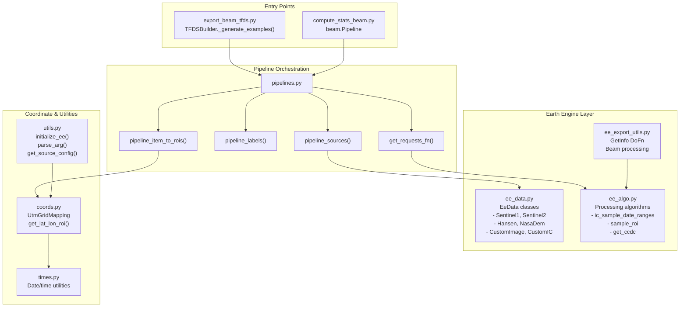
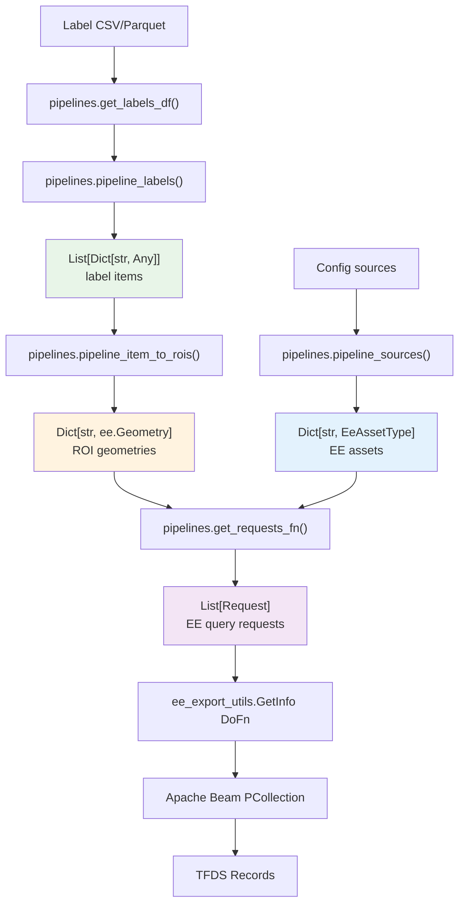
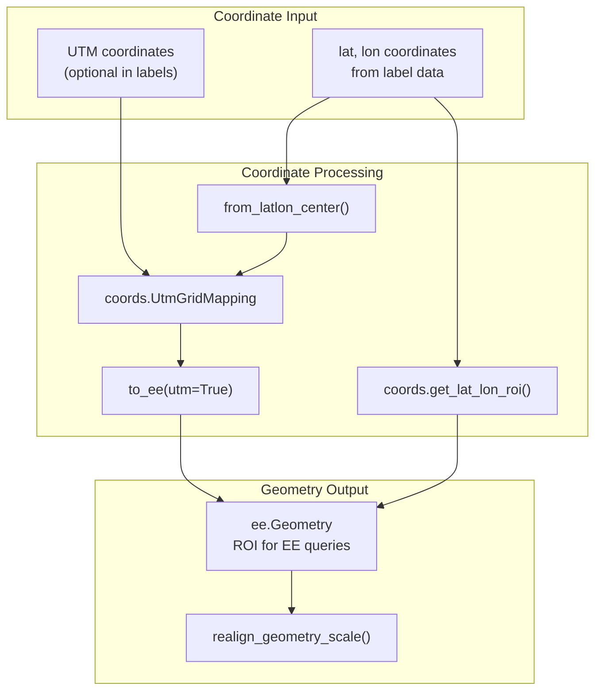
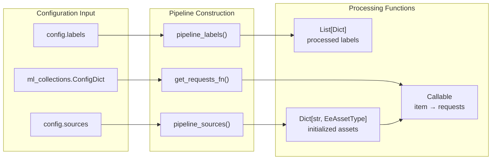

<!-- source: DeepWiki mcp.deepwiki.com · repo google-deepmind/geeflow · page 3 Core Architecture · fetched 2026-10-26 -->

# Core Architecture

Relevant source files

The following files were used as context for generating this wiki page:

- [README.md](README.md)
- [geeflow/pipelines.py](geeflow/pipelines.py)
- [geeflow/utils.py](geeflow/utils.py)

This document explains the overall system architecture of GeeFlow, covering the key modules, their interactions, and the architectural patterns that enable large-scale geospatial dataset generation using Google Earth Engine. For configuration details, see [Configuration System](#6). For pipeline implementation specifics, see [Main Pipelines](#4).

## System Overview

GeeFlow follows a configuration-driven, pipeline-based architecture built on Apache Beam for distributed processing. The system transforms geospatial label data into machine learning-ready datasets by orchestrating Earth Engine queries through a modular processing pipeline.

## Core Architectural Components

### Configuration-Driven Design

Sources: [README.md:56-142](), [geeflow/utils.py:216-227]()

### Request-Response Architecture

The system uses a request-response pattern where processing is broken down into discrete `Request` objects that encapsulate Earth Engine queries:

Sources: [geeflow/pipelines.py:61-70](), [geeflow/pipelines.py:289-410]()

## Module Architecture

### Core Processing Modules

The system is organized into distinct processing layers:

Sources: [geeflow/pipelines.py:1-36](), [README.md:150-177]()

### Data Flow Through Processing Layers

Sources: [geeflow/pipelines.py:106-128](), [geeflow/pipelines.py:179-208](), [geeflow/pipelines.py:289-410]()

## Algorithm Selection and Processing

The system uses a mapping strategy to select appropriate processing algorithms based on the data source type:

| Data Source Type | Algorithm Function | Purpose |
|------------------|-------------------|---------|
| `IC_SAMPLE_DATE_RANGES` | `ee_algo.ic_sample_date_ranges` | Time-series sampling with date ranges |
| `IC_SAMPLE` | `ee_algo.ic_sample` | Simple image collection sampling |
| `RGB_IC_SAMPLE` | `ee_algo.rgb_ic_sample` | RGB-specific collection sampling |
| `SAMPLE_ROI` | `ee_algo.sample_roi` | Region-of-interest sampling |
| `FC_GET` | `ee_algo.fc_get` | Feature collection property extraction |
| `CCDC` | `ee_algo.get_ccdc` | Continuous Change Detection Classification |

Sources: [geeflow/pipelines.py:42-59](), [geeflow/pipelines.py:262-272]()

## Coordinate System Management

GeeFlow implements a sophisticated coordinate system that handles both UTM projections and lat/lon coordinates:

Sources: [geeflow/pipelines.py:131-159](), [geeflow/pipelines.py:250-259]()

## Configuration Processing Pipeline

The configuration system transforms user specifications into executable processing functions:

Sources: [geeflow/pipelines.py:115-128](), [geeflow/pipelines.py:179-208](), [geeflow/pipelines.py:289-291]()

## Error Handling and Validation

The system includes validation at multiple levels:

- **Band/Property Validation**: [geeflow/pipelines.py:223-247]() validates that selected bands exist in the source
- **Configuration Validation**: [geeflow/pipelines.py:266-272]() ensures valid algorithm mapping
- **Geometry Validation**: [geeflow/pipelines.py:315-321]() handles scale alignment for grid consistency

The architecture emphasizes modularity and extensibility, allowing new Earth Engine data sources and processing algorithms to be added through the configuration system without modifying core pipeline logic.

---

