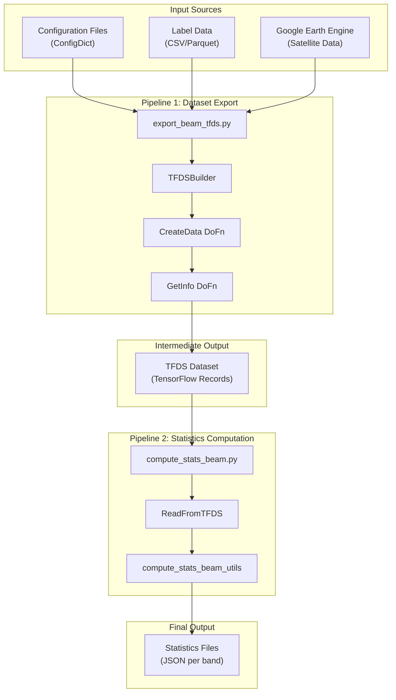
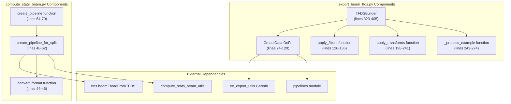

<!-- source: DeepWiki mcp.deepwiki.com · repo google-deepmind/geeflow · page 4 Main Pipelines · fetched 2026-10-26 -->

# Main Pipelines

<details>
<summary>Relevant source files</summary>

The following files were used as context for generating this wiki page:

- [README.md](README.md)
- [geeflow/export_beam_tfds.py](geeflow/export_beam_tfds.py)
- [geeflow/stats/compute_stats_beam.py](geeflow/stats/compute_stats_beam.py)

</details>


This document provides an overview of the two primary Apache Beam pipelines that form the core of GeoFlow's data processing system. These pipelines work sequentially to extract geospatial data from Google Earth Engine and generate machine learning-ready datasets with computed statistics.

For detailed explanations of individual pipeline components and configuration, see [Dataset Export Pipeline](#4.1) and [Statistics Computation Pipeline](#4.2). For information about configuring these pipelines, see [Configuration System](#6).

## Pipeline Architecture Overview

GeoFlow operates through two main Apache Beam pipelines that process geospatial data in sequence:



**Sources:** [geeflow/export_beam_tfds.py:1-486](), [geeflow/stats/compute_stats_beam.py:1-83]()

## Pipeline Component Mapping

The following diagram maps the high-level pipeline components to their specific code implementations:



**Sources:** [geeflow/export_beam_tfds.py:74-120](), [geeflow/export_beam_tfds.py:323-405](), [geeflow/stats/compute_stats_beam.py:48-70]()

## Dataset Export Pipeline

The dataset export pipeline (`export_beam_tfds.py`) serves as the primary data extraction and transformation engine. This pipeline:

| Component | Function | Key Classes/Functions |
|-----------|----------|----------------------|
| **Data Creation** | Reads label data and creates initial feature collections | `CreateData` DoFn |
| **EE Query Processing** | Executes distributed Google Earth Engine queries | `ee_export_utils.GetInfo` DoFn |
| **Data Filtering** | Applies configurable filters to remove unwanted samples | `apply_filters` function |
| **Data Transformation** | Performs spatial cropping, CCDC generation, and format conversion | `apply_transforms` function |
| **TFDS Generation** | Converts processed data to TensorFlow Dataset format | `TFDSBuilder` class |

The pipeline processes data through the following stages:
1. **Label Processing**: Reads CSV/Parquet files containing sample locations and metadata [geeflow/export_beam_tfds.py:85-92]()
2. **Split Generation**: Creates train/validation/test splits either from data columns or geographic distribution [geeflow/export_beam_tfds.py:94-113]()
3. **Earth Engine Queries**: Retrieves satellite imagery and geospatial data for each location [geeflow/export_beam_tfds.py:384-396]()
4. **Data Processing**: Applies algorithms, filters, and transformations to raw data [geeflow/export_beam_tfds.py:397-404]()

**Sources:** [geeflow/export_beam_tfds.py:323-405](), [geeflow/export_beam_tfds.py:74-120]()

## Statistics Computation Pipeline

The statistics computation pipeline (`compute_stats_beam.py`) operates on the TFDS datasets generated by the export pipeline. This pipeline:

| Component | Function | Implementation |
|-----------|----------|----------------|
| **TFDS Reading** | Loads generated datasets for analysis | `tfds.beam.ReadFromTFDS` |
| **Format Conversion** | Converts TensorFlow data to NumPy arrays | `convert_format` function |
| **Statistics Processing** | Computes per-band statistics across all samples | `compute_stats_beam_utils` module |
| **Output Generation** | Saves statistics as JSON files for each band and split | File I/O operations |

The pipeline operates in the following sequence:
1. **Dataset Loading**: Reads TFDS datasets for specified splits [geeflow/stats/compute_stats_beam.py:50-55]()
2. **Data Conversion**: Transforms data format for statistics computation [geeflow/stats/compute_stats_beam.py:44-46]()
3. **Statistics Calculation**: Computes comprehensive statistics per band [geeflow/stats/compute_stats_beam.py:60-61]()
4. **Results Storage**: Outputs JSON files with statistical summaries [geeflow/stats/compute_stats_beam.py:56-61]()

**Sources:** [geeflow/stats/compute_stats_beam.py:48-70](), [geeflow/stats/compute_stats_beam.py:44-46]()

## Pipeline Execution and Configuration

Both pipelines are designed to run with Apache Beam and support multiple execution modes:

- **Direct Runner**: Local execution with configurable threading [geeflow/export_beam_tfds.py:467-468]()
- **Cloud Runner**: Distributed execution on Google Cloud Dataflow [geeflow/export_beam_tfds.py:469-470]()

The pipelines accept command-line arguments for configuration and can be launched independently:

```bash
# Export pipeline
python -m geeflow.export_beam_tfds --config_path=... --tfds_name=... --output_dir=...

# Statistics pipeline  
python -m geeflow.stats.compute_stats_beam --tfds_name=... --split=... --data_dir=...
```

Both pipelines integrate with the ML Collections configuration system and support flexible parameterization through config files and command-line overrides.

**Sources:** [geeflow/export_beam_tfds.py:45-68](), [geeflow/stats/compute_stats_beam.py:28-41]()

---

