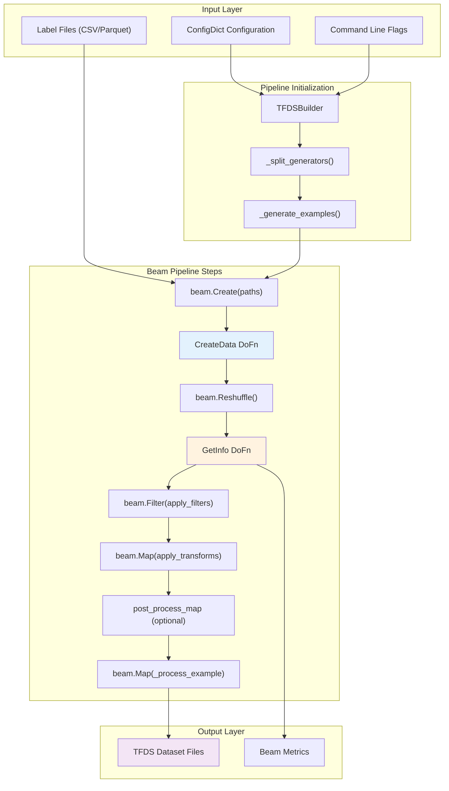
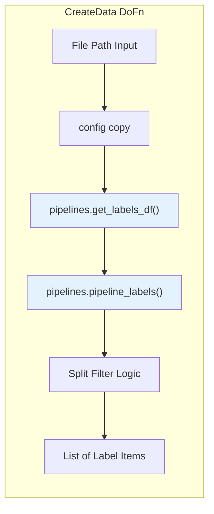
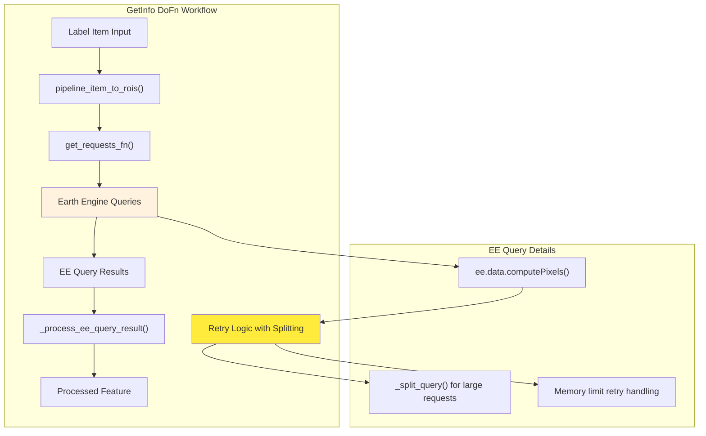
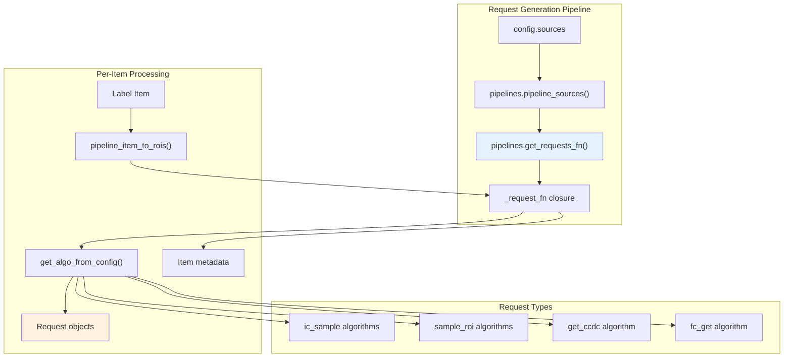
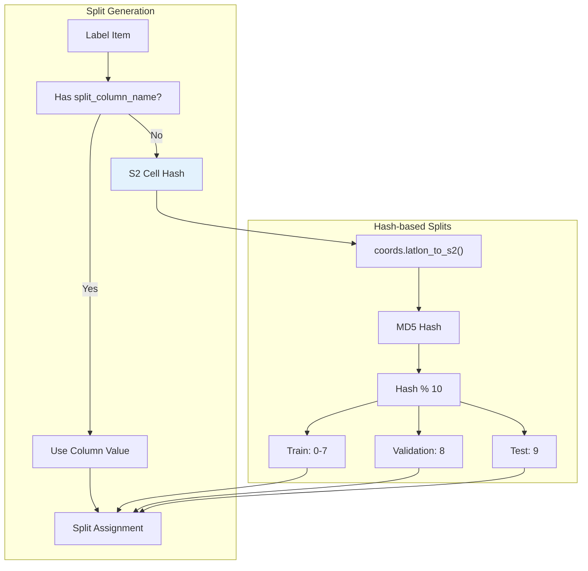
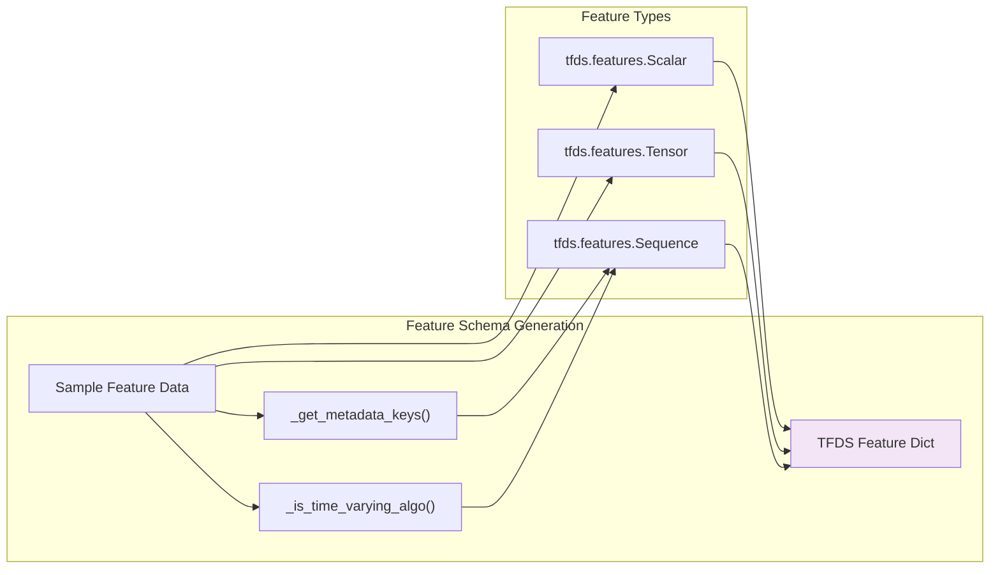
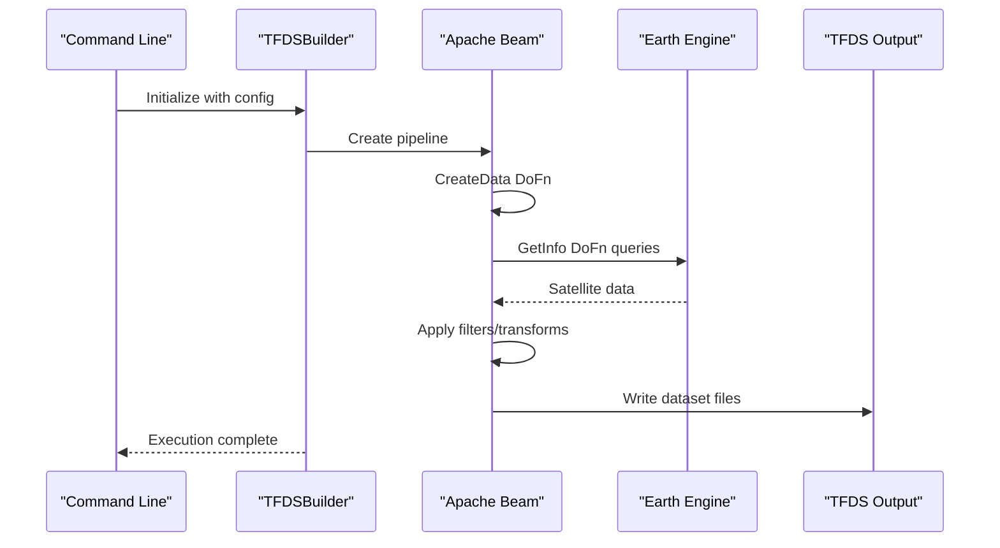

<!-- source: DeepWiki mcp.deepwiki.com · repo google-deepmind/geeflow · page 4.1 Dataset Export Pipeline · fetched 2026-10-26 -->

# Dataset Export Pipeline

Relevant source files

The following files were used as context for generating this wiki page:

- [geeflow/ee_export_utils.py](geeflow/ee_export_utils.py)
- [geeflow/export_beam_tfds.py](geeflow/export_beam_tfds.py)
- [geeflow/pipelines.py](geeflow/pipelines.py)

This document explains the Dataset Export Pipeline, which is the primary Apache Beam pipeline for extracting geospatial data from Google Earth Engine and converting it to TensorFlow Datasets (TFDS) format. The pipeline processes large-scale satellite imagery and geospatial datasets according to user-defined configurations.

For information about the Statistics Computation Pipeline that processes the output of this pipeline, see [Statistics Computation Pipeline](#4.2). For details about configuration format and structure, see [Configuration System](#6).

## Purpose and Overview

The Dataset Export Pipeline (`export_beam_tfds.py`) orchestrates the entire data extraction and conversion process. It reads label data (CSV/Parquet files with coordinates and metadata), queries Google Earth Engine for satellite imagery and geospatial data at those locations, and outputs machine learning-ready datasets in TFDS format.

Sources: [geeflow/export_beam_tfds.py:15-23]()

## Pipeline Architecture

The pipeline consists of several key Apache Beam transformations organized into a data processing workflow:

Sources: [geeflow/export_beam_tfds.py:378-404](), [geeflow/export_beam_tfds.py:370-376]()

## Key Components

### TFDSBuilder Class

The `TFDSBuilder` class extends `tfds.core.GeneratorBasedBuilder` and serves as the main orchestrator for the dataset generation process:

| Component | Purpose | Key Methods |
|-----------|---------|-------------|
| `__init__` | Initialize builder with config and metrics | Sets up beam counters and distributions |
| `_info()` | Define dataset metadata and features | Calls `make_tfds_features()` |
| `_split_generators()` | Define train/validation/test splits | Uses `get_split_tuples()` |
| `_generate_examples()` | Main pipeline definition | Creates Beam pipeline |

Sources: [geeflow/export_beam_tfds.py:323-361](), [geeflow/export_beam_tfds.py:362-368](), [geeflow/export_beam_tfds.py:370-376](), [geeflow/export_beam_tfds.py:378-404]()

### CreateData DoFn

The `CreateData` DoFn processes label files and creates initial data items for each geographic location:

Sources: [geeflow/export_beam_tfds.py:74-120](), [geeflow/export_beam_tfds.py:85-119]()

### GetInfo DoFn

The `GetInfo` DoFn is the core component that queries Google Earth Engine and retrieves satellite data:

Sources: [geeflow/ee_export_utils.py:110-253](), [geeflow/ee_export_utils.py:234-252](), [geeflow/ee_export_utils.py:145-232]()

## Data Flow and Processing

### Request Generation Flow

The pipeline uses a sophisticated request generation system to create Earth Engine queries:

Sources: [geeflow/pipelines.py:289-410](), [geeflow/pipelines.py:179-208](), [geeflow/pipelines.py:262-272]()

### Transform and Filter Operations

After Earth Engine data retrieval, the pipeline applies several processing steps:

| Operation | Function | Purpose |
|-----------|----------|---------|
| Filtering | `apply_filters()` | Remove empty or unwanted samples |
| CCDC Generation | `generate_ccdc()` | Process CCDC time series data |
| Transforms | `apply_transforms()` | Resize and format arrays |
| Post-processing | `post_process_map` | Optional custom processing |
| TFDS Formatting | `_process_example()` | Convert to TFDS format |

Sources: [geeflow/export_beam_tfds.py:126-136](), [geeflow/export_beam_tfds.py:139-195](), [geeflow/export_beam_tfds.py:198-240](), [geeflow/export_beam_tfds.py:243-273]()

## Configuration and Execution

### Command Line Interface

The pipeline accepts several key command line arguments:

| Flag | Purpose | Example |
|------|---------|---------|
| `--config_path` | Path to configuration file | `/path/to/config.py` |
| `--ee_project` | Earth Engine project and service account | `project:service@account.com` |
| `--output_dir` | Output directory for TFDS files | `/path/to/output` |
| `--tfds_name` | Dataset name and version | `my_dataset:1.0.0` |
| `--splits` | Dataset splits to generate | `train,validation,test` |

Sources: [geeflow/export_beam_tfds.py:45-68]()

### Split Generation Logic

The pipeline supports multiple split generation strategies:

Sources: [geeflow/export_beam_tfds.py:94-113](), [geeflow/export_beam_tfds.py:103-111]()

## Output Format and Features

### TFDS Feature Generation

The pipeline automatically infers TFDS feature schemas from the processed data:

Sources: [geeflow/export_beam_tfds.py:407-455](), [geeflow/export_beam_tfds.py:276-297](), [geeflow/export_beam_tfds.py:300-307]()

### Pipeline Execution

The main execution flow integrates all components:

Sources: [geeflow/export_beam_tfds.py:458-482](), [geeflow/export_beam_tfds.py:477-481]()

---

