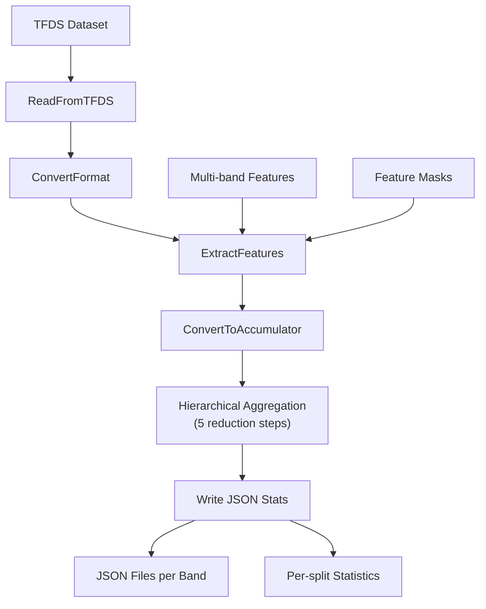
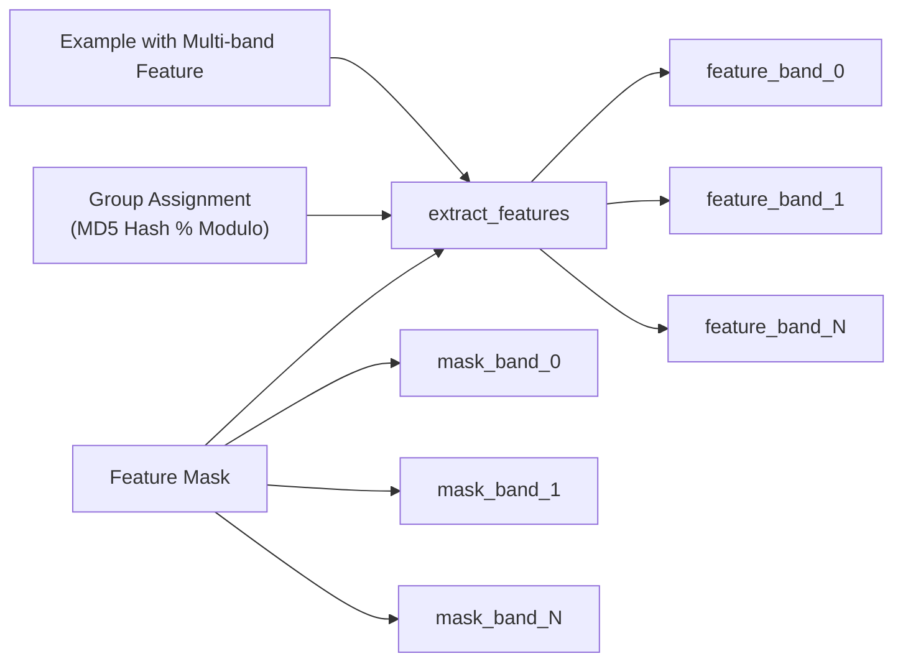
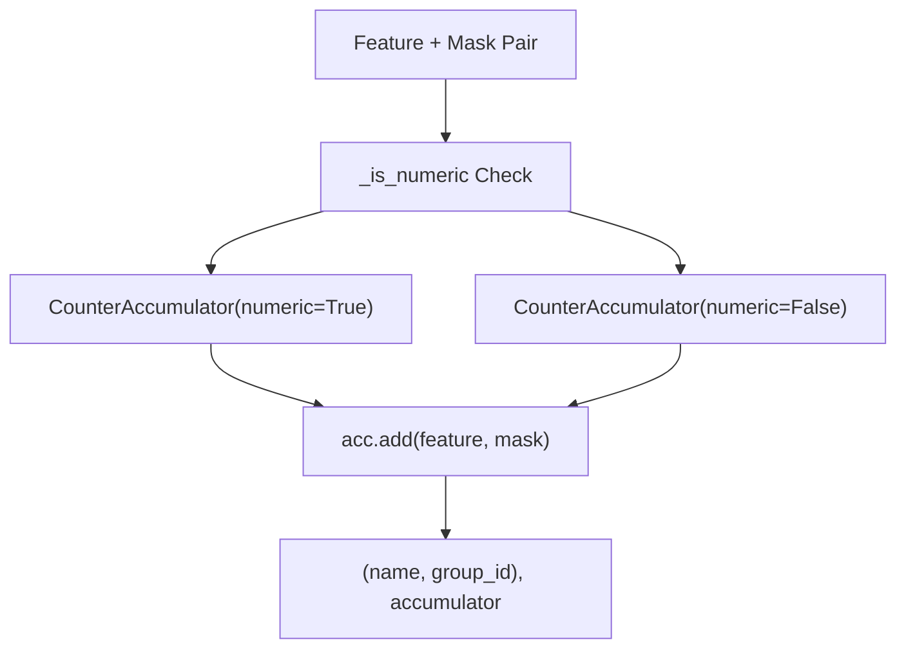
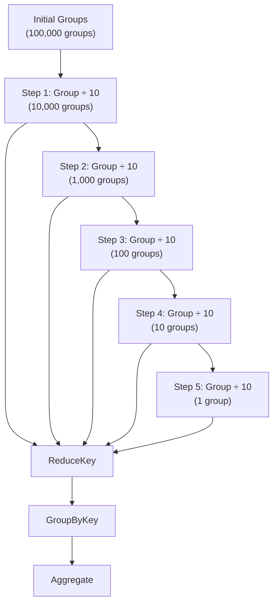
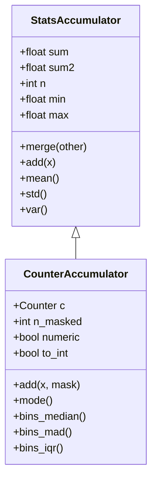
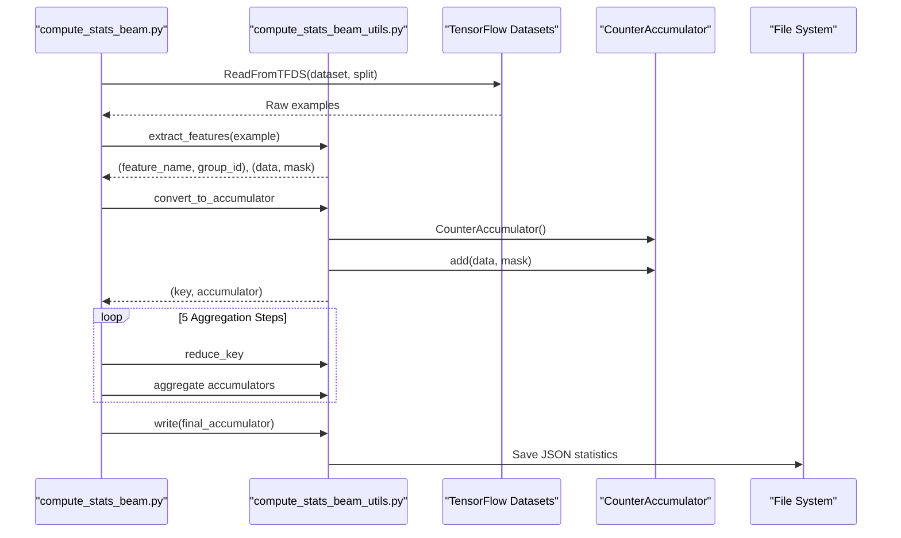

<!-- source: DeepWiki mcp.deepwiki.com · repo google-deepmind/geeflow · page 4.2 Statistics Computation Pipeline · fetched 2026-10-26 -->

# Statistics Computation Pipeline

<details>
<summary>Relevant source files</summary>

The following files were used as context for generating this wiki page:

- [geeflow/stats/compute_stats_beam.py](geeflow/stats/compute_stats_beam.py)
- [geeflow/stats/compute_stats_beam_utils.py](geeflow/stats/compute_stats_beam_utils.py)
- [geeflow/stats/stats_util.py](geeflow/stats/stats_util.py)

</details>


This document covers the Apache Beam pipeline that computes comprehensive statistics on TensorFlow Datasets (TFDS) generated by GeoFlow. The statistics computation pipeline processes multi-band geospatial imagery and feature data to produce detailed statistical summaries saved as JSON files.

For information about the dataset export pipeline that generates the TFDS data consumed by this pipeline, see [Dataset Export Pipeline](#4.1). For details about the accumulator classes and statistical computation methods, see [Statistics System](#9).

## Overview

The statistics computation pipeline is implemented as an Apache Beam pipeline that reads TFDS datasets and computes per-band statistics using a hierarchical aggregation approach. The pipeline handles both numeric and categorical data types, supports masking, and outputs comprehensive statistical summaries including histograms, quantiles, and robust statistics.



Sources: [geeflow/stats/compute_stats_beam.py:1-83](), [geeflow/stats/compute_stats_beam_utils.py:1-143]()

## Main Entry Point

The `compute_stats_beam.py` module serves as the main entry point for the statistics computation pipeline. It accepts command-line arguments to specify the TFDS dataset, data directory, output location, and processing splits.

| Flag | Description | Default |
|------|-------------|---------|
| `tfds_name` | Name of the TFDS dataset to process | (required) |
| `data_dir` | Directory containing TFDS data | (required) |
| `output_dir` | Output directory for statistics files | (uses dataset directory) |
| `split` | Dataset splits to process | `["train"]` |
| `running_mode` | Beam execution mode | `"direct"` |

The main pipeline function `create_pipeline_for_split` reads data using `tfds.beam.ReadFromTFDS` and converts the format using JAX utilities before delegating to the core processing pipeline.

Sources: [geeflow/stats/compute_stats_beam.py:28-83]()

## Feature Extraction and Processing

### Multi-Band Feature Handling

The `extract_features` function processes examples to handle multi-band imagery and associated feature masks. For each feature in an example:

- **Multi-band features**: Split into individual bands with naming convention `{feature_name}_band_{i}`
- **Feature masks**: Applied per-band if available with naming pattern `{feature_name}_mask`
- **Grouping**: Each example is assigned to a group based on MD5 hash of its ID for distributed processing



Sources: [geeflow/stats/compute_stats_beam_utils.py:51-73]()

### Accumulator Creation

The `convert_to_accumulator` function creates `CounterAccumulator` instances for each feature. The accumulator type is determined by the `_is_numeric` function which identifies whether features contain numeric or categorical data.



Sources: [geeflow/stats/compute_stats_beam_utils.py:75-82](), [geeflow/stats/compute_stats_beam_utils.py:40-48]()

## Hierarchical Aggregation Strategy

The pipeline uses a hierarchical aggregation approach with 5 reduction steps to efficiently process large datasets. This strategy prevents memory issues and enables distributed processing.

### Aggregation Parameters

- `_NUM_AGGREGATION_STEPS = 5`: Number of reduction levels
- `_AGGREGATION_DIVISOR = 10`: Grouping factor per step  
- `_AGGREGATION_MODULO = 100000`: Total number of initial groups



Each step performs:
1. **ReduceKey**: Maps `(name, group_id)` to `(name, group_id // 10)`
2. **GroupByKey**: Groups accumulators by the new key
3. **Aggregate**: Merges accumulators using the `merge` method

Sources: [geeflow/stats/compute_stats_beam_utils.py:27-33](), [geeflow/stats/compute_stats_beam_utils.py:84-106](), [geeflow/stats/compute_stats_beam_utils.py:132-142]()

## Accumulator Classes

### StatsAccumulator

The base `StatsAccumulator` class computes fundamental numerical statistics:

| Property | Description | Formula |
|----------|-------------|---------|
| `mean` | Arithmetic mean | `sum / n` |
| `std` | Standard deviation | `√(sum2/n - (sum/n)²)` |
| `var` | Variance | `sum2/n - (sum/n)²` |
| `sample_std` | Sample standard deviation | `√(sample_var)` |
| `sample_var` | Sample variance | `(sum2 - sum²/n)/(n-1)` |
| `min` | Minimum value | Updated incrementally |
| `max` | Maximum value | Updated incrementally |

### CounterAccumulator  

The `CounterAccumulator` extends `StatsAccumulator` with histogram and counter functionality:

- **Counters**: Frequency counts for each unique value
- **Bins**: Histogram bins for numeric data
- **Robust statistics**: Median, MAD, IQR computed from histograms
- **Masking support**: Handles masked values separately



Sources: [geeflow/stats/stats_util.py:37-160](), [geeflow/stats/stats_util.py:162-375]()

## Output Format

Statistics are saved as JSON files with the following structure:

### File Organization
- **Per-band files**: `{feature_name}_band_{i}.json`
- **Per-split directories**: Statistics organized by train/validation/test splits
- **Location**: Either specified `output_dir` or `{dataset_dir}/stats/`

### JSON Schema
```json
{
  "mean": 0.5,
  "std": 0.2,
  "var": 0.04,
  "min": 0.0,
  "max": 1.0,
  "total": 500.0,
  "size": 1000,
  "mode": 0,
  "bins_mean": 0.498,
  "bins_median": 0.502,
  "bins_std": 0.199,
  "bins_iqr": 0.25,
  "bins_mad": 0.12
}
```

The `write` function ensures the final group ID is 0, confirming that all reduction steps completed successfully before saving statistics.

Sources: [geeflow/stats/compute_stats_beam_utils.py:108-118](), [geeflow/stats/stats_util.py:116-130](), [geeflow/stats/stats_util.py:472-489]()

## Pipeline Execution Flow

The complete pipeline execution follows this sequence:

1. **Initialization**: Parse command-line arguments and set up Beam pipeline options
2. **Data Reading**: Use `tfds.beam.ReadFromTFDS` to read the specified dataset splits
3. **Format Conversion**: Convert data using `jax.tree.map(utils.to_np, example)`
4. **Feature Extraction**: Process multi-band features and masks per example
5. **Accumulator Creation**: Create `CounterAccumulator` instances for each feature
6. **Hierarchical Aggregation**: Execute 5 reduction steps to merge statistics
7. **Output**: Write final JSON statistics files organized by split and feature name



Sources: [geeflow/stats/compute_stats_beam.py:48-78](), [geeflow/stats/compute_stats_beam_utils.py:120-142]()

---

