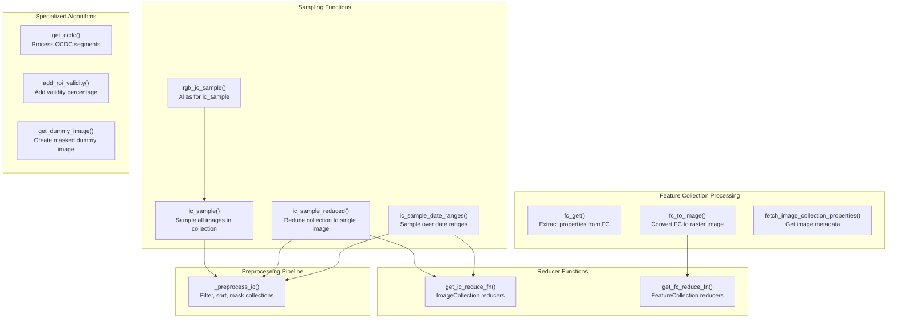
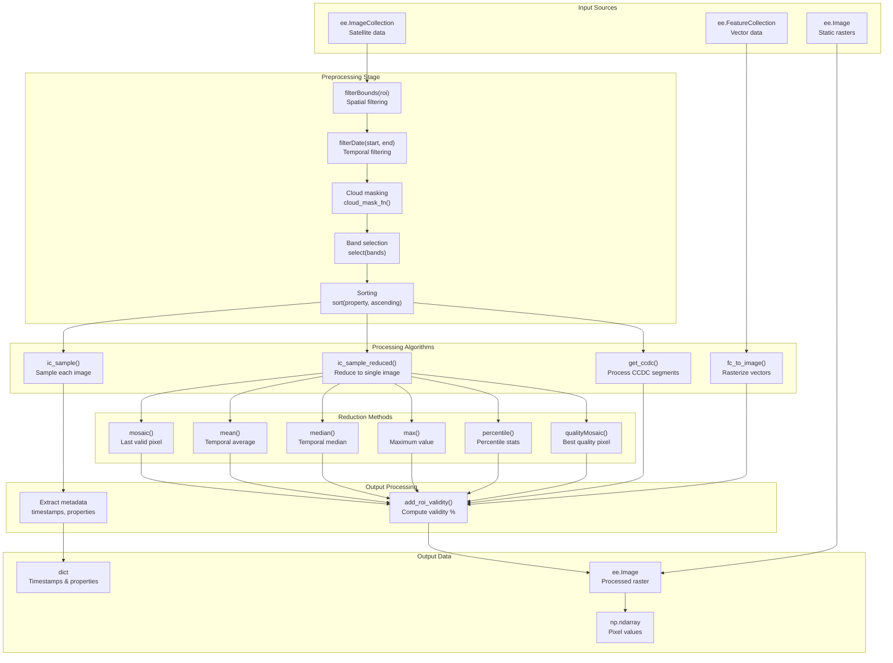

<!-- source: DeepWiki mcp.deepwiki.com · repo google-deepmind/geeflow · page 5 Data Sources and Processing · fetched 2026-10-26 -->

# Data Sources and Processing

<details>
<summary>Relevant source files</summary>

The following files were used as context for generating this wiki page:

- [geeflow/ee_algo.py](geeflow/ee_algo.py)
- [geeflow/ee_data.py](geeflow/ee_data.py)

</details>


This document covers GeoFlow's integration with Google Earth Engine for accessing satellite and geospatial datasets, and the processing algorithms used to transform raw Earth Engine data into machine learning-ready formats. For information about the main export pipeline that orchestrates this processing, see [Dataset Export Pipeline](#4.1). For details about coordinate systems and geometry handling, see [Coordinate Systems and Geometry](#7).

## Overview

GeoFlow's data processing system is built around two core modules:
- **Data Source Definitions** (`ee_data.py`): Classes that define and configure access to various Earth Engine datasets
- **Processing Algorithms** (`ee_algo.py`): Functions that sample, reduce, and transform Earth Engine data collections

The system supports over 30 different satellite and geospatial data sources, from optical imagery (Sentinel-2, Landsat) to SAR data (Sentinel-1), elevation models, forest change data, and population datasets.

## Earth Engine Data Sources Architecture

```mermaid
graph TB
    subgraph "Abstract Base Classes"
        EeData["EeData<br/>Base class for datasets"]
        EeDataFC["EeDataFC<br/>FeatureCollection datasets"]
    end
    
    subgraph "Satellite Imagery"
        Sentinel1["Sentinel1<br/>SAR data (VV, VH)"]
        Sentinel2["Sentinel2<br/>Optical imagery (13 bands)"]
        Landsat7["Landsat7<br/>Surface reflectance"]
        Landsat8["Landsat8<br/>Surface reflectance"]
        NAIP["NAIP<br/>High-res aerial imagery"]
        Nicfi["Nicfi<br/>Planet basemaps"]
    end
    
    subgraph "MODIS Products"
        ModisTerraVeg["ModisTerraVeg<br/>Vegetation indices"]
        ModisSurfRefl["ModisSurfRefl<br/>Surface reflectance"]
        ModisGPP["ModisGPP<br/>Gross primary productivity"]
        ModisET["ModisET<br/>Evapotranspiration"]
        ModisBurn["ModisBurn<br/>Burned area"]
        ModisFire["ModisFire<br/>Fire anomalies"]
    end
    
    subgraph "Forest and Land Cover"
        Hansen["Hansen<br/>Global forest change"]
        Primary["Primary<br/>Humid tropical forests"]
        DynamicWorld["DynamicWorld<br/>Land cover classification"]
        WorldCover["WorldCover<br/>ESA land cover"]
        NLCD["NLCD<br/>US land cover"]
    end
    
    subgraph "Elevation and Structure"
        NasaDem["NasaDem<br/>Elevation from SRTM"]
        FABDEM["FABDEM<br/>Buildings removed DEM"]
        CopDem["CopDem<br/>Copernicus DEM"]
        GediRasterCanopyHeight["GediRasterCanopyHeight<br/>Canopy height"]
        GediRasterAGB["GediRasterAGB<br/>Aboveground biomass"]
    end
    
    subgraph "Climate and Analysis"
        CCDC["CCDC<br/>Change detection"]
        Era5["Era5<br/>Climate reanalysis"]
    end
    
    subgraph "Human Population"
        CIESIN["CIESIN<br/>Population count"]
        WorldPop["WorldPop<br/>Population density"]
        GHSPop["GHSPop<br/>Settlement data"]
        FPP["FPP<br/>Forest proximate people"]
        TPP["TPP<br/>Tree proximate people"]
    end
    
    subgraph "Administrative/Custom"
        Countries["Countries<br/>Country boundaries"]
        Ecoregions["Ecoregions<br/>Ecological regions"]
        CustomFC["CustomFC<br/>Custom FeatureCollection"]
        CustomImage["CustomImage<br/>Custom Image"]
        CustomIC["CustomIC<br/>Custom ImageCollection"]
    end
    
    EeData --> Sentinel1
    EeData --> Sentinel2
    EeData --> Landsat7
    EeData --> Landsat8
    EeData --> NAIP
    EeData --> Nicfi
    EeData --> ModisTerraVeg
    EeData --> ModisSurfRefl
    EeData --> ModisGPP
    EeData --> ModisET
    EeData --> ModisBurn
    EeData --> ModisFire
    EeData --> Hansen
    EeData --> Primary
    EeData --> DynamicWorld
    EeData --> WorldCover
    EeData --> NLCD
    EeData --> NasaDem
    EeData --> FABDEM
    EeData --> CopDem
    EeData --> GediRasterCanopyHeight
    EeData --> GediRasterAGB
    EeData --> CCDC
    EeData --> Era5
    EeData --> CIESIN
    EeData --> WorldPop
    EeData --> GHSPop
    EeData --> FPP
    EeData --> TPP
    EeData --> CustomImage
    EeData --> CustomIC
    
    EeDataFC --> Countries
    EeDataFC --> Ecoregions
    EeDataFC --> CustomFC
```



**Data Source Class Hierarchy**

Sources: [geeflow/ee_data.py:31-1149]()

## Core Processing Functions

The `ee_algo.py` module provides the core algorithms for sampling and processing Earth Engine data:



**Key Processing Algorithm Functions**

Sources: [geeflow/ee_algo.py:38-460]()

## Data Processing Pipeline



**Data Processing Flow from Earth Engine to Processed Arrays**

Sources: [geeflow/ee_algo.py:46-460]()

## Key Processing Components

### Image Collection Sampling

The `ic_sample()` function [geeflow/ee_algo.py:359-387]() provides the primary interface for sampling Earth Engine ImageCollections:

| Parameter | Type | Description |
|-----------|------|-------------|
| `roi` | `ee.Geometry` | Region of interest for spatial filtering |
| `ic` | `ee.ImageCollection` | Input image collection |
| `cloud_mask_fn` | `Callable` | Function to mask clouds/invalid pixels |
| `sort_by` | `str` | Property to sort images by (e.g., "system:time_start") |
| `bands` | `list[str]` | Specific bands to select |
| `filter_bounds` | `bool` | Whether to filter by ROI bounds |
| `date_range` | `tuple[str, str]` | Start and end dates for temporal filtering |

### Reduction Operations

The `get_ic_reduce_fn()` function [geeflow/ee_algo.py:281-356]() supports multiple reduction strategies:

- **`mosaic`**: Last valid pixel composite
- **`mean`**: Temporal average (converted to float)
- **`median`**: Temporal median
- **`percentile`**: Multiple percentile statistics
- **`qualityMosaic`**: Best quality pixel based on QA band
- **`with_most_valid_pixels_in_band_0`**: Image with most valid pixels

### Feature Collection Processing

Vector data processing through `fc_to_image()` [geeflow/ee_algo.py:143-189]():


**Feature Collection to Raster Conversion**

Sources: [geeflow/ee_algo.py:143-189]()

### CCDC Processing

The Continuous Change Detection and Classification (CCDC) algorithm processing [geeflow/ee_algo.py:224-256]() handles time series analysis:

- Extracts multiple temporal segments per pixel
- Supports both 1D and 2D coefficient arrays
- Pads with zeros if insufficient segments found
- Handles both harmonic coefficients and metadata bands

### Cloud Masking Strategies

Different datasets implement specific cloud masking approaches:

| Dataset | Method | Function |
|---------|--------|----------|
| Sentinel-2 | QA60 bitmask | `Sentinel2.im_cloud_mask()` |
| Sentinel-2 | Cloud Score+ | `Sentinel2.im_cloud_score_plus_mask()` |
| Sentinel-2 | CDI + probability | `Sentinel2.im_cloud_mask2()` |
| Landsat 7/8 | QA_PIXEL bitmask | `Landsat7.im_cloud_mask()` |

Sources: [geeflow/ee_data.py:229-305]()

## Data Source Configuration

### Satellite Data Configuration

Each data source class provides configurable parameters:

```python
# Sentinel-1 SAR configuration
Sentinel1(mode="IW", pols=("VV", "VH"), orbit="both")

# Sentinel-2 optical configuration  
Sentinel2(mode="L2A")  # Surface reflectance

# MODIS vegetation configuration
ModisTerraVeg(mode="250m")  # 250m resolution NDVI/EVI
```

### Custom Data Sources

The system supports custom data sources through flexible base classes:

- **`CustomFC`**: Custom FeatureCollections with filtering and buffering
- **`CustomImage`**: Custom single images with processing functions
- **`CustomIC`**: Custom ImageCollections with merging capabilities

Sources: [geeflow/ee_data.py:972-1102]()

## Integration with Main Pipeline

The data sources and processing algorithms integrate with the main export pipeline through the `pipelines.py` module, which:

1. Reads data source configurations from ML Collections ConfigDict
2. Instantiates appropriate `EeData` classes
3. Applies processing algorithms based on configuration
4. Coordinates spatial and temporal sampling across multiple sources

For details on how these components integrate into the complete dataset generation workflow, see [Dataset Export Pipeline](#4.1) and [Configuration System](#6).

Sources: [geeflow/ee_data.py:1-1149](), [geeflow/ee_algo.py:1-460]()

---

