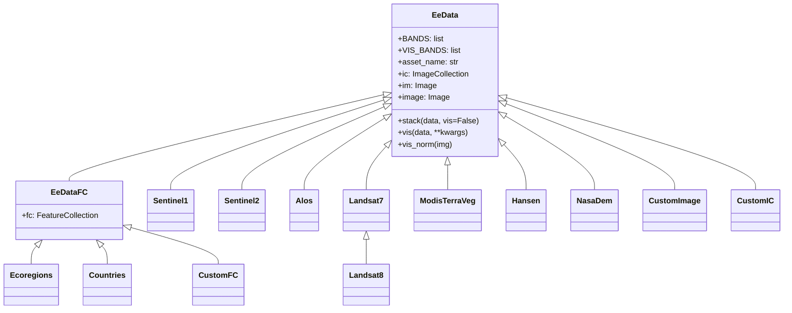
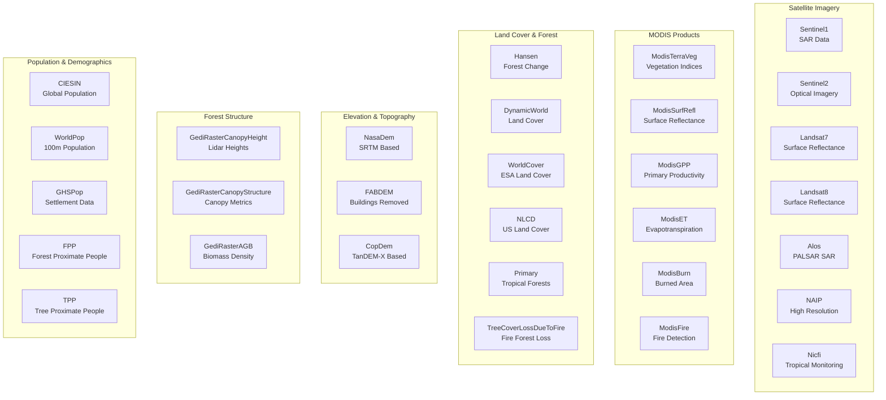
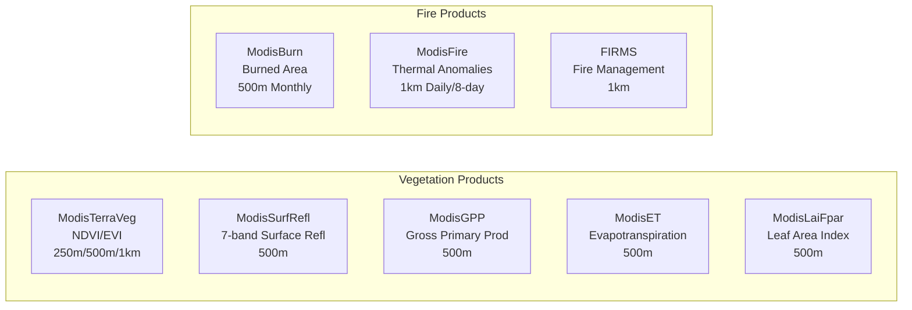
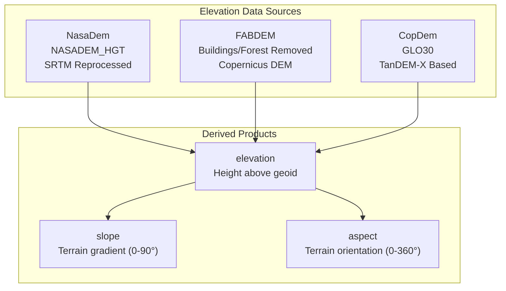
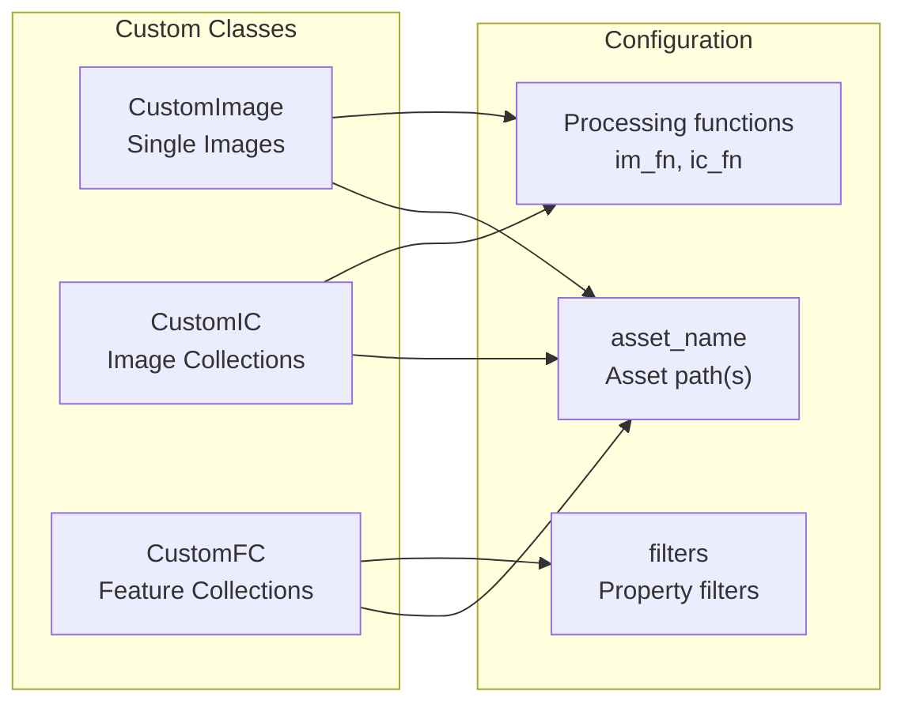

<!-- source: DeepWiki mcp.deepwiki.com · repo google-deepmind/geeflow · page 5.1 Earth Engine Datasets · fetched 2026-10-26 -->

# Earth Engine Datasets

<details>
<summary>Relevant source files</summary>

The following files were used as context for generating this wiki page:

- [geeflow/coords_test.py](geeflow/coords_test.py)
- [geeflow/ee_data.py](geeflow/ee_data.py)
- [geeflow/ee_data_test.py](geeflow/ee_data_test.py)

</details>


This document provides a comprehensive guide to the Earth Engine datasets supported by GeoFlow. The `ee_data.py` module defines dataset classes that encapsulate Earth Engine assets, providing standardized interfaces for accessing satellite imagery, land cover data, elevation models, and other geospatial datasets. For information about data processing algorithms applied to these datasets, see [Data Processing Algorithms](#5.2).

## Class Hierarchy and Architecture

The Earth Engine dataset system is built around abstract base classes that define consistent interfaces for different types of Earth Engine assets.

### Dataset Class Hierarchy



Sources: [geeflow/ee_data.py:31-89]()

### Core Dataset Categories



Sources: [geeflow/ee_data.py:92-1149]()

## Core Satellite Imagery Datasets

### Sentinel-1 SAR Data

The `Sentinel1` class provides access to Copernicus Sentinel-1 Ground Range Detected (GRD) data with configurable polarization and orbit parameters.

| Parameter | Options | Description |
|-----------|---------|-------------|
| `mode` | `"IW"` (default) | Instrument mode |
| `pols` | `("VV", "VH")` (default) | Polarization channels |
| `orbit` | `"both"`, `"asc"`, `"desc"` | Orbit direction filter |

**Key Features:**
- Bands: `["VV", "VH", "angle"]`
- Visualization bands: `["VV", "VH", "VV"]` (excludes angle)
- Asset: `"COPERNICUS/S1_GRD"`
- Visualization range: -25 to 5 dB

Sources: [geeflow/ee_data.py:92-137]()

### Sentinel-2 Optical Imagery

The `Sentinel2` class supports both Level-1C (Top of Atmosphere) and Level-2A (Surface Reflectance) harmonized products.

| Parameter | Options | Description |
|-----------|---------|-------------|
| `mode` | `"L2A"` (default), `"L1C"` | Processing level |

**Key Features:**
- Bands: All 13 spectral bands plus quality bands (`B1`-`B12`, `QA10`, `QA20`, `QA60`)
- Visualization bands: `["B4", "B3", "B2"]` (RGB)
- Assets: `"COPERNICUS/S2_SR_HARMONIZED"` (L2A), `"COPERNICUS/S2_HARMONIZED"` (L1C)
- Cloud masking methods: Official QA60-based, cloud probability-based, Cloud Score+

**Cloud Masking Options:**
- `im_cloud_mask()`: Official QA60 bit mask method
- `im_cloud_mask2()`: Advanced method using Cloud Displacement Index
- `im_cloud_score_plus_mask()`: Google Cloud Score+ integration

Sources: [geeflow/ee_data.py:183-264]()

### Landsat Data

Both `Landsat7` and `Landsat8` classes provide access to Collection 2 Surface Reflectance data.

**Landsat 7 (1999-2022):**
- Asset: `"LANDSAT/LE07/C02/T1_L2"`
- Bands: Surface reflectance (`SR_B1`-`SR_B7`), thermal (`ST_B6`), quality bands
- Visualization: `["SR_B3", "SR_B2", "SR_B1"]`

**Landsat 8 (2013-present):**
- Asset: `"LANDSAT/LC08/C02/T1"`
- Bands: `B1`-`B11` plus quality and angle bands
- Visualization: `["B4", "B3", "B2"]`

Sources: [geeflow/ee_data.py:267-319]()

## MODIS Product Suite

GeoFlow supports multiple MODIS products with different temporal and spatial resolutions.

### MODIS Product Overview



### Key MODIS Datasets

**ModisTerraVeg (Vegetation Indices):**
- Modes: `"250m"`, `"500m"`, `"1km"` 
- Assets: `MOD13Q1`, `MOD13A1`, `MOD13A2`
- Primary bands: `NDVI`, `EVI`, surface reflectance bands
- 16-day composites

**ModisBurn (Burned Area):**
- Asset: `"MODIS/061/MCD64A1"`
- Bands: `["BurnDate", "Uncertainty", "QA", "FirstDay", "LastDay"]`
- Monthly 500m resolution

**ModisFire (Thermal Anomalies):**
- Modes: `"daily"`, `"8-day"`, `"yearly"`
- Assets: `MOD14A1` (daily), `MOD14A2` (8-day)
- Bands: `["MaxFRP"]` (Maximum Fire Radiative Power)

Sources: [geeflow/ee_data.py:358-483]()

## Land Cover and Forest Datasets

### Forest Change and Structure

**Hansen Global Forest Change:**
- Asset: `"UMD/hansen/global_forest_change_2022_v1_10"`
- Key bands: `treecover2000`, `loss`, `gain`, `lossyear`, `datamask`
- 30m resolution, global coverage (2000-2022)

**Primary Tropical Forests:**
- Modes: `"2001"`, `"2020"`
- Asset: `"UMD/GLAD/PRIMARY_HUMID_TROPICAL_FORESTS/v1"`
- Band: `["Primary_HT_forests"]`

**GEDI Lidar Products:**
- `GediRasterCanopyHeight`: Canopy top height from L2A
- `GediRasterCanopyStructure`: Vertical profile metrics from L2B  
- `GediRasterAGB`: Aboveground biomass density from L4A
- 25m resolution, ±51.6° latitude coverage

Sources: [geeflow/ee_data.py:529-727]()

### Land Cover Classification

**DynamicWorld:**
- Asset: `"GOOGLE/DYNAMICWORLD/V1"`
- 9 land cover classes: water, trees, grass, crops, built, etc.
- 10m resolution, global coverage
- Includes probability bands and discrete classification

**ESA WorldCover:**
- Assets: `"ESA/WorldCover/v100"` (2020), `"ESA/WorldCover/v200"` (2021)
- 11 land cover classes
- 10m resolution, global coverage

Sources: [geeflow/ee_data.py:803-863]()

## Elevation and Topography

### Digital Elevation Models



**Coverage and Resolution:**
- **NasaDem**: Limited to ±60° latitude, 30m resolution
- **FABDEM**: Global coverage, 30m resolution, vegetation/buildings removed
- **CopDem**: Global coverage, 30m resolution, high accuracy

All elevation datasets automatically generate slope and aspect bands using `ee.Terrain` algorithms.

Sources: [geeflow/ee_data.py:561-640]()

## Custom Dataset Classes

GeoFlow provides flexible custom dataset classes for user-defined assets.

### Custom Dataset Types



**CustomFC Features:**
- Multiple asset support with merging
- Property-based filtering (`eq`, `lt`, `gte`, `inList`, etc.)
- Point buffering with configurable radius
- Geometry bounds conversion

**Example CustomFC Usage:**
```python
# Configuration example
c.gedi = copy.deepcopy(all_sources.CustomFC)
c.gedi.kw.asset_name = "projects/computing-engine-190414/assets/gedi_predictions"
c.gedi.select = ["canopy_height"]
c.gedi.filters = [("quality", "high"), ("confidence", ">", 0.8)]
```

Sources: [geeflow/ee_data.py:973-1102]()

## Dataset Usage Patterns

### Common Interface Methods

All dataset classes inherit core functionality from the `EeData` base class:

| Method | Purpose | Returns |
|--------|---------|---------|
| `stack(data, vis=False)` | Stack bands into numpy array | `np.ndarray` (H,W,C) |
| `vis(data, **kwargs)` | Prepare visualization | RGB normalized array |
| `vis_norm(img)` | Normalize for display | Scaled [0,1] array |
| `.ic` | Access ImageCollection | `ee.ImageCollection` |
| `.im` / `.image` | Access single Image | `ee.Image` |
| `.fc` | Access FeatureCollection | `ee.FeatureCollection` |

### Asset Access Patterns

**ImageCollection Access:**
```python
sentinel2 = ee_data.Sentinel2(mode="L2A")
collection = sentinel2.ic.filterDate("2023-01-01", "2023-12-31")
```

**Single Image Access:**
```python
hansen = ee_data.Hansen()
forest_change = hansen.im.select(["treecover2000", "loss", "gain"])
```

**FeatureCollection Access:**
```python
countries = ee_data.Countries(mode="simple")
colombia = countries.filter_by_name("Colombia")
```

Sources: [geeflow/ee_data.py:31-74](), [geeflow/ee_data.py:115-127](), [geeflow/ee_data.py:1115-1121]()

---

