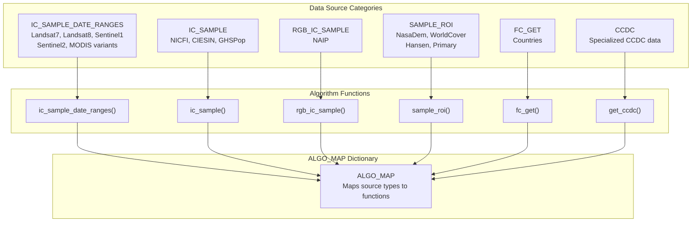
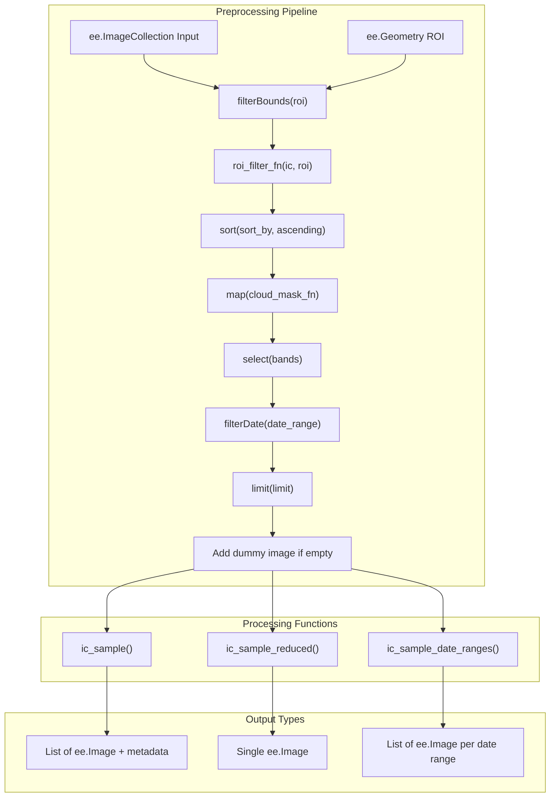
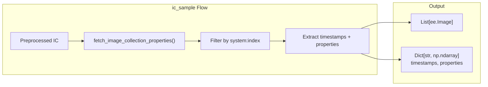
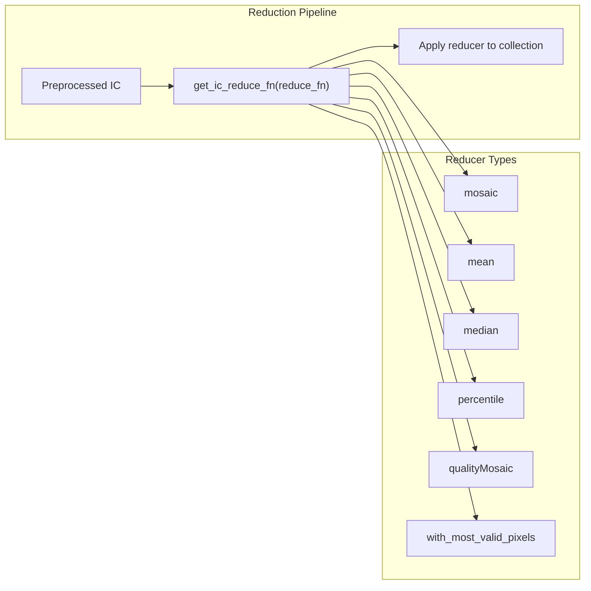
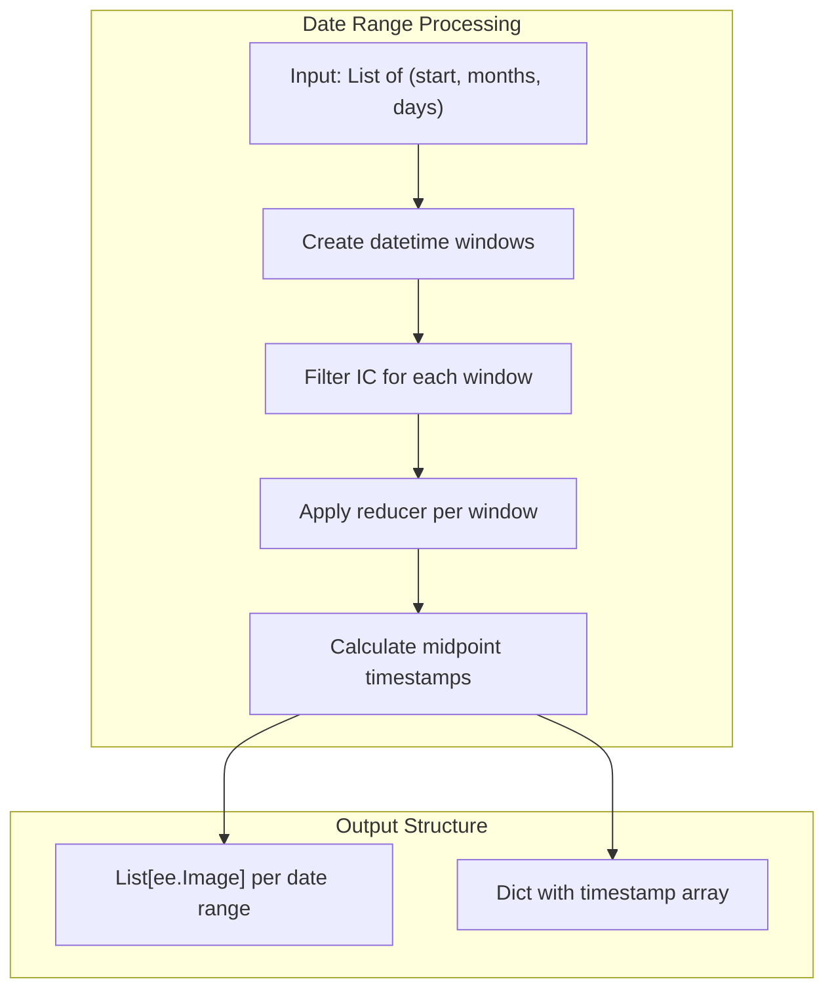
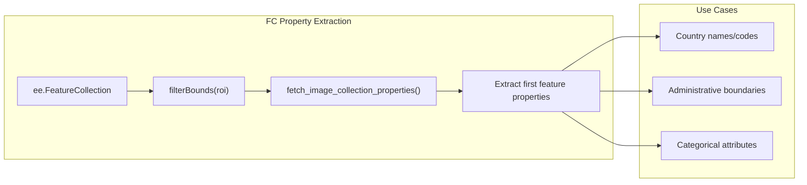
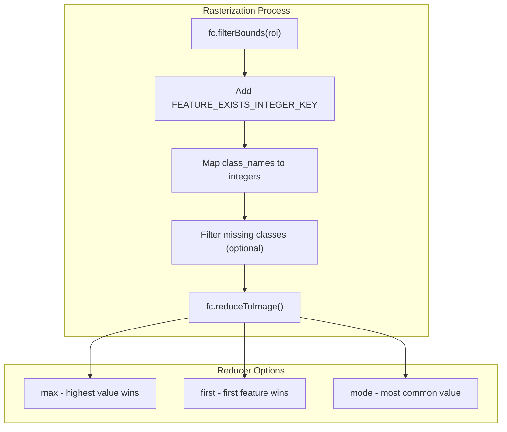
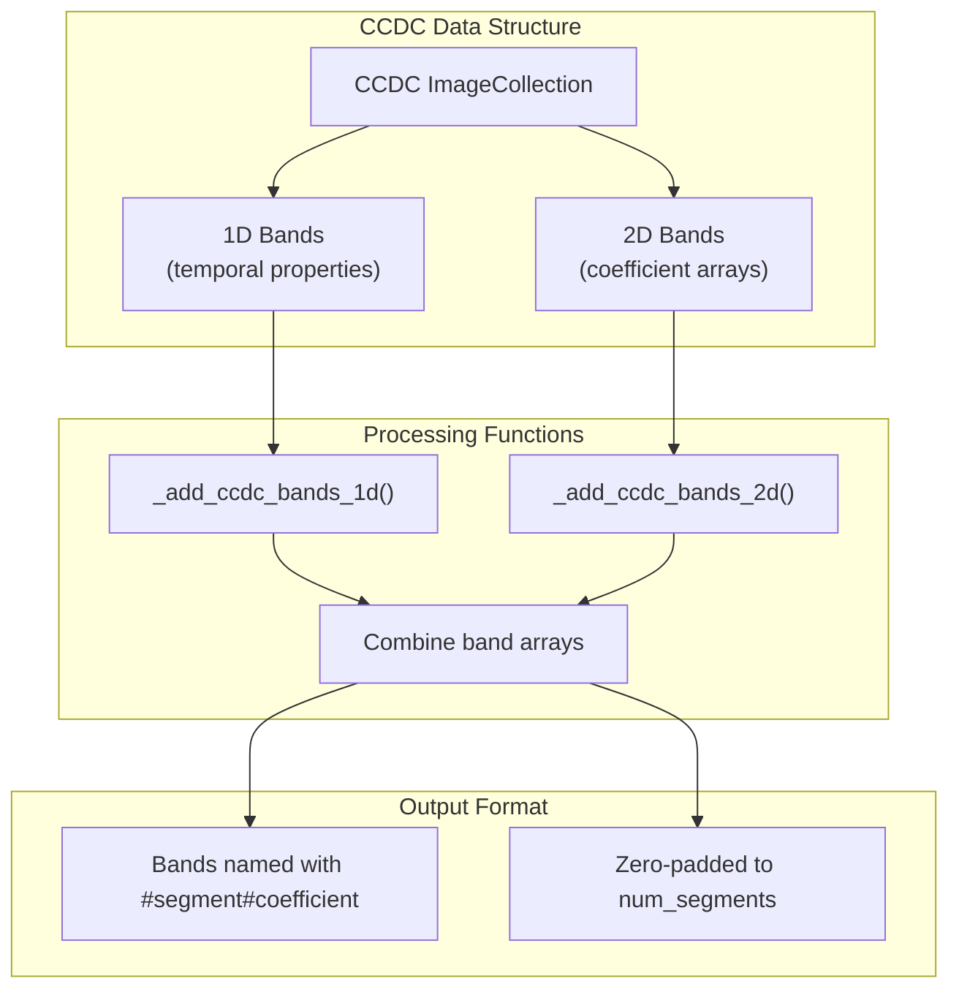
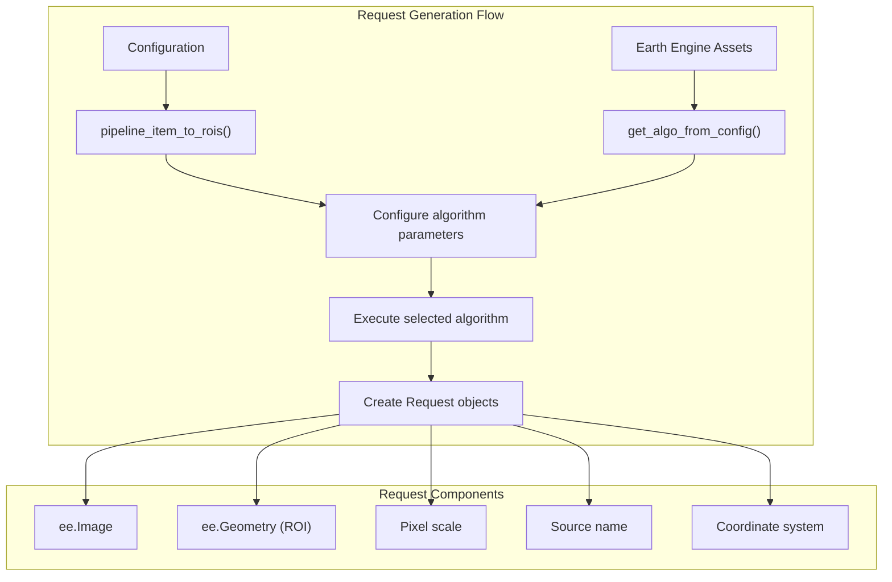

<!-- source: DeepWiki mcp.deepwiki.com · repo google-deepmind/geeflow · page 5.2 Data Processing Algorithms · fetched 2026-10-26 -->

# Data Processing Algorithms

Relevant source files

The following files were used as context for generating this wiki page:

- [geeflow/ee_algo.py](geeflow/ee_algo.py)
- [geeflow/pipelines.py](geeflow/pipelines.py)

This page provides a comprehensive overview of the Earth Engine algorithms that power GeoFlow's data processing capabilities. These algorithms handle sampling, reducing, and processing Earth Engine image collections and feature collections to extract geospatial data at specified regions of interest.

The algorithms in this module work in conjunction with the Earth Engine datasets (see [Earth Engine Datasets](#5.1)) and are orchestrated by the main pipelines (see [Main Pipelines](#4)) to produce machine learning-ready datasets.

## Algorithm Types and Mapping

GeoFlow categorizes data sources based on their processing requirements and maps them to appropriate algorithms. The system uses a hierarchical approach where different Earth Engine asset types require different sampling strategies.

**Algorithm Mapping Structure**

| Category | Data Sources | Algorithm Function | Purpose |
|----------|-------------|-------------------|---------|
| Date Range Sampling | Landsat7/8, Sentinel1/2, MODIS | `ic_sample_date_ranges` | Multi-temporal analysis over specific date ranges |
| Collection Sampling | NICFI, CIESIN, GHSPop | `ic_sample` | Individual image sampling from collections |
| RGB Sampling | NAIP | `rgb_ic_sample` | RGB imagery processing |
| ROI Sampling | Hansen, WorldCover, DEMs | `sample_roi` | Single image/region sampling |
| Feature Collection | Countries | `fc_get` | Extracting feature properties |
| CCDC | Change detection data | `get_ccdc` | Specialized CCDC time series |

Sources: [geeflow/pipelines.py:42-58]()

## Image Collection Processing Pipeline

The core image collection processing follows a standardized pipeline that preprocesses collections before applying specific sampling algorithms.

**Core Preprocessing Function**

The `_preprocess_ic` function [geeflow/ee_algo.py:46-78]() handles the standardized preprocessing pipeline:

- **Spatial Filtering**: `filterBounds(roi)` restricts images to the region of interest
- **Custom ROI Filtering**: Optional `roi_filter_fn` for specialized spatial constraints
- **Temporal Sorting**: Orders images by specified property (typically timestamp)
- **Cloud Masking**: Applies cloud mask functions to filter out cloudy pixels
- **Band Selection**: Selects only required spectral bands
- **Date Filtering**: Restricts collection to specified date ranges
- **Collection Limiting**: Caps the number of images processed
- **Empty Collection Handling**: Adds dummy images when collections are empty

Sources: [geeflow/ee_algo.py:46-78]()

## Collection Sampling Algorithms

### Individual Image Sampling

The `ic_sample` function extracts individual images from collections along with their metadata:

Key capabilities:
- Preserves individual image timestamps and properties
- Handles additional metadata properties beyond system properties
- Returns both images and structured metadata for downstream processing

Sources: [geeflow/ee_algo.py:359-386]()

### Reduced Collection Sampling

The `ic_sample_reduced` function applies reduction operations across entire collections:

**Available Reducers**

| Reducer Name | Function | Use Case |
|-------------|----------|----------|
| `mosaic` | `x.mosaic()` | Composite images with latest on top |
| `mean` | `x.mean()` | Average pixel values across time |
| `median` | `x.median()` | Median pixel values (noise reduction) |
| `percentile` | `x.reduce(ee.Reducer.percentile())` | Percentile statistics |
| `qualityMosaic` | `x.qualityMosaic()` | Best quality pixels composite |
| `with_most_valid_pixels` | Custom validity-based selection | Choose images with most valid data |

Sources: [geeflow/ee_algo.py:281-356](), [geeflow/ee_algo.py:389-409]()

### Date Range Sampling

The `ic_sample_date_ranges` function processes collections over specific temporal windows:

This algorithm enables multi-temporal analysis by:
- Creating temporal windows from relative date specifications
- Processing each window independently with specified reducers
- Maintaining temporal metadata for downstream analysis
- Supporting complex time series analysis workflows

Sources: [geeflow/ee_algo.py:412-446]()

## Feature Collection Processing

### Property Extraction

The `fc_get` function extracts properties from feature collections within regions of interest:

### Feature to Image Conversion

The `fc_to_image` function rasterizes feature collections into image format:

Key features:
- Automatic string-to-integer class mapping
- Configurable handling of missing classes
- Multiple reduction strategies for overlapping features
- Support for existence indicators via `FEATURE_EXISTS_INTEGER_KEY`

Sources: [geeflow/ee_algo.py:132-189](), [geeflow/ee_algo.py:267-278]()

## Specialized Algorithms

### CCDC Processing

The Continuous Change Detection and Classification (CCDC) algorithm handles specialized time series change detection data:

CCDC processing involves:
- Handling multi-dimensional coefficient arrays
- Padding segments to consistent lengths
- Creating systematic band naming conventions
- Supporting both temporal and spectral change parameters

Sources: [geeflow/ee_algo.py:224-256](), [geeflow/ee_algo.py:192-221]()

## Request Generation and Orchestration

The pipeline system orchestrates these algorithms through the `get_requests_fn` function:

The request generation process:
1. Converts label items to region-of-interest geometries
2. Selects appropriate algorithms based on source configuration
3. Configures algorithm-specific parameters (bands, date ranges, reducers)
4. Executes algorithms to generate processed Earth Engine images
5. Creates standardized `Request` objects for downstream processing

Key orchestration features:
- Dynamic algorithm selection based on data source types
- Flexible parameter passing through configuration
- Support for both temporal and spatial parameter functions
- Metadata preservation throughout the processing pipeline

Sources: [geeflow/pipelines.py:289-410](), [geeflow/pipelines.py:262-272]()

---

