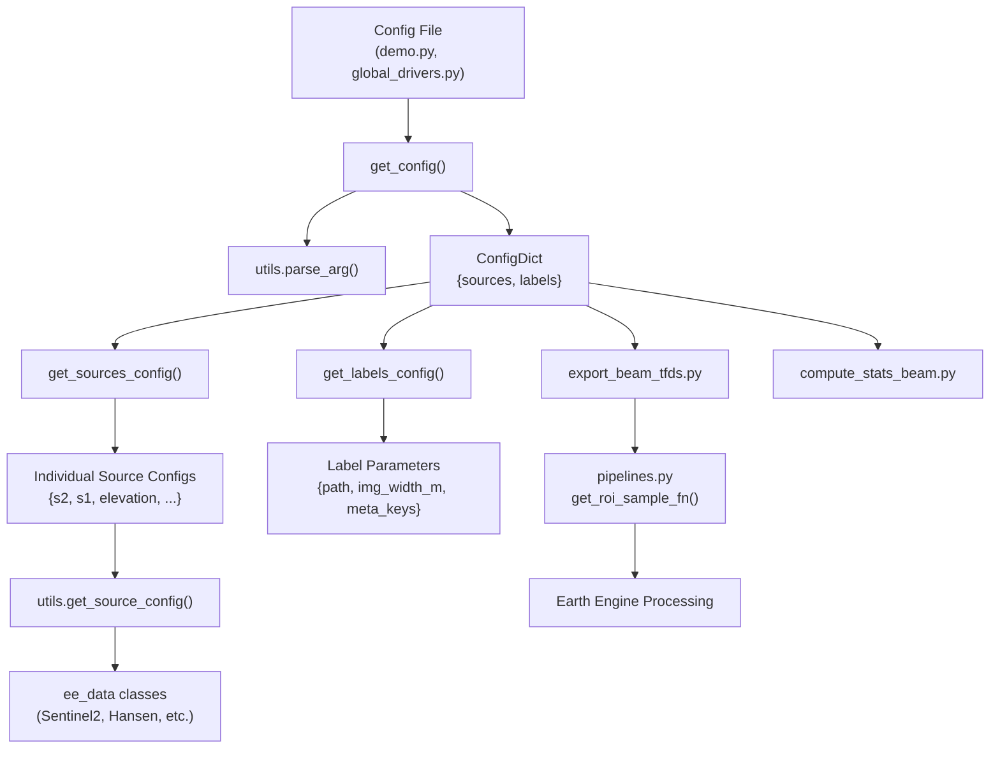
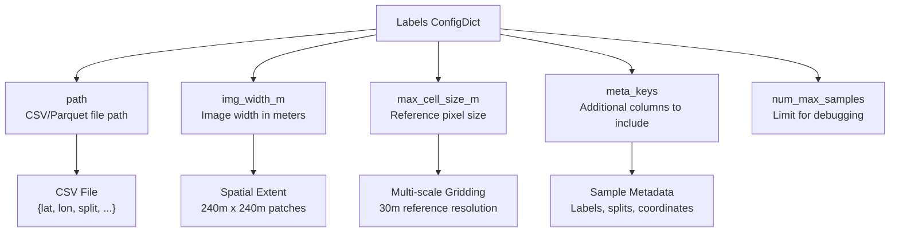
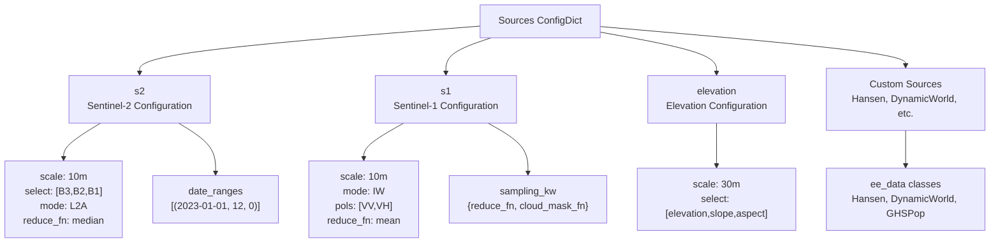
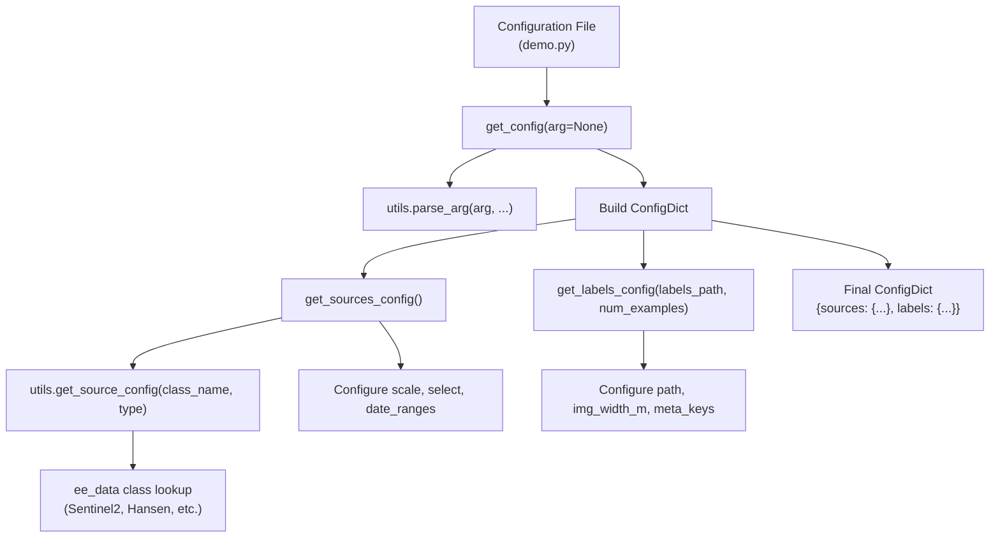
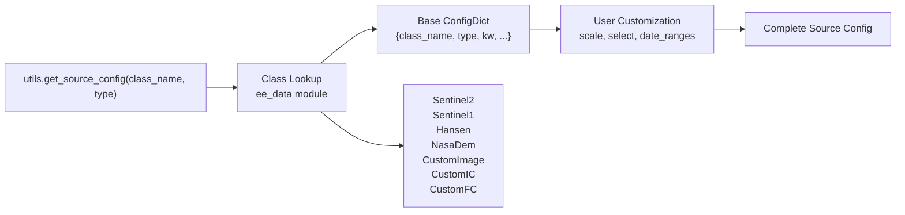
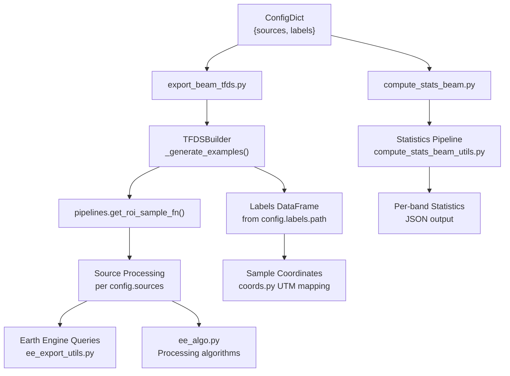
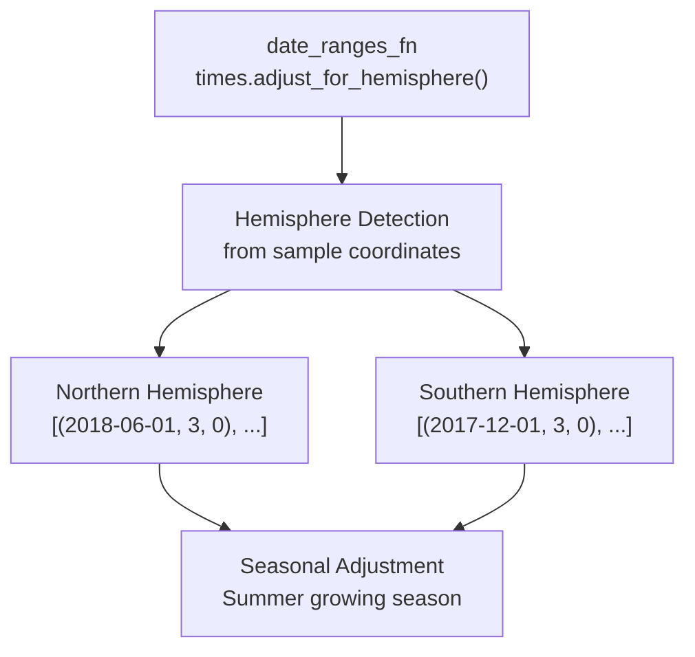
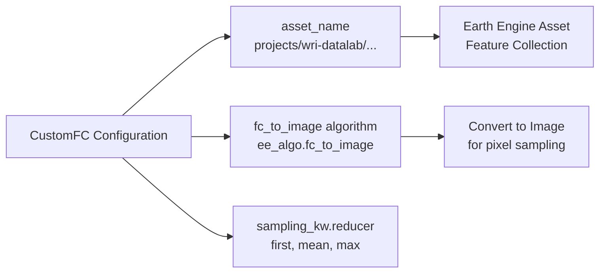

<!-- source: DeepWiki mcp.deepwiki.com · repo google-deepmind/geeflow · page 6 Configuration System · fetched 2026-10-26 -->

# Configuration System

Relevant source files

The following files were used as context for generating this wiki page:

- [README.md](README.md)
- [geeflow/configs/public/demo.py](geeflow/configs/public/demo.py)
- [geeflow/configs/public/global_drivers_1km_2022_v1.py](geeflow/configs/public/global_drivers_1km_2022_v1.py)

## Purpose and Scope

The Configuration System in GeoFlow provides a flexible and declarative way to specify dataset generation parameters using ML Collections ConfigDict files. This system defines what data sources to extract from Google Earth Engine, where to find label data, and how to process and structure the resulting datasets.

The configuration system is the primary interface for users to customize GeoFlow's behavior without modifying code. For information about the specific data sources available, see [Earth Engine Datasets](#5.1). For details on how configurations are processed into executable pipelines, see [Main Pipelines](#4).

## Configuration Architecture

The configuration system operates through Python configuration files that return structured `ConfigDict` objects. These configurations drive the entire dataset generation pipeline from data source specification to final TFDS output.

### Configuration Flow

Sources: [README.md:56-147](), [geeflow/configs/public/demo.py:66-71](), [geeflow/configs/public/global_drivers_1km_2022_v1.py:105-119]()

### Configuration Components

The configuration system consists of two main components that work together to define complete dataset specifications:

| Component | Purpose | Key Parameters |
|-----------|---------|----------------|
| **Labels Configuration** | Defines sample locations and metadata | `path`, `img_width_m`, `meta_keys`, `max_cell_size_m` |
| **Sources Configuration** | Specifies Earth Engine data sources | `scale`, `select`, `date_ranges`, `sampling_kw` |

Sources: [README.md:65-147]()

## Configuration Structure

### Labels Configuration

The labels configuration specifies where to find sample locations and how to structure the resulting dataset. It requires a CSV or Parquet file with location data and defines the spatial extent and metadata for each sample.

Key configuration parameters:

- **`path`**: File path to CSV/Parquet with sample locations (`lat`, `lon` columns required)
- **`img_width_m`**: Image width and height in meters for UTM projected samples
- **`max_cell_size_m`**: Reference maximal pixel size for proper multi-scale gridding
- **`meta_keys`**: List of additional columns to include in dataset samples
- **`default_scale`**: Default resolution per pixel for all sources (can be overridden per source)

Sources: [README.md:65-83](), [geeflow/configs/public/demo.py:55-63](), [geeflow/configs/public/global_drivers_1km_2022_v1.py:86-102]()

### Sources Configuration

The sources configuration defines which Earth Engine datasets to extract and how to process them. Each source is configured independently with its own spatial, temporal, and spectral parameters.

Key source parameters:

- **`scale`**: Resolution per pixel in meters
- **`select`**: Which bands/channels to include, in order
- **`date_ranges`**: List of time ranges as (`start_date`, `months`, `days`) tuples
- **`sampling_kw`**: Keyword arguments for temporal aggregation (e.g., `reduce_fn`, `cloud_mask_fn`)
- **`kw`**: Additional parameters passed to the Earth Engine data class

Sources: [README.md:95-147](), [geeflow/configs/public/demo.py:30-52](), [geeflow/configs/public/global_drivers_1km_2022_v1.py:29-83]()

## Configuration Loading and Processing

### Configuration File Structure

Configuration files follow a standard pattern with three main functions that create modular, reusable configurations:

The standard configuration file pattern includes:

1. **`get_config(arg=None)`**: Main entry point that parses arguments and assembles the complete configuration
2. **`get_sources_config()`**: Builds the sources configuration with all Earth Engine data sources
3. **`get_labels_config(labels_path, ...)`**: Builds the labels configuration with location and metadata parameters

Sources: [geeflow/configs/public/demo.py:66-71](), [geeflow/configs/public/global_drivers_1km_2022_v1.py:105-119]()

### Source Configuration Factory

The `utils.get_source_config()` function provides a factory pattern for creating standardized source configurations:

This factory approach ensures consistent configuration structure while allowing flexible customization of individual source parameters.

Sources: [geeflow/configs/public/demo.py:34-51](), [geeflow/configs/public/global_drivers_1km_2022_v1.py:33-82]()

## Configuration Processing Pipeline

### From Configuration to Execution

The configuration system integrates with the main processing pipelines through a well-defined interface:

The configuration drives the entire pipeline execution by:

1. **Labels Processing**: Converting the labels file path into a pandas DataFrame of sample locations
2. **Source Processing**: Creating processing functions for each configured Earth Engine source
3. **Coordinate Mapping**: Using the spatial parameters for UTM grid mapping
4. **Algorithm Selection**: Choosing appropriate Earth Engine algorithms based on source configuration

Sources: [README.md:161-176]()

## Advanced Configuration Patterns

### Dynamic Date Ranges

Advanced configurations can use functions to generate dynamic date ranges based on geographic location:

This pattern allows for sophisticated temporal sampling that adapts to geographic and seasonal variations.

Sources: [geeflow/configs/public/global_drivers_1km_2022_v1.py:64-67]()

### Custom Feature Collections

For specialized datasets, configurations can reference custom Earth Engine assets:

This enables integration of custom datasets and research-specific feature collections into the standardized processing pipeline.

Sources: [geeflow/configs/public/global_drivers_1km_2022_v1.py:33-40](), [geeflow/configs/public/global_drivers_1km_2022_v1.py:50-55]()

---

