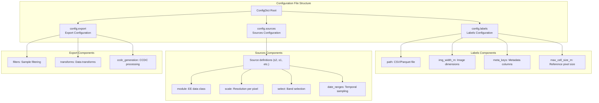
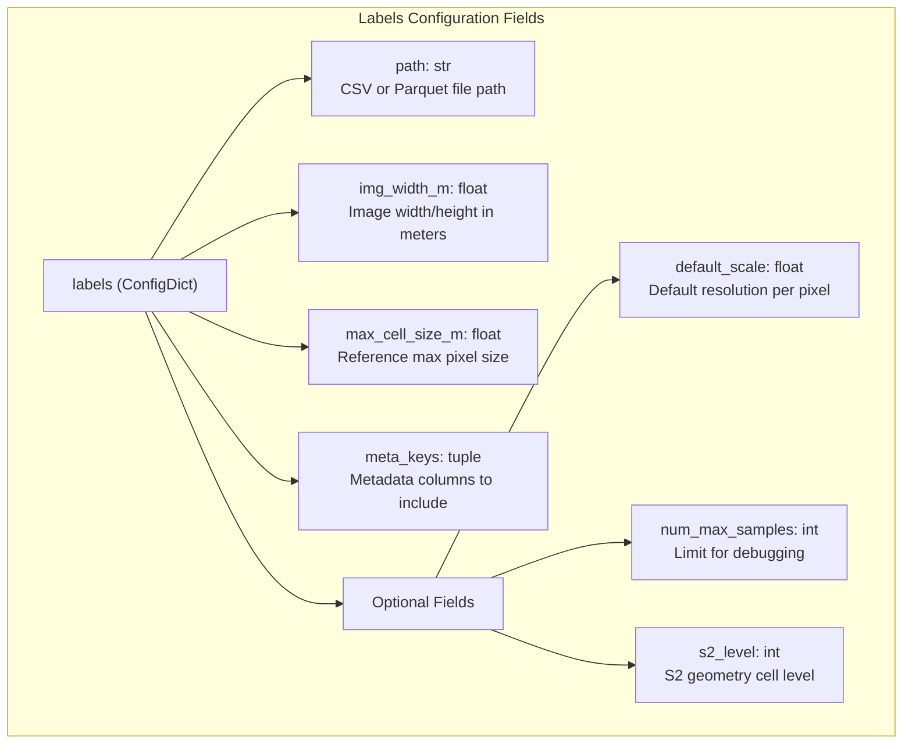
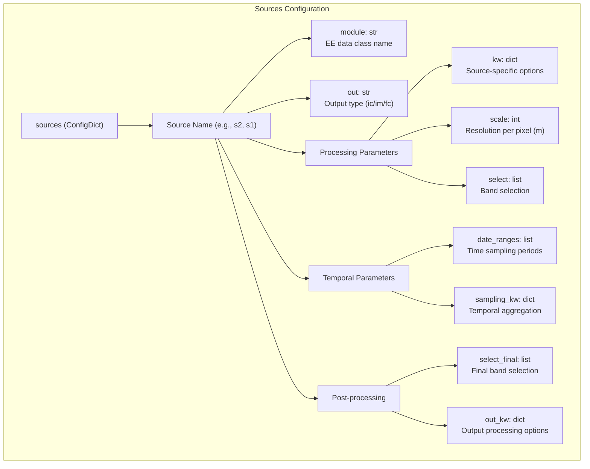
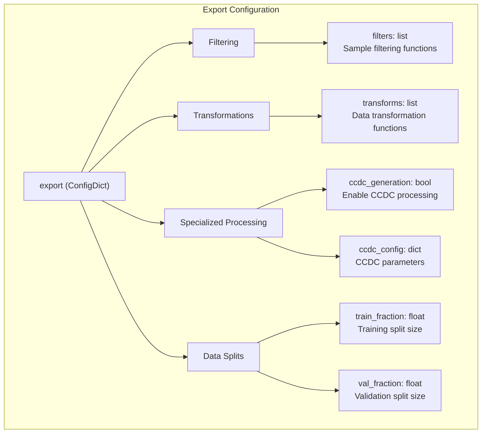
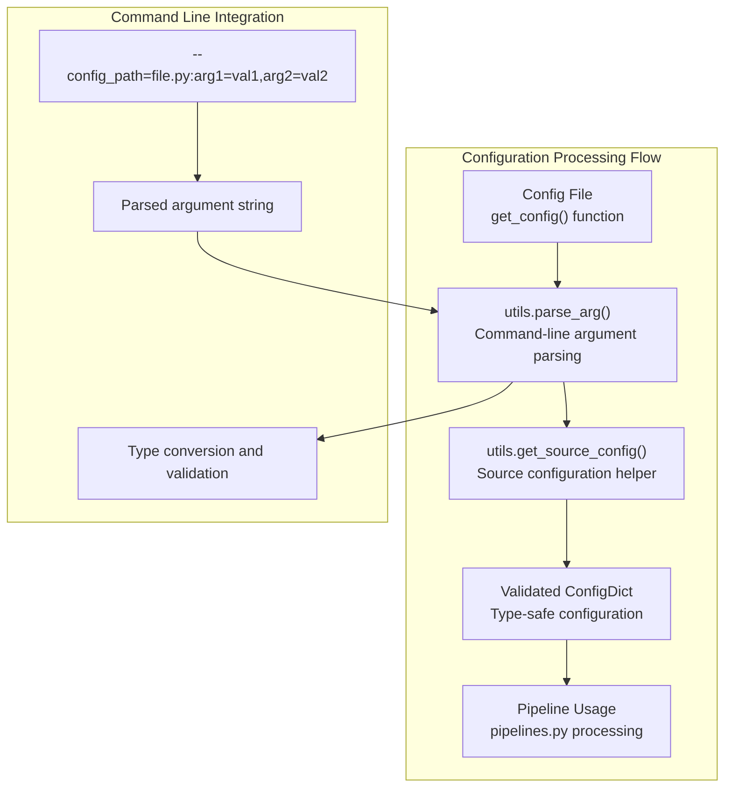
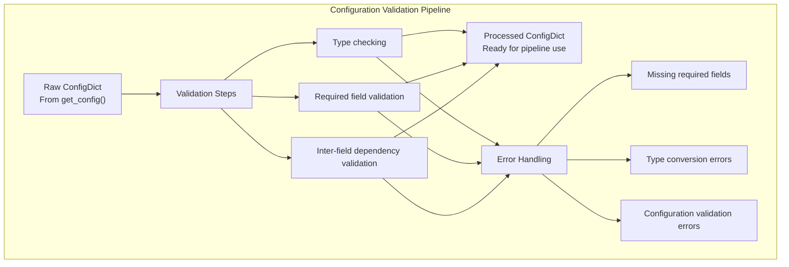

<!-- source: DeepWiki mcp.deepwiki.com · repo google-deepmind/geeflow · page 6.1 Configuration Structure · fetched 2026-10-26 -->

# Configuration Structure

<details>
<summary>Relevant source files</summary>

The following files were used as context for generating this wiki page:

- [README.md](README.md)
- [geeflow/utils.py](geeflow/utils.py)

</details>


This document describes the detailed structure of GeoFlow's configuration system, including the format and organization of configuration files using ML Collections ConfigDict. This covers the labels configuration, sources configuration, and export configuration sections that control dataset generation behavior.

For examples of complete configurations, see [Example Configurations](#6.2). For information about Earth Engine datasets referenced in source configurations, see [Earth Engine Datasets](#5.1).

## Configuration Format Overview

GeoFlow uses [ML Collections ConfigDict](https://github.com/google/ml_collections) as the foundation for all configuration files. Configuration files are Python scripts that define a `get_config()` function returning a structured ConfigDict with three main sections:

| Section | Purpose | Required |
|---------|---------|----------|
| `labels` | Defines input data locations, image dimensions, and metadata | Yes |
| `sources` | Specifies Earth Engine data sources and processing parameters | Yes |
| `export` | Controls filtering, transformations, and export behavior | Optional |



Sources: [README.md:56-147](), [geeflow/utils.py:216-227]()

## Labels Configuration Structure

The labels configuration defines the input sample locations and image specifications. This section is mandatory and controls how the spatial sampling grid is constructed:



### Core Labels Fields

| Field | Type | Purpose | Example |
|-------|------|---------|---------|
| `path` | str | Path to CSV/Parquet file with sample locations | `"data/demo_labels.csv"` |
| `img_width_m` | float | Image width and height in meters | `240` |
| `max_cell_size_m` | float | Reference maximal pixel size for gridding | `30` |
| `meta_keys` | tuple | Column names to include as metadata | `("lat", "lon", "split")` |

### Optional Labels Fields

| Field | Type | Purpose | Default |
|-------|------|---------|---------|
| `default_scale` | float | Default resolution when source doesn't specify | Based on `max_cell_size_m` |
| `num_max_samples` | int | Maximum samples for debugging | Unlimited |
| `s2_level` | int | S2 geometry level for geographic splitting | Auto-calculated |

Sources: [README.md:64-93]()

## Sources Configuration Structure

The sources configuration defines Earth Engine data sources and their processing parameters. Each source is configured as a separate ConfigDict entry:



### Source Definition Fields

Each source in the `sources` ConfigDict contains these fields:

| Field | Type | Purpose | Required |
|-------|------|---------|----------|
| `module` | str | Earth Engine data class name | Yes |
| `out` | str | Output type: "ic", "im", or "fc" | Yes |
| `kw` | dict | Source-specific initialization options | No |
| `scale` | int | Resolution per pixel in meters | Recommended |
| `select` | list | Bands to extract in specified order | No |
| `date_ranges` | list | Temporal sampling specifications | For image collections |
| `sampling_kw` | dict | Temporal aggregation parameters | For image collections |

### Date Ranges Format

The `date_ranges` field specifies temporal sampling as a list of tuples:
- Format: `(start_date, months, days)`
- `start_date`: ISO date string (e.g., "2023-01-01")
- `months`: Number of months to aggregate
- `days`: Additional days to aggregate

Sources: [README.md:95-141](), [geeflow/utils.py:216-227]()

## Export Configuration Structure

The export configuration is optional and controls data filtering, transformations, and specialized processing:



Sources: [geeflow/export_beam_tfds.py:1-200]()

## Configuration Parsing and Processing

The configuration system uses utilities from `utils.py` to parse and process configuration arguments:



### Configuration Argument Parsing

The `parse_arg()` function in `utils.py` provides flexible command-line argument parsing:

| Feature | Syntax | Example |
|---------|--------|---------|
| Named arguments | `key=value` | `labels_path=data/new.csv` |
| Boolean flags | `key` or `key=True/False` | `runlocal` or `runlocal=False` |
| Multiple arguments | `arg1=val1,arg2=val2` | `res=128,runlocal` |
| Type conversion | Auto-detected from defaults | String to int/float/bool |

### Source Configuration Helper

The `get_source_config()` function creates standardized source configurations:

```python
# Returns ConfigDict with default structure:
{
    'module': module_name,
    'out': output_type,
    'kw': {},
    'out_kw': {},
    'select': None,
    'select_final': None, 
    'sampling_kw': {},
    'scale': None
}
```

Sources: [geeflow/utils.py:108-181](), [geeflow/utils.py:216-227]()

## Configuration Validation and Processing

The configuration system performs validation and type checking during processing:



### Common Validation Rules

| Component | Validation Rules |
|-----------|------------------|
| Labels | `path` must exist, `img_width_m` > 0, `meta_keys` must be tuple |
| Sources | `module` must be valid EE class, `scale` must be positive integer |
| Export | Filter functions must be callable, transform functions must be valid |

Sources: [geeflow/utils.py:108-214](), [geeflow/pipelines.py:1-100]()

---

