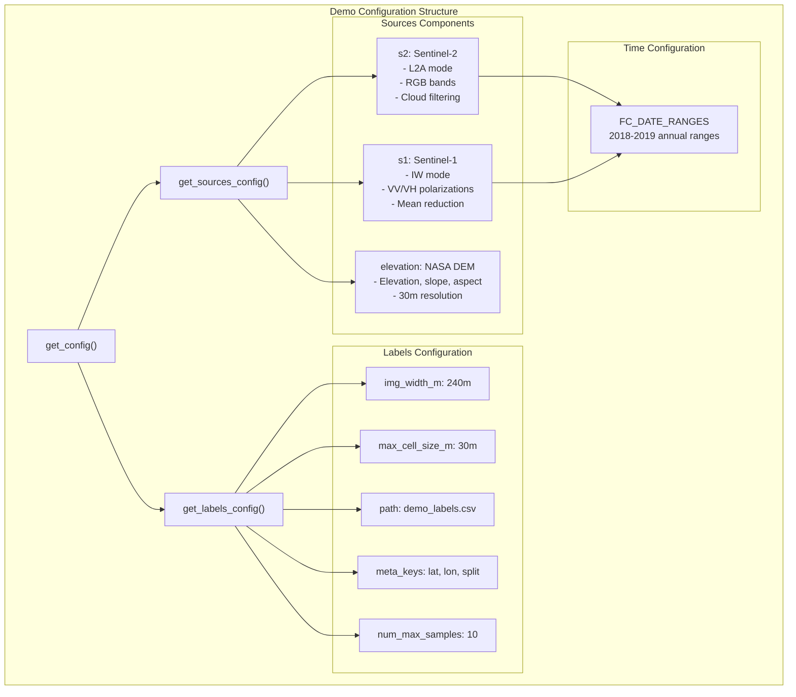
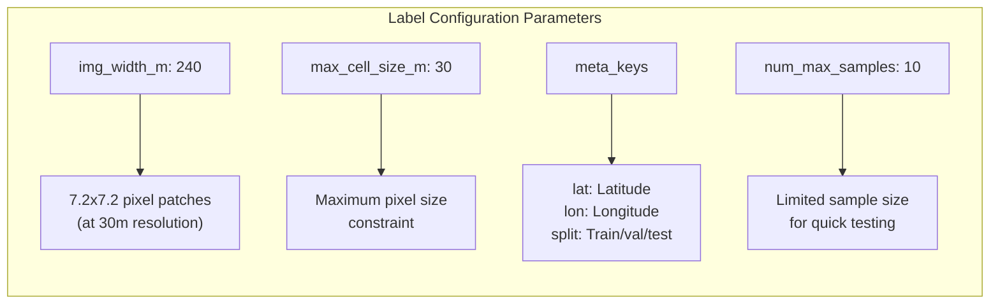
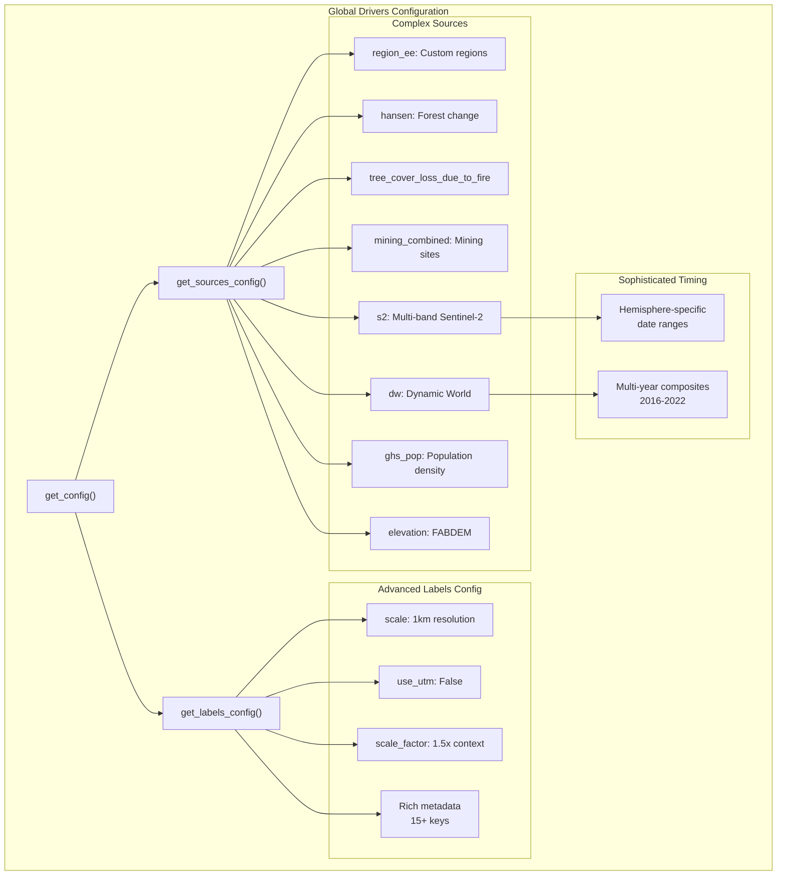
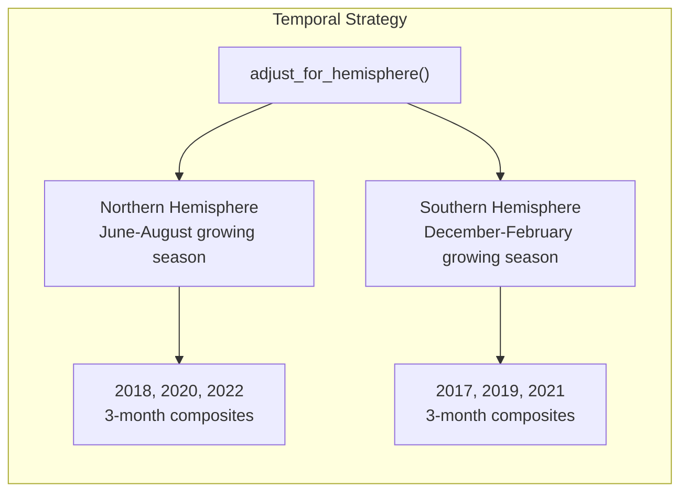
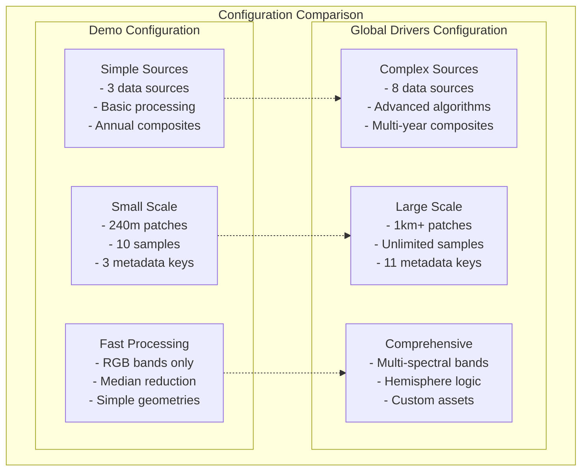

<!-- source: DeepWiki mcp.deepwiki.com · repo google-deepmind/geeflow · page 6.2 Example Configurations · fetched 2026-10-26 -->

# Example Configurations

<details>
<summary>Relevant source files</summary>

The following files were used as context for generating this wiki page:

- [geeflow/configs/public/demo.py](geeflow/configs/public/demo.py)
- [geeflow/configs/public/global_drivers_1km_2022_v1.py](geeflow/configs/public/global_drivers_1km_2022_v1.py)

</details>


This page provides detailed walkthroughs of the example configurations included with GeoFlow, demonstrating how to configure different types of geospatial data extraction workflows. These examples serve as templates for creating custom configurations tailored to specific research needs.

For information about the overall configuration structure and format, see [Configuration Structure](#6.1). For details about the underlying data sources and processing algorithms, see [Earth Engine Datasets](#5.1) and [Data Processing Algorithms](#5.2).

## Configuration Overview

GeoFlow includes two primary example configurations that demonstrate different use cases:

| Configuration | Purpose | Scale | Complexity | Use Case |
|--------------|---------|-------|------------|----------|
| `demo.py` | Development and testing | Small (240m patches) | Simple | Quick prototyping |
| `global_drivers_1km_2022_v1.py` | Production research | Large (1km+ patches) | Complex | Forest drivers analysis |

## Demo Configuration Structure

The demo configuration [geeflow/configs/public/demo.py]() provides a simplified setup for development and testing purposes.



Sources: [geeflow/configs/public/demo.py:26-72]()

### Demo Sources Configuration

The demo configuration defines three key data sources with optimized settings for quick processing:

**Sentinel-2 Configuration**
- **Mode**: L2A (atmospherically corrected)
- **Bands**: RGB only (`B3`, `B2`, `B1`) for visual inspection
- **Cloud filtering**: 50% cloud coverage threshold with Cloud Score+ masking
- **Temporal reduction**: Median composite over annual periods
- **Resolution**: 10m native resolution

[geeflow/configs/public/demo.py:34-41]()

**Sentinel-1 Configuration**
- **Mode**: Interferometric Wide swath (IW)
- **Polarizations**: Both VV and VH
- **Orbit**: Both ascending and descending
- **Temporal reduction**: Mean composite
- **Resolution**: 10m resolution

[geeflow/configs/public/demo.py:43-47]()

**Elevation Configuration**
- **Source**: NASA DEM
- **Variables**: Elevation, slope, and aspect
- **Resolution**: 30m native resolution
- **Processing**: Static layer (no temporal dimension)

[geeflow/configs/public/demo.py:49-52]()

### Demo Labels Configuration

The labels configuration defines the spatial extent and metadata structure:



Sources: [geeflow/configs/public/demo.py:55-63]()

## Global Drivers Configuration Structure

The global drivers configuration [geeflow/configs/public/global_drivers_1km_2022_v1.py]() demonstrates a production-scale setup for analyzing forest loss drivers globally.



Sources: [geeflow/configs/public/global_drivers_1km_2022_v1.py:29-119]()

### Global Drivers Sources Configuration

The production configuration includes eight distinct data sources, each optimized for forest drivers analysis:

**Hansen Forest Change Data**
- **Dataset**: Hansen Global Forest Change v1.10 (2022)
- **Purpose**: Primary forest loss detection
- **Resolution**: 1km (aggregated from 30m)
- **Coverage**: Global, annual updates

[geeflow/configs/public/global_drivers_1km_2022_v1.py:42-44]()

**Custom Region Boundaries**
- **Source**: Custom FeatureCollection asset
- **Purpose**: Regional stratification for analysis  
- **Processing**: Feature collection to image conversion using `fc_to_image`
- **Reducer**: First value within each pixel

[geeflow/configs/public/global_drivers_1km_2022_v1.py:33-40]()

**Advanced Sentinel-2 Configuration**
- **Bands**: Five carefully selected bands (`B3`, `B4`, `B5`, `B7`, `B12`)
- **Mode**: L1C (top-of-atmosphere) for consistent global coverage
- **Temporal Strategy**: Hemisphere-specific date ranges for optimal seasonal coverage
- **Cloud Handling**: Cloud Score+ masking with mean temporal reduction

[geeflow/configs/public/global_drivers_1km_2022_v1.py:57-67]()

### Hemisphere-Specific Date Ranges

The configuration implements sophisticated temporal logic to account for seasonal differences between hemispheres:



Sources: [geeflow/configs/public/global_drivers_1km_2022_v1.py:64-67]()

### Rich Metadata Configuration

The global drivers configuration includes extensive metadata capture for comprehensive analysis:

| Metadata Key | Purpose | Type |
|-------------|---------|------|
| `lat`, `lon` | Geographic coordinates | Float |
| `label_7`, `split` | Classification labels | String/Integer |
| `confidence` | Label confidence score | Float |
| `hansen_year` | Year of forest loss | Integer |
| `hansen_year_deforestation_ratio` | Loss intensity | Float |
| `original_id`, `region` | Traceability | String |

Sources: [geeflow/configs/public/global_drivers_1km_2022_v1.py:96-101]()

## Configuration Comparison

The two configurations demonstrate different approaches to the same underlying system:



Sources: [geeflow/configs/public/demo.py:26-72](), [geeflow/configs/public/global_drivers_1km_2022_v1.py:29-119]()

## Configuration Usage Patterns

Both configurations follow the same structural pattern using `ml_collections.ConfigDict`:

1. **Main Configuration Function**: `get_config()` serves as the entry point
2. **Modular Components**: Separate functions for sources and labels configuration
3. **Argument Parsing**: Integration with `utils.parse_arg()` for command-line flexibility
4. **Parameterization**: Key parameters exposed as function arguments

The configurations can be used directly with the main pipelines:

```bash
# Demo configuration
python -m geeflow.export_beam_tfds --config_module=geeflow.configs.public.demo

# Global drivers configuration  
python -m geeflow.export_beam_tfds --config_module=geeflow.configs.public.global_drivers_1km_2022_v1
```

Sources: [geeflow/configs/public/demo.py:66-71](), [geeflow/configs/public/global_drivers_1km_2022_v1.py:105-119]()

---

