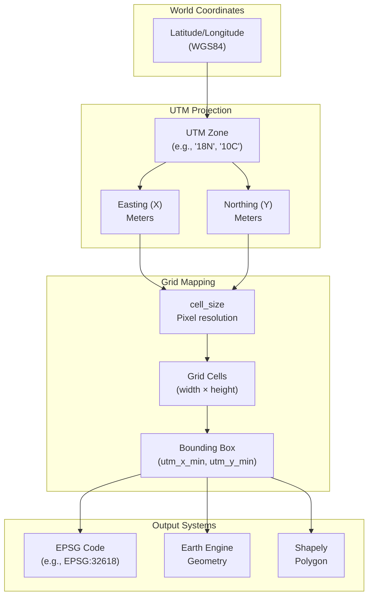
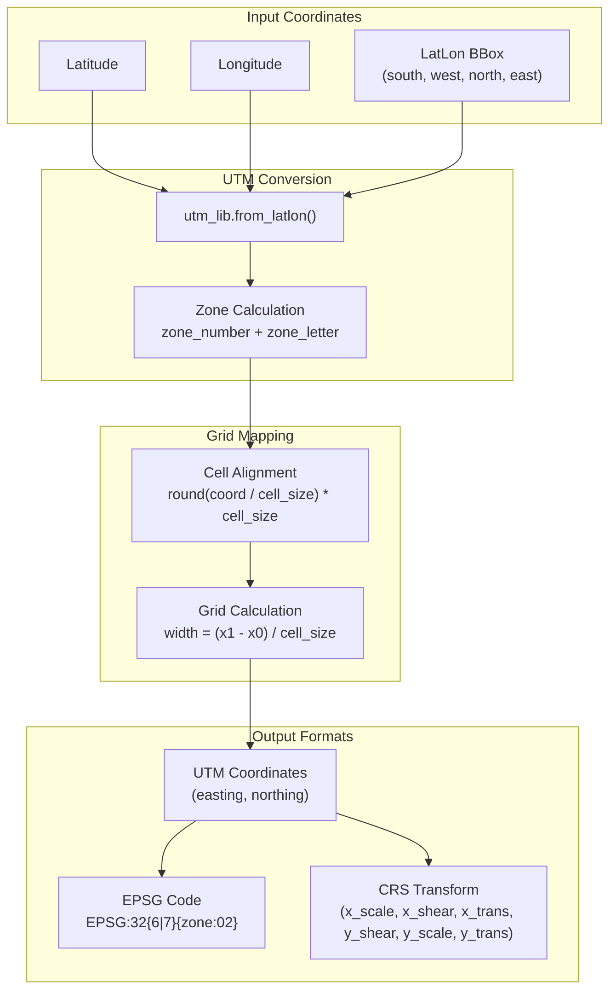
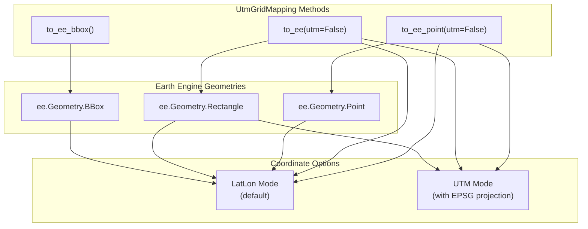
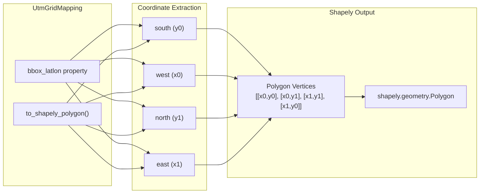
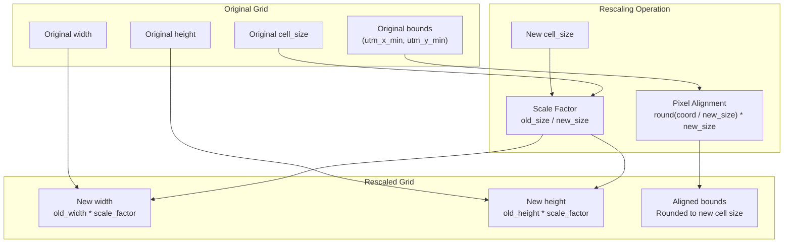
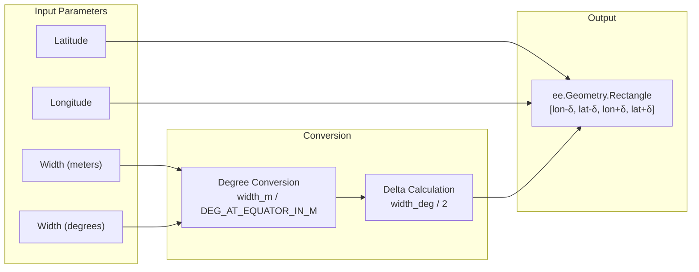

<!-- source: DeepWiki mcp.deepwiki.com · repo google-deepmind/geeflow · page 7 Coordinate Systems and Geometry · fetched 2026-10-26 -->

# Coordinate Systems and Geometry

<details>
<summary>Relevant source files</summary>

The following files were used as context for generating this wiki page:

- [geeflow/coords.py](geeflow/coords.py)
- [geeflow/coords_test.py](geeflow/coords_test.py)
- [geeflow/ee_data_test.py](geeflow/ee_data_test.py)

</details>


This document explains the coordinate systems and geometric operations used throughout GeoFlow. The primary focus is on the Universal Transverse Mercator (UTM) grid mapping system implemented in the `UtmGridMapping` class, which handles coordinate transformations, spatial projections, and integration with Google Earth Engine geometries.

For information about Earth Engine datasets and their spatial properties, see [Earth Engine Datasets](#5.1). For details about data processing algorithms that use these coordinate systems, see [Data Processing Algorithms](#5.2).

## UTM Grid System Overview

GeoFlow uses the Universal Transverse Mercator (UTM) coordinate system as its primary spatial reference system. UTM divides the Earth into 60 longitudinal zones, each 6 degrees wide, with separate projections for northern and southern hemispheres.

**UTM Grid System Architecture**



Sources: [geeflow/coords.py:40-172]()

## UtmGridMapping Class

The `UtmGridMapping` class is the core component for handling coordinate transformations and spatial projections in GeoFlow. It manages the conversion between world coordinates (latitude/longitude) and projected pixel coordinates in UTM space.

**UtmGridMapping Class Structure**

```mermaid
classDiagram
    class UtmGridMapping {
        +str utm_zone
        +float cell_size
        +int|ndarray width
        +int|ndarray height
        +float utm_x_min
        +float utm_y_min
        
        +from_bbox(utm_zone, cell_size, bbox) UtmGridMapping
        +from_latlon_center(lat, lon, cell_size, width, height) UtmGridMapping
        +rescale(cell_size) UtmGridMapping
        
        +grid_cell_size() float
        +epsg() str
        +crs() tuple
        +centroid() tuple
        +centroid_latlon() tuple
        +bbox() tuple
        +bbox_latlon() tuple
        
        +to_ee_point(utm) ee.geometry.Geometry
        +to_ee(utm) ee.Geometry
        +to_ee_bbox() ee.Geometry
        +to_shapely_polygon() shapely.geometry.Polygon
    }
    
    class "External Libraries" {
        <<interface>>
        utm_lib
        ee
        shapely.geometry
        numpy
    }
    
    UtmGridMapping --> "External Libraries"
```

The class provides three main construction methods:

| Method | Purpose | Parameters |
|--------|---------|------------|
| `from_bbox` | Create from UTM bounding box | `utm_zone`, `cell_size`, `bbox` |
| `from_latlon_center` | Create from lat/lon center point | `lat`, `lon`, `cell_size`, `width`, `height` |
| Direct constructor | Create with explicit UTM parameters | All UTM parameters directly |

Sources: [geeflow/coords.py:39-76]()

## Coordinate Transformations

The coordinate transformation system handles conversions between different spatial reference systems used throughout GeoFlow's processing pipeline.

**Coordinate Transformation Flow**



### EPSG Code Generation

The system automatically generates EPSG codes based on UTM zone information:

```python
# Northern hemisphere: EPSG:326XX
# Southern hemisphere: EPSG:327XX
# Where XX is the zero-padded zone number
```

The logic implemented in `epsg` property:
- Northern hemisphere zones (N-Z): EPSG:326XX
- Southern hemisphere zones (A-M): EPSG:327XX

Sources: [geeflow/coords.py:83-86](), [geeflow/coords.py:72-76](), [geeflow/coords.py:89-97]()

## Earth Engine Integration

GeoFlow integrates UTM grid mappings with Google Earth Engine geometry objects for spatial queries and data extraction.

**Earth Engine Geometry Integration**



### Geometry Conversion Methods

| Method | Output Type | Coordinate System | Usage |
|--------|-------------|-------------------|-------|
| `to_ee_point(utm=False)` | `ee.Geometry.Point` | LatLon or UTM | Point-based queries |
| `to_ee(utm=False)` | `ee.Geometry.Rectangle` | LatLon or UTM | Area-based queries |
| `to_ee_bbox()` | `ee.Geometry.BBox` | LatLon only | Bounding box queries |

Sources: [geeflow/coords.py:147-171]()

## Geometric Operations

The system provides integration with Shapely for advanced geometric operations and spatial analysis.

**Shapely Integration**



### Bounding Box Calculations

The system provides multiple bounding box representations:

| Property | Coordinate System | Format | Usage |
|----------|-------------------|--------|-------|
| `bbox` | UTM | `(x0, y0, x1, y1)` | UTM-based calculations |
| `bbox_latlon` | LatLon | `(south, west, north, east)` | Geographic queries |
| `centroid` | UTM | `(x, y)` | UTM center point |
| `centroid_latlon` | LatLon | `(lat, lon)` | Geographic center point |

Sources: [geeflow/coords.py:112-134](), [geeflow/coords.py:168-171]()

## Grid Rescaling and Pixel Alignment

The `UtmGridMapping` class supports rescaling operations to change pixel resolution while maintaining spatial alignment.

**Grid Rescaling Process**



The `rescale` method ensures that:
- New grid dimensions are calculated proportionally
- Pixel boundaries remain aligned to the new cell size
- UTM coordinates are rounded to maintain grid consistency

Sources: [geeflow/coords.py:136-145](), [geeflow/coords.py:54-56]()

## Utility Functions

The coordinate system includes utility functions for common spatial operations.

### Region of Interest (ROI) Generation

The `get_lat_lon_roi` function creates Earth Engine geometry objects for spatial queries:

```python
def get_lat_lon_roi(lat, lon, width_m=None, width_deg=None):
    # Creates ee.Geometry.Rectangle centered on lat/lon
    # with specified width in meters or degrees
```

**ROI Generation Process**



The constant `DEG_AT_EQUATOR_IN_M = 111_111.111` represents the approximate meters per degree at the equator.

Sources: [geeflow/coords.py:31-36](), [geeflow/coords.py:28]()

---

