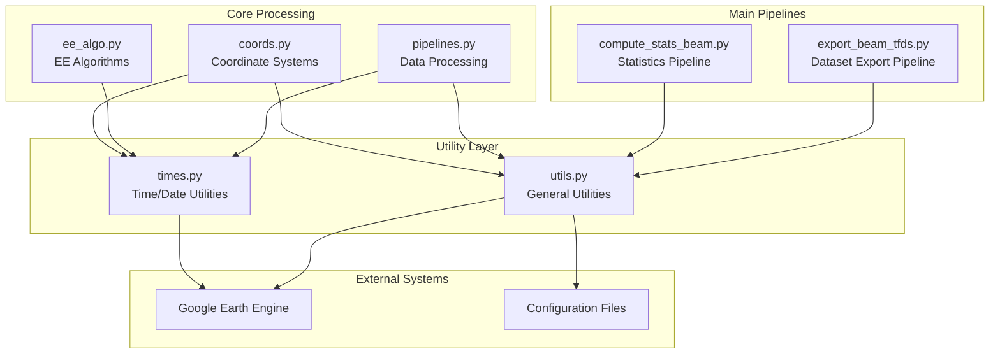
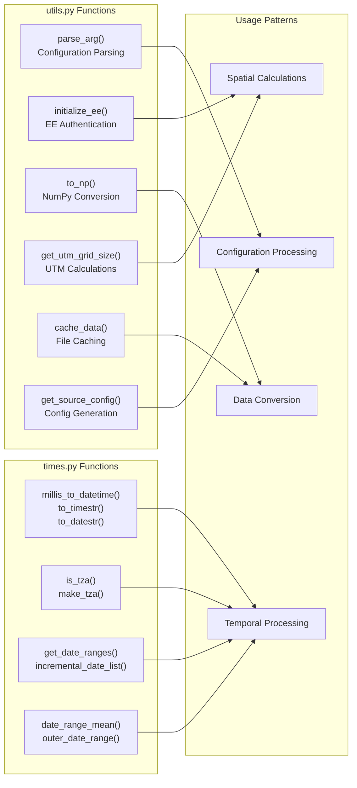
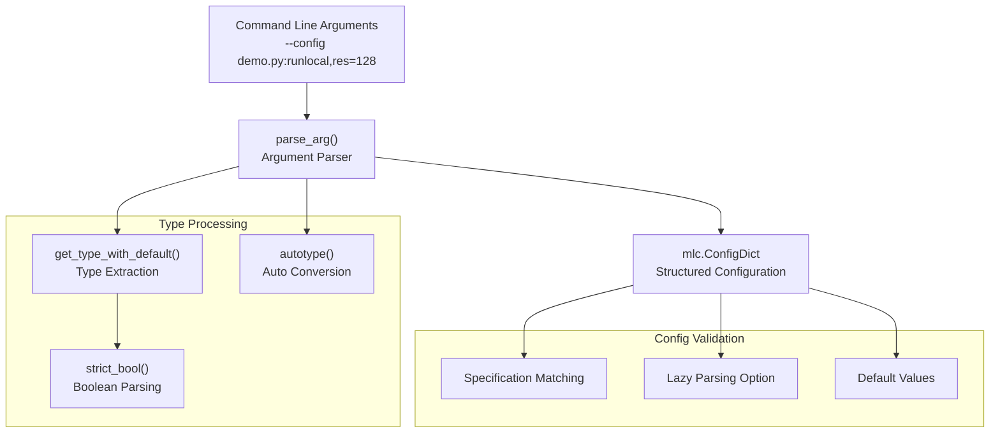
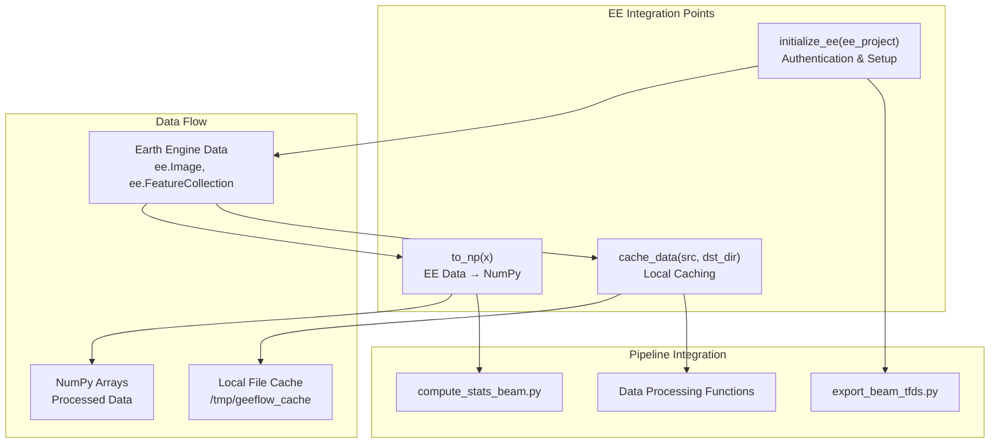
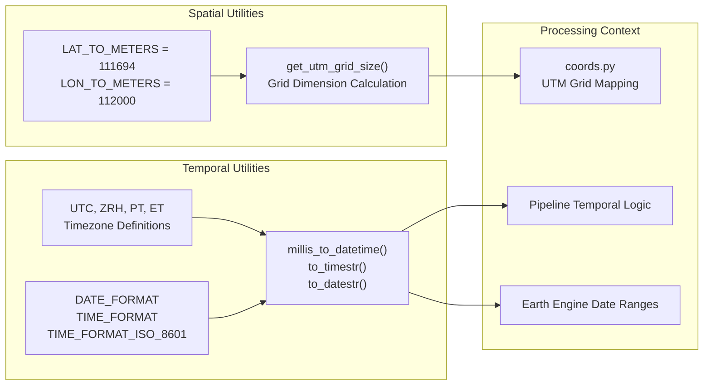

<!-- source: DeepWiki mcp.deepwiki.com · repo google-deepmind/geeflow · page 8 Utilities and Helpers · fetched 2026-10-26 -->

# Utilities and Helpers

Relevant source files

The following files were used as context for generating this wiki page:

- [geeflow/times.py](geeflow/times.py)
- [geeflow/utils.py](geeflow/utils.py)

This document provides an overview of the utility modules that support GeoFlow's core functionality. The utilities are organized into two main categories: general-purpose utilities for configuration, data conversion, and Earth Engine integration, and specialized time/date handling utilities for temporal data processing.

For detailed information about time and date utilities, see [Time and Date Utilities](#8.1). For detailed information about general utilities, see [General Utilities](#8.2).

## Purpose and Integration

The utility modules in GeoFlow serve as foundational support layers for the main processing pipelines and data handling operations. They provide essential services including Earth Engine initialization, configuration argument parsing, coordinate system calculations, data type conversions, and comprehensive time/date management.

### System Integration Overview

Sources: [geeflow/utils.py:1-228](), [geeflow/times.py:1-145]()

## Core Utility Categories

GeoFlow's utilities are organized into several functional categories that address different aspects of the system's requirements:

| Category | Module | Primary Functions | Usage Context |
|----------|--------|------------------|---------------|
| Configuration | `utils.py` | Argument parsing, type conversion | Pipeline initialization, config processing |
| Earth Engine | `utils.py` | EE initialization, authentication | All EE-dependent operations |
| Data Conversion | `utils.py` | NumPy conversion, type handling | Data processing, statistics |
| Coordinate Math | `utils.py` | UTM grid calculations | Spatial processing, coordinate systems |
| File Operations | `utils.py` | Caching, copying | Data management, temporary storage |
| Time Processing | `times.py` | Date parsing, timezone handling | Temporal data processing |
| Date Ranges | `times.py` | Range generation, calculations | Time series analysis |

### Function Distribution and Dependencies

Sources: [geeflow/utils.py:35-53](), [geeflow/utils.py:56-61](), [geeflow/utils.py:63-75](), [geeflow/times.py:41-48](), [geeflow/times.py:79-91]()

## Configuration and Type System Support

The utilities provide sophisticated support for configuration management and type conversion, particularly through the `parse_arg` function which enables flexible command-line argument parsing for ML Collections ConfigDict objects.

### Configuration Argument Flow

Sources: [geeflow/utils.py:108-181](), [geeflow/utils.py:184-201](), [geeflow/utils.py:203-214]()

## Earth Engine Integration Utilities

The utilities provide essential Earth Engine integration capabilities, including authentication, initialization, and data conversion functions that ensure seamless interaction with Google Earth Engine services.

### Earth Engine Utility Functions

Sources: [geeflow/utils.py:56-61](), [geeflow/utils.py:63-75](), [geeflow/utils.py:77-106]()

## Spatial and Temporal Calculation Support

The utilities provide critical mathematical functions for spatial coordinate calculations and comprehensive temporal data handling, supporting GeoFlow's geospatial processing requirements.

### Coordinate and Time Calculation Integration

Sources: [geeflow/utils.py:31-33](), [geeflow/utils.py:35-53](), [geeflow/times.py:31-38](), [geeflow/times.py:41-55]()

## Usage Patterns and Integration Points

The utility modules are designed to be imported and used throughout the GeoFlow codebase, providing consistent interfaces for common operations. They serve as the foundation layer that enables higher-level components to focus on their specific domain logic.

Key integration patterns include:
- **Configuration Processing**: `parse_arg` enables flexible command-line configuration for all pipeline scripts
- **Earth Engine Setup**: `initialize_ee` provides standardized EE authentication across all EE-dependent modules  
- **Data Type Management**: `to_np` ensures consistent NumPy array handling for statistics and processing
- **Temporal Consistency**: Timezone-aware datetime handling ensures accurate temporal data processing
- **Spatial Calculations**: UTM grid size calculations support the coordinate system mapping functionality

Sources: [geeflow/utils.py:1-228](), [geeflow/times.py:1-145]()

---

