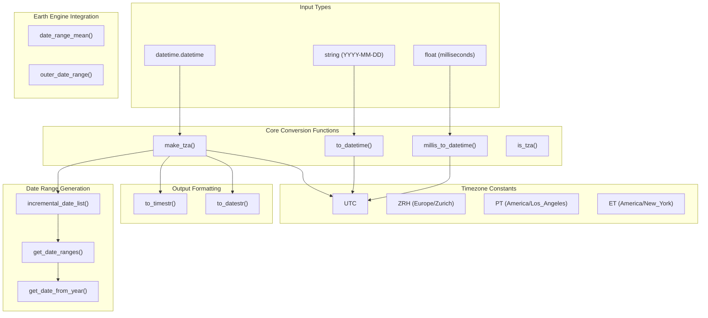
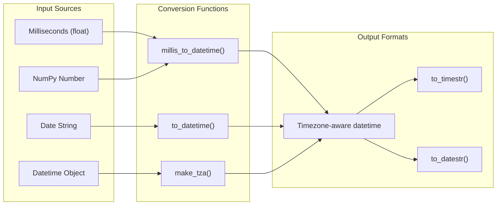
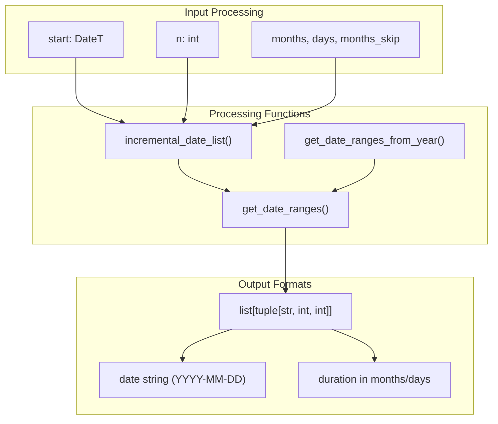
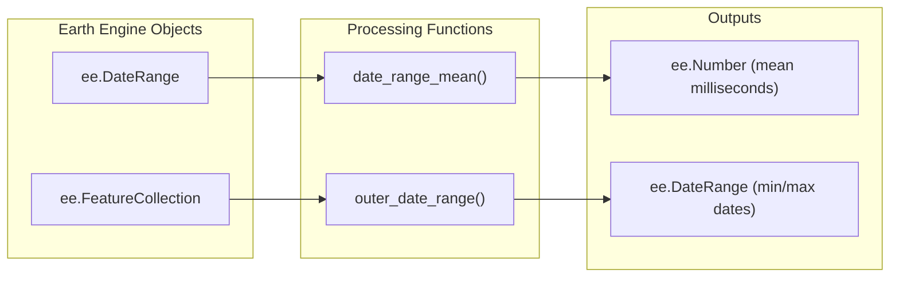

<!-- source: DeepWiki mcp.deepwiki.com · repo google-deepmind/geeflow · page 8.1 Time and Date Utilities · fetched 2026-10-26 -->

# Time and Date Utilities

<details>
<summary>Relevant source files</summary>

The following files were used as context for generating this wiki page:

- [geeflow/times.py](geeflow/times.py)
- [geeflow/times_test.py](geeflow/times_test.py)

</details>


This document covers the time and date handling utilities provided by GeoFlow. These utilities ensure consistent timezone-aware date handling throughout the system, provide date range generation for temporal data processing, and integrate with Google Earth Engine's date handling requirements.

For information about coordinate system utilities, see [Coordinate Systems and Geometry](#7). For general utilities including data conversion and Earth Engine initialization, see [General Utilities](#8.2).

## Purpose and Design Philosophy

The time utilities in GeoFlow follow a strict design philosophy: all dates and times must be timezone-aware, with UTC as the preferred timezone. This approach prevents timezone-related bugs and ensures consistent temporal data handling across distributed processing pipelines.

**Time Utilities System Architecture**



Sources: [geeflow/times.py:1-145]()

## Core Date and Time Handling

### Timezone Management

The system provides predefined timezone constants and functions to ensure all datetime objects are timezone-aware:

| Constant | Description | Usage |
|----------|-------------|-------|
| `UTC` | UTC timezone | Primary timezone for all operations |
| `ZRH` | Europe/Zurich | CEST (UTC+2) or CET (UTC+1) |
| `PT` | America/Los_Angeles | PDT (UTC-7) or PST (UTC-8) |
| `ET` | America/New_York | EDT (UTC-4) or EST (UTC-5) |

The `is_tza()` function checks if a datetime object is timezone-aware, while `make_tza()` converts naive datetime objects to timezone-aware ones using UTC as the default timezone.

Sources: [geeflow/times.py:31-34](), [geeflow/times.py:61-71]()

### Date Format Constants

The system defines standardized date and time formats:

- `TIME_FORMAT_ISO_8601`: ISO 8601 format with timezone information (`%Y-%m-%dT%H:%M:%S.%f%z`)
- `TIME_FORMAT`: Human-readable format with timezone string (`%Y-%m-%dT%H:%M:%S-%Z`)
- `DATE_FORMAT`: Simple date format (`%Y-%m-%d`)

Sources: [geeflow/times.py:36-38]()

### Type Conversion Functions

**Date Conversion Flow**



The `millis_to_datetime()` function converts millisecond timestamps to timezone-aware datetime objects in UTC. The `to_timestr()` and `to_datestr()` functions handle conversion from various input types (float, datetime, numpy numbers) to formatted strings.

Sources: [geeflow/times.py:41-55]()

## Date Range Generation

### Incremental Date Lists

The `incremental_date_list()` function generates sequences of dates with specified increments in years, months, or days. This is essential for temporal data processing where regular time intervals are needed.

```python
# Example usage patterns:
# Quarterly intervals: incremental_date_list(start="2020-01-01", n=4, months=3)
# Monthly intervals: incremental_date_list(start=datetime.now(), n=12, months=1)
# Daily intervals: incremental_date_list(start=timestamp_millis, n=30, days=1)
```

The function accepts multiple input types (`DateT = float | datetime.datetime | str`) and always returns timezone-aware datetime objects.

Sources: [geeflow/times.py:79-91]()

### Date Range Utilities

**Date Range Generation Pipeline**



The `get_date_ranges()` function builds on `incremental_date_list()` to create lists of date ranges with associated durations. The `get_date_ranges_from_year()` function provides a convenient interface for generating ranges starting from a specific year or date key in data dictionaries.

Sources: [geeflow/times.py:93-110]()

### Hemisphere-Aware Date Adjustment

The `adjust_for_hemisphere()` function allows for different date handling based on latitude, enabling seasonal adjustments for data processing in different hemispheres:

```python
# Returns different values based on latitude:
# data["lat"] >= 0: returns north parameter
# data["lat"] < 0: returns south parameter
```

Sources: [geeflow/times.py:117-122]()

## Earth Engine Integration

### Earth Engine Date Range Operations

The system provides specialized functions for working with Google Earth Engine's date handling:

- `date_range_mean()`: Calculates the mean date from an Earth Engine DateRange as milliseconds
- `outer_date_range()`: Extracts the outer date range from a FeatureCollection containing date ranges

**Earth Engine Date Processing**



These functions are particularly useful in the data processing pipelines where Earth Engine date ranges need to be computed or extracted from feature collections.

Sources: [geeflow/times.py:134-145]()

## Utility Functions

### Date Range Analysis

The `outer_dates()` function finds the minimum and maximum dates from a list of date ranges, useful for determining the overall temporal extent of data:

```python
# Input: list of (start_date, duration_months) tuples
# Output: (min_date_str, max_date_str) or (min_datetime, max_datetime)
```

This function is commonly used in data export pipelines to determine the complete temporal coverage of requested data.

Sources: [geeflow/times.py:124-132]()

### Current Time Access

The `now()` function provides timezone-aware current time, defaulting to UTC:

```python
# Returns current time in UTC
current_utc = now()
# Returns current time in specified timezone  
current_local = now(tz=ZRH)
```

Sources: [geeflow/times.py:57-58]()

## Integration with Data Processing Pipelines

The time utilities integrate extensively with GeoFlow's main processing pipelines. The date range generation functions are used in configuration processing to create temporal sampling windows, while the timezone-aware datetime handling ensures consistent temporal data across distributed processing nodes.

The Earth Engine integration functions are specifically designed to work with the Earth Engine algorithms and data processing modules documented in [Data Processing Algorithms](#5.2) and [Earth Engine Datasets](#5.1).

Sources: [geeflow/times.py:1-145](), [geeflow/times_test.py:1-66]()

---

