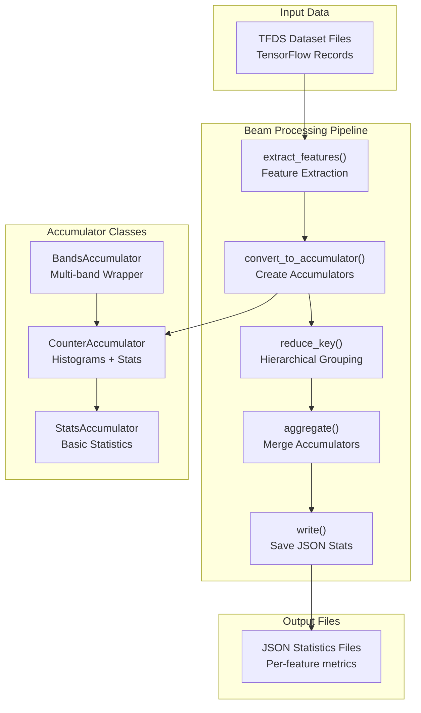
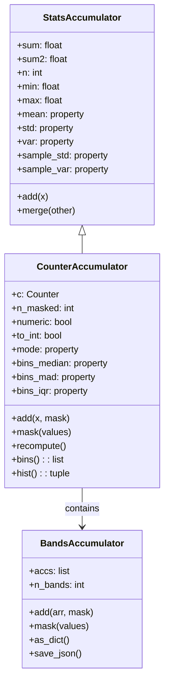
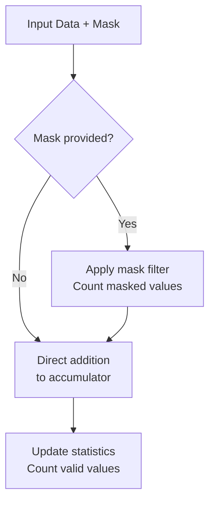

<!-- source: DeepWiki mcp.deepwiki.com · repo google-deepmind/geeflow · page 9 Statistics System · fetched 2026-10-26 -->

# Statistics System

<details>
<summary>Relevant source files</summary>

The following files were used as context for generating this wiki page:

- [geeflow/stats/compute_stats_beam_utils.py](geeflow/stats/compute_stats_beam_utils.py)
- [geeflow/stats/stats_util.py](geeflow/stats/stats_util.py)
- [geeflow/stats/stats_util_test.py](geeflow/stats/stats_util_test.py)

</details>


The Statistics System is a distributed computation framework for calculating comprehensive statistical metrics on generated geospatial datasets. It operates as a post-processing step after the main dataset export pipeline, analyzing TFDS datasets to produce detailed per-feature statistics that include both basic metrics (mean, std, min, max) and advanced statistical measures (histograms, quantiles, robust statistics).

This system is separate from the main data processing pipeline. For information about the primary dataset generation pipeline, see [Dataset Export Pipeline](#4.1).

## Overview

The statistics system consists of two main components: an Apache Beam processing pipeline and a collection of accumulator classes that track statistical measures incrementally. The system is designed to handle large-scale datasets efficiently through hierarchical aggregation and distributed processing.



Sources: [geeflow/stats/compute_stats_beam_utils.py:51-143](), [geeflow/stats/stats_util.py:38-506]()

## Processing Pipeline Architecture

The statistics computation uses an Apache Beam pipeline with hierarchical aggregation to efficiently process large datasets. The pipeline processes examples through multiple stages of grouping and reduction to avoid memory bottlenecks.

```mermaid
graph LR
    subgraph "Feature Extraction Stage"
        INPUT["TFDS Examples"]
        EXTRACT_FN["extract_features()"]
        FEATURES["(feature_name, group_id)<br/>→ (feature_data, mask)"]
    end
    
    subgraph "Accumulator Creation"
        CONVERT_FN["convert_to_accumulator()"]
        ACCS["CounterAccumulator Objects"]
    end
    
    subgraph "Hierarchical Aggregation"
        REDUCE1["reduce_key() Step 1"]
        GROUP1["GroupByKey() Step 1"]
        AGG1["aggregate() Step 1"]
        REDUCE2["reduce_key() Step 2"]
        GROUP2["GroupByKey() Step 2"]
        AGG2["aggregate() Step 2"]
        DOTS["..."]
        REDUCE5["reduce_key() Step 5"]
        GROUP5["GroupByKey() Step 5"]
        AGG5["aggregate() Step 5"]
    end
    
    subgraph "Output Stage"
        WRITE_FN["write()"]
        JSON_OUT["JSON Files"]
    end
    
    INPUT --> EXTRACT_FN
    EXTRACT_FN --> FEATURES
    FEATURES --> CONVERT_FN
    CONVERT_FN --> ACCS
    
    ACCS --> REDUCE1
    REDUCE1 --> GROUP1
    GROUP1 --> AGG1
    AGG1 --> REDUCE2
    REDUCE2 --> GROUP2
    GROUP2 --> AGG2
    AGG2 --> DOTS
    DOTS --> REDUCE5
    REDUCE5 --> GROUP5
    GROUP5 --> AGG5
    
    AGG5 --> WRITE_FN
    WRITE_FN --> JSON_OUT
```



The aggregation uses 5 reduction steps with a divisor of 10 at each step, resulting in a total modulo of 100,000 for initial group assignment. This approach ensures balanced distribution across workers while maintaining efficient memory usage.

Sources: [geeflow/stats/compute_stats_beam_utils.py:27-32](), [geeflow/stats/compute_stats_beam_utils.py:120-143]()

## Feature Extraction and Multi-band Processing

The system automatically handles both single-band and multi-band features. Multi-band features are split into individual bands, each tracked separately with its own accumulator.

### Feature Processing Logic

| Feature Type | Processing Method | Output |
|--------------|-------------------|---------|
| Single-band feature | Direct processing | `(feature_name, group_id) → (data, mask)` |
| Multi-band feature | Per-band extraction | `(feature_name_band_i, group_id) → (data[..., i], mask[..., i])` |
| String/categorical | Non-numeric mode | Counter-only statistics |
| Numeric data | Full statistics | Mean, std, histograms, quantiles |

The `extract_features()` function identifies multi-band features using shape analysis and automatically creates separate entries for each band:

```python
# Multi-band detection logic
def _is_multi_band(name: str, feature: Any) -> bool:
    return len(np.array(feature).shape) > 1
```

Sources: [geeflow/stats/compute_stats_beam_utils.py:35-37](), [geeflow/stats/compute_stats_beam_utils.py:51-73]()

## Accumulator Classes

The statistics system provides three accumulator classes with different capabilities:



### StatsAccumulator

The base accumulator tracks fundamental statistical measures using incremental algorithms:

- **Basic metrics**: mean, standard deviation, variance, min, max, total, count
- **Sample statistics**: sample standard deviation and variance (using Bessel's correction)
- **Incremental computation**: Supports adding individual values or arrays
- **Mergeable**: Multiple accumulators can be combined

Sources: [geeflow/stats/stats_util.py:37-160]()

### CounterAccumulator

Extends `StatsAccumulator` with histogram tracking and robust statistics:

- **Value counting**: Maintains a `collections.Counter` for frequency tracking
- **Binning**: Automatic binning for float values (converted to integers)
- **Masking support**: Can mask out specific values and recompute statistics
- **Robust statistics**: Median, MAD (Median Absolute Deviation), IQR (Interquartile Range)
- **Histogram methods**: `bins()`, `hist()` for distribution analysis

### Statistical Measures Available

| Metric Type | Methods | Description |
|-------------|---------|-------------|
| Basic Stats | `mean`, `std`, `var`, `min`, `max` | Standard statistical measures |
| Sample Stats | `sample_std`, `sample_var` | Unbiased estimators (n-1 denominator) |
| Mode/Frequency | `mode`, `counters` | Most frequent value and full frequency table |
| Distribution | `bins()`, `hist()` | Histogram bins and frequency counts |
| Robust Stats | `bins_median`, `bins_mad`, `bins_iqr` | Outlier-resistant measures |
| Bin-based Stats | `bins_mean`, `bins_std` | Statistics computed from histogram bins |

Sources: [geeflow/stats/stats_util.py:162-376]()

### BandsAccumulator

Manages multiple accumulators for multi-band data:

- **Per-band processing**: Separate accumulator for each band
- **Lazy initialization**: Determines number of bands from first data input
- **Unified interface**: Same `add()`, `mask()`, `save_json()` methods as single accumulators
- **Band indexing**: Output statistics keyed by band index

Sources: [geeflow/stats/stats_util.py:377-434]()

## Masking and Data Quality

The system supports sophisticated masking operations to handle invalid or unwanted values:

### Masking Mechanisms

1. **Direct masking during addition**: Pass mask array to `add(data, mask)`
2. **Post-hoc masking**: Use `mask(values)` to exclude specific values
3. **Recomputation**: Call `recompute()` to update all statistics after masking

### Mask Processing Logic



The masking system tracks both valid and masked value counts, enabling quality assessment of the input data.

Sources: [geeflow/stats/stats_util.py:196-214](), [geeflow/stats/stats_util.py:343-368]()

## Output Format and Storage

Statistics are saved as JSON files with standardized naming and structure:

### File Naming Convention

- **Single features**: `{output_dir}/{split}/{feature_name}.json`
- **Multi-band features**: `{output_dir}/{split}/{feature_name}_band_{i}.json`
- **Custom postfix**: `{output_dir}/{split}/{feature_name}_{postfix}.json`

### JSON Structure Example

```json
{
    "mean": 125.4,
    "std": 67.8,
    "var": 4596.84,
    "min": 0.0,
    "max": 255.0,
    "total": 15048000.0,
    "size": 120000,
    "sample_std": 67.801,
    "sample_var": 4596.976,
    "mode": 128,
    "bins_median": 127.5,
    "bins_mad": 45.2,
    "bins_iqr": 89.3,
    "bins_iqr_std": 66.2,
    "bins_mad_std": 67.0
}
```

### Loading Statistics

The system provides `load_json()` utility for reading statistics back:

- **Automatic detection**: Handles both single files and multi-band file patterns
- **Support variable handling**: Filters out internal variables (prefixed with `~`)
- **ConfigDict conversion**: Optional conversion to ML Collections ConfigDict format

Sources: [geeflow/stats/stats_util.py:116-130](), [geeflow/stats/stats_util.py:436-470](), [geeflow/stats/stats_util.py:472-489]()

## Integration with Main Pipeline

The statistics computation is typically run as a separate Apache Beam job after the main dataset export completes. The system reads the generated TFDS files and produces comprehensive statistical summaries for downstream analysis and model training preparation.

For details on how statistics computation fits into the overall GeoFlow workflow, see [Statistics Computation Pipeline](#4.2).

Sources: [geeflow/stats/compute_stats_beam_utils.py:108-118]()

---

