# Page: Overview

# Overview

<details>
<summary>Relevant source files</summary>

The following files were used as context for generating this wiki page:

- [README.md](README.md)
- [geeflow/__init__.py](geeflow/__init__.py)

</details>


This document provides a high-level introduction to GeoFlow, explaining its purpose as a library for generating large-scale geospatial datasets using Google Earth Engine, and summarizing its key capabilities and architecture. For detailed information about running the pipelines, see [Getting Started](#2). For configuration details, see [Configuration System](#6). For specific pipeline documentation, see [Main Pipelines](#4).

## Purpose and Scope

GeoFlow is a Python library designed for generating large-scale geospatial datasets using [Google Earth Engine](https://earthengine.google.com/) (GEE). The library focuses on supporting geospatial AI research by providing utilities, configurations, and pipeline launch scripts to extract and process satellite data into machine learning-ready formats.

**Core Capabilities:**
- Creating small- and large-scale datasets (supervised and unsupervised) ready for geospatial AI model training
- Generating inference maps up to global scale at arbitrary resolutions  
- Supporting any geospatial satellite and remote sensing data available in Google Earth Engine
- Providing arbitrary spatial and temporal resolution sampling of data sources
- Producing datasets in TensorFlow Datasets (TFDS) format with precomputed statistics

**Out of Scope:**
- Model training and inference (use frameworks like JAX/Flax with [Jeo](https://github.com/google-deepmind/jeo) or PyTorch with [TorchGeo](https://github.com/microsoft/torchgeo))
- Interactive Earth Engine data visualization (use tools like [geemap](https://geemap.org/))
- Dataset hosting and distribution (use platforms like Hugging Face or TFDS Catalog)

Sources: [README.md:7-41]()

## System Architecture

### High-Level Component Overview

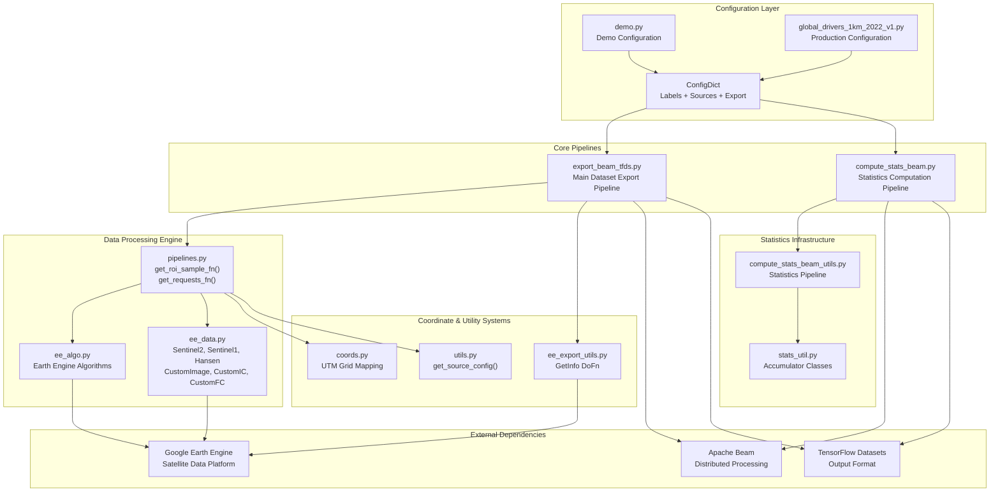

**System Architecture Overview**

Sources: [README.md:150-177](), [geeflow/export_beam_tfds.py](), [geeflow/stats/compute_stats_beam.py](), [geeflow/pipelines.py](), [geeflow/ee_data.py](), [geeflow/ee_algo.py]()

### Data Processing Workflow

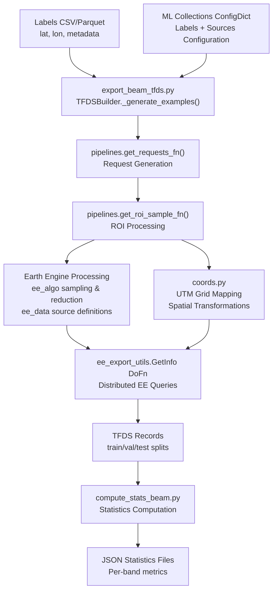

**Data Processing Workflow**

Sources: [README.md:161-177](), [geeflow/export_beam_tfds.py](), [geeflow/pipelines.py](), [geeflow/ee_export_utils.py](), [geeflow/stats/compute_stats_beam.py]()

## Core Concepts

### Configuration-Driven Design

GeoFlow uses [ML Collections ConfigDict](https://github.com/google/ml_collections) for flexible dataset configuration. The configuration is split into three main sections:

| Configuration Section | Purpose | Key Components |
|----------------------|---------|----------------|
| **Labels Configuration** | Defines sample locations and metadata | `path`, `img_width_m`, `max_cell_size_m`, `meta_keys` |
| **Sources Configuration** | Specifies Earth Engine data sources | Source classes, `scale`, `select`, `date_ranges`, `sampling_kw` |
| **Export Configuration** | Controls processing and output | Filters, transforms, CCDC generation options |

Sources: [README.md:56-147]()

### Earth Engine Integration

GeoFlow provides abstractions for common Earth Engine data sources through the `ee_data.py` module:

- **Predefined Sources**: `Sentinel2`, `Sentinel1`, `Hansen`, `NasaDem`, `MODIS` classes
- **Custom Sources**: `CustomImage`, `CustomIC`, `CustomFC` for arbitrary Earth Engine assets
- **Processing Algorithms**: Temporal aggregation, cloud masking, and spatial sampling in `ee_algo.py`

Sources: [README.md:105-109](), [README.md:152-158](), [geeflow/ee_data.py](), [geeflow/ee_algo.py]()

### Coordinate System Conventions

GeoFlow follows consistent coordinate system conventions:

- **Default CRS**: WGS 84 (World Geodetic System) for latitude/longitude
- **Projected Coordinates**: Local UTM (Universal Transverse Mercator) coordinates
- **Grid Mapping**: UTM-based spatial gridding implemented in `coords.py`
- **Reference Variables**: `lat`/`lon` for geographic coordinates throughout the codebase

Sources: [README.md:178-187](), [geeflow/coords.py]()

## Main Processing Pipelines

### Dataset Export Pipeline

The primary pipeline is implemented in `export_beam_tfds.py` and orchestrates the complete dataset generation process:

1. **Input Processing**: Reads label CSV/Parquet files and processes configuration
2. **Request Generation**: Uses `pipelines.get_requests_fn()` to create processing requests
3. **Data Extraction**: Applies `pipelines.get_roi_sample_fn()` per location to extract Earth Engine data
4. **Coordinate Transformation**: Maps geographic coordinates to UTM grid system
5. **TFDS Generation**: Converts processed data to TensorFlow Datasets format with train/val/test splits

Sources: [README.md:161-174](), [geeflow/export_beam_tfds.py]()

### Statistics Computation Pipeline  

The statistics pipeline in `compute_stats_beam.py` generates comprehensive dataset statistics:

1. **Band-level Analysis**: Computes statistics for each band in each data source
2. **Statistical Metrics**: Mean, variance, quantiles, histograms, and robust statistics
3. **Parallel Processing**: Uses Apache Beam for distributed computation
4. **Output Format**: JSON files with detailed per-band statistics

Sources: [README.md:174-177](), [README.md:285-322](), [geeflow/stats/compute_stats_beam.py]()

## Versioning and Reproducibility

GeoFlow implements semantic versioning for datasets using the pattern `{LABELS_VERSION}.{SOURCES_VERSION}.{OTHERS}`:

- **MAJOR**: Incremented for new or modified label sets
- **MINOR**: Incremented for changes to Earth Engine data sources  
- **PATCH**: Used for processing changes, split modifications, or other updates

The system automatically saves launch commands and configuration arguments for full reproducibility.

Sources: [README.md:189-204]()

## Integration Ecosystem

GeoFlow integrates with several external systems and follows established patterns:

- **Apache Beam**: Distributed processing for scalable dataset generation
- **TensorFlow Datasets**: Standard output format for ML pipelines  
- **Google Earth Engine**: Primary data source for satellite and geospatial data
- **JAX/Flax Integration**: Compatible with [Jeo](https://github.com/google-deepmind/jeo) for model training
- **Cloud Platform**: Designed for Google Cloud Platform deployment

Sources: [README.md:13-14](), [README.md:29-33](), [README.md:162-163](), [README.md:265-268]()

---

# Page: Getting Started

# Getting Started

<details>
<summary>Relevant source files</summary>

The following files were used as context for generating this wiki page:

- [README.md](README.md)
- [geeflow/configs/public/demo.py](geeflow/configs/public/demo.py)

</details>


## Purpose and Scope

This page provides a quick start guide for using GeoFlow to generate your first geospatial dataset. It covers installation, running the demo configuration, and understanding the output structure. For detailed information about configuration options, see [Configuration System](#6). For comprehensive architecture details, see [Core Architecture](#3).

## Prerequisites

Before starting with GeoFlow, ensure you have:

1. **Google Cloud Platform Account**: GeoFlow uses Google Earth Engine, which requires a GCP account
2. **Earth Engine Access**: You need to be authenticated with Google Earth Engine
3. **Python Environment**: Python 3.8+ with virtual environment capabilities

### Earth Engine Authentication

You must authenticate with Google Earth Engine and have access to a GCP project. Verify your setup by running:

```python
import ee
ee.Authenticate()
print(ee.String("Hello from GeeFlow!").getInfo())
```

## Installation

Clone the repository and set up the Python environment:

```bash
git clone https://github.com/google-deepmind/geeflow
cd geeflow
python -m venv .venv
source .venv/bin/activate
pip install -e .
cd geeflow
```

Set up your environment variables:

```bash
export OUTDIR="/tmp/tfds"
export EE_PROJECT="YOUR_GCP_PROJECT_ID"  # Replace with your GCP Project ID
```

Sources: [README.md:206-224]()

## Running Your First Dataset Export

GeoFlow includes a demo configuration that demonstrates the basic workflow. The demo uses the configuration defined in [geeflow/configs/public/demo.py]() to extract sample data from multiple Earth Engine sources.

### Demo Configuration Overview

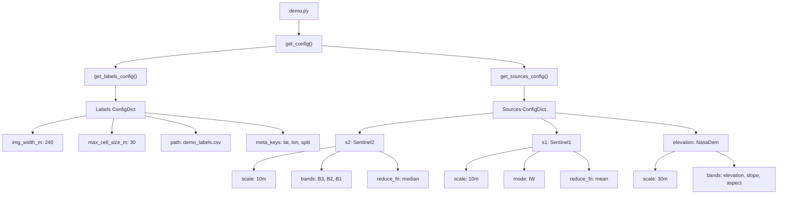

**Demo Configuration Workflow**

Sources: [geeflow/configs/public/demo.py:66-71]()

### Execute the Demo Pipeline

Run the complete dataset export pipeline:

```bash
python -m geeflow.export_beam_tfds \
--config_path=configs/public/demo.py:labels_path=data/demo_labels.csv,num=20 \
--tfds_name=demo:1.0.0 --output_dir=$OUTDIR --logtostderr --running_mode=direct \
--splits=train,val,test --ee_project=$EE_PROJECT --file_format="tfrecord" -- \
--direct_num_workers=4 --direct_running_mode=multi_threading
```

### Pipeline Execution Flow

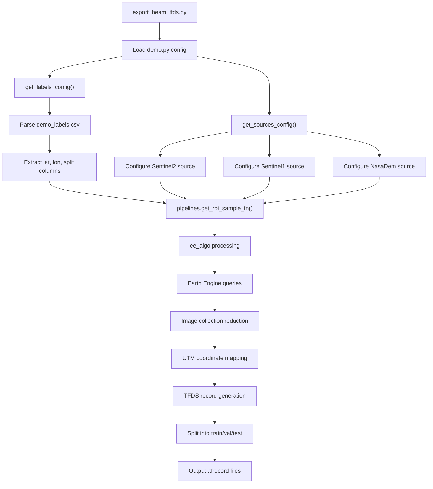

**Dataset Export Pipeline Flow**

Sources: [README.md:250-262](), [geeflow/export_beam_tfds.py:161-174]()

## Understanding the Output

After successful execution, your output directory will contain:

```
/tmp/tfds/demo/
├── demo/
│   └── 1.0.0/
│       ├── dataset_info.json
│       ├── demo-test.tfrecord-00000-of-00001
│       ├── demo-train.tfrecord-00000-of-00001
│       ├── demo-val.tfrecord-00000-of-00001
│       └── features.json
└── extracted/  # Temporary processing directory
```

### Output Files Description

| File | Purpose |
|------|---------|
| `dataset_info.json` | TFDS metadata including schema and split information |
| `demo-{split}.tfrecord-*` | TensorFlow record files containing the actual dataset |
| `features.json` | Feature schema definition for the dataset |
| `extracted/` | Temporary directory used during Apache Beam processing |

Each TFDS record contains:
- **Geospatial imagery**: Multi-spectral data from Sentinel-2, SAR data from Sentinel-1, elevation data from NASA DEM
- **Spatial metadata**: Latitude, longitude, UTM coordinates
- **Label information**: Any additional columns specified in `meta_keys`

Sources: [README.md:270-283]()

## Computing Statistics

After generating the dataset, compute comprehensive statistics for each data source:

```bash
python -m geeflow.stats.compute_stats_beam --tfds_name=demo \
--split=test,train,val --data_dir=$OUTDIR -- \
--direct_num_workers=4 --direct_running_mode=multi_threading --no_pipeline_type_check
```

### Statistics Processing Flow

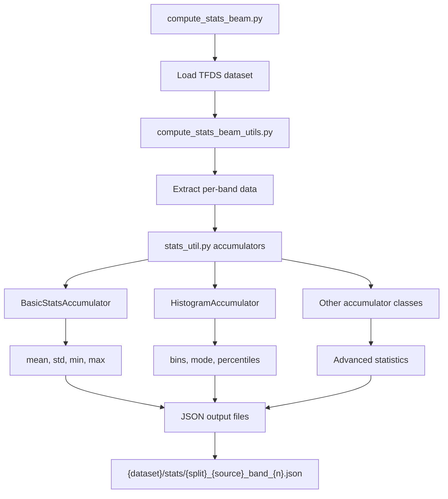

**Statistics Computation Pipeline**

### Example Statistics Output

The statistics pipeline generates detailed metrics for each band:

```json
{
  "bins_iqr": 316.0,
  "bins_iqr_std": 234.24759080800592,
  "bins_mad": 155.0,
  "bins_mad_std": 229.803,
  "bins_mean": 557.5357349537037,
  "bins_median": 420.5,
  "bins_std": 506.70404309973185,
  "max": 4252.0,
  "mean": 557.7291508427372,
  "min": 90.5,
  "mode": 249,
  "n": 13824,
  "n_masked": 0,
  "sample_std": 506.67234659545005,
  "sample_var": 256716.86680453984,
  "std": 506.6540204413037,
  "sum": 7710047.78125,
  "total": 7710047.78125,
  "var": 256698.296429337
}
```

Sources: [README.md:285-322](), [geeflow/stats/compute_stats_beam.py:174-176]()

## Apache Beam Configuration

Both pipelines use Apache Beam for distributed processing. Key configuration options:

| Parameter | Purpose |
|-----------|---------|
| `--running_mode=direct` | Run locally using DirectRunner |
| `--direct_num_workers=4` | Number of parallel workers |
| `--direct_running_mode=multi_threading` | Threading mode for local execution |
| `--no_pipeline_type_check` | Disable strict type checking (statistics only) |

For production deployments, you can use other Beam runners like Dataflow for Google Cloud processing.

Sources: [README.md:264-268]()

## Next Steps

After successfully running the demo:

1. **Explore Configuration**: Learn about customizing data sources and processing options in [Configuration System](#6)
2. **Understand Architecture**: Deep dive into the system design in [Core Architecture](#3)  
3. **Add Data Sources**: Explore the available Earth Engine datasets in [Earth Engine Datasets](#5.1)
4. **Scale Up**: Learn about production deployment patterns in [Main Pipelines](#4)
5. **Custom Processing**: Implement custom algorithms using [Data Processing Algorithms](#5.2)

The demo configuration provides a foundation that you can extend with:
- Additional Earth Engine data sources
- Custom temporal sampling strategies  
- Different spatial resolutions
- Custom label datasets
- Advanced processing algorithms

Sources: [README.md:50-148]()

---

# Page: Core Architecture

# Core Architecture

<details>
<summary>Relevant source files</summary>

The following files were used as context for generating this wiki page:

- [README.md](README.md)
- [geeflow/pipelines.py](geeflow/pipelines.py)
- [geeflow/utils.py](geeflow/utils.py)

</details>


This document explains the overall system architecture of GeeFlow, covering the key modules, their interactions, and the architectural patterns that enable large-scale geospatial dataset generation using Google Earth Engine. For configuration details, see [Configuration System](#6). For pipeline implementation specifics, see [Main Pipelines](#4).

## System Overview

GeeFlow follows a configuration-driven, pipeline-based architecture built on Apache Beam for distributed processing. The system transforms geospatial label data into machine learning-ready datasets by orchestrating Earth Engine queries through a modular processing pipeline.

## Core Architectural Components

### Configuration-Driven Design

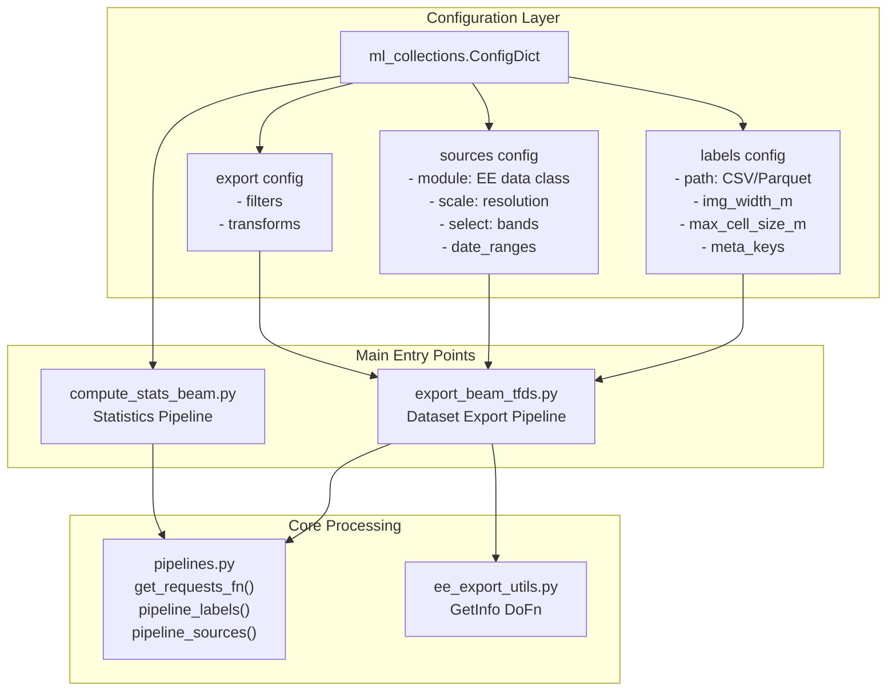

Sources: [README.md:56-142](), [geeflow/utils.py:216-227]()

### Request-Response Architecture

The system uses a request-response pattern where processing is broken down into discrete `Request` objects that encapsulate Earth Engine queries:

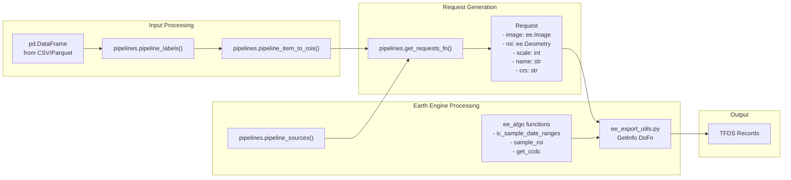

Sources: [geeflow/pipelines.py:61-70](), [geeflow/pipelines.py:289-410]()

## Module Architecture

### Core Processing Modules

The system is organized into distinct processing layers:

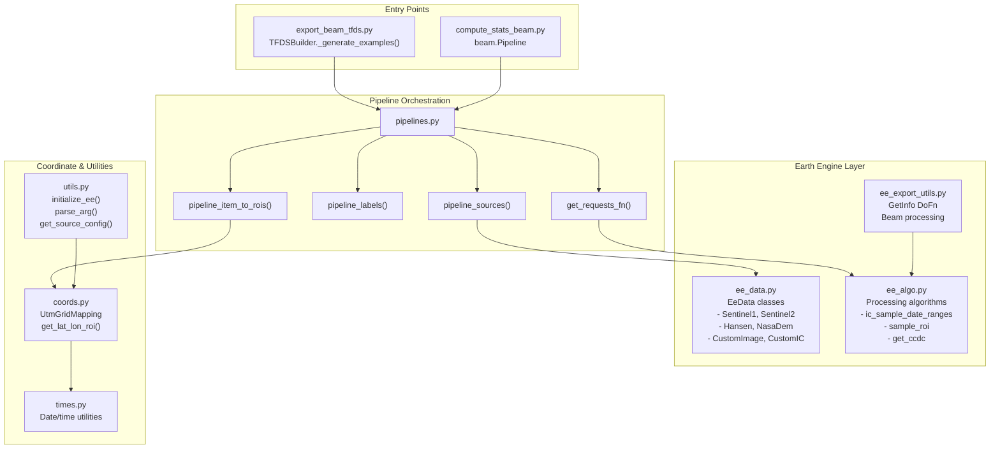

Sources: [geeflow/pipelines.py:1-36](), [README.md:150-177]()

### Data Flow Through Processing Layers

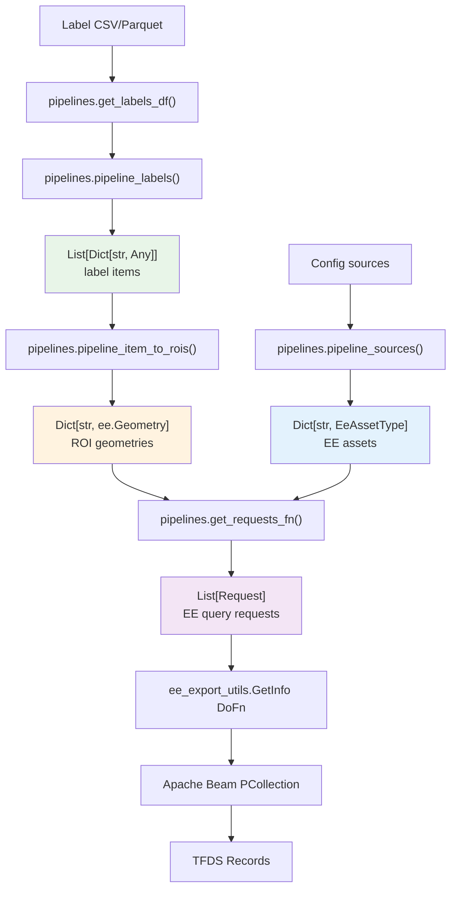

Sources: [geeflow/pipelines.py:106-128](), [geeflow/pipelines.py:179-208](), [geeflow/pipelines.py:289-410]()

## Algorithm Selection and Processing

The system uses a mapping strategy to select appropriate processing algorithms based on the data source type:

| Data Source Type | Algorithm Function | Purpose |
|------------------|-------------------|---------|
| `IC_SAMPLE_DATE_RANGES` | `ee_algo.ic_sample_date_ranges` | Time-series sampling with date ranges |
| `IC_SAMPLE` | `ee_algo.ic_sample` | Simple image collection sampling |
| `RGB_IC_SAMPLE` | `ee_algo.rgb_ic_sample` | RGB-specific collection sampling |
| `SAMPLE_ROI` | `ee_algo.sample_roi` | Region-of-interest sampling |
| `FC_GET` | `ee_algo.fc_get` | Feature collection property extraction |
| `CCDC` | `ee_algo.get_ccdc` | Continuous Change Detection Classification |

Sources: [geeflow/pipelines.py:42-59](), [geeflow/pipelines.py:262-272]()

## Coordinate System Management

GeeFlow implements a sophisticated coordinate system that handles both UTM projections and lat/lon coordinates:

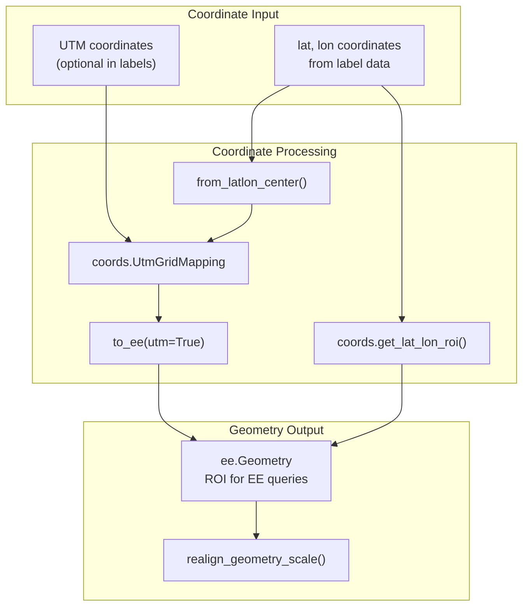

Sources: [geeflow/pipelines.py:131-159](), [geeflow/pipelines.py:250-259]()

## Configuration Processing Pipeline

The configuration system transforms user specifications into executable processing functions:

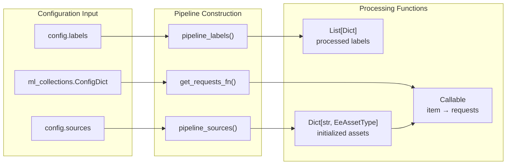

Sources: [geeflow/pipelines.py:115-128](), [geeflow/pipelines.py:179-208](), [geeflow/pipelines.py:289-291]()

## Error Handling and Validation

The system includes validation at multiple levels:

- **Band/Property Validation**: [geeflow/pipelines.py:223-247]() validates that selected bands exist in the source
- **Configuration Validation**: [geeflow/pipelines.py:266-272]() ensures valid algorithm mapping
- **Geometry Validation**: [geeflow/pipelines.py:315-321]() handles scale alignment for grid consistency

The architecture emphasizes modularity and extensibility, allowing new Earth Engine data sources and processing algorithms to be added through the configuration system without modifying core pipeline logic.

---

# Page: Main Pipelines

# Main Pipelines

<details>
<summary>Relevant source files</summary>

The following files were used as context for generating this wiki page:

- [README.md](README.md)
- [geeflow/export_beam_tfds.py](geeflow/export_beam_tfds.py)
- [geeflow/stats/compute_stats_beam.py](geeflow/stats/compute_stats_beam.py)

</details>


This document provides an overview of the two primary Apache Beam pipelines that form the core of GeoFlow's data processing system. These pipelines work sequentially to extract geospatial data from Google Earth Engine and generate machine learning-ready datasets with computed statistics.

For detailed explanations of individual pipeline components and configuration, see [Dataset Export Pipeline](#4.1) and [Statistics Computation Pipeline](#4.2). For information about configuring these pipelines, see [Configuration System](#6).

## Pipeline Architecture Overview

GeoFlow operates through two main Apache Beam pipelines that process geospatial data in sequence:

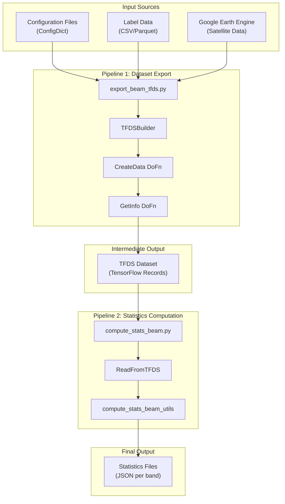

**Sources:** [geeflow/export_beam_tfds.py:1-486](), [geeflow/stats/compute_stats_beam.py:1-83]()

## Pipeline Component Mapping

The following diagram maps the high-level pipeline components to their specific code implementations:

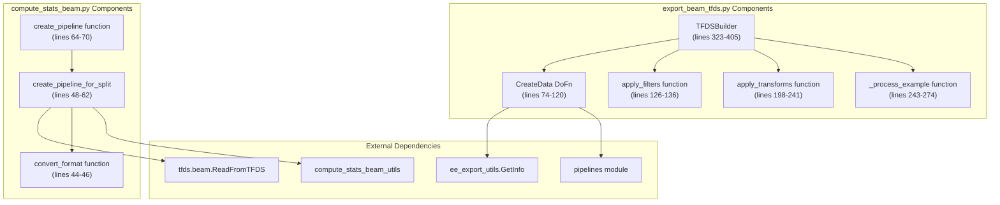

**Sources:** [geeflow/export_beam_tfds.py:74-120](), [geeflow/export_beam_tfds.py:323-405](), [geeflow/stats/compute_stats_beam.py:48-70]()

## Dataset Export Pipeline

The dataset export pipeline (`export_beam_tfds.py`) serves as the primary data extraction and transformation engine. This pipeline:

| Component | Function | Key Classes/Functions |
|-----------|----------|----------------------|
| **Data Creation** | Reads label data and creates initial feature collections | `CreateData` DoFn |
| **EE Query Processing** | Executes distributed Google Earth Engine queries | `ee_export_utils.GetInfo` DoFn |
| **Data Filtering** | Applies configurable filters to remove unwanted samples | `apply_filters` function |
| **Data Transformation** | Performs spatial cropping, CCDC generation, and format conversion | `apply_transforms` function |
| **TFDS Generation** | Converts processed data to TensorFlow Dataset format | `TFDSBuilder` class |

The pipeline processes data through the following stages:
1. **Label Processing**: Reads CSV/Parquet files containing sample locations and metadata [geeflow/export_beam_tfds.py:85-92]()
2. **Split Generation**: Creates train/validation/test splits either from data columns or geographic distribution [geeflow/export_beam_tfds.py:94-113]()
3. **Earth Engine Queries**: Retrieves satellite imagery and geospatial data for each location [geeflow/export_beam_tfds.py:384-396]()
4. **Data Processing**: Applies algorithms, filters, and transformations to raw data [geeflow/export_beam_tfds.py:397-404]()

**Sources:** [geeflow/export_beam_tfds.py:323-405](), [geeflow/export_beam_tfds.py:74-120]()

## Statistics Computation Pipeline

The statistics computation pipeline (`compute_stats_beam.py`) operates on the TFDS datasets generated by the export pipeline. This pipeline:

| Component | Function | Implementation |
|-----------|----------|----------------|
| **TFDS Reading** | Loads generated datasets for analysis | `tfds.beam.ReadFromTFDS` |
| **Format Conversion** | Converts TensorFlow data to NumPy arrays | `convert_format` function |
| **Statistics Processing** | Computes per-band statistics across all samples | `compute_stats_beam_utils` module |
| **Output Generation** | Saves statistics as JSON files for each band and split | File I/O operations |

The pipeline operates in the following sequence:
1. **Dataset Loading**: Reads TFDS datasets for specified splits [geeflow/stats/compute_stats_beam.py:50-55]()
2. **Data Conversion**: Transforms data format for statistics computation [geeflow/stats/compute_stats_beam.py:44-46]()
3. **Statistics Calculation**: Computes comprehensive statistics per band [geeflow/stats/compute_stats_beam.py:60-61]()
4. **Results Storage**: Outputs JSON files with statistical summaries [geeflow/stats/compute_stats_beam.py:56-61]()

**Sources:** [geeflow/stats/compute_stats_beam.py:48-70](), [geeflow/stats/compute_stats_beam.py:44-46]()

## Pipeline Execution and Configuration

Both pipelines are designed to run with Apache Beam and support multiple execution modes:

- **Direct Runner**: Local execution with configurable threading [geeflow/export_beam_tfds.py:467-468]()
- **Cloud Runner**: Distributed execution on Google Cloud Dataflow [geeflow/export_beam_tfds.py:469-470]()

The pipelines accept command-line arguments for configuration and can be launched independently:

```bash
# Export pipeline
python -m geeflow.export_beam_tfds --config_path=... --tfds_name=... --output_dir=...

# Statistics pipeline  
python -m geeflow.stats.compute_stats_beam --tfds_name=... --split=... --data_dir=...
```

Both pipelines integrate with the ML Collections configuration system and support flexible parameterization through config files and command-line overrides.

**Sources:** [geeflow/export_beam_tfds.py:45-68](), [geeflow/stats/compute_stats_beam.py:28-41]()

---

# Page: Dataset Export Pipeline

# Dataset Export Pipeline

<details>
<summary>Relevant source files</summary>

The following files were used as context for generating this wiki page:

- [geeflow/ee_export_utils.py](geeflow/ee_export_utils.py)
- [geeflow/export_beam_tfds.py](geeflow/export_beam_tfds.py)
- [geeflow/pipelines.py](geeflow/pipelines.py)

</details>


This document explains the Dataset Export Pipeline, which is the primary Apache Beam pipeline for extracting geospatial data from Google Earth Engine and converting it to TensorFlow Datasets (TFDS) format. The pipeline processes large-scale satellite imagery and geospatial datasets according to user-defined configurations.

For information about the Statistics Computation Pipeline that processes the output of this pipeline, see [Statistics Computation Pipeline](#4.2). For details about configuration format and structure, see [Configuration System](#6).

## Purpose and Overview

The Dataset Export Pipeline (`export_beam_tfds.py`) orchestrates the entire data extraction and conversion process. It reads label data (CSV/Parquet files with coordinates and metadata), queries Google Earth Engine for satellite imagery and geospatial data at those locations, and outputs machine learning-ready datasets in TFDS format.

Sources: [geeflow/export_beam_tfds.py:15-23]()

## Pipeline Architecture

The pipeline consists of several key Apache Beam transformations organized into a data processing workflow:

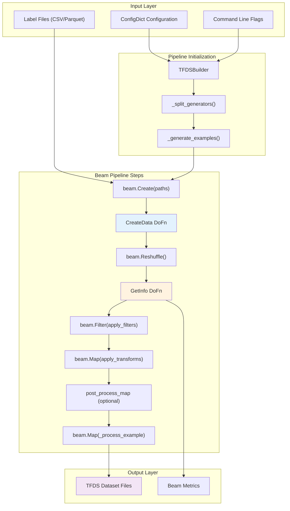

Sources: [geeflow/export_beam_tfds.py:378-404](), [geeflow/export_beam_tfds.py:370-376]()

## Key Components

### TFDSBuilder Class

The `TFDSBuilder` class extends `tfds.core.GeneratorBasedBuilder` and serves as the main orchestrator for the dataset generation process:

| Component | Purpose | Key Methods |
|-----------|---------|-------------|
| `__init__` | Initialize builder with config and metrics | Sets up beam counters and distributions |
| `_info()` | Define dataset metadata and features | Calls `make_tfds_features()` |
| `_split_generators()` | Define train/validation/test splits | Uses `get_split_tuples()` |
| `_generate_examples()` | Main pipeline definition | Creates Beam pipeline |

Sources: [geeflow/export_beam_tfds.py:323-361](), [geeflow/export_beam_tfds.py:362-368](), [geeflow/export_beam_tfds.py:370-376](), [geeflow/export_beam_tfds.py:378-404]()

### CreateData DoFn

The `CreateData` DoFn processes label files and creates initial data items for each geographic location:

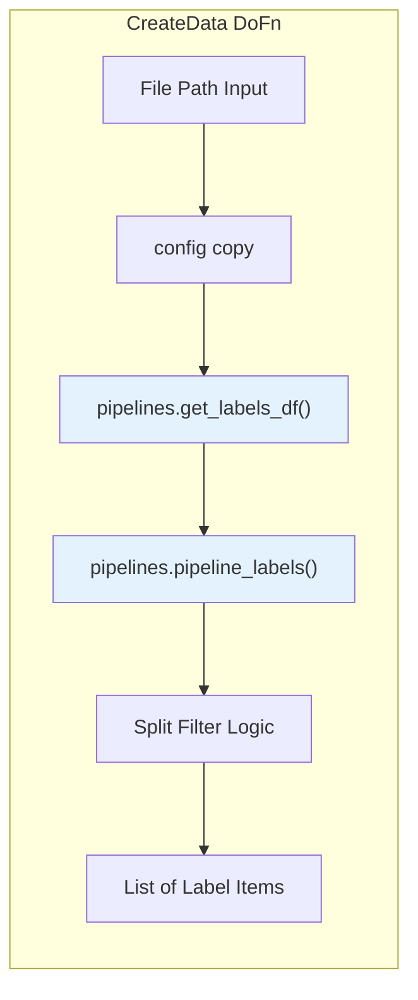

Sources: [geeflow/export_beam_tfds.py:74-120](), [geeflow/export_beam_tfds.py:85-119]()

### GetInfo DoFn

The `GetInfo` DoFn is the core component that queries Google Earth Engine and retrieves satellite data:

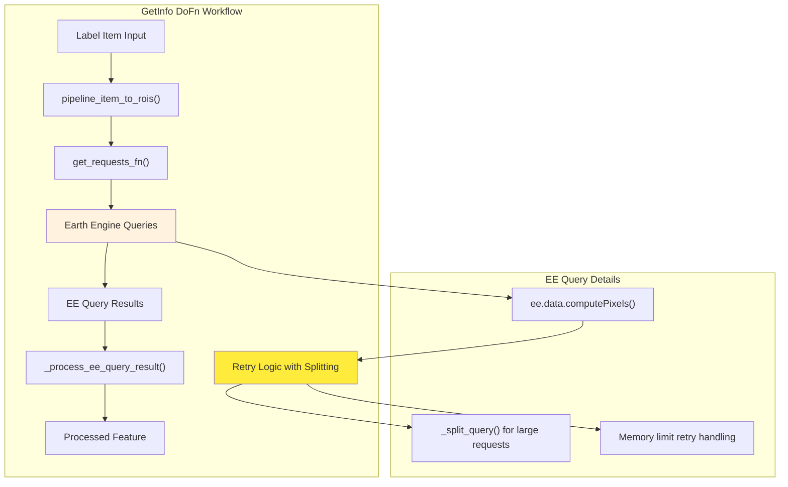

Sources: [geeflow/ee_export_utils.py:110-253](), [geeflow/ee_export_utils.py:234-252](), [geeflow/ee_export_utils.py:145-232]()

## Data Flow and Processing

### Request Generation Flow

The pipeline uses a sophisticated request generation system to create Earth Engine queries:

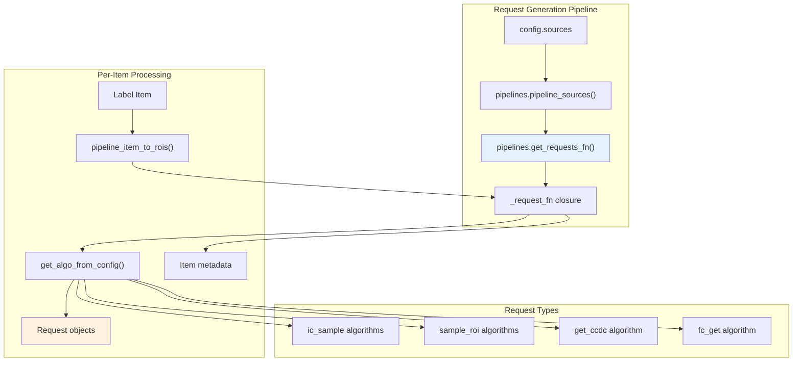

Sources: [geeflow/pipelines.py:289-410](), [geeflow/pipelines.py:179-208](), [geeflow/pipelines.py:262-272]()

### Transform and Filter Operations

After Earth Engine data retrieval, the pipeline applies several processing steps:

| Operation | Function | Purpose |
|-----------|----------|---------|
| Filtering | `apply_filters()` | Remove empty or unwanted samples |
| CCDC Generation | `generate_ccdc()` | Process CCDC time series data |
| Transforms | `apply_transforms()` | Resize and format arrays |
| Post-processing | `post_process_map` | Optional custom processing |
| TFDS Formatting | `_process_example()` | Convert to TFDS format |

Sources: [geeflow/export_beam_tfds.py:126-136](), [geeflow/export_beam_tfds.py:139-195](), [geeflow/export_beam_tfds.py:198-240](), [geeflow/export_beam_tfds.py:243-273]()

## Configuration and Execution

### Command Line Interface

The pipeline accepts several key command line arguments:

| Flag | Purpose | Example |
|------|---------|---------|
| `--config_path` | Path to configuration file | `/path/to/config.py` |
| `--ee_project` | Earth Engine project and service account | `project:service@account.com` |
| `--output_dir` | Output directory for TFDS files | `/path/to/output` |
| `--tfds_name` | Dataset name and version | `my_dataset:1.0.0` |
| `--splits` | Dataset splits to generate | `train,validation,test` |

Sources: [geeflow/export_beam_tfds.py:45-68]()

### Split Generation Logic

The pipeline supports multiple split generation strategies:

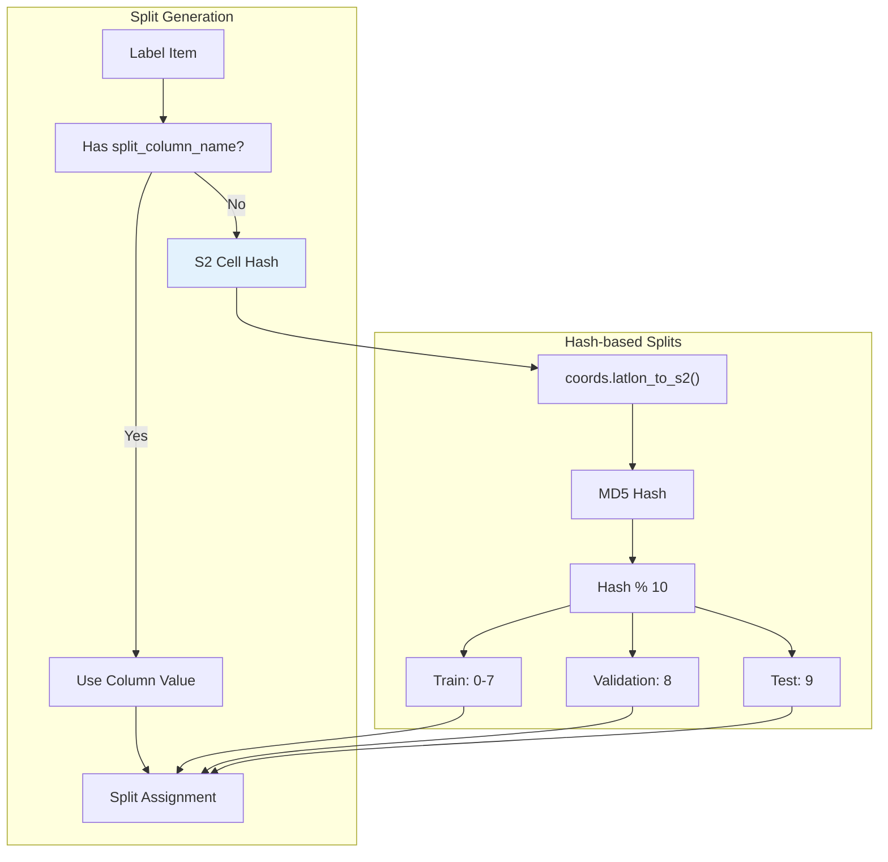

Sources: [geeflow/export_beam_tfds.py:94-113](), [geeflow/export_beam_tfds.py:103-111]()

## Output Format and Features

### TFDS Feature Generation

The pipeline automatically infers TFDS feature schemas from the processed data:

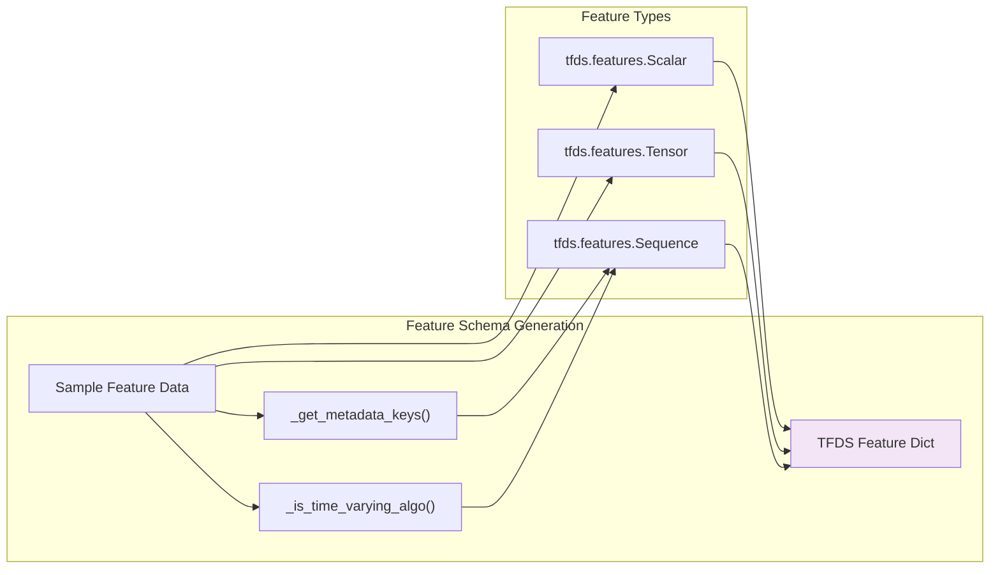

Sources: [geeflow/export_beam_tfds.py:407-455](), [geeflow/export_beam_tfds.py:276-297](), [geeflow/export_beam_tfds.py:300-307]()

### Pipeline Execution

The main execution flow integrates all components:

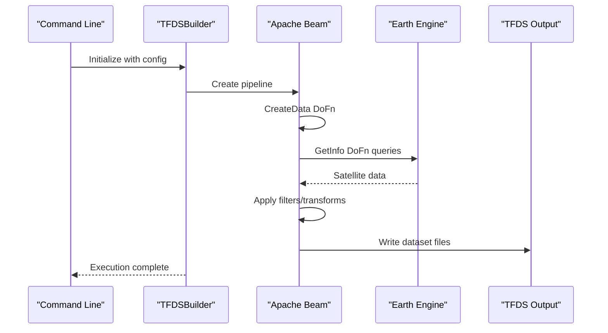

Sources: [geeflow/export_beam_tfds.py:458-482](), [geeflow/export_beam_tfds.py:477-481]()

---

# Page: Statistics Computation Pipeline

# Statistics Computation Pipeline

<details>
<summary>Relevant source files</summary>

The following files were used as context for generating this wiki page:

- [geeflow/stats/compute_stats_beam.py](geeflow/stats/compute_stats_beam.py)
- [geeflow/stats/compute_stats_beam_utils.py](geeflow/stats/compute_stats_beam_utils.py)
- [geeflow/stats/stats_util.py](geeflow/stats/stats_util.py)

</details>


This document covers the Apache Beam pipeline that computes comprehensive statistics on TensorFlow Datasets (TFDS) generated by GeoFlow. The statistics computation pipeline processes multi-band geospatial imagery and feature data to produce detailed statistical summaries saved as JSON files.

For information about the dataset export pipeline that generates the TFDS data consumed by this pipeline, see [Dataset Export Pipeline](#4.1). For details about the accumulator classes and statistical computation methods, see [Statistics System](#9).

## Overview

The statistics computation pipeline is implemented as an Apache Beam pipeline that reads TFDS datasets and computes per-band statistics using a hierarchical aggregation approach. The pipeline handles both numeric and categorical data types, supports masking, and outputs comprehensive statistical summaries including histograms, quantiles, and robust statistics.

```mermaid
flowchart TD
    A["TFDS Dataset"] --> B["ReadFromTFDS"]
    B --> C["ConvertFormat"]
    C --> D["ExtractFeatures"] 
    D --> E["ConvertToAccumulator"]
    E --> F["Hierarchical Aggregation<br/>(5 reduction steps)"]
    F --> G["Write JSON Stats"]
    
    H["Multi-band Features"] --> D
    I["Feature Masks"] --> D
    
    G --> J["JSON Files per Band"]
    G --> K["Per-split Statistics"]
```

Sources: [geeflow/stats/compute_stats_beam.py:1-83](), [geeflow/stats/compute_stats_beam_utils.py:1-143]()

## Main Entry Point

The `compute_stats_beam.py` module serves as the main entry point for the statistics computation pipeline. It accepts command-line arguments to specify the TFDS dataset, data directory, output location, and processing splits.

| Flag | Description | Default |
|------|-------------|---------|
| `tfds_name` | Name of the TFDS dataset to process | (required) |
| `data_dir` | Directory containing TFDS data | (required) |
| `output_dir` | Output directory for statistics files | (uses dataset directory) |
| `split` | Dataset splits to process | `["train"]` |
| `running_mode` | Beam execution mode | `"direct"` |

The main pipeline function `create_pipeline_for_split` reads data using `tfds.beam.ReadFromTFDS` and converts the format using JAX utilities before delegating to the core processing pipeline.

Sources: [geeflow/stats/compute_stats_beam.py:28-83]()

## Feature Extraction and Processing

### Multi-Band Feature Handling

The `extract_features` function processes examples to handle multi-band imagery and associated feature masks. For each feature in an example:

- **Multi-band features**: Split into individual bands with naming convention `{feature_name}_band_{i}`
- **Feature masks**: Applied per-band if available with naming pattern `{feature_name}_mask`
- **Grouping**: Each example is assigned to a group based on MD5 hash of its ID for distributed processing

```mermaid
flowchart LR
    A["Example with Multi-band Feature"] --> B["extract_features"]
    B --> C["feature_band_0"]
    B --> D["feature_band_1"] 
    B --> E["feature_band_N"]
    
    F["Feature Mask"] --> B
    F --> G["mask_band_0"]
    F --> H["mask_band_1"]
    F --> I["mask_band_N"]
    
    J["Group Assignment<br/>(MD5 Hash % Modulo)"] --> B
```

Sources: [geeflow/stats/compute_stats_beam_utils.py:51-73]()

### Accumulator Creation

The `convert_to_accumulator` function creates `CounterAccumulator` instances for each feature. The accumulator type is determined by the `_is_numeric` function which identifies whether features contain numeric or categorical data.

```mermaid
flowchart TD
    A["Feature + Mask Pair"] --> B["_is_numeric Check"]
    B --> C["CounterAccumulator(numeric=True)"]
    B --> D["CounterAccumulator(numeric=False)"]
    C --> E["acc.add(feature, mask)"]
    D --> E
    E --> F["(name, group_id), accumulator"]
```

Sources: [geeflow/stats/compute_stats_beam_utils.py:75-82](), [geeflow/stats/compute_stats_beam_utils.py:40-48]()

## Hierarchical Aggregation Strategy

The pipeline uses a hierarchical aggregation approach with 5 reduction steps to efficiently process large datasets. This strategy prevents memory issues and enables distributed processing.

### Aggregation Parameters

- `_NUM_AGGREGATION_STEPS = 5`: Number of reduction levels
- `_AGGREGATION_DIVISOR = 10`: Grouping factor per step  
- `_AGGREGATION_MODULO = 100000`: Total number of initial groups

```mermaid
flowchart TD
    A["Initial Groups<br/>(100,000 groups)"] --> B["Step 1: Group ÷ 10<br/>(10,000 groups)"]
    B --> C["Step 2: Group ÷ 10<br/>(1,000 groups)"]
    C --> D["Step 3: Group ÷ 10<br/>(100 groups)"]
    D --> E["Step 4: Group ÷ 10<br/>(10 groups)"]
    E --> F["Step 5: Group ÷ 10<br/>(1 group)"]
    
    G["ReduceKey"] --> H["GroupByKey"]
    H --> I["Aggregate"]
    
    B --> G
    C --> G
    D --> G
    E --> G
    F --> G
```

Each step performs:
1. **ReduceKey**: Maps `(name, group_id)` to `(name, group_id // 10)`
2. **GroupByKey**: Groups accumulators by the new key
3. **Aggregate**: Merges accumulators using the `merge` method

Sources: [geeflow/stats/compute_stats_beam_utils.py:27-33](), [geeflow/stats/compute_stats_beam_utils.py:84-106](), [geeflow/stats/compute_stats_beam_utils.py:132-142]()

## Accumulator Classes

### StatsAccumulator

The base `StatsAccumulator` class computes fundamental numerical statistics:

| Property | Description | Formula |
|----------|-------------|---------|
| `mean` | Arithmetic mean | `sum / n` |
| `std` | Standard deviation | `√(sum2/n - (sum/n)²)` |
| `var` | Variance | `sum2/n - (sum/n)²` |
| `sample_std` | Sample standard deviation | `√(sample_var)` |
| `sample_var` | Sample variance | `(sum2 - sum²/n)/(n-1)` |
| `min` | Minimum value | Updated incrementally |
| `max` | Maximum value | Updated incrementally |

### CounterAccumulator  

The `CounterAccumulator` extends `StatsAccumulator` with histogram and counter functionality:

- **Counters**: Frequency counts for each unique value
- **Bins**: Histogram bins for numeric data
- **Robust statistics**: Median, MAD, IQR computed from histograms
- **Masking support**: Handles masked values separately

```mermaid
classDiagram
    class StatsAccumulator {
        +float sum
        +float sum2  
        +int n
        +float min
        +float max
        +merge(other)
        +add(x)
        +mean()
        +std()
        +var()
    }
    
    class CounterAccumulator {
        +Counter c
        +int n_masked
        +bool numeric
        +bool to_int
        +add(x, mask)
        +mode()
        +bins_median()
        +bins_mad()
        +bins_iqr()
    }
    
    StatsAccumulator <|-- CounterAccumulator
```

Sources: [geeflow/stats/stats_util.py:37-160](), [geeflow/stats/stats_util.py:162-375]()

## Output Format

Statistics are saved as JSON files with the following structure:

### File Organization
- **Per-band files**: `{feature_name}_band_{i}.json`
- **Per-split directories**: Statistics organized by train/validation/test splits
- **Location**: Either specified `output_dir` or `{dataset_dir}/stats/`

### JSON Schema
```json
{
  "mean": 0.5,
  "std": 0.2,
  "var": 0.04,
  "min": 0.0,
  "max": 1.0,
  "total": 500.0,
  "size": 1000,
  "mode": 0,
  "bins_mean": 0.498,
  "bins_median": 0.502,
  "bins_std": 0.199,
  "bins_iqr": 0.25,
  "bins_mad": 0.12
}
```

The `write` function ensures the final group ID is 0, confirming that all reduction steps completed successfully before saving statistics.

Sources: [geeflow/stats/compute_stats_beam_utils.py:108-118](), [geeflow/stats/stats_util.py:116-130](), [geeflow/stats/stats_util.py:472-489]()

## Pipeline Execution Flow

The complete pipeline execution follows this sequence:

1. **Initialization**: Parse command-line arguments and set up Beam pipeline options
2. **Data Reading**: Use `tfds.beam.ReadFromTFDS` to read the specified dataset splits
3. **Format Conversion**: Convert data using `jax.tree.map(utils.to_np, example)`
4. **Feature Extraction**: Process multi-band features and masks per example
5. **Accumulator Creation**: Create `CounterAccumulator` instances for each feature
6. **Hierarchical Aggregation**: Execute 5 reduction steps to merge statistics
7. **Output**: Write final JSON statistics files organized by split and feature name

```mermaid
sequenceDiagram
    participant Main as "compute_stats_beam.py"
    participant Utils as "compute_stats_beam_utils.py" 
    participant TFDS as "TensorFlow Datasets"
    participant Acc as "CounterAccumulator"
    participant FS as "File System"
    
    Main->>TFDS: ReadFromTFDS(dataset, split)
    TFDS-->>Main: Raw examples
    Main->>Utils: extract_features(example)
    Utils-->>Main: (feature_name, group_id), (data, mask)
    Main->>Utils: convert_to_accumulator
    Utils->>Acc: CounterAccumulator()
    Utils->>Acc: add(data, mask)
    Utils-->>Main: (key, accumulator)
    
    loop 5 Aggregation Steps
        Main->>Utils: reduce_key
        Main->>Utils: aggregate accumulators
    end
    
    Main->>Utils: write(final_accumulator)
    Utils->>FS: Save JSON statistics
```

Sources: [geeflow/stats/compute_stats_beam.py:48-78](), [geeflow/stats/compute_stats_beam_utils.py:120-142]()

---

# Page: Data Sources and Processing

# Data Sources and Processing

<details>
<summary>Relevant source files</summary>

The following files were used as context for generating this wiki page:

- [geeflow/ee_algo.py](geeflow/ee_algo.py)
- [geeflow/ee_data.py](geeflow/ee_data.py)

</details>


This document covers GeoFlow's integration with Google Earth Engine for accessing satellite and geospatial datasets, and the processing algorithms used to transform raw Earth Engine data into machine learning-ready formats. For information about the main export pipeline that orchestrates this processing, see [Dataset Export Pipeline](#4.1). For details about coordinate systems and geometry handling, see [Coordinate Systems and Geometry](#7).

## Overview

GeoFlow's data processing system is built around two core modules:
- **Data Source Definitions** (`ee_data.py`): Classes that define and configure access to various Earth Engine datasets
- **Processing Algorithms** (`ee_algo.py`): Functions that sample, reduce, and transform Earth Engine data collections

The system supports over 30 different satellite and geospatial data sources, from optical imagery (Sentinel-2, Landsat) to SAR data (Sentinel-1), elevation models, forest change data, and population datasets.

## Earth Engine Data Sources Architecture

```mermaid
graph TB
    subgraph "Abstract Base Classes"
        EeData["EeData<br/>Base class for datasets"]
        EeDataFC["EeDataFC<br/>FeatureCollection datasets"]
    end
    
    subgraph "Satellite Imagery"
        Sentinel1["Sentinel1<br/>SAR data (VV, VH)"]
        Sentinel2["Sentinel2<br/>Optical imagery (13 bands)"]
        Landsat7["Landsat7<br/>Surface reflectance"]
        Landsat8["Landsat8<br/>Surface reflectance"]
        NAIP["NAIP<br/>High-res aerial imagery"]
        Nicfi["Nicfi<br/>Planet basemaps"]
    end
    
    subgraph "MODIS Products"
        ModisTerraVeg["ModisTerraVeg<br/>Vegetation indices"]
        ModisSurfRefl["ModisSurfRefl<br/>Surface reflectance"]
        ModisGPP["ModisGPP<br/>Gross primary productivity"]
        ModisET["ModisET<br/>Evapotranspiration"]
        ModisBurn["ModisBurn<br/>Burned area"]
        ModisFire["ModisFire<br/>Fire anomalies"]
    end
    
    subgraph "Forest and Land Cover"
        Hansen["Hansen<br/>Global forest change"]
        Primary["Primary<br/>Humid tropical forests"]
        DynamicWorld["DynamicWorld<br/>Land cover classification"]
        WorldCover["WorldCover<br/>ESA land cover"]
        NLCD["NLCD<br/>US land cover"]
    end
    
    subgraph "Elevation and Structure"
        NasaDem["NasaDem<br/>Elevation from SRTM"]
        FABDEM["FABDEM<br/>Buildings removed DEM"]
        CopDem["CopDem<br/>Copernicus DEM"]
        GediRasterCanopyHeight["GediRasterCanopyHeight<br/>Canopy height"]
        GediRasterAGB["GediRasterAGB<br/>Aboveground biomass"]
    end
    
    subgraph "Climate and Analysis"
        CCDC["CCDC<br/>Change detection"]
        Era5["Era5<br/>Climate reanalysis"]
    end
    
    subgraph "Human Population"
        CIESIN["CIESIN<br/>Population count"]
        WorldPop["WorldPop<br/>Population density"]
        GHSPop["GHSPop<br/>Settlement data"]
        FPP["FPP<br/>Forest proximate people"]
        TPP["TPP<br/>Tree proximate people"]
    end
    
    subgraph "Administrative/Custom"
        Countries["Countries<br/>Country boundaries"]
        Ecoregions["Ecoregions<br/>Ecological regions"]
        CustomFC["CustomFC<br/>Custom FeatureCollection"]
        CustomImage["CustomImage<br/>Custom Image"]
        CustomIC["CustomIC<br/>Custom ImageCollection"]
    end
    
    EeData --> Sentinel1
    EeData --> Sentinel2
    EeData --> Landsat7
    EeData --> Landsat8
    EeData --> NAIP
    EeData --> Nicfi
    EeData --> ModisTerraVeg
    EeData --> ModisSurfRefl
    EeData --> ModisGPP
    EeData --> ModisET
    EeData --> ModisBurn
    EeData --> ModisFire
    EeData --> Hansen
    EeData --> Primary
    EeData --> DynamicWorld
    EeData --> WorldCover
    EeData --> NLCD
    EeData --> NasaDem
    EeData --> FABDEM
    EeData --> CopDem
    EeData --> GediRasterCanopyHeight
    EeData --> GediRasterAGB
    EeData --> CCDC
    EeData --> Era5
    EeData --> CIESIN
    EeData --> WorldPop
    EeData --> GHSPop
    EeData --> FPP
    EeData --> TPP
    EeData --> CustomImage
    EeData --> CustomIC
    
    EeDataFC --> Countries
    EeDataFC --> Ecoregions
    EeDataFC --> CustomFC
```

**Data Source Class Hierarchy**

Sources: [geeflow/ee_data.py:31-1149]()

## Core Processing Functions

The `ee_algo.py` module provides the core algorithms for sampling and processing Earth Engine data:

```mermaid
graph TB
    subgraph "Sampling Functions"
        ic_sample["ic_sample()<br/>Sample all images in collection"]
        ic_sample_reduced["ic_sample_reduced()<br/>Reduce collection to single image"]
        ic_sample_date_ranges["ic_sample_date_ranges()<br/>Sample over date ranges"]
        rgb_ic_sample["rgb_ic_sample()<br/>Alias for ic_sample"]
    end
    
    subgraph "Feature Collection Processing"
        fc_get["fc_get()<br/>Extract properties from FC"]
        fc_to_image["fc_to_image()<br/>Convert FC to raster image"]
        fetch_image_collection_properties["fetch_image_collection_properties()<br/>Get image metadata"]
    end
    
    subgraph "Specialized Algorithms"
        get_ccdc["get_ccdc()<br/>Process CCDC segments"]
        add_roi_validity["add_roi_validity()<br/>Add validity percentage"]
        get_dummy_image["get_dummy_image()<br/>Create masked dummy image"]
    end
    
    subgraph "Reducer Functions"
        get_ic_reduce_fn["get_ic_reduce_fn()<br/>ImageCollection reducers"]
        get_fc_reduce_fn["get_fc_reduce_fn()<br/>FeatureCollection reducers"]
    end
    
    subgraph "Preprocessing Pipeline"
        _preprocess_ic["_preprocess_ic()<br/>Filter, sort, mask collections"]
    end
    
    ic_sample --> _preprocess_ic
    ic_sample_reduced --> _preprocess_ic
    ic_sample_reduced --> get_ic_reduce_fn
    ic_sample_date_ranges --> _preprocess_ic
    ic_sample_date_ranges --> get_ic_reduce_fn
    fc_to_image --> get_fc_reduce_fn
    rgb_ic_sample --> ic_sample
```

**Key Processing Algorithm Functions**

Sources: [geeflow/ee_algo.py:38-460]()

## Data Processing Pipeline

```mermaid
flowchart TD
    subgraph "Input Sources"
        EE_IC["ee.ImageCollection<br/>Satellite data"]
        EE_FC["ee.FeatureCollection<br/>Vector data"]
        EE_Image["ee.Image<br/>Static rasters"]
    end
    
    subgraph "Preprocessing Stage"
        filter_bounds["filterBounds(roi)<br/>Spatial filtering"]
        filter_date["filterDate(start, end)<br/>Temporal filtering"]
        cloud_mask["Cloud masking<br/>cloud_mask_fn()"]
        band_select["Band selection<br/>select(bands)"]
        sort_data["Sorting<br/>sort(property, ascending)"]
    end
    
    subgraph "Processing Algorithms"
        ic_sample_alg["ic_sample()<br/>Sample each image"]
        ic_reduce_alg["ic_sample_reduced()<br/>Reduce to single image"]
        fc_rasterize["fc_to_image()<br/>Rasterize vectors"]
        ccdc_process["get_ccdc()<br/>Process CCDC segments"]
    end
    
    subgraph "Reduction Methods"
        mosaic["mosaic()<br/>Last valid pixel"]
        mean_reduce["mean()<br/>Temporal average"]
        median_reduce["median()<br/>Temporal median"]
        max_reduce["max()<br/>Maximum value"]
        percentile_reduce["percentile()<br/>Percentile stats"]
        quality_mosaic["qualityMosaic()<br/>Best quality pixel"]
    end
    
    subgraph "Output Processing"
        add_validity["add_roi_validity()<br/>Compute validity %"]
        metadata_extract["Extract metadata<br/>timestamps, properties"]
    end
    
    subgraph "Output Data"
        ee_image_out["ee.Image<br/>Processed raster"]
        metadata_out["dict<br/>Timestamps & properties"]
        numpy_arrays["np.ndarray<br/>Pixel values"]
    end
    
    EE_IC --> filter_bounds
    EE_FC --> fc_rasterize
    EE_Image --> ee_image_out
    
    filter_bounds --> filter_date
    filter_date --> cloud_mask
    cloud_mask --> band_select
    band_select --> sort_data
    
    sort_data --> ic_sample_alg
    sort_data --> ic_reduce_alg
    sort_data --> ccdc_process
    
    ic_reduce_alg --> mosaic
    ic_reduce_alg --> mean_reduce
    ic_reduce_alg --> median_reduce
    ic_reduce_alg --> max_reduce
    ic_reduce_alg --> percentile_reduce
    ic_reduce_alg --> quality_mosaic
    
    mosaic --> add_validity
    mean_reduce --> add_validity
    median_reduce --> add_validity
    max_reduce --> add_validity
    percentile_reduce --> add_validity
    quality_mosaic --> add_validity
    
    ic_sample_alg --> metadata_extract
    fc_rasterize --> add_validity
    ccdc_process --> add_validity
    
    add_validity --> ee_image_out
    metadata_extract --> metadata_out
    ee_image_out --> numpy_arrays
```

**Data Processing Flow from Earth Engine to Processed Arrays**

Sources: [geeflow/ee_algo.py:46-460]()

## Key Processing Components

### Image Collection Sampling

The `ic_sample()` function [geeflow/ee_algo.py:359-387]() provides the primary interface for sampling Earth Engine ImageCollections:

| Parameter | Type | Description |
|-----------|------|-------------|
| `roi` | `ee.Geometry` | Region of interest for spatial filtering |
| `ic` | `ee.ImageCollection` | Input image collection |
| `cloud_mask_fn` | `Callable` | Function to mask clouds/invalid pixels |
| `sort_by` | `str` | Property to sort images by (e.g., "system:time_start") |
| `bands` | `list[str]` | Specific bands to select |
| `filter_bounds` | `bool` | Whether to filter by ROI bounds |
| `date_range` | `tuple[str, str]` | Start and end dates for temporal filtering |

### Reduction Operations

The `get_ic_reduce_fn()` function [geeflow/ee_algo.py:281-356]() supports multiple reduction strategies:

- **`mosaic`**: Last valid pixel composite
- **`mean`**: Temporal average (converted to float)
- **`median`**: Temporal median
- **`percentile`**: Multiple percentile statistics
- **`qualityMosaic`**: Best quality pixel based on QA band
- **`with_most_valid_pixels_in_band_0`**: Image with most valid pixels

### Feature Collection Processing

Vector data processing through `fc_to_image()` [geeflow/ee_algo.py:143-189]():

```mermaid
graph LR
    FC["FeatureCollection<br/>Vector features"]
    filter_fc["filterBounds(roi)<br/>Spatial filter"]
    class_map["Class mapping<br/>String to integer"]
    reduce_fc["reduceToImage()<br/>Rasterization"]
    raster_out["ee.Image<br/>Rasterized output"]
    
    FC --> filter_fc
    filter_fc --> class_map
    class_map --> reduce_fc
    reduce_fc --> raster_out
```

**Feature Collection to Raster Conversion**

Sources: [geeflow/ee_algo.py:143-189]()

### CCDC Processing

The Continuous Change Detection and Classification (CCDC) algorithm processing [geeflow/ee_algo.py:224-256]() handles time series analysis:

- Extracts multiple temporal segments per pixel
- Supports both 1D and 2D coefficient arrays
- Pads with zeros if insufficient segments found
- Handles both harmonic coefficients and metadata bands

### Cloud Masking Strategies

Different datasets implement specific cloud masking approaches:

| Dataset | Method | Function |
|---------|--------|----------|
| Sentinel-2 | QA60 bitmask | `Sentinel2.im_cloud_mask()` |
| Sentinel-2 | Cloud Score+ | `Sentinel2.im_cloud_score_plus_mask()` |
| Sentinel-2 | CDI + probability | `Sentinel2.im_cloud_mask2()` |
| Landsat 7/8 | QA_PIXEL bitmask | `Landsat7.im_cloud_mask()` |

Sources: [geeflow/ee_data.py:229-305]()

## Data Source Configuration

### Satellite Data Configuration

Each data source class provides configurable parameters:

```python
# Sentinel-1 SAR configuration
Sentinel1(mode="IW", pols=("VV", "VH"), orbit="both")

# Sentinel-2 optical configuration  
Sentinel2(mode="L2A")  # Surface reflectance

# MODIS vegetation configuration
ModisTerraVeg(mode="250m")  # 250m resolution NDVI/EVI
```

### Custom Data Sources

The system supports custom data sources through flexible base classes:

- **`CustomFC`**: Custom FeatureCollections with filtering and buffering
- **`CustomImage`**: Custom single images with processing functions
- **`CustomIC`**: Custom ImageCollections with merging capabilities

Sources: [geeflow/ee_data.py:972-1102]()

## Integration with Main Pipeline

The data sources and processing algorithms integrate with the main export pipeline through the `pipelines.py` module, which:

1. Reads data source configurations from ML Collections ConfigDict
2. Instantiates appropriate `EeData` classes
3. Applies processing algorithms based on configuration
4. Coordinates spatial and temporal sampling across multiple sources

For details on how these components integrate into the complete dataset generation workflow, see [Dataset Export Pipeline](#4.1) and [Configuration System](#6).

Sources: [geeflow/ee_data.py:1-1149](), [geeflow/ee_algo.py:1-460]()

---

# Page: Earth Engine Datasets

# Earth Engine Datasets

<details>
<summary>Relevant source files</summary>

The following files were used as context for generating this wiki page:

- [geeflow/coords_test.py](geeflow/coords_test.py)
- [geeflow/ee_data.py](geeflow/ee_data.py)
- [geeflow/ee_data_test.py](geeflow/ee_data_test.py)

</details>


This document provides a comprehensive guide to the Earth Engine datasets supported by GeoFlow. The `ee_data.py` module defines dataset classes that encapsulate Earth Engine assets, providing standardized interfaces for accessing satellite imagery, land cover data, elevation models, and other geospatial datasets. For information about data processing algorithms applied to these datasets, see [Data Processing Algorithms](#5.2).

## Class Hierarchy and Architecture

The Earth Engine dataset system is built around abstract base classes that define consistent interfaces for different types of Earth Engine assets.

### Dataset Class Hierarchy

```mermaid
classDiagram
    class EeData {
        +BANDS: list
        +VIS_BANDS: list
        +asset_name: str
        +stack(data, vis=False)
        +vis(data, **kwargs)
        +vis_norm(img)
        +ic: ImageCollection
        +im: Image
        +image: Image
    }
    
    class EeDataFC {
        +fc: FeatureCollection
    }
    
    EeData <|-- EeDataFC
    EeData <|-- Sentinel1
    EeData <|-- Sentinel2
    EeData <|-- Alos
    EeData <|-- Landsat7
    EeData <|-- ModisTerraVeg
    EeData <|-- Hansen
    EeData <|-- NasaDem
    EeData <|-- CustomImage
    EeData <|-- CustomIC
    EeDataFC <|-- Ecoregions
    EeDataFC <|-- Countries
    EeDataFC <|-- CustomFC
    
    Landsat7 <|-- Landsat8
```

Sources: [geeflow/ee_data.py:31-89]()

### Core Dataset Categories

```mermaid
graph TB
    subgraph "Satellite Imagery"
        S1["Sentinel1<br/>SAR Data"]
        S2["Sentinel2<br/>Optical Imagery"]
        L7["Landsat7<br/>Surface Reflectance"]
        L8["Landsat8<br/>Surface Reflectance"]
        ALOS["Alos<br/>PALSAR SAR"]
        NAIP["NAIP<br/>High Resolution"]
        NICFI["Nicfi<br/>Tropical Monitoring"]
    end
    
    subgraph "MODIS Products"
        MVEG["ModisTerraVeg<br/>Vegetation Indices"]
        MSURF["ModisSurfRefl<br/>Surface Reflectance"]
        MGPP["ModisGPP<br/>Primary Productivity"]
        MET["ModisET<br/>Evapotranspiration"]
        MBURN["ModisBurn<br/>Burned Area"]
        MFIRE["ModisFire<br/>Fire Detection"]
    end
    
    subgraph "Land Cover & Forest"
        HANSEN["Hansen<br/>Forest Change"]
        DW["DynamicWorld<br/>Land Cover"]
        WC["WorldCover<br/>ESA Land Cover"]
        NLCD["NLCD<br/>US Land Cover"]
        PRIMARY["Primary<br/>Tropical Forests"]
        TREE_LOSS["TreeCoverLossDueToFire<br/>Fire Forest Loss"]
    end
    
    subgraph "Elevation & Topography"
        NASA_DEM["NasaDem<br/>SRTM Based"]
        FAB_DEM["FABDEM<br/>Buildings Removed"]
        COP_DEM["CopDem<br/>TanDEM-X Based"]
    end
    
    subgraph "Forest Structure"
        GEDI_HEIGHT["GediRasterCanopyHeight<br/>Lidar Heights"]
        GEDI_STRUCT["GediRasterCanopyStructure<br/>Canopy Metrics"]
        GEDI_AGB["GediRasterAGB<br/>Biomass Density"]
    end
    
    subgraph "Population & Demographics"
        CIESIN["CIESIN<br/>Global Population"]
        WORLDPOP["WorldPop<br/>100m Population"]
        GHSPOP["GHSPop<br/>Settlement Data"]
        FPP["FPP<br/>Forest Proximate People"]
        TPP["TPP<br/>Tree Proximate People"]
    end
```

Sources: [geeflow/ee_data.py:92-1149]()

## Core Satellite Imagery Datasets

### Sentinel-1 SAR Data

The `Sentinel1` class provides access to Copernicus Sentinel-1 Ground Range Detected (GRD) data with configurable polarization and orbit parameters.

| Parameter | Options | Description |
|-----------|---------|-------------|
| `mode` | `"IW"` (default) | Instrument mode |
| `pols` | `("VV", "VH")` (default) | Polarization channels |
| `orbit` | `"both"`, `"asc"`, `"desc"` | Orbit direction filter |

**Key Features:**
- Bands: `["VV", "VH", "angle"]`
- Visualization bands: `["VV", "VH", "VV"]` (excludes angle)
- Asset: `"COPERNICUS/S1_GRD"`
- Visualization range: -25 to 5 dB

Sources: [geeflow/ee_data.py:92-137]()

### Sentinel-2 Optical Imagery

The `Sentinel2` class supports both Level-1C (Top of Atmosphere) and Level-2A (Surface Reflectance) harmonized products.

| Parameter | Options | Description |
|-----------|---------|-------------|
| `mode` | `"L2A"` (default), `"L1C"` | Processing level |

**Key Features:**
- Bands: All 13 spectral bands plus quality bands (`B1`-`B12`, `QA10`, `QA20`, `QA60`)
- Visualization bands: `["B4", "B3", "B2"]` (RGB)
- Assets: `"COPERNICUS/S2_SR_HARMONIZED"` (L2A), `"COPERNICUS/S2_HARMONIZED"` (L1C)
- Cloud masking methods: Official QA60-based, cloud probability-based, Cloud Score+

**Cloud Masking Options:**
- `im_cloud_mask()`: Official QA60 bit mask method
- `im_cloud_mask2()`: Advanced method using Cloud Displacement Index
- `im_cloud_score_plus_mask()`: Google Cloud Score+ integration

Sources: [geeflow/ee_data.py:183-264]()

### Landsat Data

Both `Landsat7` and `Landsat8` classes provide access to Collection 2 Surface Reflectance data.

**Landsat 7 (1999-2022):**
- Asset: `"LANDSAT/LE07/C02/T1_L2"`
- Bands: Surface reflectance (`SR_B1`-`SR_B7`), thermal (`ST_B6`), quality bands
- Visualization: `["SR_B3", "SR_B2", "SR_B1"]`

**Landsat 8 (2013-present):**
- Asset: `"LANDSAT/LC08/C02/T1"`
- Bands: `B1`-`B11` plus quality and angle bands
- Visualization: `["B4", "B3", "B2"]`

Sources: [geeflow/ee_data.py:267-319]()

## MODIS Product Suite

GeoFlow supports multiple MODIS products with different temporal and spatial resolutions.

### MODIS Product Overview

```mermaid
graph LR
    subgraph "Vegetation Products"
        MVEG["ModisTerraVeg<br/>NDVI/EVI<br/>250m/500m/1km"]
        MSURF["ModisSurfRefl<br/>7-band Surface Refl<br/>500m"]
        MGPP["ModisGPP<br/>Gross Primary Prod<br/>500m"]
        MET["ModisET<br/>Evapotranspiration<br/>500m"]
        MLAI["ModisLaiFpar<br/>Leaf Area Index<br/>500m"]
    end
    
    subgraph "Fire Products"
        MBURN["ModisBurn<br/>Burned Area<br/>500m Monthly"]
        MFIRE["ModisFire<br/>Thermal Anomalies<br/>1km Daily/8-day"]
        FIRMS["FIRMS<br/>Fire Management<br/>1km"]
    end
```

### Key MODIS Datasets

**ModisTerraVeg (Vegetation Indices):**
- Modes: `"250m"`, `"500m"`, `"1km"` 
- Assets: `MOD13Q1`, `MOD13A1`, `MOD13A2`
- Primary bands: `NDVI`, `EVI`, surface reflectance bands
- 16-day composites

**ModisBurn (Burned Area):**
- Asset: `"MODIS/061/MCD64A1"`
- Bands: `["BurnDate", "Uncertainty", "QA", "FirstDay", "LastDay"]`
- Monthly 500m resolution

**ModisFire (Thermal Anomalies):**
- Modes: `"daily"`, `"8-day"`, `"yearly"`
- Assets: `MOD14A1` (daily), `MOD14A2` (8-day)
- Bands: `["MaxFRP"]` (Maximum Fire Radiative Power)

Sources: [geeflow/ee_data.py:358-483]()

## Land Cover and Forest Datasets

### Forest Change and Structure

**Hansen Global Forest Change:**
- Asset: `"UMD/hansen/global_forest_change_2022_v1_10"`
- Key bands: `treecover2000`, `loss`, `gain`, `lossyear`, `datamask`
- 30m resolution, global coverage (2000-2022)

**Primary Tropical Forests:**
- Modes: `"2001"`, `"2020"`
- Asset: `"UMD/GLAD/PRIMARY_HUMID_TROPICAL_FORESTS/v1"`
- Band: `["Primary_HT_forests"]`

**GEDI Lidar Products:**
- `GediRasterCanopyHeight`: Canopy top height from L2A
- `GediRasterCanopyStructure`: Vertical profile metrics from L2B  
- `GediRasterAGB`: Aboveground biomass density from L4A
- 25m resolution, ±51.6° latitude coverage

Sources: [geeflow/ee_data.py:529-727]()

### Land Cover Classification

**DynamicWorld:**
- Asset: `"GOOGLE/DYNAMICWORLD/V1"`
- 9 land cover classes: water, trees, grass, crops, built, etc.
- 10m resolution, global coverage
- Includes probability bands and discrete classification

**ESA WorldCover:**
- Assets: `"ESA/WorldCover/v100"` (2020), `"ESA/WorldCover/v200"` (2021)
- 11 land cover classes
- 10m resolution, global coverage

Sources: [geeflow/ee_data.py:803-863]()

## Elevation and Topography

### Digital Elevation Models

```mermaid
graph TB
    subgraph "Elevation Data Sources"
        NASA["NasaDem<br/>NASADEM_HGT<br/>SRTM Reprocessed"]
        FAB["FABDEM<br/>Buildings/Forest Removed<br/>Copernicus DEM"]
        COP["CopDem<br/>GLO30<br/>TanDEM-X Based"]
    end
    
    subgraph "Derived Products"
        ELEV["elevation<br/>Height above geoid"]
        SLOPE["slope<br/>Terrain gradient (0-90°)"]
        ASPECT["aspect<br/>Terrain orientation (0-360°)"]
    end
    
    NASA --> ELEV
    FAB --> ELEV
    COP --> ELEV
    
    ELEV --> SLOPE
    ELEV --> ASPECT
```

**Coverage and Resolution:**
- **NasaDem**: Limited to ±60° latitude, 30m resolution
- **FABDEM**: Global coverage, 30m resolution, vegetation/buildings removed
- **CopDem**: Global coverage, 30m resolution, high accuracy

All elevation datasets automatically generate slope and aspect bands using `ee.Terrain` algorithms.

Sources: [geeflow/ee_data.py:561-640]()

## Custom Dataset Classes

GeoFlow provides flexible custom dataset classes for user-defined assets.

### Custom Dataset Types

```mermaid
graph LR
    subgraph "Custom Classes"
        CI["CustomImage<br/>Single Images"]
        CIC["CustomIC<br/>Image Collections"]
        CFC["CustomFC<br/>Feature Collections"]
    end
    
    subgraph "Configuration"
        ASSET["asset_name<br/>Asset path(s)"]
        FILTERS["filters<br/>Property filters"]
        FUNCS["Processing functions<br/>im_fn, ic_fn"]
    end
    
    CI --> ASSET
    CIC --> ASSET
    CFC --> ASSET
    
    CFC --> FILTERS
    CIC --> FUNCS
    CI --> FUNCS
```

**CustomFC Features:**
- Multiple asset support with merging
- Property-based filtering (`eq`, `lt`, `gte`, `inList`, etc.)
- Point buffering with configurable radius
- Geometry bounds conversion

**Example CustomFC Usage:**
```python
# Configuration example
c.gedi = copy.deepcopy(all_sources.CustomFC)
c.gedi.kw.asset_name = "projects/computing-engine-190414/assets/gedi_predictions"
c.gedi.select = ["canopy_height"]
c.gedi.filters = [("quality", "high"), ("confidence", ">", 0.8)]
```

Sources: [geeflow/ee_data.py:973-1102]()

## Dataset Usage Patterns

### Common Interface Methods

All dataset classes inherit core functionality from the `EeData` base class:

| Method | Purpose | Returns |
|--------|---------|---------|
| `stack(data, vis=False)` | Stack bands into numpy array | `np.ndarray` (H,W,C) |
| `vis(data, **kwargs)` | Prepare visualization | RGB normalized array |
| `vis_norm(img)` | Normalize for display | Scaled [0,1] array |
| `.ic` | Access ImageCollection | `ee.ImageCollection` |
| `.im` / `.image` | Access single Image | `ee.Image` |
| `.fc` | Access FeatureCollection | `ee.FeatureCollection` |

### Asset Access Patterns

**ImageCollection Access:**
```python
sentinel2 = ee_data.Sentinel2(mode="L2A")
collection = sentinel2.ic.filterDate("2023-01-01", "2023-12-31")
```

**Single Image Access:**
```python
hansen = ee_data.Hansen()
forest_change = hansen.im.select(["treecover2000", "loss", "gain"])
```

**FeatureCollection Access:**
```python
countries = ee_data.Countries(mode="simple")
colombia = countries.filter_by_name("Colombia")
```

Sources: [geeflow/ee_data.py:31-74](), [geeflow/ee_data.py:115-127](), [geeflow/ee_data.py:1115-1121]()

---

# Page: Data Processing Algorithms

# Data Processing Algorithms

<details>
<summary>Relevant source files</summary>

The following files were used as context for generating this wiki page:

- [geeflow/ee_algo.py](geeflow/ee_algo.py)
- [geeflow/pipelines.py](geeflow/pipelines.py)

</details>


This page provides a comprehensive overview of the Earth Engine algorithms that power GeoFlow's data processing capabilities. These algorithms handle sampling, reducing, and processing Earth Engine image collections and feature collections to extract geospatial data at specified regions of interest.

The algorithms in this module work in conjunction with the Earth Engine datasets (see [Earth Engine Datasets](#5.1)) and are orchestrated by the main pipelines (see [Main Pipelines](#4)) to produce machine learning-ready datasets.

## Algorithm Types and Mapping

GeoFlow categorizes data sources based on their processing requirements and maps them to appropriate algorithms. The system uses a hierarchical approach where different Earth Engine asset types require different sampling strategies.

```mermaid
graph TB
    subgraph "Data Source Categories"
        DATE_RANGES["IC_SAMPLE_DATE_RANGES<br/>Landsat7, Landsat8, Sentinel1<br/>Sentinel2, MODIS variants"]
        SAMPLE["IC_SAMPLE<br/>NICFI, CIESIN, GHSPop"]
        RGB_SAMPLE["RGB_IC_SAMPLE<br/>NAIP"]
        ROI_SAMPLE["SAMPLE_ROI<br/>NasaDem, WorldCover<br/>Hansen, Primary"]
        FC_GET["FC_GET<br/>Countries"]
        CCDC["CCDC<br/>Specialized CCDC data"]
    end
    
    subgraph "Algorithm Functions"
        IC_DATE_RANGES["ic_sample_date_ranges()"]
        IC_SAMPLE["ic_sample()"]
        RGB_IC_SAMPLE["rgb_ic_sample()"]
        SAMPLE_ROI["sample_roi()"]
        FC_GET_ALGO["fc_get()"]
        GET_CCDC["get_ccdc()"]
    end
    
    DATE_RANGES --> IC_DATE_RANGES
    SAMPLE --> IC_SAMPLE
    RGB_SAMPLE --> RGB_IC_SAMPLE
    ROI_SAMPLE --> SAMPLE_ROI
    FC_GET --> FC_GET_ALGO
    CCDC --> GET_CCDC
    
    subgraph "ALGO_MAP Dictionary"
        ALGO_MAP["ALGO_MAP<br/>Maps source types to functions"]
    end
    
    IC_DATE_RANGES --> ALGO_MAP
    IC_SAMPLE --> ALGO_MAP
    RGB_IC_SAMPLE --> ALGO_MAP
    SAMPLE_ROI --> ALGO_MAP
    FC_GET_ALGO --> ALGO_MAP
    GET_CCDC --> ALGO_MAP
```

**Algorithm Mapping Structure**

| Category | Data Sources | Algorithm Function | Purpose |
|----------|-------------|-------------------|---------|
| Date Range Sampling | Landsat7/8, Sentinel1/2, MODIS | `ic_sample_date_ranges` | Multi-temporal analysis over specific date ranges |
| Collection Sampling | NICFI, CIESIN, GHSPop | `ic_sample` | Individual image sampling from collections |
| RGB Sampling | NAIP | `rgb_ic_sample` | RGB imagery processing |
| ROI Sampling | Hansen, WorldCover, DEMs | `sample_roi` | Single image/region sampling |
| Feature Collection | Countries | `fc_get` | Extracting feature properties |
| CCDC | Change detection data | `get_ccdc` | Specialized CCDC time series |

Sources: [geeflow/pipelines.py:42-58]()

## Image Collection Processing Pipeline

The core image collection processing follows a standardized pipeline that preprocesses collections before applying specific sampling algorithms.

```mermaid
graph TD
    subgraph "Preprocessing Pipeline"
        IC_INPUT["ee.ImageCollection Input"]
        ROI_INPUT["ee.Geometry ROI"]
        
        FILTER_BOUNDS["filterBounds(roi)"]
        ROI_FILTER["roi_filter_fn(ic, roi)"]
        SORT["sort(sort_by, ascending)"]
        CLOUD_MASK["map(cloud_mask_fn)"]
        SELECT_BANDS["select(bands)"]
        FILTER_DATE["filterDate(date_range)"]
        LIMIT["limit(limit)"]
        DUMMY_IM["Add dummy image if empty"]
        
        IC_INPUT --> FILTER_BOUNDS
        ROI_INPUT --> FILTER_BOUNDS
        FILTER_BOUNDS --> ROI_FILTER
        ROI_FILTER --> SORT
        SORT --> CLOUD_MASK
        CLOUD_MASK --> SELECT_BANDS
        SELECT_BANDS --> FILTER_DATE
        FILTER_DATE --> LIMIT
        LIMIT --> DUMMY_IM
    end
    
    subgraph "Processing Functions"
        DUMMY_IM --> IC_SAMPLE_FUNC["ic_sample()"]
        DUMMY_IM --> IC_REDUCED_FUNC["ic_sample_reduced()"]
        DUMMY_IM --> IC_DATE_FUNC["ic_sample_date_ranges()"]
    end
    
    subgraph "Output Types"
        IC_SAMPLE_FUNC --> INDIVIDUAL_IMAGES["List of ee.Image + metadata"]
        IC_REDUCED_FUNC --> REDUCED_IMAGE["Single ee.Image"]
        IC_DATE_FUNC --> DATE_IMAGES["List of ee.Image per date range"]
    end
```

**Core Preprocessing Function**

The `_preprocess_ic` function [geeflow/ee_algo.py:46-78]() handles the standardized preprocessing pipeline:

- **Spatial Filtering**: `filterBounds(roi)` restricts images to the region of interest
- **Custom ROI Filtering**: Optional `roi_filter_fn` for specialized spatial constraints
- **Temporal Sorting**: Orders images by specified property (typically timestamp)
- **Cloud Masking**: Applies cloud mask functions to filter out cloudy pixels
- **Band Selection**: Selects only required spectral bands
- **Date Filtering**: Restricts collection to specified date ranges
- **Collection Limiting**: Caps the number of images processed
- **Empty Collection Handling**: Adds dummy images when collections are empty

Sources: [geeflow/ee_algo.py:46-78]()

## Collection Sampling Algorithms

### Individual Image Sampling

The `ic_sample` function extracts individual images from collections along with their metadata:

```mermaid
graph LR
    subgraph "ic_sample Flow"
        INPUT["Preprocessed IC"]
        FETCH_PROPS["fetch_image_collection_properties()"]
        FILTER_IMAGES["Filter by system:index"]
        EXTRACT_META["Extract timestamps + properties"]
        
        INPUT --> FETCH_PROPS
        FETCH_PROPS --> FILTER_IMAGES
        FILTER_IMAGES --> EXTRACT_META
    end
    
    subgraph "Output"
        IMAGE_LIST["List[ee.Image]"]
        METADATA["Dict[str, np.ndarray]<br/>timestamps, properties"]
    end
    
    EXTRACT_META --> IMAGE_LIST
    EXTRACT_META --> METADATA
```

Key capabilities:
- Preserves individual image timestamps and properties
- Handles additional metadata properties beyond system properties
- Returns both images and structured metadata for downstream processing

Sources: [geeflow/ee_algo.py:359-386]()

### Reduced Collection Sampling

The `ic_sample_reduced` function applies reduction operations across entire collections:

```mermaid
graph LR
    subgraph "Reduction Pipeline"
        PREPROCESSED["Preprocessed IC"]
        GET_REDUCER["get_ic_reduce_fn(reduce_fn)"]
        APPLY_REDUCER["Apply reducer to collection"]
        
        PREPROCESSED --> GET_REDUCER
        GET_REDUCER --> APPLY_REDUCER
    end
    
    subgraph "Reducer Types"
        MOSAIC["mosaic"]
        MEAN["mean"]
        MEDIAN["median"]
        PERCENTILE["percentile"]
        QUALITY_MOSAIC["qualityMosaic"]
        VALID_PIXELS["with_most_valid_pixels"]
    end
    
    GET_REDUCER --> MOSAIC
    GET_REDUCER --> MEAN
    GET_REDUCER --> MEDIAN
    GET_REDUCER --> PERCENTILE
    GET_REDUCER --> QUALITY_MOSAIC
    GET_REDUCER --> VALID_PIXELS
```

**Available Reducers**

| Reducer Name | Function | Use Case |
|-------------|----------|----------|
| `mosaic` | `x.mosaic()` | Composite images with latest on top |
| `mean` | `x.mean()` | Average pixel values across time |
| `median` | `x.median()` | Median pixel values (noise reduction) |
| `percentile` | `x.reduce(ee.Reducer.percentile())` | Percentile statistics |
| `qualityMosaic` | `x.qualityMosaic()` | Best quality pixels composite |
| `with_most_valid_pixels` | Custom validity-based selection | Choose images with most valid data |

Sources: [geeflow/ee_algo.py:281-356](), [geeflow/ee_algo.py:389-409]()

### Date Range Sampling

The `ic_sample_date_ranges` function processes collections over specific temporal windows:

```mermaid
graph TD
    subgraph "Date Range Processing"
        DATE_RANGES["Input: List of (start, months, days)"]
        CREATE_WINDOWS["Create datetime windows"]
        FILTER_DATES["Filter IC for each window"]
        APPLY_REDUCER["Apply reducer per window"]
        TIMESTAMP_CALC["Calculate midpoint timestamps"]
    end
    
    subgraph "Output Structure"
        IMAGES_LIST["List[ee.Image] per date range"]
        TIMESTAMPS["Dict with timestamp array"]
    end
    
    DATE_RANGES --> CREATE_WINDOWS
    CREATE_WINDOWS --> FILTER_DATES
    FILTER_DATES --> APPLY_REDUCER
    APPLY_REDUCER --> TIMESTAMP_CALC
    
    TIMESTAMP_CALC --> IMAGES_LIST
    TIMESTAMP_CALC --> TIMESTAMPS
```

This algorithm enables multi-temporal analysis by:
- Creating temporal windows from relative date specifications
- Processing each window independently with specified reducers
- Maintaining temporal metadata for downstream analysis
- Supporting complex time series analysis workflows

Sources: [geeflow/ee_algo.py:412-446]()

## Feature Collection Processing

### Property Extraction

The `fc_get` function extracts properties from feature collections within regions of interest:

```mermaid
graph LR
    subgraph "FC Property Extraction"
        FC_INPUT["ee.FeatureCollection"]
        ROI_FILTER["filterBounds(roi)"]
        FETCH_PROPS["fetch_image_collection_properties()"]
        EXTRACT_FIRST["Extract first feature properties"]
    end
    
    FC_INPUT --> ROI_FILTER
    ROI_FILTER --> FETCH_PROPS
    FETCH_PROPS --> EXTRACT_FIRST
    
    subgraph "Use Cases"
        COUNTRIES["Country names/codes"]
        ADMIN_BOUNDS["Administrative boundaries"]
        CATEGORICAL["Categorical attributes"]
    end
    
    EXTRACT_FIRST --> COUNTRIES
    EXTRACT_FIRST --> ADMIN_BOUNDS
    EXTRACT_FIRST --> CATEGORICAL
```

### Feature to Image Conversion

The `fc_to_image` function rasterizes feature collections into image format:

```mermaid
graph TD
    subgraph "Rasterization Process"
        FC_BOUNDS["fc.filterBounds(roi)"]
        ADD_EXISTS["Add FEATURE_EXISTS_INTEGER_KEY"]
        CLASS_MAPPING["Map class_names to integers"]
        DROP_MISSING["Filter missing classes (optional)"]
        REDUCE_TO_IMAGE["fc.reduceToImage()"]
    end
    
    FC_BOUNDS --> ADD_EXISTS
    ADD_EXISTS --> CLASS_MAPPING
    CLASS_MAPPING --> DROP_MISSING
    DROP_MISSING --> REDUCE_TO_IMAGE
    
    subgraph "Reducer Options"
        MAX_REDUCER["max - highest value wins"]
        FIRST_REDUCER["first - first feature wins"]
        MODE_REDUCER["mode - most common value"]
    end
    
    REDUCE_TO_IMAGE --> MAX_REDUCER
    REDUCE_TO_IMAGE --> FIRST_REDUCER
    REDUCE_TO_IMAGE --> MODE_REDUCER
```

Key features:
- Automatic string-to-integer class mapping
- Configurable handling of missing classes
- Multiple reduction strategies for overlapping features
- Support for existence indicators via `FEATURE_EXISTS_INTEGER_KEY`

Sources: [geeflow/ee_algo.py:132-189](), [geeflow/ee_algo.py:267-278]()

## Specialized Algorithms

### CCDC Processing

The Continuous Change Detection and Classification (CCDC) algorithm handles specialized time series change detection data:

```mermaid
graph TD
    subgraph "CCDC Data Structure"
        CCDC_IC["CCDC ImageCollection"]
        BANDS_1D["1D Bands<br/>(temporal properties)"]
        BANDS_2D["2D Bands<br/>(coefficient arrays)"]
    end
    
    subgraph "Processing Functions"
        ADD_1D["_add_ccdc_bands_1d()"]
        ADD_2D["_add_ccdc_bands_2d()"]
        COMBINE["Combine band arrays"]
    end
    
    CCDC_IC --> BANDS_1D
    CCDC_IC --> BANDS_2D
    BANDS_1D --> ADD_1D
    BANDS_2D --> ADD_2D
    ADD_1D --> COMBINE
    ADD_2D --> COMBINE
    
    subgraph "Output Format"
        SEGMENT_BANDS["Bands named with #segment#coefficient"]
        PADDED_ZEROS["Zero-padded to num_segments"]
    end
    
    COMBINE --> SEGMENT_BANDS
    COMBINE --> PADDED_ZEROS
```

CCDC processing involves:
- Handling multi-dimensional coefficient arrays
- Padding segments to consistent lengths
- Creating systematic band naming conventions
- Supporting both temporal and spectral change parameters

Sources: [geeflow/ee_algo.py:224-256](), [geeflow/ee_algo.py:192-221]()

## Request Generation and Orchestration

The pipeline system orchestrates these algorithms through the `get_requests_fn` function:

```mermaid
graph TB
    subgraph "Request Generation Flow"
        CONFIG["Configuration"]
        SOURCES["Earth Engine Assets"]
        ROI_GENERATION["pipeline_item_to_rois()"]
        ALGO_SELECTION["get_algo_from_config()"]
        PARAMETER_SETUP["Configure algorithm parameters"]
        EXECUTE_ALGO["Execute selected algorithm"]
        CREATE_REQUEST["Create Request objects"]
    end
    
    CONFIG --> ROI_GENERATION
    SOURCES --> ALGO_SELECTION
    ROI_GENERATION --> PARAMETER_SETUP
    ALGO_SELECTION --> PARAMETER_SETUP
    PARAMETER_SETUP --> EXECUTE_ALGO
    EXECUTE_ALGO --> CREATE_REQUEST
    
    subgraph "Request Components"
        IMAGE["ee.Image"]
        GEOMETRY["ee.Geometry (ROI)"]
        SCALE["Pixel scale"]
        NAME["Source name"]
        CRS["Coordinate system"]
    end
    
    CREATE_REQUEST --> IMAGE
    CREATE_REQUEST --> GEOMETRY
    CREATE_REQUEST --> SCALE
    CREATE_REQUEST --> NAME
    CREATE_REQUEST --> CRS
```

The request generation process:
1. Converts label items to region-of-interest geometries
2. Selects appropriate algorithms based on source configuration
3. Configures algorithm-specific parameters (bands, date ranges, reducers)
4. Executes algorithms to generate processed Earth Engine images
5. Creates standardized `Request` objects for downstream processing

Key orchestration features:
- Dynamic algorithm selection based on data source types
- Flexible parameter passing through configuration
- Support for both temporal and spatial parameter functions
- Metadata preservation throughout the processing pipeline

Sources: [geeflow/pipelines.py:289-410](), [geeflow/pipelines.py:262-272]()

---

# Page: Configuration System

# Configuration System

<details>
<summary>Relevant source files</summary>

The following files were used as context for generating this wiki page:

- [README.md](README.md)
- [geeflow/configs/public/demo.py](geeflow/configs/public/demo.py)
- [geeflow/configs/public/global_drivers_1km_2022_v1.py](geeflow/configs/public/global_drivers_1km_2022_v1.py)

</details>


## Purpose and Scope

The Configuration System in GeoFlow provides a flexible and declarative way to specify dataset generation parameters using ML Collections ConfigDict files. This system defines what data sources to extract from Google Earth Engine, where to find label data, and how to process and structure the resulting datasets.

The configuration system is the primary interface for users to customize GeoFlow's behavior without modifying code. For information about the specific data sources available, see [Earth Engine Datasets](#5.1). For details on how configurations are processed into executable pipelines, see [Main Pipelines](#4).

## Configuration Architecture

The configuration system operates through Python configuration files that return structured `ConfigDict` objects. These configurations drive the entire dataset generation pipeline from data source specification to final TFDS output.

### Configuration Flow

```mermaid
flowchart TD
    CONFIG_FILE["Config File<br/>(demo.py, global_drivers.py)"] --> GET_CONFIG["get_config()"]
    GET_CONFIG --> PARSE_ARG["utils.parse_arg()"]
    GET_CONFIG --> CONFIG_DICT["ConfigDict<br/>{sources, labels}"]
    
    CONFIG_DICT --> SOURCES_CONFIG["get_sources_config()"]
    CONFIG_DICT --> LABELS_CONFIG["get_labels_config()"]
    
    SOURCES_CONFIG --> SOURCE_CONFIGS["Individual Source Configs<br/>{s2, s1, elevation, ...}"]
    LABELS_CONFIG --> LABEL_PARAMS["Label Parameters<br/>{path, img_width_m, meta_keys}"]
    
    SOURCE_CONFIGS --> GET_SOURCE_CONFIG["utils.get_source_config()"]
    GET_SOURCE_CONFIG --> EE_DATA_CLASSES["ee_data classes<br/>(Sentinel2, Hansen, etc.)"]
    
    CONFIG_DICT --> EXPORT_PIPELINE["export_beam_tfds.py"]
    CONFIG_DICT --> STATS_PIPELINE["compute_stats_beam.py"]
    
    EXPORT_PIPELINE --> PIPELINES["pipelines.py<br/>get_roi_sample_fn()"]
    PIPELINES --> EE_PROCESSING["Earth Engine Processing"]
```

Sources: [README.md:56-147](), [geeflow/configs/public/demo.py:66-71](), [geeflow/configs/public/global_drivers_1km_2022_v1.py:105-119]()

### Configuration Components

The configuration system consists of two main components that work together to define complete dataset specifications:

| Component | Purpose | Key Parameters |
|-----------|---------|----------------|
| **Labels Configuration** | Defines sample locations and metadata | `path`, `img_width_m`, `meta_keys`, `max_cell_size_m` |
| **Sources Configuration** | Specifies Earth Engine data sources | `scale`, `select`, `date_ranges`, `sampling_kw` |

Sources: [README.md:65-147]()

## Configuration Structure

### Labels Configuration

The labels configuration specifies where to find sample locations and how to structure the resulting dataset. It requires a CSV or Parquet file with location data and defines the spatial extent and metadata for each sample.

```mermaid
graph TB
    LABELS_CONFIG["Labels ConfigDict"] --> PATH["path<br/>CSV/Parquet file path"]
    LABELS_CONFIG --> IMG_WIDTH["img_width_m<br/>Image width in meters"]
    LABELS_CONFIG --> MAX_CELL["max_cell_size_m<br/>Reference pixel size"]
    LABELS_CONFIG --> META_KEYS["meta_keys<br/>Additional columns to include"]
    LABELS_CONFIG --> NUM_SAMPLES["num_max_samples<br/>Limit for debugging"]
    
    PATH --> CSV_FILE["CSV File<br/>{lat, lon, split, ...}"]
    IMG_WIDTH --> SPATIAL_EXTENT["Spatial Extent<br/>240m x 240m patches"]
    MAX_CELL --> MULTI_SCALE["Multi-scale Gridding<br/>30m reference resolution"]
    META_KEYS --> METADATA["Sample Metadata<br/>Labels, splits, coordinates"]
```

Key configuration parameters:

- **`path`**: File path to CSV/Parquet with sample locations (`lat`, `lon` columns required)
- **`img_width_m`**: Image width and height in meters for UTM projected samples
- **`max_cell_size_m`**: Reference maximal pixel size for proper multi-scale gridding
- **`meta_keys`**: List of additional columns to include in dataset samples
- **`default_scale`**: Default resolution per pixel for all sources (can be overridden per source)

Sources: [README.md:65-83](), [geeflow/configs/public/demo.py:55-63](), [geeflow/configs/public/global_drivers_1km_2022_v1.py:86-102]()

### Sources Configuration

The sources configuration defines which Earth Engine datasets to extract and how to process them. Each source is configured independently with its own spatial, temporal, and spectral parameters.

```mermaid
graph TB
    SOURCES_CONFIG["Sources ConfigDict"] --> S2_CONFIG["s2<br/>Sentinel-2 Configuration"]
    SOURCES_CONFIG --> S1_CONFIG["s1<br/>Sentinel-1 Configuration"]
    SOURCES_CONFIG --> ELEVATION_CONFIG["elevation<br/>Elevation Configuration"]
    SOURCES_CONFIG --> CUSTOM_CONFIG["Custom Sources<br/>Hansen, DynamicWorld, etc."]
    
    S2_CONFIG --> S2_PARAMS["scale: 10m<br/>select: [B3,B2,B1]<br/>mode: L2A<br/>reduce_fn: median"]
    S1_CONFIG --> S1_PARAMS["scale: 10m<br/>mode: IW<br/>pols: [VV,VH]<br/>reduce_fn: mean"]
    ELEVATION_CONFIG --> ELEV_PARAMS["scale: 30m<br/>select: [elevation,slope,aspect]"]
    
    S2_CONFIG --> DATE_RANGES["date_ranges<br/>[(2023-01-01, 12, 0)]"]
    S1_CONFIG --> SAMPLING_KW["sampling_kw<br/>{reduce_fn, cloud_mask_fn}"]
    
    CUSTOM_CONFIG --> EE_DATA_CLASSES["ee_data classes<br/>Hansen, DynamicWorld, GHSPop"]
```

Key source parameters:

- **`scale`**: Resolution per pixel in meters
- **`select`**: Which bands/channels to include, in order
- **`date_ranges`**: List of time ranges as (`start_date`, `months`, `days`) tuples
- **`sampling_kw`**: Keyword arguments for temporal aggregation (e.g., `reduce_fn`, `cloud_mask_fn`)
- **`kw`**: Additional parameters passed to the Earth Engine data class

Sources: [README.md:95-147](), [geeflow/configs/public/demo.py:30-52](), [geeflow/configs/public/global_drivers_1km_2022_v1.py:29-83]()

## Configuration Loading and Processing

### Configuration File Structure

Configuration files follow a standard pattern with three main functions that create modular, reusable configurations:

```mermaid
flowchart TD
    CONFIG_FILE["Configuration File<br/>(demo.py)"] --> GET_CONFIG_FUNC["get_config(arg=None)"]
    GET_CONFIG_FUNC --> PARSE_ARGS["utils.parse_arg(arg, ...)"]
    GET_CONFIG_FUNC --> BUILD_CONFIG["Build ConfigDict"]
    
    BUILD_CONFIG --> GET_SOURCES["get_sources_config()"]
    BUILD_CONFIG --> GET_LABELS["get_labels_config(labels_path, num_examples)"]
    
    GET_SOURCES --> SOURCE_SETUP["utils.get_source_config(class_name, type)"]
    GET_SOURCES --> SOURCE_PARAMS["Configure scale, select, date_ranges"]
    
    GET_LABELS --> LABEL_PARAMS["Configure path, img_width_m, meta_keys"]
    
    SOURCE_SETUP --> EE_DATA_LOOKUP["ee_data class lookup<br/>(Sentinel2, Hansen, etc.)"]
    
    BUILD_CONFIG --> FINAL_CONFIG["Final ConfigDict<br/>{sources: {...}, labels: {...}}"]
```

The standard configuration file pattern includes:

1. **`get_config(arg=None)`**: Main entry point that parses arguments and assembles the complete configuration
2. **`get_sources_config()`**: Builds the sources configuration with all Earth Engine data sources
3. **`get_labels_config(labels_path, ...)`**: Builds the labels configuration with location and metadata parameters

Sources: [geeflow/configs/public/demo.py:66-71](), [geeflow/configs/public/global_drivers_1km_2022_v1.py:105-119]()

### Source Configuration Factory

The `utils.get_source_config()` function provides a factory pattern for creating standardized source configurations:

```mermaid
graph LR
    GET_SOURCE_CONFIG["utils.get_source_config(class_name, type)"] --> LOOKUP["Class Lookup<br/>ee_data module"]
    LOOKUP --> BASE_CONFIG["Base ConfigDict<br/>{class_name, type, kw, ...}"]
    BASE_CONFIG --> CUSTOMIZATION["User Customization<br/>scale, select, date_ranges"]
    CUSTOMIZATION --> FINAL_SOURCE["Complete Source Config"]
    
    LOOKUP --> EE_DATA_CLASSES["Sentinel2<br/>Sentinel1<br/>Hansen<br/>NasaDem<br/>CustomImage<br/>CustomIC<br/>CustomFC"]
```

This factory approach ensures consistent configuration structure while allowing flexible customization of individual source parameters.

Sources: [geeflow/configs/public/demo.py:34-51](), [geeflow/configs/public/global_drivers_1km_2022_v1.py:33-82]()

## Configuration Processing Pipeline

### From Configuration to Execution

The configuration system integrates with the main processing pipelines through a well-defined interface:

```mermaid
flowchart TD
    CONFIG_DICT["ConfigDict<br/>{sources, labels}"] --> EXPORT_BEAM["export_beam_tfds.py"]
    CONFIG_DICT --> STATS_BEAM["compute_stats_beam.py"]
    
    EXPORT_BEAM --> TFDS_BUILDER["TFDSBuilder<br/>_generate_examples()"]
    TFDS_BUILDER --> LABELS_DF["Labels DataFrame<br/>from config.labels.path"]
    TFDS_BUILDER --> ROI_SAMPLE_FN["pipelines.get_roi_sample_fn()"]
    
    ROI_SAMPLE_FN --> SOURCE_PROCESSING["Source Processing<br/>per config.sources"]
    SOURCE_PROCESSING --> EE_QUERIES["Earth Engine Queries<br/>ee_export_utils.py"]
    
    STATS_BEAM --> STATS_PIPELINE["Statistics Pipeline<br/>compute_stats_beam_utils.py"]
    STATS_PIPELINE --> BAND_STATS["Per-band Statistics<br/>JSON output"]
    
    LABELS_DF --> COORDINATES["Sample Coordinates<br/>coords.py UTM mapping"]
    SOURCE_PROCESSING --> EE_ALGORITHMS["ee_algo.py<br/>Processing algorithms"]
```

The configuration drives the entire pipeline execution by:

1. **Labels Processing**: Converting the labels file path into a pandas DataFrame of sample locations
2. **Source Processing**: Creating processing functions for each configured Earth Engine source
3. **Coordinate Mapping**: Using the spatial parameters for UTM grid mapping
4. **Algorithm Selection**: Choosing appropriate Earth Engine algorithms based on source configuration

Sources: [README.md:161-176]()

## Advanced Configuration Patterns

### Dynamic Date Ranges

Advanced configurations can use functions to generate dynamic date ranges based on geographic location:

```mermaid
graph TB
    DATE_RANGES_FN["date_ranges_fn<br/>times.adjust_for_hemisphere()"] --> HEMISPHERE_LOGIC["Hemisphere Detection<br/>from sample coordinates"]
    HEMISPHERE_LOGIC --> NORTH_DATES["Northern Hemisphere<br/>[(2018-06-01, 3, 0), ...]"]
    HEMISPHERE_LOGIC --> SOUTH_DATES["Southern Hemisphere<br/>[(2017-12-01, 3, 0), ...]"]
    
    NORTH_DATES --> SEASONAL_ADJUST["Seasonal Adjustment<br/>Summer growing season"]
    SOUTH_DATES --> SEASONAL_ADJUST
```

This pattern allows for sophisticated temporal sampling that adapts to geographic and seasonal variations.

Sources: [geeflow/configs/public/global_drivers_1km_2022_v1.py:64-67]()

### Custom Feature Collections

For specialized datasets, configurations can reference custom Earth Engine assets:

```mermaid
graph LR
    CUSTOM_FC["CustomFC Configuration"] --> ASSET_NAME["asset_name<br/>projects/wri-datalab/..."]
    CUSTOM_FC --> FEATURE_PROCESSING["fc_to_image algorithm<br/>ee_algo.fc_to_image"]
    CUSTOM_FC --> REDUCER["sampling_kw.reducer<br/>first, mean, max"]
    
    ASSET_NAME --> EE_ASSET["Earth Engine Asset<br/>Feature Collection"]
    FEATURE_PROCESSING --> IMAGE_CONVERSION["Convert to Image<br/>for pixel sampling"]
```

This enables integration of custom datasets and research-specific feature collections into the standardized processing pipeline.

Sources: [geeflow/configs/public/global_drivers_1km_2022_v1.py:33-40](), [geeflow/configs/public/global_drivers_1km_2022_v1.py:50-55]()

---

# Page: Configuration Structure

# Configuration Structure

<details>
<summary>Relevant source files</summary>

The following files were used as context for generating this wiki page:

- [README.md](README.md)
- [geeflow/utils.py](geeflow/utils.py)

</details>


This document describes the detailed structure of GeoFlow's configuration system, including the format and organization of configuration files using ML Collections ConfigDict. This covers the labels configuration, sources configuration, and export configuration sections that control dataset generation behavior.

For examples of complete configurations, see [Example Configurations](#6.2). For information about Earth Engine datasets referenced in source configurations, see [Earth Engine Datasets](#5.1).

## Configuration Format Overview

GeoFlow uses [ML Collections ConfigDict](https://github.com/google/ml_collections) as the foundation for all configuration files. Configuration files are Python scripts that define a `get_config()` function returning a structured ConfigDict with three main sections:

| Section | Purpose | Required |
|---------|---------|----------|
| `labels` | Defines input data locations, image dimensions, and metadata | Yes |
| `sources` | Specifies Earth Engine data sources and processing parameters | Yes |
| `export` | Controls filtering, transformations, and export behavior | Optional |

```mermaid  
graph TB
    subgraph "Configuration File Structure"
        CONFIG["ConfigDict Root"]
        LABELS["config.labels<br/>Labels Configuration"]
        SOURCES["config.sources<br/>Sources Configuration"] 
        EXPORT["config.export<br/>Export Configuration"]
    end
    
    subgraph "Labels Components"
        LABELS_PATH["path: CSV/Parquet file"]
        LABELS_IMG["img_width_m: Image dimensions"]
        LABELS_META["meta_keys: Metadata columns"]
        LABELS_SCALE["max_cell_size_m: Reference pixel size"]
    end
    
    subgraph "Sources Components"
        SOURCE_DEF["Source definitions (s2, s1, etc.)"]
        SOURCE_MODULE["module: EE data class"]
        SOURCE_SCALE["scale: Resolution per pixel"]
        SOURCE_SELECT["select: Band selection"]
        SOURCE_DATES["date_ranges: Temporal sampling"]
    end
    
    subgraph "Export Components"
        EXPORT_FILTER["filters: Sample filtering"]
        EXPORT_TRANSFORM["transforms: Data transforms"]
        EXPORT_CCDC["ccdc_generation: CCDC processing"]
    end
    
    CONFIG --> LABELS
    CONFIG --> SOURCES
    CONFIG --> EXPORT
    
    LABELS --> LABELS_PATH
    LABELS --> LABELS_IMG
    LABELS --> LABELS_META
    LABELS --> LABELS_SCALE
    
    SOURCES --> SOURCE_DEF
    SOURCE_DEF --> SOURCE_MODULE
    SOURCE_DEF --> SOURCE_SCALE
    SOURCE_DEF --> SOURCE_SELECT
    SOURCE_DEF --> SOURCE_DATES
    
    EXPORT --> EXPORT_FILTER
    EXPORT --> EXPORT_TRANSFORM
    EXPORT --> EXPORT_CCDC
```

Sources: [README.md:56-147](), [geeflow/utils.py:216-227]()

## Labels Configuration Structure

The labels configuration defines the input sample locations and image specifications. This section is mandatory and controls how the spatial sampling grid is constructed:

```mermaid
graph TB
    subgraph "Labels Configuration Fields"
        LABELS_ROOT["labels (ConfigDict)"]
        
        PATH["path: str<br/>CSV or Parquet file path"]
        IMG_WIDTH["img_width_m: float<br/>Image width/height in meters"]
        MAX_CELL["max_cell_size_m: float<br/>Reference max pixel size"]
        META_KEYS["meta_keys: tuple<br/>Metadata columns to include"]
        
        OPTIONAL["Optional Fields"]
        DEFAULT_SCALE["default_scale: float<br/>Default resolution per pixel"]
        NUM_SAMPLES["num_max_samples: int<br/>Limit for debugging"]
        S2_LEVEL["s2_level: int<br/>S2 geometry cell level"]
    end
    
    LABELS_ROOT --> PATH
    LABELS_ROOT --> IMG_WIDTH
    LABELS_ROOT --> MAX_CELL
    LABELS_ROOT --> META_KEYS
    LABELS_ROOT --> OPTIONAL
    
    OPTIONAL --> DEFAULT_SCALE
    OPTIONAL --> NUM_SAMPLES
    OPTIONAL --> S2_LEVEL
```

### Core Labels Fields

| Field | Type | Purpose | Example |
|-------|------|---------|---------|
| `path` | str | Path to CSV/Parquet file with sample locations | `"data/demo_labels.csv"` |
| `img_width_m` | float | Image width and height in meters | `240` |
| `max_cell_size_m` | float | Reference maximal pixel size for gridding | `30` |
| `meta_keys` | tuple | Column names to include as metadata | `("lat", "lon", "split")` |

### Optional Labels Fields

| Field | Type | Purpose | Default |
|-------|------|---------|---------|
| `default_scale` | float | Default resolution when source doesn't specify | Based on `max_cell_size_m` |
| `num_max_samples` | int | Maximum samples for debugging | Unlimited |
| `s2_level` | int | S2 geometry level for geographic splitting | Auto-calculated |

Sources: [README.md:64-93]()

## Sources Configuration Structure

The sources configuration defines Earth Engine data sources and their processing parameters. Each source is configured as a separate ConfigDict entry:

```mermaid
graph TB
    subgraph "Sources Configuration"
        SOURCES_ROOT["sources (ConfigDict)"]
        
        SOURCE_NAME["Source Name (e.g., s2, s1)"]
        MODULE["module: str<br/>EE data class name"]
        OUT["out: str<br/>Output type (ic/im/fc)"]
        
        PROCESSING["Processing Parameters"]
        KW["kw: dict<br/>Source-specific options"]
        SCALE["scale: int<br/>Resolution per pixel (m)"]
        SELECT["select: list<br/>Band selection"]
        
        TEMPORAL["Temporal Parameters"]
        DATE_RANGES["date_ranges: list<br/>Time sampling periods"]
        SAMPLING_KW["sampling_kw: dict<br/>Temporal aggregation"]
        
        POSTPROCESSING["Post-processing"]
        SELECT_FINAL["select_final: list<br/>Final band selection"]
        OUT_KW["out_kw: dict<br/>Output processing options"]
    end
    
    SOURCES_ROOT --> SOURCE_NAME
    SOURCE_NAME --> MODULE
    SOURCE_NAME --> OUT
    SOURCE_NAME --> PROCESSING
    SOURCE_NAME --> TEMPORAL
    SOURCE_NAME --> POSTPROCESSING
    
    PROCESSING --> KW
    PROCESSING --> SCALE
    PROCESSING --> SELECT
    
    TEMPORAL --> DATE_RANGES
    TEMPORAL --> SAMPLING_KW
    
    POSTPROCESSING --> SELECT_FINAL
    POSTPROCESSING --> OUT_KW
```

### Source Definition Fields

Each source in the `sources` ConfigDict contains these fields:

| Field | Type | Purpose | Required |
|-------|------|---------|----------|
| `module` | str | Earth Engine data class name | Yes |
| `out` | str | Output type: "ic", "im", or "fc" | Yes |
| `kw` | dict | Source-specific initialization options | No |
| `scale` | int | Resolution per pixel in meters | Recommended |
| `select` | list | Bands to extract in specified order | No |
| `date_ranges` | list | Temporal sampling specifications | For image collections |
| `sampling_kw` | dict | Temporal aggregation parameters | For image collections |

### Date Ranges Format

The `date_ranges` field specifies temporal sampling as a list of tuples:
- Format: `(start_date, months, days)`
- `start_date`: ISO date string (e.g., "2023-01-01")
- `months`: Number of months to aggregate
- `days`: Additional days to aggregate

Sources: [README.md:95-141](), [geeflow/utils.py:216-227]()

## Export Configuration Structure

The export configuration is optional and controls data filtering, transformations, and specialized processing:

```mermaid
graph TB
    subgraph "Export Configuration"
        EXPORT_ROOT["export (ConfigDict)"]
        
        FILTERING["Filtering"]
        FILTERS["filters: list<br/>Sample filtering functions"]
        
        TRANSFORM["Transformations"]
        TRANSFORMS["transforms: list<br/>Data transformation functions"]
        
        SPECIALIZED["Specialized Processing"]
        CCDC_GEN["ccdc_generation: bool<br/>Enable CCDC processing"]
        CCDC_CONFIG["ccdc_config: dict<br/>CCDC parameters"]
        
        SPLITS["Data Splits"]
        TRAIN_FRACTION["train_fraction: float<br/>Training split size"]
        VAL_FRACTION["val_fraction: float<br/>Validation split size"]
    end
    
    EXPORT_ROOT --> FILTERING
    EXPORT_ROOT --> TRANSFORM
    EXPORT_ROOT --> SPECIALIZED
    EXPORT_ROOT --> SPLITS
    
    FILTERING --> FILTERS
    TRANSFORM --> TRANSFORMS
    SPECIALIZED --> CCDC_GEN
    SPECIALIZED --> CCDC_CONFIG
    SPLITS --> TRAIN_FRACTION
    SPLITS --> VAL_FRACTION
```

Sources: [geeflow/export_beam_tfds.py:1-200]()

## Configuration Parsing and Processing

The configuration system uses utilities from `utils.py` to parse and process configuration arguments:

```mermaid
flowchart TD
    subgraph "Configuration Processing Flow"
        CONFIG_FILE["Config File<br/>get_config() function"]
        
        PARSE_ARG["utils.parse_arg()<br/>Command-line argument parsing"]
        
        GET_SOURCE["utils.get_source_config()<br/>Source configuration helper"]
        
        VALIDATED_CONFIG["Validated ConfigDict<br/>Type-safe configuration"]
        
        PIPELINE_USE["Pipeline Usage<br/>pipelines.py processing"]
    end
    
    CONFIG_FILE --> PARSE_ARG
    PARSE_ARG --> GET_SOURCE
    GET_SOURCE --> VALIDATED_CONFIG
    VALIDATED_CONFIG --> PIPELINE_USE
    
    subgraph "Command Line Integration"
        CLI_ARGS["--config_path=file.py:arg1=val1,arg2=val2"]
        ARG_STRING["Parsed argument string"]
        TYPE_CONVERSION["Type conversion and validation"]
    end
    
    CLI_ARGS --> ARG_STRING
    ARG_STRING --> PARSE_ARG
    PARSE_ARG --> TYPE_CONVERSION
```

### Configuration Argument Parsing

The `parse_arg()` function in `utils.py` provides flexible command-line argument parsing:

| Feature | Syntax | Example |
|---------|--------|---------|
| Named arguments | `key=value` | `labels_path=data/new.csv` |
| Boolean flags | `key` or `key=True/False` | `runlocal` or `runlocal=False` |
| Multiple arguments | `arg1=val1,arg2=val2` | `res=128,runlocal` |
| Type conversion | Auto-detected from defaults | String to int/float/bool |

### Source Configuration Helper

The `get_source_config()` function creates standardized source configurations:

```python
# Returns ConfigDict with default structure:
{
    'module': module_name,
    'out': output_type,
    'kw': {},
    'out_kw': {},
    'select': None,
    'select_final': None, 
    'sampling_kw': {},
    'scale': None
}
```

Sources: [geeflow/utils.py:108-181](), [geeflow/utils.py:216-227]()

## Configuration Validation and Processing

The configuration system performs validation and type checking during processing:

```mermaid
graph TB  
    subgraph "Configuration Validation Pipeline"
        RAW_CONFIG["Raw ConfigDict<br/>From get_config()"]
        
        VALIDATION["Validation Steps"]
        TYPE_CHECK["Type checking"]
        REQUIRED_CHECK["Required field validation"]
        DEPENDENCY_CHECK["Inter-field dependency validation"]
        
        PROCESSED_CONFIG["Processed ConfigDict<br/>Ready for pipeline use"]
        
        ERROR_HANDLING["Error Handling"]
        MISSING_FIELDS["Missing required fields"]
        TYPE_ERRORS["Type conversion errors"]
        VALIDATION_ERRORS["Configuration validation errors"]
    end
    
    RAW_CONFIG --> VALIDATION
    VALIDATION --> TYPE_CHECK
    VALIDATION --> REQUIRED_CHECK
    VALIDATION --> DEPENDENCY_CHECK
    
    TYPE_CHECK --> PROCESSED_CONFIG
    REQUIRED_CHECK --> PROCESSED_CONFIG
    DEPENDENCY_CHECK --> PROCESSED_CONFIG
    
    TYPE_CHECK --> ERROR_HANDLING
    REQUIRED_CHECK --> ERROR_HANDLING
    DEPENDENCY_CHECK --> ERROR_HANDLING
    
    ERROR_HANDLING --> MISSING_FIELDS
    ERROR_HANDLING --> TYPE_ERRORS
    ERROR_HANDLING --> VALIDATION_ERRORS
```

### Common Validation Rules

| Component | Validation Rules |
|-----------|------------------|
| Labels | `path` must exist, `img_width_m` > 0, `meta_keys` must be tuple |
| Sources | `module` must be valid EE class, `scale` must be positive integer |
| Export | Filter functions must be callable, transform functions must be valid |

Sources: [geeflow/utils.py:108-214](), [geeflow/pipelines.py:1-100]()

---

# Page: Example Configurations

# Example Configurations

<details>
<summary>Relevant source files</summary>

The following files were used as context for generating this wiki page:

- [geeflow/configs/public/demo.py](geeflow/configs/public/demo.py)
- [geeflow/configs/public/global_drivers_1km_2022_v1.py](geeflow/configs/public/global_drivers_1km_2022_v1.py)

</details>


This page provides detailed walkthroughs of the example configurations included with GeoFlow, demonstrating how to configure different types of geospatial data extraction workflows. These examples serve as templates for creating custom configurations tailored to specific research needs.

For information about the overall configuration structure and format, see [Configuration Structure](#6.1). For details about the underlying data sources and processing algorithms, see [Earth Engine Datasets](#5.1) and [Data Processing Algorithms](#5.2).

## Configuration Overview

GeoFlow includes two primary example configurations that demonstrate different use cases:

| Configuration | Purpose | Scale | Complexity | Use Case |
|--------------|---------|-------|------------|----------|
| `demo.py` | Development and testing | Small (240m patches) | Simple | Quick prototyping |
| `global_drivers_1km_2022_v1.py` | Production research | Large (1km+ patches) | Complex | Forest drivers analysis |

## Demo Configuration Structure

The demo configuration [geeflow/configs/public/demo.py]() provides a simplified setup for development and testing purposes.

```mermaid
graph TB
    subgraph "Demo Configuration Structure"
        DEMO["get_config()"]
        SOURCES["get_sources_config()"]
        LABELS["get_labels_config()"]
        
        subgraph "Sources Components"
            S2["s2: Sentinel-2<br/>- L2A mode<br/>- RGB bands<br/>- Cloud filtering"]
            S1["s1: Sentinel-1<br/>- IW mode<br/>- VV/VH polarizations<br/>- Mean reduction"]
            ELEV["elevation: NASA DEM<br/>- Elevation, slope, aspect<br/>- 30m resolution"]
        end
        
        subgraph "Labels Configuration"
            IMG_SIZE["img_width_m: 240m"]
            MAX_CELL["max_cell_size_m: 30m"]
            PATH["path: demo_labels.csv"]
            META["meta_keys: lat, lon, split"]
            SAMPLES["num_max_samples: 10"]
        end
        
        subgraph "Time Configuration"
            DATE_RANGES["FC_DATE_RANGES<br/>2018-2019 annual ranges"]
        end
    end
    
    DEMO --> SOURCES
    DEMO --> LABELS
    SOURCES --> S2
    SOURCES --> S1
    SOURCES --> ELEV
    LABELS --> IMG_SIZE
    LABELS --> MAX_CELL
    LABELS --> PATH
    LABELS --> META
    LABELS --> SAMPLES
    S2 --> DATE_RANGES
    S1 --> DATE_RANGES
```

Sources: [geeflow/configs/public/demo.py:26-72]()

### Demo Sources Configuration

The demo configuration defines three key data sources with optimized settings for quick processing:

**Sentinel-2 Configuration**
- **Mode**: L2A (atmospherically corrected)
- **Bands**: RGB only (`B3`, `B2`, `B1`) for visual inspection
- **Cloud filtering**: 50% cloud coverage threshold with Cloud Score+ masking
- **Temporal reduction**: Median composite over annual periods
- **Resolution**: 10m native resolution

[geeflow/configs/public/demo.py:34-41]()

**Sentinel-1 Configuration**
- **Mode**: Interferometric Wide swath (IW)
- **Polarizations**: Both VV and VH
- **Orbit**: Both ascending and descending
- **Temporal reduction**: Mean composite
- **Resolution**: 10m resolution

[geeflow/configs/public/demo.py:43-47]()

**Elevation Configuration**
- **Source**: NASA DEM
- **Variables**: Elevation, slope, and aspect
- **Resolution**: 30m native resolution
- **Processing**: Static layer (no temporal dimension)

[geeflow/configs/public/demo.py:49-52]()

### Demo Labels Configuration

The labels configuration defines the spatial extent and metadata structure:

```mermaid
graph LR
    subgraph "Label Configuration Parameters"
        A["img_width_m: 240"] --> B["7.2x7.2 pixel patches<br/>(at 30m resolution)"]
        C["max_cell_size_m: 30"] --> D["Maximum pixel size<br/>constraint"]
        E["meta_keys"] --> F["lat: Latitude<br/>lon: Longitude<br/>split: Train/val/test"]
        G["num_max_samples: 10"] --> H["Limited sample size<br/>for quick testing"]
    end
```

Sources: [geeflow/configs/public/demo.py:55-63]()

## Global Drivers Configuration Structure

The global drivers configuration [geeflow/configs/public/global_drivers_1km_2022_v1.py]() demonstrates a production-scale setup for analyzing forest loss drivers globally.

```mermaid
graph TB
    subgraph "Global Drivers Configuration"
        CONFIG["get_config()"]
        SOURCES_FUNC["get_sources_config()"]
        LABELS_FUNC["get_labels_config()"]
        
        subgraph "Complex Sources"
            REGION["region_ee: Custom regions"]
            HANSEN["hansen: Forest change"]
            FIRE["tree_cover_loss_due_to_fire"]
            MINING["mining_combined: Mining sites"]
            S2_COMPLEX["s2: Multi-band Sentinel-2"]
            DW["dw: Dynamic World"]
            POP["ghs_pop: Population density"]
            ELEV_COMPLEX["elevation: FABDEM"]
        end
        
        subgraph "Advanced Labels Config"
            SCALE["scale: 1km resolution"]
            UTM["use_utm: False"]
            CONTEXT["scale_factor: 1.5x context"]
            RICH_META["Rich metadata<br/>15+ keys"]
        end
        
        subgraph "Sophisticated Timing"
            HEMISPHERE["Hemisphere-specific<br/>date ranges"]
            MULTI_YEAR["Multi-year composites<br/>2016-2022"]
        end
    end
    
    CONFIG --> SOURCES_FUNC
    CONFIG --> LABELS_FUNC
    SOURCES_FUNC --> REGION
    SOURCES_FUNC --> HANSEN
    SOURCES_FUNC --> FIRE
    SOURCES_FUNC --> MINING
    SOURCES_FUNC --> S2_COMPLEX
    SOURCES_FUNC --> DW
    SOURCES_FUNC --> POP
    SOURCES_FUNC --> ELEV_COMPLEX
    LABELS_FUNC --> SCALE
    LABELS_FUNC --> UTM
    LABELS_FUNC --> CONTEXT
    LABELS_FUNC --> RICH_META
    S2_COMPLEX --> HEMISPHERE
    DW --> MULTI_YEAR
```

Sources: [geeflow/configs/public/global_drivers_1km_2022_v1.py:29-119]()

### Global Drivers Sources Configuration

The production configuration includes eight distinct data sources, each optimized for forest drivers analysis:

**Hansen Forest Change Data**
- **Dataset**: Hansen Global Forest Change v1.10 (2022)
- **Purpose**: Primary forest loss detection
- **Resolution**: 1km (aggregated from 30m)
- **Coverage**: Global, annual updates

[geeflow/configs/public/global_drivers_1km_2022_v1.py:42-44]()

**Custom Region Boundaries**
- **Source**: Custom FeatureCollection asset
- **Purpose**: Regional stratification for analysis  
- **Processing**: Feature collection to image conversion using `fc_to_image`
- **Reducer**: First value within each pixel

[geeflow/configs/public/global_drivers_1km_2022_v1.py:33-40]()

**Advanced Sentinel-2 Configuration**
- **Bands**: Five carefully selected bands (`B3`, `B4`, `B5`, `B7`, `B12`)
- **Mode**: L1C (top-of-atmosphere) for consistent global coverage
- **Temporal Strategy**: Hemisphere-specific date ranges for optimal seasonal coverage
- **Cloud Handling**: Cloud Score+ masking with mean temporal reduction

[geeflow/configs/public/global_drivers_1km_2022_v1.py:57-67]()

### Hemisphere-Specific Date Ranges

The configuration implements sophisticated temporal logic to account for seasonal differences between hemispheres:

```mermaid
graph LR
    subgraph "Temporal Strategy"
        A["adjust_for_hemisphere()"] --> B["Northern Hemisphere<br/>June-August growing season"]
        A --> C["Southern Hemisphere<br/>December-February growing season"]
        B --> D["2018, 2020, 2022<br/>3-month composites"]
        C --> E["2017, 2019, 2021<br/>3-month composites"]
    end
```

Sources: [geeflow/configs/public/global_drivers_1km_2022_v1.py:64-67]()

### Rich Metadata Configuration

The global drivers configuration includes extensive metadata capture for comprehensive analysis:

| Metadata Key | Purpose | Type |
|-------------|---------|------|
| `lat`, `lon` | Geographic coordinates | Float |
| `label_7`, `split` | Classification labels | String/Integer |
| `confidence` | Label confidence score | Float |
| `hansen_year` | Year of forest loss | Integer |
| `hansen_year_deforestation_ratio` | Loss intensity | Float |
| `original_id`, `region` | Traceability | String |

Sources: [geeflow/configs/public/global_drivers_1km_2022_v1.py:96-101]()

## Configuration Comparison

The two configurations demonstrate different approaches to the same underlying system:

```mermaid
graph TB
    subgraph "Configuration Comparison"
        subgraph "Demo Configuration"
            DEMO_SIMPLE["Simple Sources<br/>- 3 data sources<br/>- Basic processing<br/>- Annual composites"]
            DEMO_SMALL["Small Scale<br/>- 240m patches<br/>- 10 samples<br/>- 3 metadata keys"]
            DEMO_FAST["Fast Processing<br/>- RGB bands only<br/>- Median reduction<br/>- Simple geometries"]
        end
        
        subgraph "Global Drivers Configuration"
            PROD_COMPLEX["Complex Sources<br/>- 8 data sources<br/>- Advanced algorithms<br/>- Multi-year composites"]
            PROD_LARGE["Large Scale<br/>- 1km+ patches<br/>- Unlimited samples<br/>- 11 metadata keys"]
            PROD_COMPREHENSIVE["Comprehensive<br/>- Multi-spectral bands<br/>- Hemisphere logic<br/>- Custom assets"]
        end
        
        DEMO_SIMPLE -.-> PROD_COMPLEX
        DEMO_SMALL -.-> PROD_LARGE
        DEMO_FAST -.-> PROD_COMPREHENSIVE
    end
```

Sources: [geeflow/configs/public/demo.py:26-72](), [geeflow/configs/public/global_drivers_1km_2022_v1.py:29-119]()

## Configuration Usage Patterns

Both configurations follow the same structural pattern using `ml_collections.ConfigDict`:

1. **Main Configuration Function**: `get_config()` serves as the entry point
2. **Modular Components**: Separate functions for sources and labels configuration
3. **Argument Parsing**: Integration with `utils.parse_arg()` for command-line flexibility
4. **Parameterization**: Key parameters exposed as function arguments

The configurations can be used directly with the main pipelines:

```bash
# Demo configuration
python -m geeflow.export_beam_tfds --config_module=geeflow.configs.public.demo

# Global drivers configuration  
python -m geeflow.export_beam_tfds --config_module=geeflow.configs.public.global_drivers_1km_2022_v1
```

Sources: [geeflow/configs/public/demo.py:66-71](), [geeflow/configs/public/global_drivers_1km_2022_v1.py:105-119]()

---

# Page: Coordinate Systems and Geometry

# Coordinate Systems and Geometry

<details>
<summary>Relevant source files</summary>

The following files were used as context for generating this wiki page:

- [geeflow/coords.py](geeflow/coords.py)
- [geeflow/coords_test.py](geeflow/coords_test.py)
- [geeflow/ee_data_test.py](geeflow/ee_data_test.py)

</details>


This document explains the coordinate systems and geometric operations used throughout GeoFlow. The primary focus is on the Universal Transverse Mercator (UTM) grid mapping system implemented in the `UtmGridMapping` class, which handles coordinate transformations, spatial projections, and integration with Google Earth Engine geometries.

For information about Earth Engine datasets and their spatial properties, see [Earth Engine Datasets](#5.1). For details about data processing algorithms that use these coordinate systems, see [Data Processing Algorithms](#5.2).

## UTM Grid System Overview

GeoFlow uses the Universal Transverse Mercator (UTM) coordinate system as its primary spatial reference system. UTM divides the Earth into 60 longitudinal zones, each 6 degrees wide, with separate projections for northern and southern hemispheres.

**UTM Grid System Architecture**

```mermaid
graph TB
    subgraph "World Coordinates"
        LATLON["Latitude/Longitude<br/>(WGS84)"]
    end
    
    subgraph "UTM Projection"
        UTMZONE["UTM Zone<br/>(e.g., '18N', '10C')"]
        EASTING["Easting (X)<br/>Meters"]
        NORTHING["Northing (Y)<br/>Meters"]
    end
    
    subgraph "Grid Mapping"
        CELLSIZE["cell_size<br/>Pixel resolution"]
        GRIDCELLS["Grid Cells<br/>(width × height)"]
        BBOX["Bounding Box<br/>(utm_x_min, utm_y_min)"]
    end
    
    subgraph "Output Systems"
        EEPSG["EPSG Code<br/>(e.g., EPSG:32618)"]
        EEGEOM["Earth Engine<br/>Geometry"]
        SHAPELY["Shapely<br/>Polygon"]
    end
    
    LATLON --> UTMZONE
    UTMZONE --> EASTING
    UTMZONE --> NORTHING
    
    EASTING --> CELLSIZE
    NORTHING --> CELLSIZE
    CELLSIZE --> GRIDCELLS
    GRIDCELLS --> BBOX
    
    BBOX --> EEPSG
    BBOX --> EEGEOM
    BBOX --> SHAPELY
```

Sources: [geeflow/coords.py:40-172]()

## UtmGridMapping Class

The `UtmGridMapping` class is the core component for handling coordinate transformations and spatial projections in GeoFlow. It manages the conversion between world coordinates (latitude/longitude) and projected pixel coordinates in UTM space.

**UtmGridMapping Class Structure**

```mermaid
classDiagram
    class UtmGridMapping {
        +str utm_zone
        +float cell_size
        +int|ndarray width
        +int|ndarray height
        +float utm_x_min
        +float utm_y_min
        
        +from_bbox(utm_zone, cell_size, bbox) UtmGridMapping
        +from_latlon_center(lat, lon, cell_size, width, height) UtmGridMapping
        +rescale(cell_size) UtmGridMapping
        
        +grid_cell_size() float
        +epsg() str
        +crs() tuple
        +centroid() tuple
        +centroid_latlon() tuple
        +bbox() tuple
        +bbox_latlon() tuple
        
        +to_ee_point(utm) ee.geometry.Geometry
        +to_ee(utm) ee.Geometry
        +to_ee_bbox() ee.Geometry
        +to_shapely_polygon() shapely.geometry.Polygon
    }
    
    class "External Libraries" {
        <<interface>>
        utm_lib
        ee
        shapely.geometry
        numpy
    }
    
    UtmGridMapping --> "External Libraries"
```

The class provides three main construction methods:

| Method | Purpose | Parameters |
|--------|---------|------------|
| `from_bbox` | Create from UTM bounding box | `utm_zone`, `cell_size`, `bbox` |
| `from_latlon_center` | Create from lat/lon center point | `lat`, `lon`, `cell_size`, `width`, `height` |
| Direct constructor | Create with explicit UTM parameters | All UTM parameters directly |

Sources: [geeflow/coords.py:39-76]()

## Coordinate Transformations

The coordinate transformation system handles conversions between different spatial reference systems used throughout GeoFlow's processing pipeline.

**Coordinate Transformation Flow**

```mermaid
flowchart TD
    subgraph "Input Coordinates"
        LAT["Latitude"]
        LON["Longitude"]
        BBOX_LATLON["LatLon BBox<br/>(south, west, north, east)"]
    end
    
    subgraph "UTM Conversion"
        UTM_LIB["utm_lib.from_latlon()"]
        ZONE_CALC["Zone Calculation<br/>zone_number + zone_letter"]
    end
    
    subgraph "Grid Mapping"
        CELL_ALIGN["Cell Alignment<br/>round(coord / cell_size) * cell_size"]
        GRID_CALC["Grid Calculation<br/>width = (x1 - x0) / cell_size"]
    end
    
    subgraph "Output Formats"
        UTM_COORDS["UTM Coordinates<br/>(easting, northing)"]
        EPSG_CODE["EPSG Code<br/>EPSG:32{6|7}{zone:02}"]
        CRS_TRANSFORM["CRS Transform<br/>(x_scale, x_shear, x_trans, y_shear, y_scale, y_trans)"]
    end
    
    LAT --> UTM_LIB
    LON --> UTM_LIB
    UTM_LIB --> ZONE_CALC
    
    ZONE_CALC --> CELL_ALIGN
    CELL_ALIGN --> GRID_CALC
    
    GRID_CALC --> UTM_COORDS
    UTM_COORDS --> EPSG_CODE
    UTM_COORDS --> CRS_TRANSFORM
    
    BBOX_LATLON --> UTM_LIB
```

### EPSG Code Generation

The system automatically generates EPSG codes based on UTM zone information:

```python
# Northern hemisphere: EPSG:326XX
# Southern hemisphere: EPSG:327XX
# Where XX is the zero-padded zone number
```

The logic implemented in `epsg` property:
- Northern hemisphere zones (N-Z): EPSG:326XX
- Southern hemisphere zones (A-M): EPSG:327XX

Sources: [geeflow/coords.py:83-86](), [geeflow/coords.py:72-76](), [geeflow/coords.py:89-97]()

## Earth Engine Integration

GeoFlow integrates UTM grid mappings with Google Earth Engine geometry objects for spatial queries and data extraction.

**Earth Engine Geometry Integration**

```mermaid
graph TB
    subgraph "UtmGridMapping Methods"
        TO_EE_POINT["to_ee_point(utm=False)"]
        TO_EE["to_ee(utm=False)"]
        TO_EE_BBOX["to_ee_bbox()"]
    end
    
    subgraph "Earth Engine Geometries"
        EE_POINT["ee.Geometry.Point"]
        EE_RECTANGLE["ee.Geometry.Rectangle"]
        EE_BBOX["ee.Geometry.BBox"]
    end
    
    subgraph "Coordinate Options"
        LATLON_MODE["LatLon Mode<br/>(default)"]
        UTM_MODE["UTM Mode<br/>(with EPSG projection)"]
    end
    
    TO_EE_POINT --> EE_POINT
    TO_EE --> EE_RECTANGLE
    TO_EE_BBOX --> EE_BBOX
    
    TO_EE_POINT --> LATLON_MODE
    TO_EE_POINT --> UTM_MODE
    TO_EE --> LATLON_MODE
    TO_EE --> UTM_MODE
    
    EE_POINT --> LATLON_MODE
    EE_RECTANGLE --> LATLON_MODE
    EE_RECTANGLE --> UTM_MODE
    EE_BBOX --> LATLON_MODE
```

### Geometry Conversion Methods

| Method | Output Type | Coordinate System | Usage |
|--------|-------------|-------------------|-------|
| `to_ee_point(utm=False)` | `ee.Geometry.Point` | LatLon or UTM | Point-based queries |
| `to_ee(utm=False)` | `ee.Geometry.Rectangle` | LatLon or UTM | Area-based queries |
| `to_ee_bbox()` | `ee.Geometry.BBox` | LatLon only | Bounding box queries |

Sources: [geeflow/coords.py:147-171]()

## Geometric Operations

The system provides integration with Shapely for advanced geometric operations and spatial analysis.

**Shapely Integration**

```mermaid
graph LR
    subgraph "UtmGridMapping"
        BBOX_LATLON_PROP["bbox_latlon property"]
        TO_SHAPELY["to_shapely_polygon()"]
    end
    
    subgraph "Coordinate Extraction"
        SOUTH["south (y0)"]
        WEST["west (x0)"]
        NORTH["north (y1)"]
        EAST["east (x1)"]
    end
    
    subgraph "Shapely Output"
        POLYGON["shapely.geometry.Polygon"]
        VERTICES["Polygon Vertices<br/>[[x0,y0], [x0,y1], [x1,y1], [x1,y0]]"]
    end
    
    BBOX_LATLON_PROP --> SOUTH
    BBOX_LATLON_PROP --> WEST
    BBOX_LATLON_PROP --> NORTH
    BBOX_LATLON_PROP --> EAST
    
    TO_SHAPELY --> SOUTH
    TO_SHAPELY --> WEST
    TO_SHAPELY --> NORTH
    TO_SHAPELY --> EAST
    
    SOUTH --> VERTICES
    WEST --> VERTICES
    NORTH --> VERTICES
    EAST --> VERTICES
    
    VERTICES --> POLYGON
```

### Bounding Box Calculations

The system provides multiple bounding box representations:

| Property | Coordinate System | Format | Usage |
|----------|-------------------|--------|-------|
| `bbox` | UTM | `(x0, y0, x1, y1)` | UTM-based calculations |
| `bbox_latlon` | LatLon | `(south, west, north, east)` | Geographic queries |
| `centroid` | UTM | `(x, y)` | UTM center point |
| `centroid_latlon` | LatLon | `(lat, lon)` | Geographic center point |

Sources: [geeflow/coords.py:112-134](), [geeflow/coords.py:168-171]()

## Grid Rescaling and Pixel Alignment

The `UtmGridMapping` class supports rescaling operations to change pixel resolution while maintaining spatial alignment.

**Grid Rescaling Process**

```mermaid
flowchart TD
    subgraph "Original Grid"
        ORIG_CELL["Original cell_size"]
        ORIG_WIDTH["Original width"]
        ORIG_HEIGHT["Original height"]
        ORIG_BOUNDS["Original bounds<br/>(utm_x_min, utm_y_min)"]
    end
    
    subgraph "Rescaling Operation"
        NEW_CELL["New cell_size"]
        SCALE_FACTOR["Scale Factor<br/>old_size / new_size"]
        ALIGNMENT["Pixel Alignment<br/>round(coord / new_size) * new_size"]
    end
    
    subgraph "Rescaled Grid"
        NEW_WIDTH["New width<br/>old_width * scale_factor"]
        NEW_HEIGHT["New height<br/>old_height * scale_factor"]
        NEW_BOUNDS["Aligned bounds<br/>Rounded to new cell size"]
    end
    
    ORIG_CELL --> SCALE_FACTOR
    NEW_CELL --> SCALE_FACTOR
    SCALE_FACTOR --> NEW_WIDTH
    SCALE_FACTOR --> NEW_HEIGHT
    
    ORIG_WIDTH --> NEW_WIDTH
    ORIG_HEIGHT --> NEW_HEIGHT
    ORIG_BOUNDS --> ALIGNMENT
    ALIGNMENT --> NEW_BOUNDS
```

The `rescale` method ensures that:
- New grid dimensions are calculated proportionally
- Pixel boundaries remain aligned to the new cell size
- UTM coordinates are rounded to maintain grid consistency

Sources: [geeflow/coords.py:136-145](), [geeflow/coords.py:54-56]()

## Utility Functions

The coordinate system includes utility functions for common spatial operations.

### Region of Interest (ROI) Generation

The `get_lat_lon_roi` function creates Earth Engine geometry objects for spatial queries:

```python
def get_lat_lon_roi(lat, lon, width_m=None, width_deg=None):
    # Creates ee.Geometry.Rectangle centered on lat/lon
    # with specified width in meters or degrees
```

**ROI Generation Process**

```mermaid
graph LR
    subgraph "Input Parameters"
        LAT_IN["Latitude"]
        LON_IN["Longitude"]
        WIDTH_M["Width (meters)"]
        WIDTH_DEG["Width (degrees)"]
    end
    
    subgraph "Conversion"
        DEG_CONV["Degree Conversion<br/>width_m / DEG_AT_EQUATOR_IN_M"]
        DELTA_CALC["Delta Calculation<br/>width_deg / 2"]
    end
    
    subgraph "Output"
        EE_RECT["ee.Geometry.Rectangle<br/>[lon-δ, lat-δ, lon+δ, lat+δ]"]
    end
    
    WIDTH_M --> DEG_CONV
    WIDTH_DEG --> DEG_CONV
    DEG_CONV --> DELTA_CALC
    
    LAT_IN --> EE_RECT
    LON_IN --> EE_RECT
    DELTA_CALC --> EE_RECT
```

The constant `DEG_AT_EQUATOR_IN_M = 111_111.111` represents the approximate meters per degree at the equator.

Sources: [geeflow/coords.py:31-36](), [geeflow/coords.py:28]()

---

# Page: Utilities and Helpers

# Utilities and Helpers

<details>
<summary>Relevant source files</summary>

The following files were used as context for generating this wiki page:

- [geeflow/times.py](geeflow/times.py)
- [geeflow/utils.py](geeflow/utils.py)

</details>


This document provides an overview of the utility modules that support GeoFlow's core functionality. The utilities are organized into two main categories: general-purpose utilities for configuration, data conversion, and Earth Engine integration, and specialized time/date handling utilities for temporal data processing.

For detailed information about time and date utilities, see [Time and Date Utilities](#8.1). For detailed information about general utilities, see [General Utilities](#8.2).

## Purpose and Integration

The utility modules in GeoFlow serve as foundational support layers for the main processing pipelines and data handling operations. They provide essential services including Earth Engine initialization, configuration argument parsing, coordinate system calculations, data type conversions, and comprehensive time/date management.

### System Integration Overview

```mermaid
graph TB
    subgraph "Main Pipelines"
        EXPORT["export_beam_tfds.py<br/>Dataset Export Pipeline"]
        STATS["compute_stats_beam.py<br/>Statistics Pipeline"]
    end
    
    subgraph "Core Processing"
        PIPELINES["pipelines.py<br/>Data Processing"]
        EE_ALGO["ee_algo.py<br/>EE Algorithms"]
        COORDS["coords.py<br/>Coordinate Systems"]
    end
    
    subgraph "Utility Layer"
        UTILS["utils.py<br/>General Utilities"]
        TIMES["times.py<br/>Time/Date Utilities"]
    end
    
    subgraph "External Systems"
        EE["Google Earth Engine"]
        CONFIGS["Configuration Files"]
    end
    
    EXPORT --> UTILS
    STATS --> UTILS
    PIPELINES --> UTILS
    PIPELINES --> TIMES
    EE_ALGO --> TIMES
    COORDS --> UTILS
    COORDS --> TIMES
    
    UTILS --> EE
    UTILS --> CONFIGS
    TIMES --> EE
```

Sources: [geeflow/utils.py:1-228](), [geeflow/times.py:1-145]()

## Core Utility Categories

GeoFlow's utilities are organized into several functional categories that address different aspects of the system's requirements:

| Category | Module | Primary Functions | Usage Context |
|----------|--------|------------------|---------------|
| Configuration | `utils.py` | Argument parsing, type conversion | Pipeline initialization, config processing |
| Earth Engine | `utils.py` | EE initialization, authentication | All EE-dependent operations |
| Data Conversion | `utils.py` | NumPy conversion, type handling | Data processing, statistics |
| Coordinate Math | `utils.py` | UTM grid calculations | Spatial processing, coordinate systems |
| File Operations | `utils.py` | Caching, copying | Data management, temporary storage |
| Time Processing | `times.py` | Date parsing, timezone handling | Temporal data processing |
| Date Ranges | `times.py` | Range generation, calculations | Time series analysis |

### Function Distribution and Dependencies

```mermaid
graph LR
    subgraph "utils.py Functions"
        PARSE["parse_arg()<br/>Configuration Parsing"]
        INIT_EE["initialize_ee()<br/>EE Authentication"]
        TO_NP["to_np()<br/>NumPy Conversion"]
        UTM_GRID["get_utm_grid_size()<br/>UTM Calculations"]
        CACHE["cache_data()<br/>File Caching"]
        CONFIG_SRC["get_source_config()<br/>Config Generation"]
    end
    
    subgraph "times.py Functions"
        DATETIME_CONV["millis_to_datetime()<br/>to_timestr()<br/>to_datestr()"]
        TZ_HANDLING["is_tza()<br/>make_tza()"]
        DATE_RANGES["get_date_ranges()<br/>incremental_date_list()"]
        EE_TIME["date_range_mean()<br/>outer_date_range()"]
    end
    
    subgraph "Usage Patterns"
        CONFIG_PROC["Configuration Processing"]
        SPATIAL_CALC["Spatial Calculations"]
        TEMPORAL_PROC["Temporal Processing"]
        DATA_CONV["Data Conversion"]
    end
    
    PARSE --> CONFIG_PROC
    CONFIG_SRC --> CONFIG_PROC
    
    UTM_GRID --> SPATIAL_CALC
    INIT_EE --> SPATIAL_CALC
    
    DATETIME_CONV --> TEMPORAL_PROC
    DATE_RANGES --> TEMPORAL_PROC
    EE_TIME --> TEMPORAL_PROC
    TZ_HANDLING --> TEMPORAL_PROC
    
    TO_NP --> DATA_CONV
    CACHE --> DATA_CONV
```

Sources: [geeflow/utils.py:35-53](), [geeflow/utils.py:56-61](), [geeflow/utils.py:63-75](), [geeflow/times.py:41-48](), [geeflow/times.py:79-91]()

## Configuration and Type System Support

The utilities provide sophisticated support for configuration management and type conversion, particularly through the `parse_arg` function which enables flexible command-line argument parsing for ML Collections ConfigDict objects.

### Configuration Argument Flow

```mermaid
flowchart TD
    CMD_LINE["Command Line Arguments<br/>--config demo.py:runlocal,res=128"]
    
    PARSE_ARG["parse_arg()<br/>Argument Parser"]
    
    subgraph "Type Processing"
        GET_TYPE["get_type_with_default()<br/>Type Extraction"]
        AUTO_TYPE["autotype()<br/>Auto Conversion"]
        STRICT_BOOL["strict_bool()<br/>Boolean Parsing"]
    end
    
    CONFIG_DICT["mlc.ConfigDict<br/>Structured Configuration"]
    
    subgraph "Config Validation"
        SPEC["Specification Matching"]
        LAZY["Lazy Parsing Option"]
        DEFAULT["Default Values"]
    end
    
    CMD_LINE --> PARSE_ARG
    PARSE_ARG --> GET_TYPE
    PARSE_ARG --> AUTO_TYPE
    GET_TYPE --> STRICT_BOOL
    
    PARSE_ARG --> CONFIG_DICT
    CONFIG_DICT --> SPEC
    CONFIG_DICT --> LAZY
    CONFIG_DICT --> DEFAULT
```

Sources: [geeflow/utils.py:108-181](), [geeflow/utils.py:184-201](), [geeflow/utils.py:203-214]()

## Earth Engine Integration Utilities

The utilities provide essential Earth Engine integration capabilities, including authentication, initialization, and data conversion functions that ensure seamless interaction with Google Earth Engine services.

### Earth Engine Utility Functions

```mermaid
graph TB
    subgraph "EE Integration Points"
        INIT["initialize_ee(ee_project)<br/>Authentication & Setup"]
        TO_NP_FUNC["to_np(x)<br/>EE Data → NumPy"]
        CACHE_FUNC["cache_data(src, dst_dir)<br/>Local Caching"]
    end
    
    subgraph "Data Flow"
        EE_DATA["Earth Engine Data<br/>ee.Image, ee.FeatureCollection"]
        NP_ARRAYS["NumPy Arrays<br/>Processed Data"]
        LOCAL_CACHE["Local File Cache<br/>/tmp/geeflow_cache"]
    end
    
    subgraph "Pipeline Integration"
        EXPORT_PIPELINE["export_beam_tfds.py"]
        STATS_PIPELINE["compute_stats_beam.py"]
        PROCESSING["Data Processing Functions"]
    end
    
    INIT --> EE_DATA
    EE_DATA --> TO_NP_FUNC
    TO_NP_FUNC --> NP_ARRAYS
    
    EE_DATA --> CACHE_FUNC
    CACHE_FUNC --> LOCAL_CACHE
    
    INIT --> EXPORT_PIPELINE
    TO_NP_FUNC --> STATS_PIPELINE
    CACHE_FUNC --> PROCESSING
```

Sources: [geeflow/utils.py:56-61](), [geeflow/utils.py:63-75](), [geeflow/utils.py:77-106]()

## Spatial and Temporal Calculation Support

The utilities provide critical mathematical functions for spatial coordinate calculations and comprehensive temporal data handling, supporting GeoFlow's geospatial processing requirements.

### Coordinate and Time Calculation Integration

```mermaid
graph LR
    subgraph "Spatial Utilities"
        LAT_LON_CONST["LAT_TO_METERS = 111694<br/>LON_TO_METERS = 112000"]
        UTM_CALC["get_utm_grid_size()<br/>Grid Dimension Calculation"]
    end
    
    subgraph "Temporal Utilities"
        TZ_DEFS["UTC, ZRH, PT, ET<br/>Timezone Definitions"]
        DATE_FORMATS["DATE_FORMAT<br/>TIME_FORMAT<br/>TIME_FORMAT_ISO_8601"]
        CONVERSION_FUNCS["millis_to_datetime()<br/>to_timestr()<br/>to_datestr()"]
    end
    
    subgraph "Processing Context"
        COORD_SYS["coords.py<br/>UTM Grid Mapping"]
        PIPELINE_TEMPORAL["Pipeline Temporal Logic"]
        EE_TEMPORAL["Earth Engine Date Ranges"]
    end
    
    LAT_LON_CONST --> UTM_CALC
    UTM_CALC --> COORD_SYS
    
    TZ_DEFS --> CONVERSION_FUNCS
    DATE_FORMATS --> CONVERSION_FUNCS
    CONVERSION_FUNCS --> PIPELINE_TEMPORAL
    CONVERSION_FUNCS --> EE_TEMPORAL
```

Sources: [geeflow/utils.py:31-33](), [geeflow/utils.py:35-53](), [geeflow/times.py:31-38](), [geeflow/times.py:41-55]()

## Usage Patterns and Integration Points

The utility modules are designed to be imported and used throughout the GeoFlow codebase, providing consistent interfaces for common operations. They serve as the foundation layer that enables higher-level components to focus on their specific domain logic.

Key integration patterns include:
- **Configuration Processing**: `parse_arg` enables flexible command-line configuration for all pipeline scripts
- **Earth Engine Setup**: `initialize_ee` provides standardized EE authentication across all EE-dependent modules  
- **Data Type Management**: `to_np` ensures consistent NumPy array handling for statistics and processing
- **Temporal Consistency**: Timezone-aware datetime handling ensures accurate temporal data processing
- **Spatial Calculations**: UTM grid size calculations support the coordinate system mapping functionality

Sources: [geeflow/utils.py:1-228](), [geeflow/times.py:1-145]()

---

# Page: Time and Date Utilities

# Time and Date Utilities

<details>
<summary>Relevant source files</summary>

The following files were used as context for generating this wiki page:

- [geeflow/times.py](geeflow/times.py)
- [geeflow/times_test.py](geeflow/times_test.py)

</details>


This document covers the time and date handling utilities provided by GeoFlow. These utilities ensure consistent timezone-aware date handling throughout the system, provide date range generation for temporal data processing, and integrate with Google Earth Engine's date handling requirements.

For information about coordinate system utilities, see [Coordinate Systems and Geometry](#7). For general utilities including data conversion and Earth Engine initialization, see [General Utilities](#8.2).

## Purpose and Design Philosophy

The time utilities in GeoFlow follow a strict design philosophy: all dates and times must be timezone-aware, with UTC as the preferred timezone. This approach prevents timezone-related bugs and ensures consistent temporal data handling across distributed processing pipelines.

**Time Utilities System Architecture**

```mermaid
graph TB
    subgraph "Input Types"
        FLOAT_INPUT["float (milliseconds)"]
        DATETIME_INPUT["datetime.datetime"]
        STRING_INPUT["string (YYYY-MM-DD)"]
    end
    
    subgraph "Core Conversion Functions"
        MILLIS_TO_DT["millis_to_datetime()"]
        TO_DATETIME["to_datetime()"]
        MAKE_TZA["make_tza()"]
        IS_TZA["is_tza()"]
    end
    
    subgraph "Timezone Constants"
        UTC_TZ["UTC"]
        ZRH_TZ["ZRH (Europe/Zurich)"]
        PT_TZ["PT (America/Los_Angeles)"]
        ET_TZ["ET (America/New_York)"]
    end
    
    subgraph "Output Formatting"
        TO_TIMESTR["to_timestr()"]
        TO_DATESTR["to_datestr()"]
    end
    
    subgraph "Date Range Generation"
        INCREMENTAL_LIST["incremental_date_list()"]
        GET_DATE_RANGES["get_date_ranges()"]
        DATE_FROM_YEAR["get_date_from_year()"]
    end
    
    subgraph "Earth Engine Integration"
        DATE_RANGE_MEAN["date_range_mean()"]
        OUTER_DATE_RANGE["outer_date_range()"]
    end
    
    FLOAT_INPUT --> MILLIS_TO_DT
    DATETIME_INPUT --> MAKE_TZA
    STRING_INPUT --> TO_DATETIME
    
    MILLIS_TO_DT --> UTC_TZ
    TO_DATETIME --> UTC_TZ
    MAKE_TZA --> UTC_TZ
    
    MAKE_TZA --> TO_TIMESTR
    MAKE_TZA --> TO_DATESTR
    MAKE_TZA --> INCREMENTAL_LIST
    
    INCREMENTAL_LIST --> GET_DATE_RANGES
    GET_DATE_RANGES --> DATE_FROM_YEAR
```

Sources: [geeflow/times.py:1-145]()

## Core Date and Time Handling

### Timezone Management

The system provides predefined timezone constants and functions to ensure all datetime objects are timezone-aware:

| Constant | Description | Usage |
|----------|-------------|-------|
| `UTC` | UTC timezone | Primary timezone for all operations |
| `ZRH` | Europe/Zurich | CEST (UTC+2) or CET (UTC+1) |
| `PT` | America/Los_Angeles | PDT (UTC-7) or PST (UTC-8) |
| `ET` | America/New_York | EDT (UTC-4) or EST (UTC-5) |

The `is_tza()` function checks if a datetime object is timezone-aware, while `make_tza()` converts naive datetime objects to timezone-aware ones using UTC as the default timezone.

Sources: [geeflow/times.py:31-34](), [geeflow/times.py:61-71]()

### Date Format Constants

The system defines standardized date and time formats:

- `TIME_FORMAT_ISO_8601`: ISO 8601 format with timezone information (`%Y-%m-%dT%H:%M:%S.%f%z`)
- `TIME_FORMAT`: Human-readable format with timezone string (`%Y-%m-%dT%H:%M:%S-%Z`)
- `DATE_FORMAT`: Simple date format (`%Y-%m-%d`)

Sources: [geeflow/times.py:36-38]()

### Type Conversion Functions

**Date Conversion Flow**

```mermaid
flowchart LR
    subgraph "Input Sources"
        A["Milliseconds (float)"]
        B["Datetime Object"]
        C["Date String"]
        D["NumPy Number"]
    end
    
    subgraph "Conversion Functions"
        E["millis_to_datetime()"]
        F["to_datetime()"]
        G["make_tza()"]
    end
    
    subgraph "Output Formats"
        H["to_timestr()"]
        I["to_datestr()"]
        J["Timezone-aware datetime"]
    end
    
    A --> E
    D --> E
    C --> F
    B --> G
    
    E --> J
    F --> J
    G --> J
    
    J --> H
    J --> I
```

The `millis_to_datetime()` function converts millisecond timestamps to timezone-aware datetime objects in UTC. The `to_timestr()` and `to_datestr()` functions handle conversion from various input types (float, datetime, numpy numbers) to formatted strings.

Sources: [geeflow/times.py:41-55]()

## Date Range Generation

### Incremental Date Lists

The `incremental_date_list()` function generates sequences of dates with specified increments in years, months, or days. This is essential for temporal data processing where regular time intervals are needed.

```python
# Example usage patterns:
# Quarterly intervals: incremental_date_list(start="2020-01-01", n=4, months=3)
# Monthly intervals: incremental_date_list(start=datetime.now(), n=12, months=1)
# Daily intervals: incremental_date_list(start=timestamp_millis, n=30, days=1)
```

The function accepts multiple input types (`DateT = float | datetime.datetime | str`) and always returns timezone-aware datetime objects.

Sources: [geeflow/times.py:79-91]()

### Date Range Utilities

**Date Range Generation Pipeline**

```mermaid
graph TB
    subgraph "Input Processing"
        START_INPUT["start: DateT"]
        N_INPUT["n: int"]
        PARAMS_INPUT["months, days, months_skip"]
    end
    
    subgraph "Processing Functions"
        INCREMENTAL["incremental_date_list()"]
        GET_RANGES["get_date_ranges()"]
        FROM_YEAR["get_date_ranges_from_year()"]
    end
    
    subgraph "Output Formats"
        TUPLE_OUTPUT["list[tuple[str, int, int]]"]
        DATE_STR["date string (YYYY-MM-DD)"]
        DURATION["duration in months/days"]
    end
    
    START_INPUT --> INCREMENTAL
    N_INPUT --> INCREMENTAL
    PARAMS_INPUT --> INCREMENTAL
    
    INCREMENTAL --> GET_RANGES
    GET_RANGES --> TUPLE_OUTPUT
    
    TUPLE_OUTPUT --> DATE_STR
    TUPLE_OUTPUT --> DURATION
    
    FROM_YEAR --> GET_RANGES
```

The `get_date_ranges()` function builds on `incremental_date_list()` to create lists of date ranges with associated durations. The `get_date_ranges_from_year()` function provides a convenient interface for generating ranges starting from a specific year or date key in data dictionaries.

Sources: [geeflow/times.py:93-110]()

### Hemisphere-Aware Date Adjustment

The `adjust_for_hemisphere()` function allows for different date handling based on latitude, enabling seasonal adjustments for data processing in different hemispheres:

```python
# Returns different values based on latitude:
# data["lat"] >= 0: returns north parameter
# data["lat"] < 0: returns south parameter
```

Sources: [geeflow/times.py:117-122]()

## Earth Engine Integration

### Earth Engine Date Range Operations

The system provides specialized functions for working with Google Earth Engine's date handling:

- `date_range_mean()`: Calculates the mean date from an Earth Engine DateRange as milliseconds
- `outer_date_range()`: Extracts the outer date range from a FeatureCollection containing date ranges

**Earth Engine Date Processing**

```mermaid
graph LR
    subgraph "Earth Engine Objects"
        EE_DATERANGE["ee.DateRange"]
        EE_FEATURECOLLECTION["ee.FeatureCollection"]
    end
    
    subgraph "Processing Functions"
        MEAN_FUNC["date_range_mean()"]
        OUTER_FUNC["outer_date_range()"]
    end
    
    subgraph "Outputs"
        MEAN_MILLIS["ee.Number (mean milliseconds)"]
        OUTER_RANGE["ee.DateRange (min/max dates)"]
    end
    
    EE_DATERANGE --> MEAN_FUNC
    EE_FEATURECOLLECTION --> OUTER_FUNC
    
    MEAN_FUNC --> MEAN_MILLIS
    OUTER_FUNC --> OUTER_RANGE
```

These functions are particularly useful in the data processing pipelines where Earth Engine date ranges need to be computed or extracted from feature collections.

Sources: [geeflow/times.py:134-145]()

## Utility Functions

### Date Range Analysis

The `outer_dates()` function finds the minimum and maximum dates from a list of date ranges, useful for determining the overall temporal extent of data:

```python
# Input: list of (start_date, duration_months) tuples
# Output: (min_date_str, max_date_str) or (min_datetime, max_datetime)
```

This function is commonly used in data export pipelines to determine the complete temporal coverage of requested data.

Sources: [geeflow/times.py:124-132]()

### Current Time Access

The `now()` function provides timezone-aware current time, defaulting to UTC:

```python
# Returns current time in UTC
current_utc = now()
# Returns current time in specified timezone  
current_local = now(tz=ZRH)
```

Sources: [geeflow/times.py:57-58]()

## Integration with Data Processing Pipelines

The time utilities integrate extensively with GeoFlow's main processing pipelines. The date range generation functions are used in configuration processing to create temporal sampling windows, while the timezone-aware datetime handling ensures consistent temporal data across distributed processing nodes.

The Earth Engine integration functions are specifically designed to work with the Earth Engine algorithms and data processing modules documented in [Data Processing Algorithms](#5.2) and [Earth Engine Datasets](#5.1).

Sources: [geeflow/times.py:1-145](), [geeflow/times_test.py:1-66]()

---

# Page: General Utilities

# General Utilities

<details>
<summary>Relevant source files</summary>

The following files were used as context for generating this wiki page:

- [geeflow/utils.py](geeflow/utils.py)
- [geeflow/utils_test.py](geeflow/utils_test.py)

</details>


## Purpose and Scope

This document covers the general utility functions provided by the `utils.py` module that support GeoFlow's core functionality. These utilities handle geographic calculations, Earth Engine initialization, data conversion, file caching, and configuration argument parsing. For time and date handling utilities, see [Time and Date Utilities](#8.1).

The utilities are designed to be reusable components that are called throughout the GeoFlow codebase to perform common operations without duplicating code.

## Utility Function Categories

The `utils.py` module provides several categories of utility functions that serve different aspects of the GeoFlow system:

```mermaid
graph TB
    subgraph "geeflow/utils.py"
        GEO["Geographic Calculations<br/>get_utm_grid_size()"]
        EE_INIT["Earth Engine Setup<br/>initialize_ee()"]
        CONVERT["Data Conversion<br/>to_np()"]
        CACHE["File Caching<br/>cache_data(), _copy()"]
        PARSE["Config Parsing<br/>parse_arg()"]
        CONFIG["Config Creation<br/>get_source_config()"]
    end
    
    subgraph "Used By"
        COORDS["coords.py<br/>UTM Grid Mapping"]
        PIPELINES["pipelines.py<br/>Data Processing"]
        EXPORT["export_beam_tfds.py<br/>Main Pipeline"]
        STATS["compute_stats_beam.py<br/>Statistics Pipeline"]
    end
    
    GEO --> COORDS
    EE_INIT --> EXPORT
    EE_INIT --> STATS
    CONVERT --> PIPELINES
    CACHE --> EXPORT
    PARSE --> EXPORT
    CONFIG --> PIPELINES
```

Sources: [geeflow/utils.py:1-228]()

## Geographic Calculations

The module provides constants and functions for geographic coordinate calculations, particularly for determining UTM grid dimensions:

| Function | Purpose | Key Parameters |
|----------|---------|----------------|
| `get_utm_grid_size()` | Calculate grid dimensions for UTM zones | `start_lat`, `start_lon`, `end_lat`, `end_lon`, `img_width_m` |

The function uses predefined constants for latitude and longitude to meter conversions:
- `LAT_TO_METERS = 111694` - Standard latitude to meters conversion
- `LON_TO_METERS = 112000` - Approximate longitude to meters conversion

The `get_utm_grid_size()` function includes a `cell_expansion_offset_meters` parameter (default 5000m) to handle misalignment between UTM and Lat/Lon grids.

Sources: [geeflow/utils.py:31-53]()

## Earth Engine Initialization

The `initialize_ee()` function provides a standardized way to initialize Google Earth Engine with project authentication:

```mermaid
flowchart LR
    INPUT["ee_project: str"]
    CHECK{"ee_project == 'skip'?"}
    SKIP["Skip initialization<br/>return"]
    INIT["ee.Initialize(project=ee_project)"]
    
    INPUT --> CHECK
    CHECK -->|Yes| SKIP
    CHECK -->|No| INIT
```

This function allows for conditional Earth Engine initialization, supporting a "skip" option for environments where Earth Engine is not needed or available.

Sources: [geeflow/utils.py:56-60]()

## Data Conversion

The `to_np()` function provides robust conversion of various data types to NumPy arrays, with special handling for nested dictionaries and byte strings:

```mermaid
graph TD
    INPUT["Input: Any"]
    DICT_CHECK{"isinstance(x, dict)?"}
    TREE_MAP["JAX tree_map(to_np, x)<br/>Recursive conversion"]
    ARRAY_CONV["np.array(x)"]
    DTYPE_CHECK{"x.dtype == 'O'?"}
    TO_LIST["x.tolist()"]
    LIST_CHECK{"isinstance(x, list)?"}
    DECODE_LIST["[y.decode() for y in x]"]
    DECODE_SINGLE["x.decode()"]
    FINAL["np.asarray(x)"]
    
    INPUT --> DICT_CHECK
    DICT_CHECK -->|Yes| TREE_MAP
    DICT_CHECK -->|No| ARRAY_CONV
    ARRAY_CONV --> DTYPE_CHECK
    DTYPE_CHECK -->|Yes| TO_LIST
    TO_LIST --> LIST_CHECK
    LIST_CHECK -->|Yes| DECODE_LIST
    LIST_CHECK -->|No| DECODE_SINGLE
    DTYPE_CHECK -->|No| FINAL
    DECODE_LIST --> FINAL
    DECODE_SINGLE --> FINAL
    TREE_MAP --> FINAL
```

The function handles:
- Nested dictionaries using JAX tree operations
- Object dtype arrays by converting to lists
- Byte string decoding for both individual strings and lists

Sources: [geeflow/utils.py:63-74]()

## File Caching System

The caching system provides local file caching capabilities with automatic directory creation and duplicate handling:

```mermaid
graph TB
    CACHE_DATA["cache_data(src, dst_dir, sub_dir)"]
    SET_DST["dst_dir = dst_dir or '/tmp/geeflow_cache'"]
    ADD_SUBDIR["Add sub_dir if provided"]
    COPY_CALL["_copy(src, dst_dir)"]
    
    subgraph "_copy() Internal Logic"
        NORMALIZE["Normalize paths<br/>(remove trailing /)"]
        CREATE_DIR["os.umask(0o022)<br/>gfile.makedirs(dst_dir)"]
        IS_DIR{"gfile.IsDirectory(src)?"}
        
        subgraph "File Copy"
            FILE_DST["dst = join(dst_dir, basename(src))"]
            FILE_EXISTS{"gfile.exists(dst)?"}
            DO_COPY["gfile.Copy(src, dst)"]
            SKIP_COPY["Skip copy (file exists)"]
        end
        
        subgraph "Directory Copy"
            DIR_DST["dst = join(dst_dir, basename(src))"]
            GLOB["gfile.Glob(join(src, '*'))"]
            RECURSIVE["Recursive _copy() calls"]
        end
    end
    
    CACHE_DATA --> SET_DST
    SET_DST --> ADD_SUBDIR
    ADD_SUBDIR --> COPY_CALL
    COPY_CALL --> NORMALIZE
    NORMALIZE --> CREATE_DIR
    CREATE_DIR --> IS_DIR
    IS_DIR -->|No| FILE_DST
    IS_DIR -->|Yes| DIR_DST
    FILE_DST --> FILE_EXISTS
    FILE_EXISTS -->|No| DO_COPY
    FILE_EXISTS -->|Yes| SKIP_COPY
    DIR_DST --> GLOB
    GLOB --> RECURSIVE
```

The system supports both individual files and directory structures, with intelligent duplicate detection to avoid unnecessary copies.

Sources: [geeflow/utils.py:77-105]()

## Configuration Argument Parsing

The `parse_arg()` function provides sophisticated parsing of command-line style arguments into ML Collections ConfigDict objects:

```mermaid
graph TB
    PARSE_ARG["parse_arg(arg, lazy, **spec)"]
    NORMALIZE["Normalize arg and spec"]
    RESULT["Create ConfigDict result"]
    
    subgraph "Convenience Expansion"
        SINGLE_CHECK{"Single param without '=' or ','?"}
        IN_SPEC{"arg in spec?"}
        BOOL_ASSIGN["arg = f'{arg}=True'"]
        FIRST_ASSIGN["arg = f'{first_spec_key}={arg}'"]
    end
    
    subgraph "Parse Key-Value Pairs"
        SPLIT_KV["Split by ',' then by '='"]
        RAW_KV["Create raw key-value dict"]
    end
    
    subgraph "Process Spec"
        SPEC_LOOP["For each spec item"]
        GET_VAL["Get value from raw_kv or default"]
        TYPE_CONVERT["Apply type conversion function"]
        STORE_RESULT["Store in result ConfigDict"]
    end
    
    subgraph "Handle Remaining"
        CHECK_REMAINING{"raw_kv not empty?"}
        LAZY_CHECK{"lazy=True?"}
        AUTOTYPE["Apply autotype() conversion"]
        ERROR["Raise ValueError"]
    end
    
    PARSE_ARG --> NORMALIZE
    NORMALIZE --> RESULT
    RESULT --> SINGLE_CHECK
    SINGLE_CHECK -->|Yes| IN_SPEC
    IN_SPEC -->|Yes| BOOL_ASSIGN
    IN_SPEC -->|No| FIRST_ASSIGN
    SINGLE_CHECK -->|No| SPLIT_KV
    BOOL_ASSIGN --> SPLIT_KV
    FIRST_ASSIGN --> SPLIT_KV
    SPLIT_KV --> RAW_KV
    RAW_KV --> SPEC_LOOP
    SPEC_LOOP --> GET_VAL
    GET_VAL --> TYPE_CONVERT
    TYPE_CONVERT --> STORE_RESULT
    STORE_RESULT --> CHECK_REMAINING
    CHECK_REMAINING -->|Yes| LAZY_CHECK
    LAZY_CHECK -->|Yes| AUTOTYPE
    LAZY_CHECK -->|No| ERROR
    CHECK_REMAINING -->|No| RESULT
    AUTOTYPE --> RESULT
```

### Argument Format Examples

The function supports multiple argument formats:

| Format | Example | Result |
|--------|---------|--------|
| Named boolean | `"runlocal"` | `runlocal=True` |
| Explicit boolean | `"runlocal=False"` | `runlocal=False` |
| Named value | `"res=128"` | `res=128` |
| Unnamed first param | `"128"` | First spec key = 128 |
| Multiple params | `"runlocal,schedule=long,res=128"` | Multiple assignments |

### Type Conversion

The `get_type_with_default()` function handles type conversion with special boolean parsing:

- **Booleans**: Strict conversion of "true"/"false"/"" strings
- **Tuples**: Support for `(default, type_function)` specifications  
- **Auto-detection**: Type derived from default value

The `autotype()` function provides automatic type detection for lazy parsing:
1. Boolean: "true"/"false" (case-insensitive)
2. Integer: Numeric strings without decimal
3. Float: Numeric strings with decimal
4. String: Everything else

Sources: [geeflow/utils.py:108-213]()

## Configuration Creation

The `get_source_config()` function creates standardized ConfigDict objects for Google Earth Engine data sources:

```python
# Example output structure
{
    'module': 'source_module_name',
    'out': 'output_field_name', 
    'kw': {},              # Module keyword arguments
    'out_kw': {},          # Output keyword arguments  
    'select': None,        # Band selection
    'select_final': None,  # Final band selection
    'sampling_kw': {},     # Sampling parameters
    'scale': None          # Spatial resolution
}
```

This provides a consistent interface for defining Earth Engine data source configurations across the GeoFlow system.

Sources: [geeflow/utils.py:216-227]()

---

# Page: Statistics System

# Statistics System

<details>
<summary>Relevant source files</summary>

The following files were used as context for generating this wiki page:

- [geeflow/stats/compute_stats_beam_utils.py](geeflow/stats/compute_stats_beam_utils.py)
- [geeflow/stats/stats_util.py](geeflow/stats/stats_util.py)
- [geeflow/stats/stats_util_test.py](geeflow/stats/stats_util_test.py)

</details>


The Statistics System is a distributed computation framework for calculating comprehensive statistical metrics on generated geospatial datasets. It operates as a post-processing step after the main dataset export pipeline, analyzing TFDS datasets to produce detailed per-feature statistics that include both basic metrics (mean, std, min, max) and advanced statistical measures (histograms, quantiles, robust statistics).

This system is separate from the main data processing pipeline. For information about the primary dataset generation pipeline, see [Dataset Export Pipeline](#4.1).

## Overview

The statistics system consists of two main components: an Apache Beam processing pipeline and a collection of accumulator classes that track statistical measures incrementally. The system is designed to handle large-scale datasets efficiently through hierarchical aggregation and distributed processing.

```mermaid
graph TB
    subgraph "Input Data"
        TFDS["TFDS Dataset Files<br/>TensorFlow Records"]
    end
    
    subgraph "Beam Processing Pipeline"
        EXTRACT["extract_features()<br/>Feature Extraction"]
        CONVERT["convert_to_accumulator()<br/>Create Accumulators"]
        REDUCE["reduce_key()<br/>Hierarchical Grouping"]
        AGGREGATE["aggregate()<br/>Merge Accumulators"]
        WRITE["write()<br/>Save JSON Stats"]
    end
    
    subgraph "Accumulator Classes"
        STATS_ACC["StatsAccumulator<br/>Basic Statistics"]
        COUNTER_ACC["CounterAccumulator<br/>Histograms + Stats"]
        BANDS_ACC["BandsAccumulator<br/>Multi-band Wrapper"]
    end
    
    subgraph "Output Files"
        JSON_STATS["JSON Statistics Files<br/>Per-feature metrics"]
    end
    
    TFDS --> EXTRACT
    EXTRACT --> CONVERT
    CONVERT --> REDUCE
    REDUCE --> AGGREGATE
    AGGREGATE --> WRITE
    WRITE --> JSON_STATS
    
    CONVERT --> COUNTER_ACC
    COUNTER_ACC --> STATS_ACC
    BANDS_ACC --> COUNTER_ACC
```

Sources: [geeflow/stats/compute_stats_beam_utils.py:51-143](), [geeflow/stats/stats_util.py:38-506]()

## Processing Pipeline Architecture

The statistics computation uses an Apache Beam pipeline with hierarchical aggregation to efficiently process large datasets. The pipeline processes examples through multiple stages of grouping and reduction to avoid memory bottlenecks.

```mermaid
graph LR
    subgraph "Feature Extraction Stage"
        INPUT["TFDS Examples"]
        EXTRACT_FN["extract_features()"]
        FEATURES["(feature_name, group_id)<br/>→ (feature_data, mask)"]
    end
    
    subgraph "Accumulator Creation"
        CONVERT_FN["convert_to_accumulator()"]
        ACCS["CounterAccumulator Objects"]
    end
    
    subgraph "Hierarchical Aggregation"
        REDUCE1["reduce_key() Step 1"]
        GROUP1["GroupByKey() Step 1"]
        AGG1["aggregate() Step 1"]
        REDUCE2["reduce_key() Step 2"]
        GROUP2["GroupByKey() Step 2"]
        AGG2["aggregate() Step 2"]
        DOTS["..."]
        REDUCE5["reduce_key() Step 5"]
        GROUP5["GroupByKey() Step 5"]
        AGG5["aggregate() Step 5"]
    end
    
    subgraph "Output Stage"
        WRITE_FN["write()"]
        JSON_OUT["JSON Files"]
    end
    
    INPUT --> EXTRACT_FN
    EXTRACT_FN --> FEATURES
    FEATURES --> CONVERT_FN
    CONVERT_FN --> ACCS
    
    ACCS --> REDUCE1
    REDUCE1 --> GROUP1
    GROUP1 --> AGG1
    AGG1 --> REDUCE2
    REDUCE2 --> GROUP2
    GROUP2 --> AGG2
    AGG2 --> DOTS
    DOTS --> REDUCE5
    REDUCE5 --> GROUP5
    GROUP5 --> AGG5
    
    AGG5 --> WRITE_FN
    WRITE_FN --> JSON_OUT
```

The aggregation uses 5 reduction steps with a divisor of 10 at each step, resulting in a total modulo of 100,000 for initial group assignment. This approach ensures balanced distribution across workers while maintaining efficient memory usage.

Sources: [geeflow/stats/compute_stats_beam_utils.py:27-32](), [geeflow/stats/compute_stats_beam_utils.py:120-143]()

## Feature Extraction and Multi-band Processing

The system automatically handles both single-band and multi-band features. Multi-band features are split into individual bands, each tracked separately with its own accumulator.

### Feature Processing Logic

| Feature Type | Processing Method | Output |
|--------------|-------------------|---------|
| Single-band feature | Direct processing | `(feature_name, group_id) → (data, mask)` |
| Multi-band feature | Per-band extraction | `(feature_name_band_i, group_id) → (data[..., i], mask[..., i])` |
| String/categorical | Non-numeric mode | Counter-only statistics |
| Numeric data | Full statistics | Mean, std, histograms, quantiles |

The `extract_features()` function identifies multi-band features using shape analysis and automatically creates separate entries for each band:

```python
# Multi-band detection logic
def _is_multi_band(name: str, feature: Any) -> bool:
    return len(np.array(feature).shape) > 1
```

Sources: [geeflow/stats/compute_stats_beam_utils.py:35-37](), [geeflow/stats/compute_stats_beam_utils.py:51-73]()

## Accumulator Classes

The statistics system provides three accumulator classes with different capabilities:

```mermaid
classDiagram
    class StatsAccumulator {
        +sum: float
        +sum2: float
        +n: int
        +min: float
        +max: float
        +add(x)
        +merge(other)
        +mean: property
        +std: property
        +var: property
        +sample_std: property
        +sample_var: property
    }
    
    class CounterAccumulator {
        +c: Counter
        +n_masked: int
        +numeric: bool
        +to_int: bool
        +add(x, mask)
        +mask(values)
        +recompute()
        +mode: property
        +bins(): list
        +hist(): tuple
        +bins_median: property
        +bins_mad: property
        +bins_iqr: property
    }
    
    class BandsAccumulator {
        +accs: list
        +n_bands: int
        +add(arr, mask)
        +mask(values)
        +as_dict()
        +save_json()
    }
    
    StatsAccumulator <|-- CounterAccumulator
    CounterAccumulator --> BandsAccumulator: contains
```

### StatsAccumulator

The base accumulator tracks fundamental statistical measures using incremental algorithms:

- **Basic metrics**: mean, standard deviation, variance, min, max, total, count
- **Sample statistics**: sample standard deviation and variance (using Bessel's correction)
- **Incremental computation**: Supports adding individual values or arrays
- **Mergeable**: Multiple accumulators can be combined

Sources: [geeflow/stats/stats_util.py:37-160]()

### CounterAccumulator

Extends `StatsAccumulator` with histogram tracking and robust statistics:

- **Value counting**: Maintains a `collections.Counter` for frequency tracking
- **Binning**: Automatic binning for float values (converted to integers)
- **Masking support**: Can mask out specific values and recompute statistics
- **Robust statistics**: Median, MAD (Median Absolute Deviation), IQR (Interquartile Range)
- **Histogram methods**: `bins()`, `hist()` for distribution analysis

### Statistical Measures Available

| Metric Type | Methods | Description |
|-------------|---------|-------------|
| Basic Stats | `mean`, `std`, `var`, `min`, `max` | Standard statistical measures |
| Sample Stats | `sample_std`, `sample_var` | Unbiased estimators (n-1 denominator) |
| Mode/Frequency | `mode`, `counters` | Most frequent value and full frequency table |
| Distribution | `bins()`, `hist()` | Histogram bins and frequency counts |
| Robust Stats | `bins_median`, `bins_mad`, `bins_iqr` | Outlier-resistant measures |
| Bin-based Stats | `bins_mean`, `bins_std` | Statistics computed from histogram bins |

Sources: [geeflow/stats/stats_util.py:162-376]()

### BandsAccumulator

Manages multiple accumulators for multi-band data:

- **Per-band processing**: Separate accumulator for each band
- **Lazy initialization**: Determines number of bands from first data input
- **Unified interface**: Same `add()`, `mask()`, `save_json()` methods as single accumulators
- **Band indexing**: Output statistics keyed by band index

Sources: [geeflow/stats/stats_util.py:377-434]()

## Masking and Data Quality

The system supports sophisticated masking operations to handle invalid or unwanted values:

### Masking Mechanisms

1. **Direct masking during addition**: Pass mask array to `add(data, mask)`
2. **Post-hoc masking**: Use `mask(values)` to exclude specific values
3. **Recomputation**: Call `recompute()` to update all statistics after masking

### Mask Processing Logic

```mermaid
flowchart TD
    DATA["Input Data + Mask"]
    CHECK_MASK{"Mask provided?"}
    APPLY_MASK["Apply mask filter<br/>Count masked values"]
    DIRECT_ADD["Direct addition<br/>to accumulator"]
    STATS_UPDATE["Update statistics<br/>Count valid values"]
    
    DATA --> CHECK_MASK
    CHECK_MASK -->|Yes| APPLY_MASK
    CHECK_MASK -->|No| DIRECT_ADD
    APPLY_MASK --> DIRECT_ADD
    DIRECT_ADD --> STATS_UPDATE
```

The masking system tracks both valid and masked value counts, enabling quality assessment of the input data.

Sources: [geeflow/stats/stats_util.py:196-214](), [geeflow/stats/stats_util.py:343-368]()

## Output Format and Storage

Statistics are saved as JSON files with standardized naming and structure:

### File Naming Convention

- **Single features**: `{output_dir}/{split}/{feature_name}.json`
- **Multi-band features**: `{output_dir}/{split}/{feature_name}_band_{i}.json`
- **Custom postfix**: `{output_dir}/{split}/{feature_name}_{postfix}.json`

### JSON Structure Example

```json
{
    "mean": 125.4,
    "std": 67.8,
    "var": 4596.84,
    "min": 0.0,
    "max": 255.0,
    "total": 15048000.0,
    "size": 120000,
    "sample_std": 67.801,
    "sample_var": 4596.976,
    "mode": 128,
    "bins_median": 127.5,
    "bins_mad": 45.2,
    "bins_iqr": 89.3,
    "bins_iqr_std": 66.2,
    "bins_mad_std": 67.0
}
```

### Loading Statistics

The system provides `load_json()` utility for reading statistics back:

- **Automatic detection**: Handles both single files and multi-band file patterns
- **Support variable handling**: Filters out internal variables (prefixed with `~`)
- **ConfigDict conversion**: Optional conversion to ML Collections ConfigDict format

Sources: [geeflow/stats/stats_util.py:116-130](), [geeflow/stats/stats_util.py:436-470](), [geeflow/stats/stats_util.py:472-489]()

## Integration with Main Pipeline

The statistics computation is typically run as a separate Apache Beam job after the main dataset export completes. The system reads the generated TFDS files and produces comprehensive statistical summaries for downstream analysis and model training preparation.

For details on how statistics computation fits into the overall GeoFlow workflow, see [Statistics Computation Pipeline](#4.2).

Sources: [geeflow/stats/compute_stats_beam_utils.py:108-118]()

---

# Page: Development and Testing

# Development and Testing

<details>
<summary>Relevant source files</summary>

The following files were used as context for generating this wiki page:

- [geeflow/coords_test.py](geeflow/coords_test.py)
- [geeflow/ee_data_test.py](geeflow/ee_data_test.py)
- [geeflow/stats/stats_util_test.py](geeflow/stats/stats_util_test.py)
- [geeflow/times_test.py](geeflow/times_test.py)
- [geeflow/utils_test.py](geeflow/utils_test.py)

</details>


This page covers the testing infrastructure, development patterns, and testing methodologies used in GeoFlow. It provides guidance for developers contributing to the codebase and explains the testing approach for the core modules.

For information about the overall system architecture, see [Core Architecture](#3). For details about specific modules being tested, see [Data Sources and Processing](#5) and [Utilities and Helpers](#8).

## Testing Framework and Structure

GeoFlow uses the Abseil Testing framework (`absl.testing`) as its primary testing infrastructure. The test suite is organized to mirror the main module structure, with comprehensive unit tests for core functionality.

### Test Organization

```mermaid
graph TB
    subgraph "Test Files"
        COORDS_TEST["coords_test.py<br/>UTM Grid Testing"]
        EE_DATA_TEST["ee_data_test.py<br/>Earth Engine Data Testing"]
        STATS_TEST["stats/stats_util_test.py<br/>Statistics Testing"]
        TIMES_TEST["times_test.py<br/>Date/Time Testing"]
        UTILS_TEST["utils_test.py<br/>Utilities Testing"]
    end
    
    subgraph "Core Modules Under Test"
        COORDS["coords.py<br/>UtmGridMapping"]
        EE_DATA["ee_data.py<br/>Sentinel2, Hansen, etc."]
        STATS_UTIL["stats/stats_util.py<br/>Accumulator Classes"]
        TIMES["times.py<br/>Date Utilities"]
        UTILS["utils.py<br/>Argument Parsing"]
    end
    
    subgraph "Testing Framework"
        ABSL["absl.testing<br/>- absltest<br/>- parameterized"]
        MOCK["unittest.mock<br/>External Dependencies"]
        NUMPY["numpy.testing<br/>Array Assertions"]
    end
    
    COORDS_TEST --> COORDS
    EE_DATA_TEST --> EE_DATA
    STATS_TEST --> STATS_UTIL
    TIMES_TEST --> TIMES
    UTILS_TEST --> UTILS
    
    COORDS_TEST --> ABSL
    EE_DATA_TEST --> MOCK
    STATS_TEST --> NUMPY
    TIMES_TEST --> ABSL
    UTILS_TEST --> ABSL
```

**Sources:** [geeflow/coords_test.py:1-91](), [geeflow/ee_data_test.py:1-58](), [geeflow/stats/stats_util_test.py:1-191](), [geeflow/times_test.py:1-67](), [geeflow/utils_test.py:1-78]()

### Test Execution Patterns

All test files follow a consistent structure using the Abseil testing framework:

| Test File | Primary Test Class | Key Features |
|-----------|-------------------|--------------|
| `coords_test.py` | `CoordsTest` | Parameterized UTM zone testing, coordinate transformation validation |
| `ee_data_test.py` | `EeDataTest` | Earth Engine mocking, data processing validation |
| `stats_util_test.py` | `StatsUtilTest` | Statistical accumulator testing, numerical precision validation |
| `times_test.py` | `TimesTest` | Date format handling, timezone conversion testing |
| `utils_test.py` | `CommonTest` | Argument parsing validation, type checking |

## Core Module Testing Patterns

### Coordinate System Testing

The `coords_test.py` module extensively tests the `UtmGridMapping` class, which is central to GeoFlow's spatial coordinate handling:

```mermaid
graph TB
    subgraph "UtmGridMapping Test Coverage"
        BASIC["test_utm_grid_mapping<br/>Basic CRS Transform"]
        RESCALE["test_utm_grid_mapping_rescale<br/>Grid Rescaling"]
        FROM_BBOX["test_utm_grid_mapping_from_bbox<br/>Bounding Box Creation"]
        FROM_LATLON["test_utm_grid_mapping_from_latlon<br/>Lat/Lon Center Creation"]
        BBOX_LATLON["test_utm_grid_mapping_bbox_latlon<br/>Coordinate Conversion"]
        UTM_EPSG["test_utm_to_epsg<br/>EPSG Code Generation"]
    end
    
    subgraph "Validation Patterns"
        COORD_VALID["Coordinate Validation<br/>UTM bounds checking"]
        PROJ_VALID["Projection Validation<br/>CRS transform accuracy"]
        EPSG_VALID["EPSG Code Validation<br/>Zone to EPSG mapping"]
    end
    
    BASIC --> COORD_VALID
    RESCALE --> COORD_VALID
    FROM_BBOX --> COORD_VALID
    FROM_LATLON --> PROJ_VALID
    BBOX_LATLON --> PROJ_VALID
    UTM_EPSG --> EPSG_VALID
```

Key testing patterns include:
- **Parameterized testing** for multiple UTM zones: `("18N", "EPSG:32618"), ("10C", "EPSG:32710")`
- **Numerical precision validation** using `numpy.testing.assert_allclose`
- **Error condition testing** for invalid coordinate ranges

**Sources:** [geeflow/coords_test.py:23-87]()

### Earth Engine Data Testing

The `ee_data_test.py` module tests Earth Engine integration with careful mocking to avoid external dependencies:

```mermaid
graph TB
    subgraph "EE Data Test Strategy"
        MOCK_EE["@mock.patch.object(ee_data, 'ee')<br/>Mock Earth Engine API"]
        ASSET_TEST["test_s2_asset<br/>Asset Name Validation"]
        STACK_TEST["test_s2_stack<br/>Band Stacking Logic"]
        VIS_TEST["test_s2_vis_and_vis_norm<br/>Visualization Normalization"]
    end
    
    subgraph "Sentinel-2 Testing"
        L2A["L2A Mode<br/>COPERNICUS/S2_SR_HARMONIZED"]
        L1C["L1C Mode<br/>COPERNICUS/S2_HARMONIZED"]
        BAND_STACK["Band Stacking<br/>B1, B2, B3, B4, B5"]
        VIS_STACK["Visualization Stack<br/>RGB Bands Only"]
    end
    
    MOCK_EE --> ASSET_TEST
    ASSET_TEST --> L2A
    ASSET_TEST --> L1C
    STACK_TEST --> BAND_STACK
    STACK_TEST --> VIS_STACK
    VIS_TEST --> VIS_STACK
```

The testing approach uses:
- **Mock patching** to isolate Earth Engine dependencies: `@mock.patch.object(ee_data, "ee")`
- **Parameterized testing** for different Sentinel-2 modes
- **Array shape validation** for band stacking operations
- **Value range validation** for visualization normalization

**Sources:** [geeflow/ee_data_test.py:25-54]()

### Statistics System Testing

The `stats_util_test.py` provides comprehensive testing for the statistics accumulator classes:

```mermaid
graph TB
    subgraph "Statistics Accumulator Testing"
        STATS_ACC["StatsAccumulator<br/>Basic Statistics"]
        COUNTER_ACC["CounterAccumulator<br/>Histogram + Statistics"]
        BANDS_ACC["BandsAccumulator<br/>Multi-band Statistics"]
    end
    
    subgraph "Test Coverage Areas"
        BASIC_STATS["Basic Statistics<br/>mean, std, var, min, max"]
        HIST_STATS["Histogram Statistics<br/>mode, bins, quantiles"]
        MASK_STATS["Masked Statistics<br/>selective computation"]
        RECOMPUTE["Recomputation<br/>after masking"]
    end
    
    subgraph "Validation Methods"
        NUMPY_COMP["NumPy Comparison<br/>arr.mean(), arr.std()"]
        PRECISION_CHECK["Precision Validation<br/>floating point accuracy"]
        EDGE_CASES["Edge Case Testing<br/>empty data, single values"]
    end
    
    STATS_ACC --> BASIC_STATS
    COUNTER_ACC --> HIST_STATS
    COUNTER_ACC --> MASK_STATS
    BANDS_ACC --> BASIC_STATS
    
    BASIC_STATS --> NUMPY_COMP
    HIST_STATS --> PRECISION_CHECK
    MASK_STATS --> RECOMPUTE
    RECOMPUTE --> EDGE_CASES
```

Key testing features:
- **Statistical accuracy validation** against NumPy reference implementations
- **Masking and recomputation testing** for selective statistics
- **Histogram quantile computation** with custom `hist_quantile` function
- **Multi-accumulator management** through `BandsAccumulator`

**Sources:** [geeflow/stats/stats_util_test.py:21-187]()

## Testing Utilities and Patterns

### Parameterized Testing

GeoFlow extensively uses parameterized tests to cover multiple scenarios efficiently:

```python
@parameterized.parameters(
    ("18N", "EPSG:32618"),
    ("10C", "EPSG:32710"), 
    ("49S", "EPSG:32649"),
    ("9m", "EPSG:32709"),
)
def test_utm_to_epsg(self, utm_zone, expected_epsg):
```

This pattern is used across:
- **UTM zone testing** in `coords_test.py`
- **Date format testing** in `times_test.py` 
- **Sentinel-2 mode testing** in `ee_data_test.py`
- **Accumulator type testing** in `stats_util_test.py`

### Mock Strategy for External Dependencies

External dependencies are systematically mocked to ensure test isolation:

```mermaid
graph TB
    subgraph "Mock Targets"
        EE_API["Earth Engine API<br/>ee.ImageCollection()"]
        EE_CALLS["EE Method Calls<br/>call_count validation"]
    end
    
    subgraph "Mock Techniques"
        PATCH_OBJ["@mock.patch.object<br/>Decorator-based mocking"]
        CALL_COUNT["call_count assertion<br/>Verify API usage"]
        RETURN_VAL["return_value control<br/>Simulate responses"]
    end
    
    EE_API --> PATCH_OBJ
    EE_CALLS --> CALL_COUNT
    PATCH_OBJ --> RETURN_VAL
```

**Sources:** [geeflow/ee_data_test.py:29-34]()

### Numerical Testing Patterns

For numerical computations, GeoFlow uses precise validation methods:

| Validation Type | Method | Use Case |
|----------------|--------|----------|
| Exact equality | `self.assertEqual()` | Integer values, discrete categories |
| Floating point | `np.testing.assert_allclose()` | Coordinate transformations |
| Approximate equality | `self.assertAlmostEqual()` | Statistical computations |
| Range validation | `self.assertLessEqual()` | Normalized values (0-1 range) |

## Development Workflow Integration

### Test Execution

Tests are designed to run independently using the standard Python test execution pattern:

```bash
python -m absl.testing.absltest geeflow.coords_test
python -m absl.testing.absltest geeflow.ee_data_test
python -m absl.testing.absltest geeflow.stats.stats_util_test
```

### Continuous Integration Considerations

The test suite is structured to support automated testing environments:

- **No external dependencies** through comprehensive mocking
- **Deterministic results** with fixed random seeds where applicable
- **Fast execution** through isolated unit tests
- **Clear failure reporting** using descriptive assertion messages

**Sources:** [geeflow/coords_test.py:89-91](), [geeflow/ee_data_test.py:56-58](), [geeflow/stats/stats_util_test.py:189-191](), [geeflow/times_test.py:65-67](), [geeflow/utils_test.py:76-78]()

## Testing Best Practices

Based on the existing test patterns, GeoFlow follows these testing principles:

1. **Comprehensive parameterization** for testing multiple scenarios
2. **External dependency isolation** through systematic mocking
3. **Numerical precision validation** using appropriate tolerance levels
4. **Edge case coverage** including empty data and boundary conditions
5. **Reference implementation comparison** against well-established libraries like NumPy

The testing infrastructure provides a solid foundation for maintaining code quality and ensuring reliable functionality across GeoFlow's core modules.