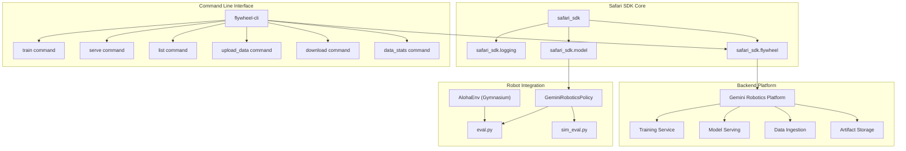
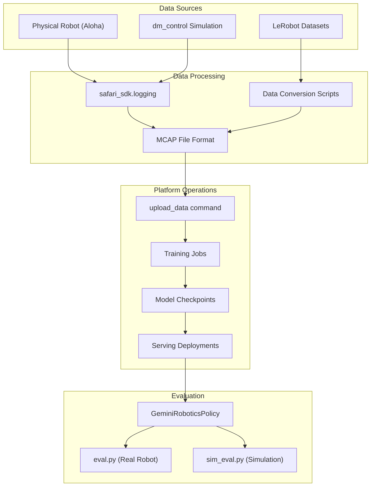

<!-- source: DeepWiki mcp.deepwiki.com · repo google-deepmind/gemini-robotics-sdk · page 1 Overview · fetched 2026-10-26 -->

# Overview

Relevant source files

The following files were used as context for generating this wiki page:

- [README.md](README.md)
- [pyproject.toml](pyproject.toml)
- [safari_sdk/__init__.py](safari_sdk/__init__.py)

The Safari SDK is a comprehensive robotics model lifecycle management system that provides tooling for working with Google DeepMind Gemini Robotics models. This document covers the high-level architecture, core components, and primary workflows of the SDK.

The Safari SDK enables users to upload robotics data, train models, deploy them for serving, and evaluate policies on both real robots and in simulation. The system is designed around a modular architecture with three main components: data logging (`safari_sdk.logging`), model interfaces (`safari_sdk.model`), and platform operations (`safari_sdk.flywheel`).

For specific CLI operations, see [Command Line Interface](#3). For Aloha robot integration details, see [Aloha Robot System](#4). For data handling workflows, see [Data Management](#5).

## System Architecture

The Safari SDK consists of several interconnected systems that work together to provide end-to-end robotics model management capabilities.

### High-Level Component Architecture

**Sources:** [README.md:1-85](), [safari_sdk/__init__.py:15-20](), [pyproject.toml:1-89]()

## Core Components

The Safari SDK is organized into three primary modules, each handling specific aspects of the robotics pipeline:

| Component | Purpose | Key Classes/Functions |
|-----------|---------|----------------------|
| `safari_sdk.logging` | Data collection and MCAP file handling | Data conversion utilities, logging infrastructure |
| `safari_sdk.model` | Model inference and robotics policy interfaces | `GeminiRoboticsPolicy`, GenAI Robotics API client |
| `safari_sdk.flywheel` | Platform operations and lifecycle management | CLI commands, training/serving orchestration |

### Entry Points and Interfaces

The system provides multiple entry points for different use cases:

- **CLI Interface**: The `flywheel-cli` command provides access to all major platform operations
- **Python API**: Direct access to SDK components through `safari_sdk` imports  
- **Robot Integration**: `AlohaEnv` Gymnasium environment for robot evaluation
- **Policy Interface**: `GeminiRoboticsPolicy` for model inference

**Sources:** [pyproject.toml:53-54](), [README.md:44-55](), [README.md:69-82]()

## Data Flow and Lifecycle

The Safari SDK manages a complete data pipeline from robot data collection through model training and deployment.

### Data Processing Pipeline

**Sources:** [README.md:44-55](), [README.md:69-82]()

## Key Workflows

### Model Training and Serving Workflow

1. **Data Upload**: Use `flywheel-cli upload_data` to ingest MCAP files
2. **Training**: Execute `flywheel-cli train` with task parameters
3. **Serving**: Deploy models using `flywheel-cli serve`
4. **Evaluation**: Run policies through `GeminiRoboticsPolicy` interface

### Robot Evaluation Workflow

1. **Environment Setup**: Configure `AlohaEnv` Gymnasium environment
2. **Policy Loading**: Initialize `GeminiRoboticsPolicy` with serve ID
3. **Real Robot**: Execute `eval.py` for physical robot evaluation
4. **Simulation**: Use `sim_eval.py` for MuJoCo-based testing

**Sources:** [README.md:69-82]()

## Dependencies and Requirements

The Safari SDK requires Python 3.10-3.12 and integrates with several key robotics and machine learning frameworks:

- **Machine Learning**: TensorFlow (tf-nightly), Google GenAI
- **Robotics**: MuJoCo, dm-env, OpenCV
- **Data Formats**: Protocol Buffers, MCAP
- **Communication**: gRPC, Google API clients

The system is distributed as a pip-installable package with the command-line interface automatically available after installation.

**Sources:** [pyproject.toml:5](), [pyproject.toml:21-48](), [README.md:14-23]()

---

