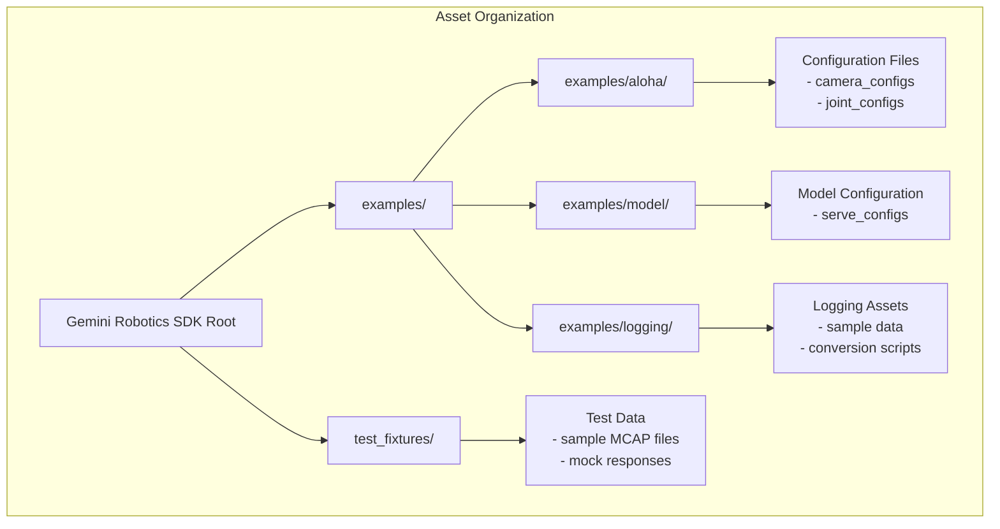
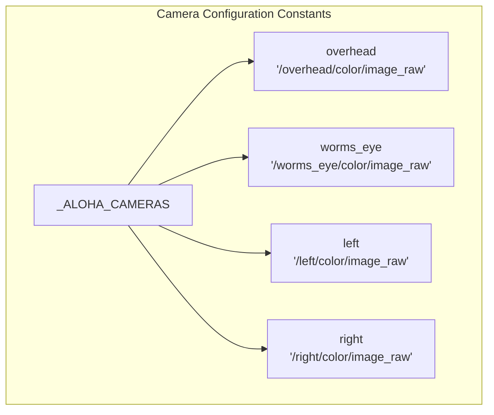
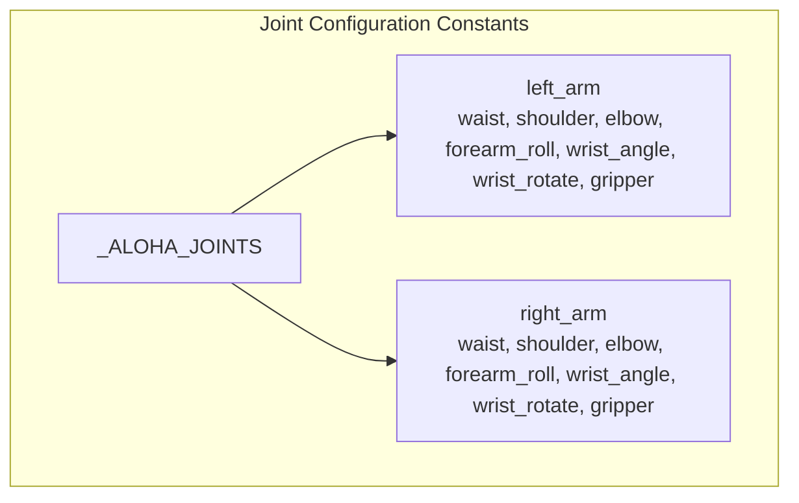
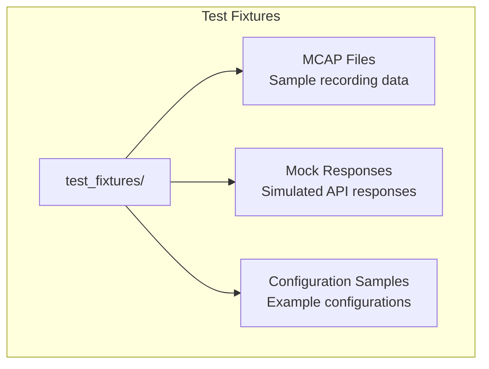
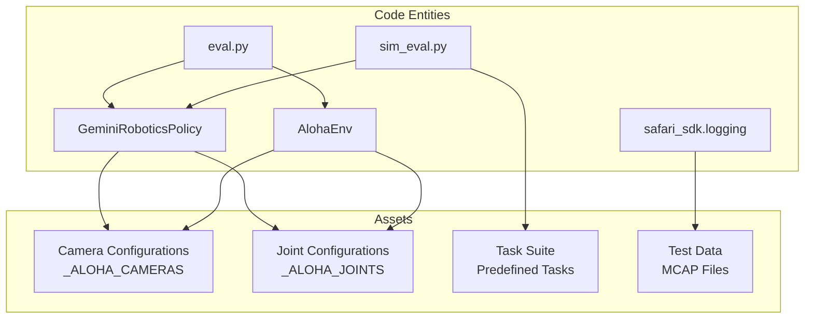

<!-- source: DeepWiki mcp.deepwiki.com · repo google-deepmind/gemini-robotics-sdk · page 10 Assets · fetched 2026-10-26 -->

# Assets

<details>
<summary>Relevant source files</summary>

The following files were used as context for generating this wiki page:

- [assets/safari_logging.png](assets/safari_logging.png)

</details>


This page documents the assets and resources used within the Gemini Robotics SDK. It provides an overview of the visual resources, configuration files, and other static assets that support the SDK's functionality.

## Purpose and Scope

The Assets section covers the various non-code resources that are essential for the Gemini Robotics SDK's operation, including:

- Example configuration files
- Camera and joint configuration constants
- Visual resources for documentation
- Test fixtures and sample data

For information about data management and MCAP files, see [Data Management](#5).

## Asset Organization

The Gemini Robotics SDK organizes its assets across several directories based on their purpose and usage. The following diagram illustrates the high-level organization of assets within the codebase:



## Configuration Constants

The SDK provides predefined configuration constants for camera and joint configurations, particularly for the Aloha robot system. These constants are essential for properly initializing and using the SDK with specific robot hardware.

### Camera Configurations

Camera configurations define the camera setup for the Aloha robot system, including camera names and their respective topics.



Sources: examples/aloha/eval.py

### Joint Configurations

Joint configurations define the robot joints that can be controlled, organized by arm (left and right).



Sources: examples/aloha/eval.py

## Example Assets

The SDK includes various example assets to help users get started with the platform. These examples demonstrate how to use different components of the SDK.

### Aloha Example Assets

The Aloha examples directory contains assets related to the Aloha robot system, including:

| Asset Type | Description | Location |
|------------|-------------|----------|
| Environment Configuration | Configuration for the AlohaEnv Gymnasium environment | examples/aloha/ |
| Evaluation Scripts | Scripts for evaluating policies on the Aloha robot | examples/aloha/eval.py |
| Simulation Assets | Assets for simulation evaluation | examples/aloha/sim_eval.py |
| Task Suite | Predefined tasks for evaluation | examples/aloha/task_suite/ |

Sources: examples/aloha/

### Model Example Assets

The model examples directory contains assets related to model configuration and usage:

| Asset Type | Description | Location |
|------------|-------------|----------|
| Serve Configurations | Configuration for serving models | examples/model/ |
| Policy Examples | Examples of using GeminiRoboticsPolicy | examples/model/ |

Sources: examples/model/

### Logging Example Assets

The logging examples directory contains assets related to data logging and conversion:

| Asset Type | Description | Location |
|------------|-------------|----------|
| Conversion Scripts | Scripts for converting between data formats | examples/logging/ |
| Sample Data | Sample data for testing conversion | examples/logging/ |

Sources: examples/logging/

## Test Fixtures

The SDK includes test fixtures that are used for testing and validation. These fixtures include sample data files and mock responses that simulate the behavior of the platform.



## Asset Usage in Code

The following diagram illustrates how assets are used within the codebase, showing the relationship between code entities and the assets they utilize:



Sources: examples/aloha/eval.py, examples/model/

## Asset Configuration Format

Configuration assets in the SDK typically follow a structured format. For example, camera configurations are defined as dictionaries mapping camera names to their respective topics:

```python
_ALOHA_CAMERAS = {
    'overhead': '/overhead/color/image_raw',
    'worms_eye': '/worms_eye/color/image_raw',
    'left': '/left/color/image_raw',
    'right': '/right/color/image_raw',
}
```

Joint configurations follow a similar pattern, organizing joints by arm:

```python
_ALOHA_JOINTS = {
    'left_arm': ['waist', 'shoulder', 'elbow', 'forearm_roll', 'wrist_angle', 'wrist_rotate', 'gripper'],
    'right_arm': ['waist', 'shoulder', 'elbow', 'forearm_roll', 'wrist_angle', 'wrist_rotate', 'gripper'],
}
```

Sources: examples/aloha/eval.py

## Summary

The assets in the Gemini Robotics SDK provide essential resources for configuring, testing, and using the platform. They include configuration constants, example files, and test fixtures that support the SDK's functionality. Understanding these assets is crucial for effectively working with the SDK and integrating it with robot systems.