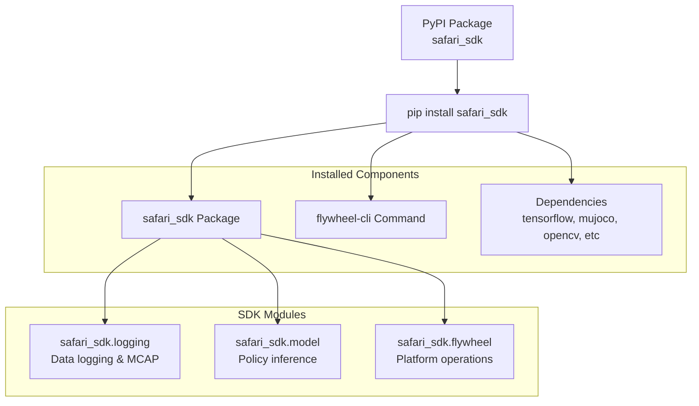
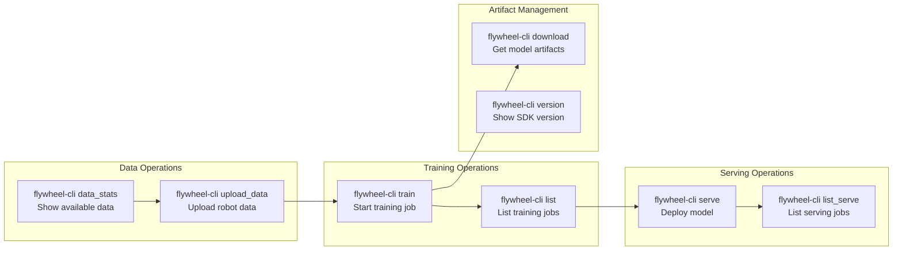
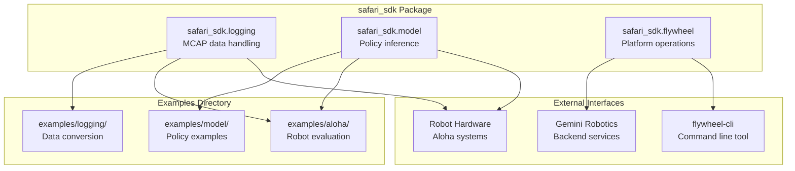

<!-- source: DeepWiki mcp.deepwiki.com · repo google-deepmind/gemini-robotics-sdk · page 2 Getting Started · fetched 2026-10-26 -->

# Getting Started

<details>
<summary>Relevant source files</summary>

The following files were used as context for generating this wiki page:

- [README.md](README.md)
- [pyproject.toml](pyproject.toml)
- [scripts/build_wheel.sh](scripts/build_wheel.sh)

</details>


This document covers initial installation, setup, and first steps with the Safari SDK. It provides the essential information needed to begin using the SDK for robotics model lifecycle management, including installation, authentication setup, and basic workflow orientation.

For detailed CLI operations, see [Command Line Interface](#3). For Aloha robot-specific setup, see [Aloha Robot System](#4). For advanced build and development setup, see [Build System](#8).

## Installation

The Safari SDK is distributed as a Python package and can be installed via PyPI. The installation includes the core SDK libraries and the `flywheel-cli` command-line tool.

### Prerequisites

- Python 3.10, 3.11, or 3.12 (Python 3.13 not supported due to TensorFlow compatibility)
- Virtual environment (recommended to avoid dependency conflicts)

### Installing from PyPI

```bash
pip install safari_sdk
```

This installs:
- The `safari_sdk` Python package with all core modules
- The `flywheel-cli` command-line tool 
- All required dependencies including TensorFlow, MuJoCo, and robotics libraries

### Installation Architecture



Sources: [README.md:16-21](), [pyproject.toml:53-54](), [pyproject.toml:21-48]()

## Verifying Installation

After installation, verify that the SDK is working correctly:

```bash
# Test CLI availability
flywheel-cli help

# Test core module imports
python -c "from safari_sdk.logging.python import stream_logger"
python -c "from safari_sdk.model import saved_model_policy"
python -c "from safari_sdk.logging.python import mcap_episodic_logger"
```

These commands should run without errors if the installation was successful.

Sources: [scripts/build_wheel.sh:29-33]()

## Basic Setup and Authentication

The Safari SDK requires authentication to access the Gemini Robotics platform. Most functionality requires participation in the Gemini Robotics Trusted Tester Program.

### Access Requirements

- Enrollment in the Gemini Robotics Trusted Tester Program
- Valid API credentials for backend services
- Network access to Google DeepMind services

### Model Access

Trusted Testers can access the Gemini Robotics On Device model starting from SDK version 2.4.1. The SDK aims to support all models in the Gemini Robotics model series.

Sources: [README.md:10-12](), [README.md:39-42]()

## First Steps Workflow

The typical getting started workflow involves data management, model training, and deployment operations through the CLI.

### CLI Command Overview



Sources: [README.md:69-81]()

## SDK Module Structure

The Safari SDK is organized into three main modules, each serving specific aspects of the robotics pipeline.

### Core Modules

| Module | Purpose | Key Components |
|--------|---------|----------------|
| `safari_sdk.logging` | Data logging and MCAP file handling | `stream_logger`, `mcap_episodic_logger` |
| `safari_sdk.model` | Model inference and policy execution | `saved_model_policy`, policy interfaces |
| `safari_sdk.flywheel` | Platform operations and CLI | `flywheel_cli`, training/serving APIs |

### Module Integration Architecture



Sources: [README.md:45-54](), [pyproject.toml:53-54]()

## Building from Source (Optional)

For development or customization, you can build the SDK from source code.

### Development Build Process

```bash
# Clone the repository
git clone https://github.com/google-deepmind/gemini-robotics-sdk
cd gemini-robotics-sdk

# Build wheel using the provided script
scripts/build_wheel.sh
```

### Build System Overview

The build script performs these operations:
1. Creates a CMake build directory at `${SAFARI_DIR}/build`
2. Runs CMake configuration and build
3. Executes `make pip_wheel pip_install` targets
4. Sets up a virtual environment at `build/safari_venv`
5. Runs smoke tests to verify the installation
6. Creates the wheel in the `dist/` directory

The final wheel path is symlinked to `/tmp/safari_sdk-lastbuild-py3-none-any.whl` for convenience.

Sources: [README.md:25-35](), [scripts/build_wheel.sh:19-41]()

## Next Steps

After completing the installation and setup:

1. **Explore CLI Commands**: Use `flywheel-cli help` to see all available commands and their usage. See [Command Line Interface](#3) for detailed documentation.

2. **Data Management**: Learn about uploading robot data and working with MCAP files. See [Data Management](#5) for comprehensive coverage.

3. **Aloha Integration**: If working with Aloha robots, set up the AlohaEnv and evaluation scripts. See [Aloha Robot System](#4).

4. **Model Integration**: Understand policy inference and the Gemini Robotics API. See [Model Integration](#6).

The SDK supports the complete robotics model lifecycle from data collection through training to deployment and evaluation.

Sources: [README.md:83-84]()

---

