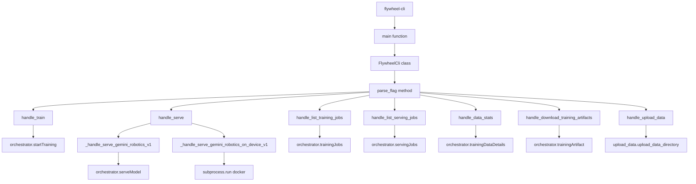

<!-- source: DeepWiki mcp.deepwiki.com · repo google-deepmind/gemini-robotics-sdk · page 3 Command Line Interface · fetched 2026-10-26 -->

# Command Line Interface

<details>
<summary>Relevant source files</summary>

The following files were used as context for generating this wiki page:

- [safari_sdk/flywheel/flywheel_cli.py](safari_sdk/flywheel/flywheel_cli.py)
- [safari_sdk/flywheel/flywheel_cli_test.py](safari_sdk/flywheel/flywheel_cli_test.py)

</details>


The Safari SDK provides a comprehensive command line interface through the `flywheel-cli` tool for managing the complete robotics model lifecycle. This interface handles training job management, model serving deployment, data ingestion operations, and artifact downloads through a unified command-line experience.

For information about the underlying model integration and policies, see [Model Integration](#6). For data conversion and upload workflows, see [Data Management](#5).

## CLI Architecture Overview

The `flywheel-cli` tool is built around the `FlywheelCli` class which orchestrates all command operations through the backend orchestrator API.

### Command Flow Architecture



Sources: [safari_sdk/flywheel/flywheel_cli.py:183-740]()

### Core CLI Components

```mermaid
graph TB
    subgraph "CLI Entry Points"
        Main[main function]
        CLIMain[cli_main function]
    end
    
    subgraph "Core Classes"
        FlywheelCli[FlywheelCli class]
        AuthService[auth.get_service]
    end
    
    subgraph "Flag Definitions"
        TrainingJobID[_TRAINING_JOB_ID]
        ModelCheckpoint[_MODEL_CHECKPOINT_NUMBER]
        TaskID[_TASK_ID]
        StartDate[_START_DATE]
        EndDate[_END_DATE]
        TrainingRecipe[_TRAINING_RECIPE]
        JSONOutput[_JSON_OUTPUT]
    end
    
    subgraph "Command Handlers"
        HandleTrain[handle_train]
        HandleServe[handle_serve]
        HandleList[handle_list_training_jobs]
        HandleDataStats[handle_data_stats]
        HandleDownload[handle_download_training_artifacts]
        HandleUpload[handle_upload_data]
    end
    
    subgraph "Backend Integration"
        OrchestratorService[orchestrator service]
        UploadDataModule[upload_data module]
    end
    
    Main --> FlywheelCli
    FlywheelCli --> AuthService
    FlywheelCli --> HandleTrain
    FlywheelCli --> HandleServe
    FlywheelCli --> HandleList
    FlywheelCli --> HandleDataStats
    FlywheelCli --> HandleDownload
    FlywheelCli --> HandleUpload
    
    HandleTrain --> OrchestratorService
    HandleServe --> OrchestratorService
    HandleList --> OrchestratorService
    HandleDataStats --> OrchestratorService
    HandleDownload --> OrchestratorService
    HandleUpload --> UploadDataModule
    
    TrainingJobID --> FlywheelCli
    ModelCheckpoint --> FlywheelCli
    TaskID --> FlywheelCli
    StartDate --> FlywheelCli
    EndDate --> FlywheelCli
    TrainingRecipe --> FlywheelCli
    JSONOutput --> FlywheelCli
```



Sources: [safari_sdk/flywheel/flywheel_cli.py:58-137](), [safari_sdk/flywheel/flywheel_cli.py:183-189]()

## Core Commands

### Training Operations

The `train` command initiates model training jobs through the `handle_train` method. Training requires specifying data filters and a training recipe.

**Required Parameters:**
- `--task_id`: Task identifier for training data
- `--start_date`: Start date in YYYYMMDD format  
- `--end_date`: End date in YYYYMMDD format
- `--training_recipe`: One of `narrow`, `gemini_robotics_v1`, `gemini_robotics_on_device_v1`

**Example Usage:**
```bash
flywheel-cli train --task_id=my_task --start_date=20240101 --end_date=20240131 --training_recipe=gemini_robotics_v1
```

The training recipes map to specific training types via `_RECIPE_TO_TYPE_MAP`:

| Recipe | Training Type |
|--------|---------------|
| `narrow` | `TRAINING_TYPE_NARROW` |
| `gemini_robotics_v1` | `TRAINING_TYPE_GEMINI_ROBOTICS_V1` |
| `gemini_robotics_on_device_v1` | `TRAINING_TYPE_GEMINI_ROBOTICS_ON_DEVICE_V1` |

Sources: [safari_sdk/flywheel/flywheel_cli.py:190-210](), [safari_sdk/flywheel/flywheel_cli.py:49-56](), [safari_sdk/flywheel/flywheel_cli.py:537-561]()

### Model Serving Operations

Model serving is handled through the `handle_serve` method with different implementations for each training recipe:

#### Gemini Robotics V1 Serving

For `gemini_robotics_v1` models, serving is managed through the `_handle_serve_gemini_robotics_v1` method:

**Required Parameters:**
- `--training_job_id`: ID of completed training job
- `--model_checkpoint_number`: Checkpoint number to serve

The method calls `orchestrator().serveModel()` to deploy the model to the cloud serving infrastructure.

#### On-Device Serving

For `gemini_robotics_on_device_v1` models, the `_handle_serve_gemini_robotics_on_device_v1` method:

1. Downloads model checkpoints if not provided locally
2. Launches a Docker container for local serving
3. Maps the checkpoint file into the container filesystem

**Optional Parameters:**
- `--model_checkpoint_path`: Local checkpoint file path
- `--serve_port`: Local serving port (default: 60061)
- `--gpu_mem_fraction`: GPU memory allocation (default: 0.8)

The Docker command executed follows this pattern:
```bash
docker run -it --gpus 0 -p {port}:60061 -v {checkpoint_dir}:/checkpoint \
  -e XLA_PYTHON_CLIENT_MEM_FRACTION={fraction} \
  google-deepmind/gemini_robotics_on_device /checkpoint/{checkpoint_file}
```

Sources: [safari_sdk/flywheel/flywheel_cli.py:342-352](), [safari_sdk/flywheel/flywheel_cli.py:353-396](), [safari_sdk/flywheel/flywheel_cli.py:397-407]()

### Job Listing and Status

#### Training Job Listing

The `handle_list_training_jobs` method retrieves and displays training job information through `orchestrator().trainingJobs()`. The output includes:

- Training job ID
- Job status/stage
- Training type
- Associated task and robot IDs
- Date range filters

#### Serving Job Listing  

The `handle_list_serving_jobs` method displays serving job information including:

- Serving job ID
- Associated training job ID
- Model checkpoint number
- Job status
- Training data filters

Both listing commands support responsive table formatting through `_print_responsive_table` that adapts to terminal width.

Sources: [safari_sdk/flywheel/flywheel_cli.py:252-296](), [safari_sdk/flywheel/flywheel_cli.py:297-341](), [safari_sdk/flywheel/flywheel_cli.py:614-669]()

### Data Management Operations

#### Data Statistics

The `handle_data_stats` method provides visibility into available training data through `orchestrator().trainingDataDetails()`. The output shows:

- Robot ID and Task ID combinations
- Available dates with data
- Daily episode counts
- Success episode counts

#### Data Upload

The `handle_upload_data` method delegates to the `upload_data.upload_data_directory` function for ingesting data files:

**Required Parameters:**
- `--upload_data_robot_id`: Robot identifier (alphanumeric, <60 chars)
- `--upload_data_directory`: Directory containing data files

Sources: [safari_sdk/flywheel/flywheel_cli.py:211-251](), [safari_sdk/flywheel/flywheel_cli.py:408-415]()

### Artifact Downloads

The download system provides two modes through the `download` command:

#### Training Job Artifacts

Using `--training_job_id`, the `handle_download_training_artifacts` method:

1. Retrieves available artifacts via `orchestrator().trainingArtifact()`
2. Presents an interactive selection menu
3. Downloads selected artifacts with progress reporting
4. Saves to user-specified locations

#### Direct Artifact Downloads

Using `--artifact_id`, the `handle_download_artifact_id` method:

1. Loads artifact metadata via `orchestrator().loadArtifact()`
2. Downloads the artifact file
3. Automatically loads Docker images if detected

The download process uses `_download_url_to_file` with `_reporthook` for progress visualization.

Sources: [safari_sdk/flywheel/flywheel_cli.py:416-491](), [safari_sdk/flywheel/flywheel_cli.py:492-530](), [safari_sdk/flywheel/flywheel_cli.py:685-694]()

## Configuration and Authentication

### Flag System

The CLI uses the `absl.flags` system for configuration management. Key flags include:

| Flag | Type | Purpose |
|------|------|---------|
| `_TRAINING_JOB_ID` | string | Training job identifier |
| `_MODEL_CHECKPOINT_NUMBER` | integer | Model checkpoint number |
| `_TASK_ID` | list | Task identifiers |
| `_START_DATE` / `_END_DATE` | string | Date range (YYYYMMDD) |
| `_TRAINING_RECIPE` | enum | Training recipe selection |
| `_JSON_OUTPUT` | boolean | JSON vs text output format |

### Authentication

Authentication is handled through the `auth.get_service()` function which:

1. Retrieves API keys from `--api_key` flag or `api_key.json` files
2. Builds the Google API client for the orchestrator service
3. Provides authenticated service instances

The `parse_flag` method validates API key presence before executing any commands.

Sources: [safari_sdk/flywheel/flywheel_cli.py:58-137](), [safari_sdk/flywheel/flywheel_cli.py:186-189](), [safari_sdk/flywheel/flywheel_cli.py:531-535]()

## Output Formats and Error Handling

### Output Formatting

The CLI supports two output modes controlled by `_JSON_OUTPUT`:

1. **JSON Mode**: Structured output for programmatic consumption
2. **Text Mode**: Human-readable tables and formatted text

Text mode includes:
- Responsive table formatting via `_print_responsive_table`
- Progress bars for downloads via `_reporthook`
- Interactive prompts for selections

### Input Validation

The `parse_flag` method performs comprehensive validation:

- **Date Format**: Validates YYYYMMDD format using `_is_valid_date`
- **Date Range**: Ensures start ≤ end via `_is_valid_start_end_date_pair`
- **Required Fields**: Checks for mandatory parameters per command
- **Recipe Support**: Validates recipe compatibility with commands

### Error Handling

Error handling includes:
- API authentication failures
- Invalid parameter combinations
- Network/download errors with informative messages
- Docker execution failures with troubleshooting hints

Sources: [safari_sdk/flywheel/flywheel_cli.py:531-612](), [safari_sdk/flywheel/flywheel_cli.py:696-712](), [safari_sdk/flywheel/flywheel_cli.py:671-694]()

---

