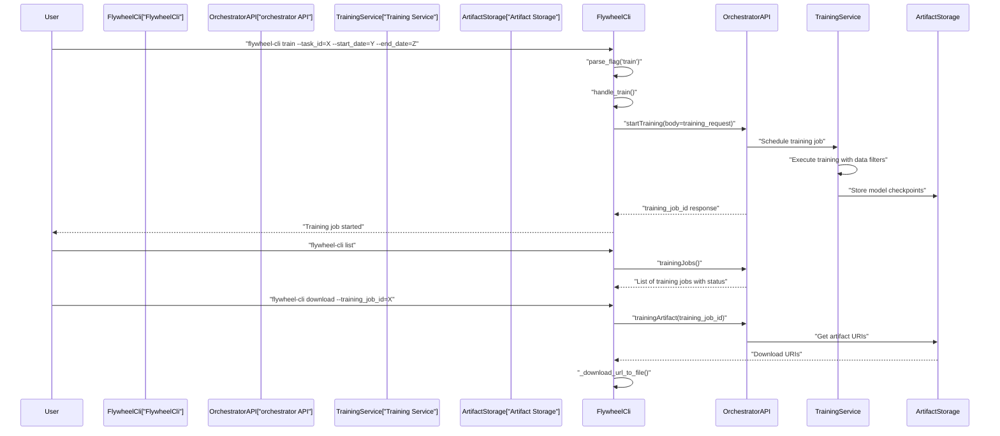
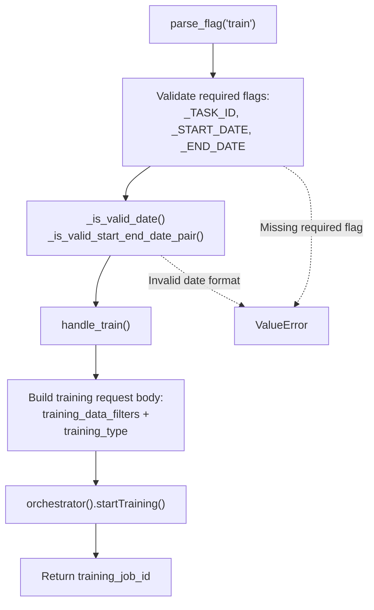
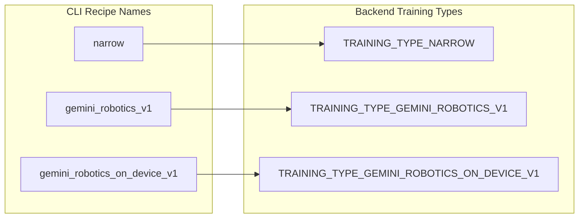
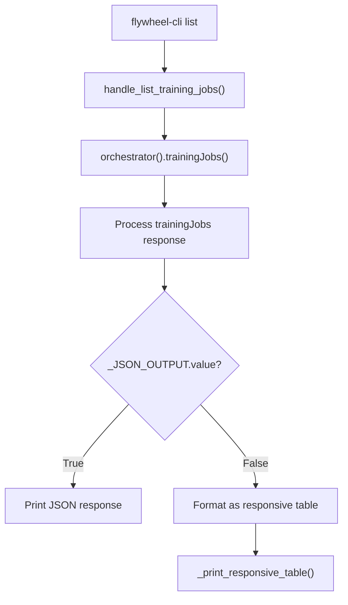
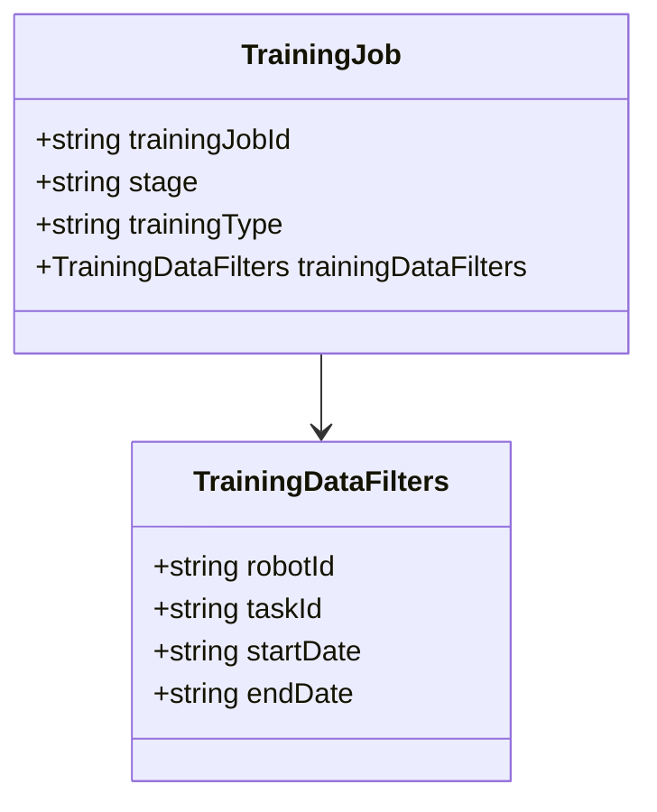
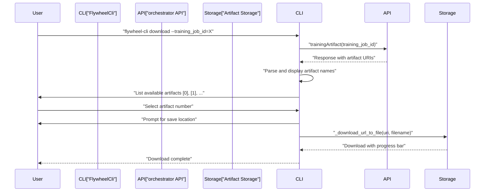
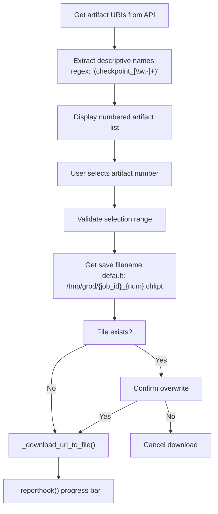
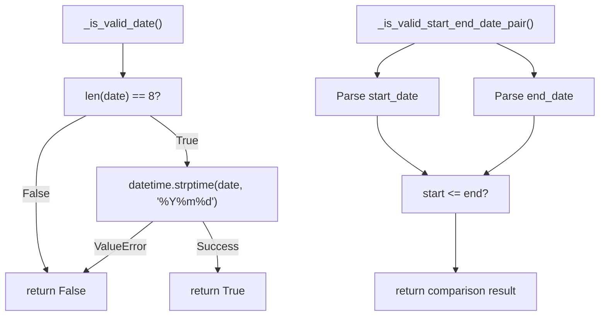

<!-- source: DeepWiki mcp.deepwiki.com · repo google-deepmind/gemini-robotics-sdk · page 3.1 Training Operations · fetched 2026-10-26 -->

# Training Operations

Relevant source files

The following files were used as context for generating this wiki page:

- [safari_sdk/flywheel/flywheel_cli.py](safari_sdk/flywheel/flywheel_cli.py)
- [safari_sdk/flywheel/flywheel_cli_test.py](safari_sdk/flywheel/flywheel_cli_test.py)

This document covers the training operations functionality of the Safari SDK CLI tool, specifically how to start training jobs, manage training workflows, and handle training artifacts. This includes the `train`, `list`, and `download` commands of the `flywheel-cli` tool.

For information about data management operations like uploading training data, see [Data Management](#3.2). For information about serving trained models, see [Model Serving](#3.3).

## Training Job Lifecycle

The training operations in Safari SDK follow a structured lifecycle managed through the `flywheel-cli` tool. Training jobs are created with specific data filters and training recipes, then executed on the backend platform.

Sources: [safari_sdk/flywheel/flywheel_cli.py:190-210](), [safari_sdk/flywheel/flywheel_cli.py:252-295](), [safari_sdk/flywheel/flywheel_cli.py:416-490]()

## Training Command Implementation

The `train` command is implemented through the `FlywheelCli` class and requires specific training data filters and recipe configuration.

### Training Request Structure

The training request body contains training data filters and training type specification:

| Field | Description | Source |
|-------|-------------|---------|
| `training_data_filters` | Filters for training data selection | [safari_sdk/flywheel/flywheel_cli.py:200-204]() |
| `task_id` | List of task identifiers | [safari_sdk/flywheel/flywheel_cli.py:93-95]() |
| `start_date` | Training data start date (YYYYMMDD) | [safari_sdk/flywheel/flywheel_cli.py:97-101]() |
| `end_date` | Training data end date (YYYYMMDD) | [safari_sdk/flywheel/flywheel_cli.py:103-105]() |
| `training_type` | Type mapped from recipe | [safari_sdk/flywheel/flywheel_cli.py:49-56]() |

Sources: [safari_sdk/flywheel/flywheel_cli.py:198-209]()

## Training Recipes and Types

The CLI supports multiple training recipes that map to specific training types on the backend platform.

The mapping is defined in `_RECIPE_TO_TYPE_MAP`:

| Recipe | Training Type | Purpose |
|--------|---------------|---------|
| `narrow` | `TRAINING_TYPE_NARROW` | Narrow domain training |
| `gemini_robotics_v1` | `TRAINING_TYPE_GEMINI_ROBOTICS_V1` | Gemini Robotics V1 training |
| `gemini_robotics_on_device_v1` | `TRAINING_TYPE_GEMINI_ROBOTICS_ON_DEVICE_V1` | On-device optimized training |

Sources: [safari_sdk/flywheel/flywheel_cli.py:49-56]()

## Training Job Management

### Listing Training Jobs

The `list` command shows all available training jobs with their status and configuration through the `handle_list_training_jobs()` method.

The table output includes the following columns:
- Training job ID
- Status (stage)
- Training type
- Task ID (from filters)
- Robot ID (from filters)
- Start date (from filters)  
- End date (from filters)

Sources: [safari_sdk/flywheel/flywheel_cli.py:252-295]()

### Training Job Response Structure

Training jobs returned from the API contain the following structure:

Sources: [safari_sdk/flywheel/flywheel_cli_test.py:41-55]()

## Training Artifact Management

### Downloading Training Artifacts

The `download` command provides interactive artifact selection and download through the `handle_download_training_artifacts()` method.

### Artifact Selection Process

The artifact selection process includes name extraction and user interaction:

1. **URI Processing**: Extract descriptive names from artifact URIs using regex pattern `(checkpoint_[\w.-]+)`
2. **Interactive Selection**: Present numbered list of artifacts to user
3. **File Path Selection**: Allow custom save location with default in `/tmp/grod/`
4. **Download Progress**: Show progress bar using `_reporthook()` callback

Sources: [safari_sdk/flywheel/flywheel_cli.py:416-490](), [safari_sdk/flywheel/flywheel_cli.py:671-683]()

### Artifact Download Implementation

Sources: [safari_sdk/flywheel/flywheel_cli.py:440-490](), [safari_sdk/flywheel/flywheel_cli.py:685-694]()

## Command Validation and Error Handling

The CLI implements comprehensive validation for training operations through the `parse_flag()` method.

### Training Command Validation

| Validation | Error Message | Implementation |
|------------|---------------|----------------|
| API Key Required | "API key is required." | [safari_sdk/flywheel/flywheel_cli.py:533-534]() |
| Task ID Required | "Task is is required." | [safari_sdk/flywheel/flywheel_cli.py:538-539]() |
| Start Date Required | "Start date is required." | [safari_sdk/flywheel/flywheel_cli.py:540-541]() |
| Start Date Format | "Start date is not in the correct format YYYYMMDD" | [safari_sdk/flywheel/flywheel_cli.py:542-546]() |
| End Date Required | "End date is required." | [safari_sdk/flywheel/flywheel_cli.py:547-548]() |
| End Date Format | "End date is not in the correct format YYYYMMDD" | [safari_sdk/flywheel/flywheel_cli.py:549-553]() |
| Date Order | "Start date must be before or equal to end date" | [safari_sdk/flywheel/flywheel_cli.py:554-560]() |

### Date Validation Functions

Sources: [safari_sdk/flywheel/flywheel_cli.py:696-711]()

---

