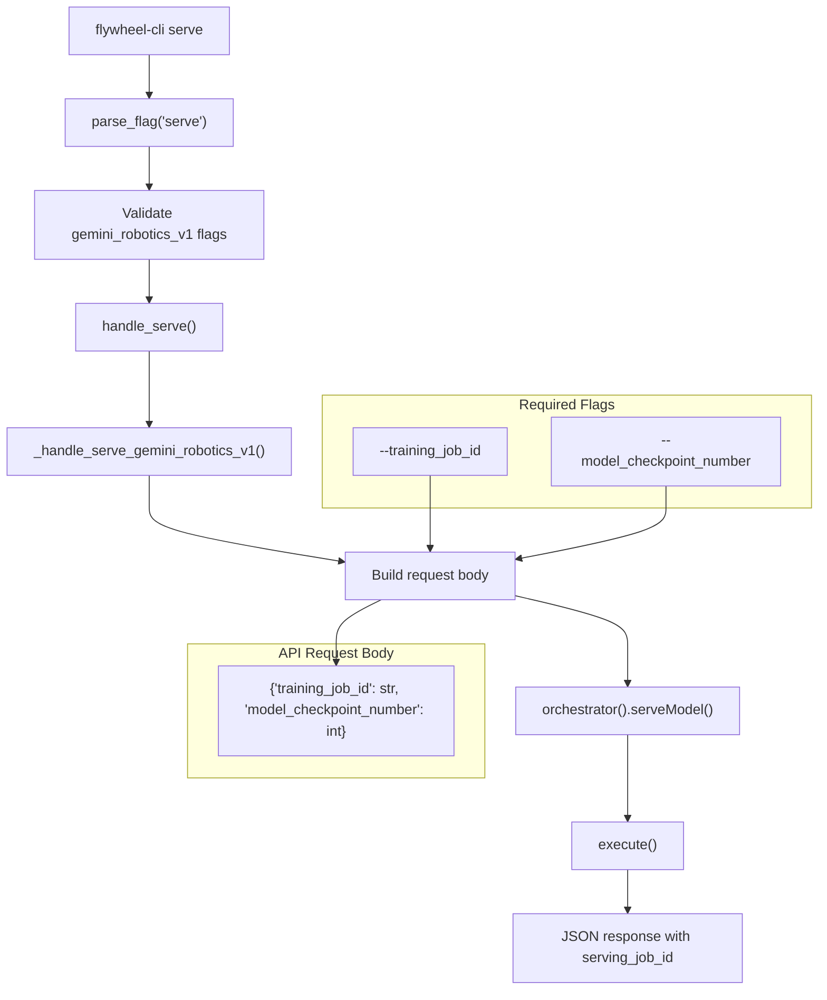
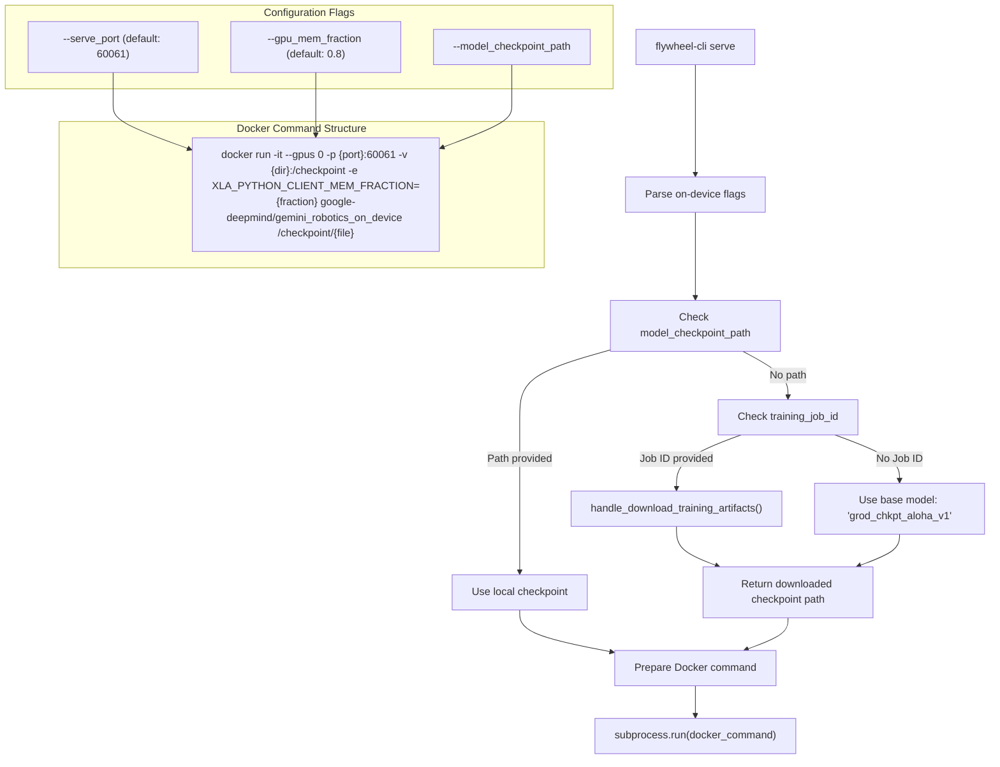
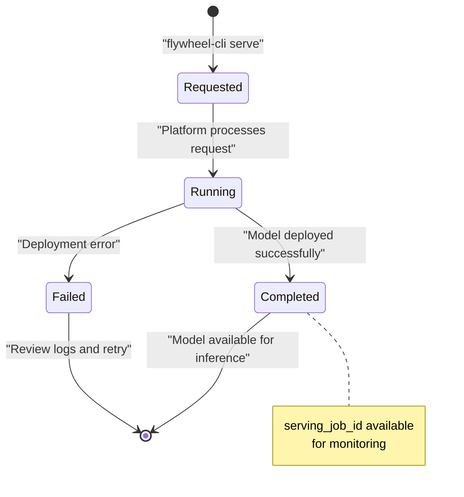

<!-- source: DeepWiki mcp.deepwiki.com · repo google-deepmind/gemini-robotics-sdk · page 3.3 Model Serving · fetched 2026-10-26 -->

# Model Serving

<details>
<summary>Relevant source files</summary>

The following files were used as context for generating this wiki page:

- [safari_sdk/flywheel/flywheel_cli.py](safari_sdk/flywheel/flywheel_cli.py)
- [safari_sdk/flywheel/flywheel_cli_test.py](safari_sdk/flywheel/flywheel_cli_test.py)

</details>


This document covers the model serving capabilities of the Safari SDK's command-line interface. Model serving enables deployment of trained robotics models for inference, supporting both cloud-based deployment and local on-device execution.

For information about training models, see [Training Operations](#3.1). For managing serving jobs after deployment, see [Data Management](#3.2).

## Overview

The Safari SDK provides model serving through the `flywheel-cli serve` command, which supports two distinct serving approaches:

| Serving Type | Recipe | Deployment Target | Requirements |
|--------------|--------|-------------------|--------------|
| Cloud Serving | `gemini_robotics_v1` | Gemini Robotics Platform | Training job ID, checkpoint number |
| On-Device Serving | `gemini_robotics_on_device_v1` | Local Docker container | Docker runtime, optional model checkpoint |

The serving functionality is implemented in the `FlywheelCli` class through the `handle_serve` method, which dispatches to recipe-specific handlers based on the `--training_recipe` flag.

Sources: [safari_sdk/flywheel/flywheel_cli.py:397-407]()

## Cloud Serving Architecture

**Cloud Serving Flow**



Cloud serving deploys models to the Gemini Robotics Platform through the orchestrator API. The process requires a completed training job and specific checkpoint number.

**Required Parameters:**
- `--training_job_id`: Identifier of the completed training job
- `--model_checkpoint_number`: Specific checkpoint to serve (must be > 0)
- `--training_recipe=gemini_robotics_v1`: Specifies cloud serving mode

The implementation validates all required parameters and calls the `serveModel` API endpoint, returning a serving job identifier for monitoring deployment status.

Sources: [safari_sdk/flywheel/flywheel_cli.py:342-351](), [safari_sdk/flywheel/flywheel_cli.py:572-581]()

## On-Device Serving Architecture

**On-Device Serving Flow**



On-device serving runs models locally using Docker containers. The system automatically handles model downloading and Docker container configuration.

**Configuration Options:**

| Flag | Default | Purpose |
|------|---------|---------|
| `--serve_port` | 60061 | Host port for model serving |
| `--gpu_mem_fraction` | 0.8 | GPU memory allocation fraction |
| `--model_checkpoint_path` | None | Local checkpoint path (optional) |
| `--training_job_id` | None | Training job for model download (optional) |

The implementation constructs a Docker command with GPU access, port mapping, and volume mounting for the checkpoint file. If no training job or checkpoint path is specified, it defaults to the base model checkpoint.

Sources: [safari_sdk/flywheel/flywheel_cli.py:353-396](), [safari_sdk/flywheel/flywheel_cli.py:582-587]()

## Serving Job Management

**Serving Job Lifecycle**



Serving jobs can be monitored using the `list_serve` command, which queries the orchestrator API for serving job status. Each serving job tracks the source training job, checkpoint number, and deployment status.

**Serving Job Information:**

The `handle_list_serving_jobs` method displays serving jobs in a formatted table with the following columns:
- Serving job ID
- Training job ID  
- Model checkpoint number
- Status
- Training data filters (task ID, robot ID, date range)

**List Serving Jobs Command:**
```bash
flywheel-cli list_serve --api_key=<key> [--json_output]
```

The command supports both human-readable table output and JSON format for programmatic processing.

Sources: [safari_sdk/flywheel/flywheel_cli.py:297-341](), [safari_sdk/flywheel/flywheel_cli_test.py:217-228]()

## Error Handling and Validation

The serving system includes comprehensive validation for all serving modes:

**Validation Rules:**

| Validation | Error Condition | Error Message |
|------------|----------------|---------------|
| Recipe Support | `training_recipe` not in supported list | "Serving is only supported for training recipe: [supported_recipes]" |
| Training Job ID | Missing for `gemini_robotics_v1` | "Training job id is required." |
| Checkpoint Number | Missing or ≤ 0 for `gemini_robotics_v1` | "Model checkpoint number is required/must be positive" |
| Checkpoint Number | Provided for `gemini_robotics_on_device_v1` | "Model checkpoint number is not supported for training recipe" |

**Docker Error Handling:**

For on-device serving, the system catches `subprocess.CalledProcessError` and provides helpful error messages:
- Suggests loading the Docker image if the container fails to start
- Provides the specific artifact ID for the model server Docker image: `grod_model_server_docker`

Sources: [safari_sdk/flywheel/flywheel_cli.py:563-587](), [safari_sdk/flywheel/flywheel_cli.py:388-395]()

## Integration with Model Inference

Once deployed, served models can be accessed through the Safari SDK's model integration components:

- **Cloud-served models**: Access through `GeminiRoboticsPolicy` with the serving job ID
- **On-device models**: Direct HTTP requests to the local serving endpoint

For details on using served models with robotics policies, see [Gemini Robotics Policies](#6.1).

Sources: [safari_sdk/flywheel/flywheel_cli.py:1-740](), [safari_sdk/flywheel/flywheel_cli_test.py:1-709]()

---

