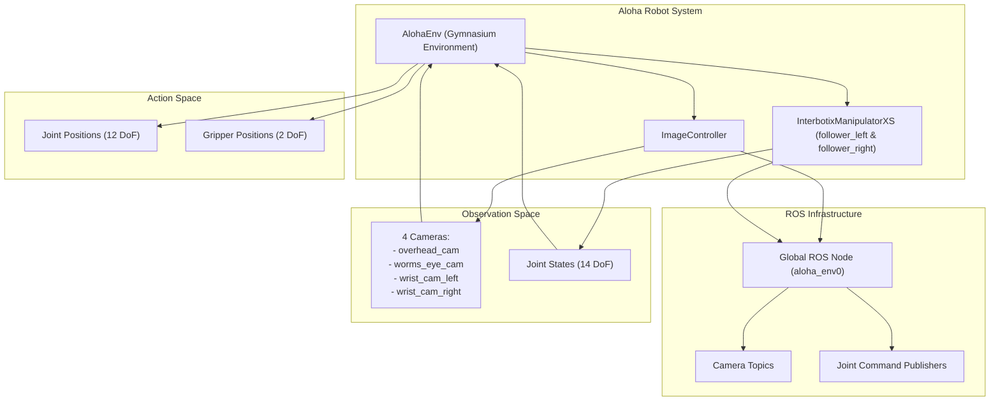
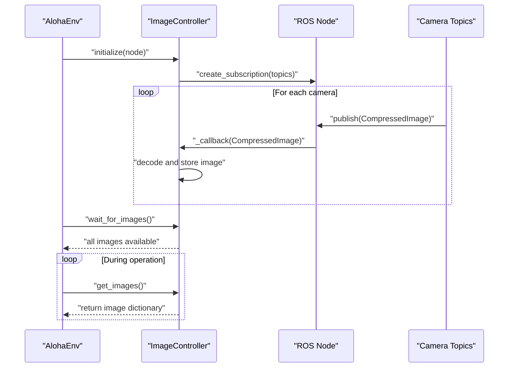
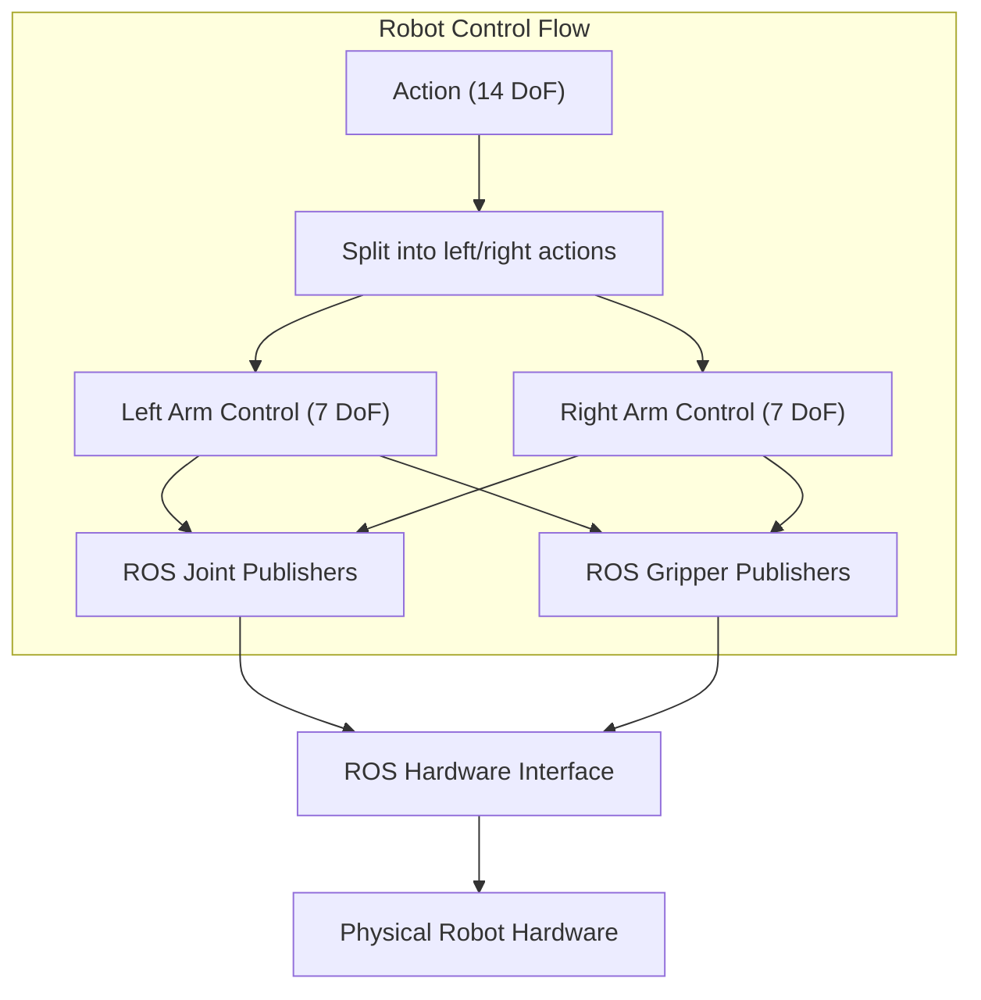
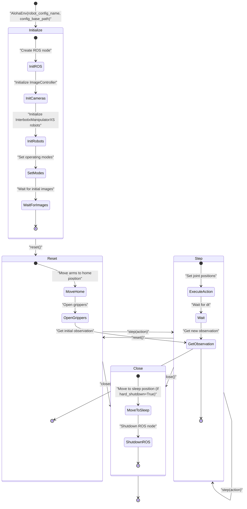
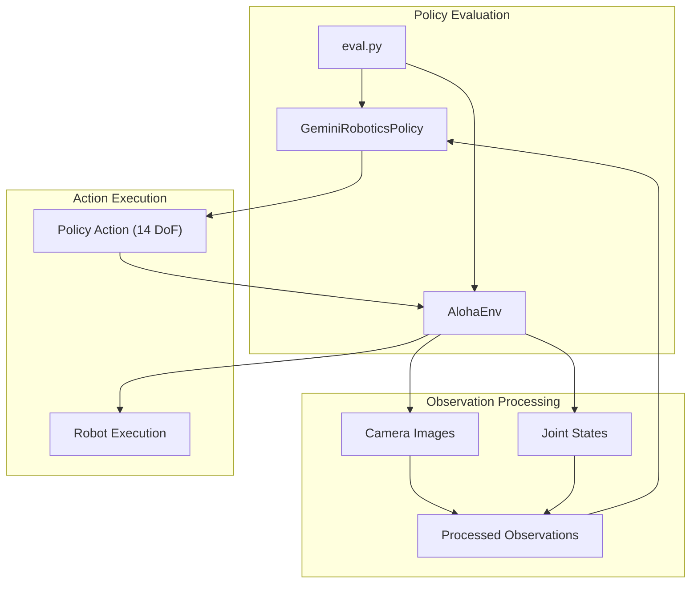

<!-- source: DeepWiki mcp.deepwiki.com · repo google-deepmind/gemini-robotics-sdk · page 4 Aloha Robot System · fetched 2026-10-26 -->

# Aloha Robot System

<details>
<summary>Relevant source files</summary>

The following files were used as context for generating this wiki page:

- [examples/aloha/env.py](examples/aloha/env.py)
- [examples/aloha/requirements.txt](examples/aloha/requirements.txt)

</details>


This document provides a comprehensive guide to the Aloha Robot System, a dual-arm robotic platform integrated with the Gemini Robotics SDK. The Aloha system provides a standardized environment for developing, testing, and evaluating robot policies in both real hardware and simulation contexts.

For information about policy evaluation specifically, see [Policy Evaluation](#4.2). For simulation evaluation, see [Simulation Evaluation](#4.3).

## Overview

The Aloha Robot System consists of two Interbotix robotic arms with multiple cameras for perception. It is implemented as a Gymnasium environment that provides a standardized interface for controlling the robot and receiving observations.



Sources: [examples/aloha/env.py:129-294]()

## Key Components

### AlohaEnv

The `AlohaEnv` class is a Gymnasium environment that provides a standardized interface for interacting with the Aloha robot system. It handles:

1. Robot initialization and configuration
2. Camera image acquisition
3. Joint state monitoring
4. Action execution
5. Environment reset and shutdown

The environment follows the standard Gymnasium interface with `reset()`, `step()`, and `close()` methods.

Sources: [examples/aloha/env.py:129-311]()

### ImageController

The `ImageController` class manages camera subscriptions and image processing. It:

1. Subscribes to multiple ROS camera topics
2. Processes compressed images into numpy arrays
3. Provides synchronized access to the latest images
4. Handles waiting for all cameras to be available



Sources: [examples/aloha/env.py:54-126]()

### Robot Control

The Aloha system uses two Interbotix robotic arms, identified as `follower_left` and `follower_right`. Each arm has:

- 6 degrees of freedom for joint positions
- 1 degree of freedom for the gripper

The environment handles:
- Setting joint positions
- Controlling grippers
- Reading joint states
- Moving to home/sleep positions



Sources: [examples/aloha/env.py:217-230]()

## Environment Interface

### Observation Space

The observation space consists of:

1. Joint positions (`joints_pos`): A 1×14 array containing the positions of all joints
2. Camera images:
   - `overhead_cam`: Top-down view of the workspace
   - `worms_eye_cam`: Bottom-up view of the workspace
   - `wrist_cam_left`: View from the left arm's wrist
   - `wrist_cam_right`: View from the right arm's wrist

Sources: [examples/aloha/env.py:204-215]()

### Action Space

The action space is a 14-dimensional vector representing:

- Positions for 6 joints on the left arm
- Position for the left gripper
- Positions for 6 joints on the right arm
- Position for the right gripper

The action space is defined as a `gym.spaces.Box` with appropriate joint limits.

Sources: [examples/aloha/env.py:184-193]()

### Environment Lifecycle



Sources: [examples/aloha/env.py:232-293](), [examples/aloha/env.py:295-310]()

## Usage Example

Here's a basic example of how to use the Aloha environment:

```python
from examples.aloha.env import AlohaEnv

# Initialize the environment
env = AlohaEnv(
    robot_config_name="aloha_config",
    config_base_path="/path/to/configs",
    instruction="pick up the red block"
)

# Reset the environment
obs, info = env.reset()

# Run a simple control loop
for _ in range(100):
    # Generate action (this would typically come from a policy)
    action = [0.0] * 14  # No-op action
    
    # Step the environment
    obs, reward, terminated, truncated, info = env.step(action)
    
    if terminated or truncated:
        break

# Close the environment
env.close()
```

Sources: [examples/aloha/env.py:129-311]()

## Dependencies

The Aloha Robot System requires several dependencies:

| Dependency | Purpose |
|------------|---------|
| gymnasium | Provides the environment interface |
| modern_robotics | Used for robot kinematics |
| pyyaml | Handles configuration files |
| transforms3d | Handles 3D transformations |
| dm_control | Used for simulation (optional) |
| ROS | Robot Operating System for hardware control |
| Interbotix packages | Specific drivers for the robot hardware |

Sources: [examples/aloha/requirements.txt:1-6]()

## Camera Configuration

The Aloha system uses four cameras positioned to provide comprehensive views of the workspace:

| Camera Name | ROS Topic | Description |
|-------------|-----------|-------------|
| overhead_cam | `/camera_high/camera/color/image_rect_raw/compressed` | Top-down view of the workspace |
| worms_eye_cam | `/camera_low/camera/color/image_rect_raw/compressed` | Bottom-up view of the workspace |
| wrist_cam_left | `/camera_wrist_left/camera/color/image_rect_raw/compressed` | View from the left arm's wrist |
| wrist_cam_right | `/camera_wrist_right/camera/color/image_rect_raw/compressed` | View from the right arm's wrist |

Sources: [examples/aloha/env.py:31-39]()

## Robot Configuration

The Aloha system uses predefined constants for robot control:

| Constant | Value | Description |
|----------|-------|-------------|
| FPS | 50 | Control frequency (Hz) |
| GRIPPER_OPEN | 1.5155 | Gripper position when fully open |
| GRIPPER_CLOSED | -0.06135 | Gripper position when fully closed |
| MOTOR_REGISTER_VALUE | 300 | Motor current limit |
| HOME_POSITION | `[[0.0, -0.96, 1.16, 0.0, -0.3, 0.0]]` | Default home position for the arms |

Sources: [examples/aloha/env.py:40-51]()

## Integration with Gemini Robotics SDK

The Aloha Robot System is designed to work seamlessly with the Gemini Robotics SDK, particularly for policy evaluation. The environment provides the standardized interface that policies expect, including the observation format and action space.



Sources: [examples/aloha/env.py:129-311]()

## Conclusion

The Aloha Robot System provides a standardized environment for developing and evaluating robot policies. By implementing the Gymnasium interface, it enables seamless integration with the Gemini Robotics SDK and other reinforcement learning frameworks. The system's comprehensive observation space and flexible action space make it suitable for a wide range of robotic manipulation tasks.

---

