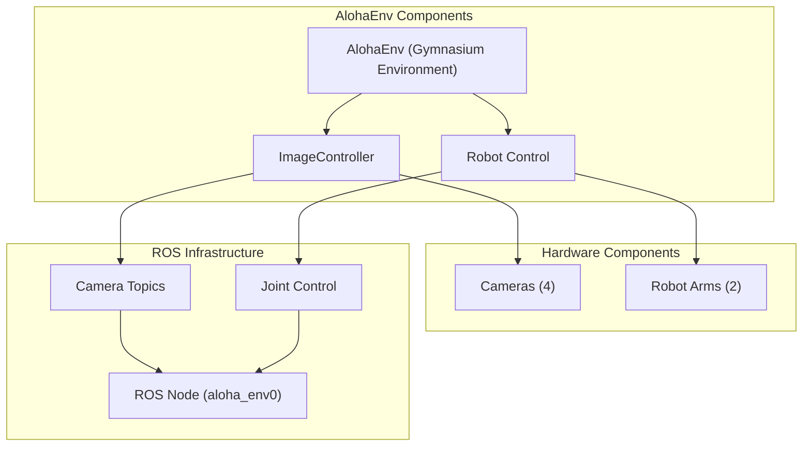
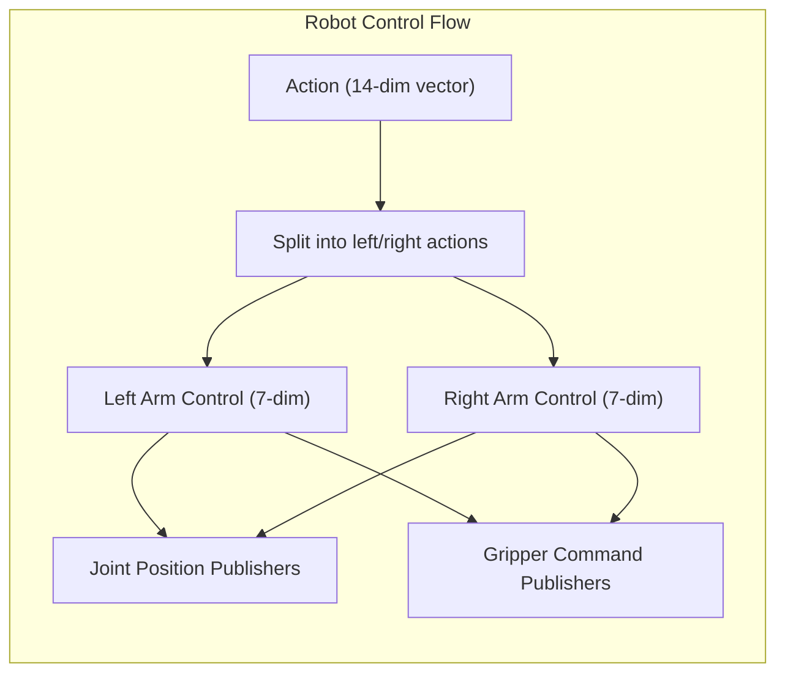
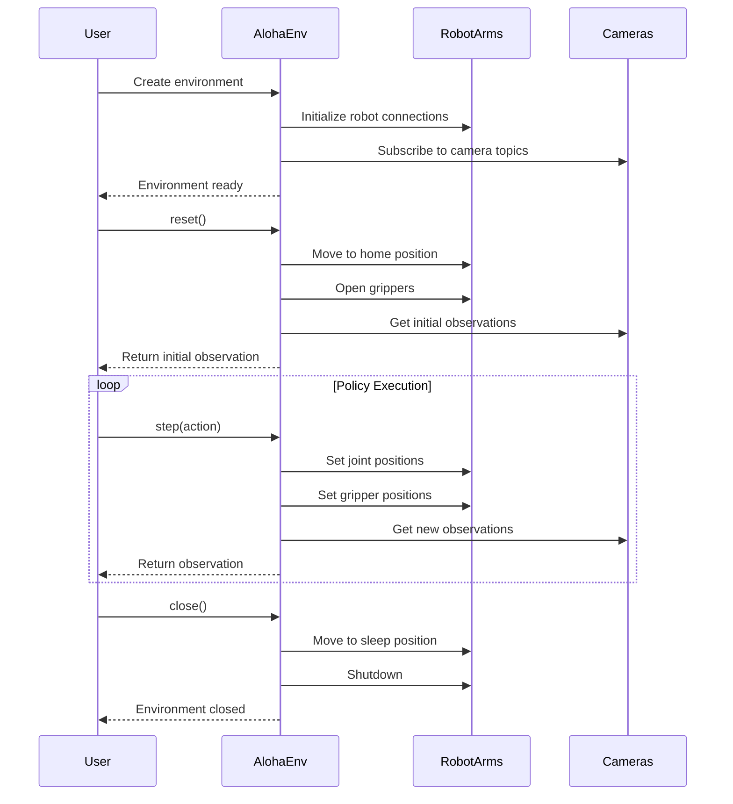

<!-- source: DeepWiki mcp.deepwiki.com · repo google-deepmind/gemini-robotics-sdk · page 4.1 Environment Setup · fetched 2026-10-26 -->

# Environment Setup

<details>
<summary>Relevant source files</summary>

The following files were used as context for generating this wiki page:

- [examples/aloha/env.py](examples/aloha/env.py)
- [examples/aloha/requirements.txt](examples/aloha/requirements.txt)

</details>


This document covers the setup and configuration of the AlohaEnv Gymnasium environment for the Aloha robot system. It explains how to prepare the environment, understand its components, and configure it for policy evaluation.

For information about running policy evaluation on real Aloha robots, see [Policy Evaluation](#4.2). For simulation evaluation, see [Simulation Evaluation](#4.3).

## Overview

The Aloha environment provides a standardized Gymnasium interface for interacting with the Aloha dual-arm robot system. It handles camera observations, robot control, and environment reset functionality needed for policy evaluation.



Sources: [examples/aloha/env.py:129-195]()

## Prerequisites

Before setting up the Aloha environment, ensure you have the following dependencies installed:

```
gymnasium
modern_robotics
pyyaml
transforms3d
dm_control
```

You can install these dependencies using the requirements file:

```bash
pip install -r examples/aloha/requirements.txt
```

Sources: [examples/aloha/requirements.txt:1-6]()

## Environment Components

The Aloha environment consists of several key components:

```mermaid
classDiagram
    class AlohaEnv {
        +__init__(robot_config_name, config_base_path, instruction)
        +reset(seed, options)
        +step(action)
        +close(hard_shutdown)
        -_get_obs()
        -_get_proprio()
        -_set_follower(robot_instance, arm_positions)
    }
    
    class ImageController {
        +__init__(node)
        +get_images()
        +wait_for_images(timeout)
        -_callback_factory(key)
    }
    
    AlohaEnv --> ImageController : uses
    AlohaEnv --> "InterbotixManipulatorXS" : controls
    ImageController --> "ROS Subscriptions" : manages
```

Sources: [examples/aloha/env.py:54-126](), [examples/aloha/env.py:129-195]()

### 1. AlohaEnv Class

The `AlohaEnv` class is the main Gymnasium environment that provides the standard interface for interacting with the Aloha robot system.

Key methods:
- `__init__`: Initializes the environment, ROS node, robot arms, and camera subscriptions
- `reset`: Resets the environment to a home position
- `step`: Executes an action on the robot and returns the new observation
- `close`: Safely shuts down the robot and environment

Sources: [examples/aloha/env.py:129-311]()

### 2. ImageController Class

The `ImageController` class manages camera subscriptions and image processing:

- Subscribes to four camera topics:
  - Overhead camera
  - Worm's eye camera
  - Left wrist camera
  - Right wrist camera
- Provides methods to access the latest images from all cameras
- Handles image conversion from ROS compressed image format to OpenCV format

Sources: [examples/aloha/env.py:54-126]()

## Camera Configuration

The environment uses four cameras positioned at different viewpoints:

| Camera Name | ROS Topic | Description |
|-------------|-----------|-------------|
| Overhead Camera | `/camera_high/camera/color/image_rect_raw/compressed` | Top-down view of the workspace |
| Worm's Eye Camera | `/camera_low/camera/color/image_rect_raw/compressed` | Bottom-up view of the workspace |
| Left Wrist Camera | `/camera_wrist_left/camera/color/image_rect_raw/compressed` | Camera mounted on the left robot wrist |
| Right Wrist Camera | `/camera_wrist_right/camera/color/image_rect_raw/compressed` | Camera mounted on the right robot wrist |

Sources: [examples/aloha/env.py:31-39]()

## Robot Configuration

The environment controls two Interbotix robot arms:

- `follower_left`: Left robot arm
- `follower_right`: Right robot arm

Each arm has 6 joints plus a gripper, for a total of 7 degrees of freedom per arm.



Sources: [examples/aloha/env.py:217-231]()

## Setting Up the Environment

To create and initialize the Aloha environment:

1. Import the necessary modules:
   ```python
   from examples.aloha.env import AlohaEnv
   ```

2. Create the environment instance:
   ```python
   env = AlohaEnv(
       robot_config_name="your_robot_config",
       config_base_path="path_to_config_directory",
       instruction="pick up the object"
   )
   ```

3. Reset the environment to get the initial observation:
   ```python
   observation, info = env.reset()
   ```

Sources: [examples/aloha/env.py:129-266]()

## Action and Observation Spaces

### Action Space

The action space is a 14-dimensional continuous space representing:
- 6 joint positions + 1 gripper position for the left arm
- 6 joint positions + 1 gripper position for the right arm

Joint limits are approximately -π to π radians, with gripper limits from `GRIPPER_CLOSED` (-0.06135) to `GRIPPER_OPEN` (1.5155).

Sources: [examples/aloha/env.py:184-193](), [examples/aloha/env.py:43-44]()

### Observation Space

The observation dictionary contains:

| Key | Type | Description |
|-----|------|-------------|
| `joints_pos` | numpy.ndarray (1, 14) | Current joint positions for both arms |
| `overhead_cam` | numpy.ndarray | RGB image from overhead camera |
| `worms_eye_cam` | numpy.ndarray | RGB image from worm's eye camera |
| `wrist_cam_left` | numpy.ndarray | RGB image from left wrist camera |
| `wrist_cam_right` | numpy.ndarray | RGB image from right wrist camera |

Sources: [examples/aloha/env.py:204-215]()

## Environment Lifecycle



Sources: [examples/aloha/env.py:232-293](), [examples/aloha/env.py:295-311]()

## Example Usage

Here's a complete example of using the AlohaEnv with a policy:

```python
from examples.aloha.env import AlohaEnv
from your_policy_module import YourPolicy

# Create environment
env = AlohaEnv(
    robot_config_name="aloha_config",
    config_base_path="/path/to/configs",
    instruction="pick up the red block"
)

# Create policy
policy = YourPolicy()

# Reset environment
observation, info = env.reset()

# Run for 100 steps
for _ in range(100):
    # Get action from policy
    action = policy.predict(observation)
    
    # Step environment
    observation, reward, terminated, truncated, info = env.step(action)
    
    if terminated or truncated:
        break

# Close environment
env.close()
```

Sources: [examples/aloha/env.py:129-311]()

## Troubleshooting

### Camera Issues

If you encounter issues with camera connections:

1. Check that all cameras are properly connected and powered
2. Verify that the ROS camera topics are publishing data:
   ```bash
   ros2 topic echo /camera_high/camera/color/image_rect_raw/compressed
   ```
3. Increase the timeout in `wait_for_images()` if cameras are slow to initialize

Sources: [examples/aloha/env.py:110-126]()

### Robot Control Issues

If you encounter issues with robot control:

1. Ensure the robot is properly powered and connected
2. Check that the robot configuration file is correct
3. Verify that the ROS node can communicate with the robot
4. Use the `hard_shutdown=False` parameter in `close()` if the robot is in an unstable state

Sources: [examples/aloha/env.py:295-311]()

## Next Steps

After setting up the environment, you can:

1. Proceed to [Policy Evaluation](#4.2) to learn how to evaluate policies on the real robot
2. Explore [Simulation Evaluation](#4.3) for testing in a simulated environment
3. Learn about [Data Management](#5) for collecting and processing robot data

---

