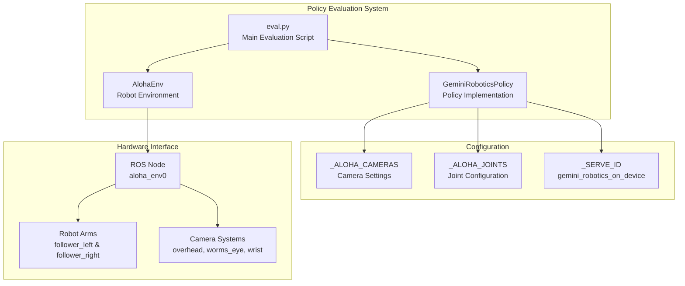
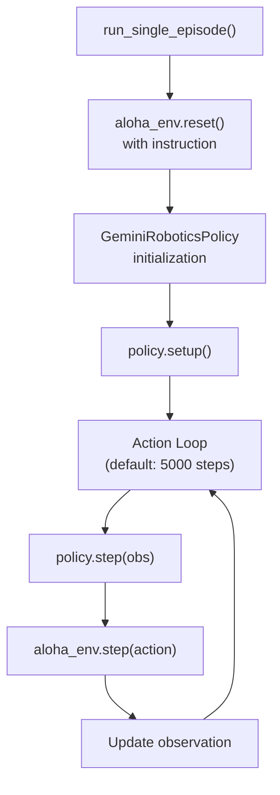
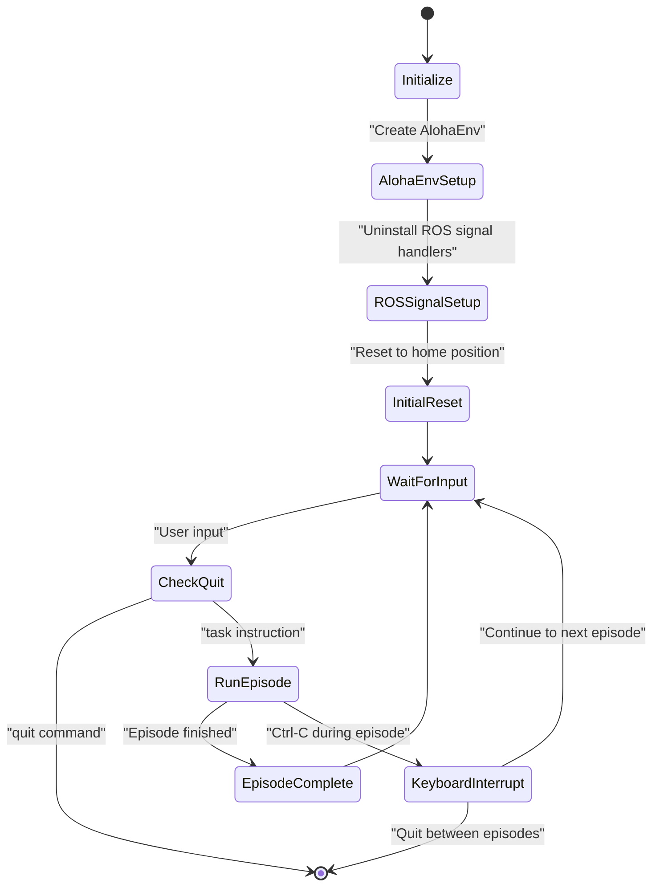

<!-- source: DeepWiki mcp.deepwiki.com · repo google-deepmind/gemini-robotics-sdk · page 4.2 Policy Evaluation · fetched 2026-10-26 -->

# Policy Evaluation

<details>
<summary>Relevant source files</summary>

The following files were used as context for generating this wiki page:

- [examples/aloha/eval.py](examples/aloha/eval.py)

</details>


This document covers running policy evaluation on real Aloha robots using the `eval.py` script. Policy evaluation allows you to test trained robotics policies on physical hardware by providing task instructions and observing robot behavior in real-time episodes.

For simulation-based evaluation, see [Simulation Evaluation](#4.3). For information about the AlohaEnv environment setup, see [Environment Setup](#4.1).

## Overview

The policy evaluation system provides a command-line interface for running trained Gemini Robotics policies on real Aloha robot hardware. The system integrates the `AlohaEnv` Gymnasium environment with `GeminiRoboticsPolicy` to execute episodes based on natural language task instructions.



**Sources:** [examples/aloha/eval.py:1-159]()

## Configuration Constants

The evaluation system uses predefined configuration constants to specify camera and joint parameters for the Aloha robot system.

| Configuration | Value | Description |
|---------------|-------|-------------|
| `_SERVE_ID` | `gemini_robotics_on_device` | Service identifier for local policy serving |
| `_IMAGE_SIZE` | `(480, 848)` | Standard image resolution for all cameras |
| `ROBOT_CONFIG_NAME` | `aloha_stationary` | Robot configuration profile |
| `CONFIG_BASE_PATH` | `/home/juggler/interbotix_ws/src/aloha/config/` | Base path for robot configuration files |

### Camera Configuration

The `_ALOHA_CAMERAS` dictionary defines the camera setup:

```python
_ALOHA_CAMERAS = {
    'overhead_cam': _IMAGE_SIZE,
    'worms_eye_cam': _IMAGE_SIZE,
    'wrist_cam_left': _IMAGE_SIZE,
    'wrist_cam_right': _IMAGE_SIZE,
}
```

### Joint Configuration

The `_ALOHA_JOINTS` dictionary specifies joint position parameters:

```python
_ALOHA_JOINTS = {'joints_pos': 14}
```

**Sources:** [examples/aloha/eval.py:27-40]()

## Episode Execution

The `run_single_episode` function orchestrates the execution of a single evaluation episode. It handles environment reset, policy initialization, and the main action-observation loop.



### Policy Initialization

The policy is initialized with specific configuration parameters:

```python
policy = gemini_robotics_policy.GeminiRoboticsPolicy(
    serve_id=_SERVE_ID,
    task_instruction=instruction,
    inference_mode=gemini_robotics_policy.InferenceMode.SYNCHRONOUS,
    cameras=_ALOHA_CAMERAS,
    joints=_ALOHA_JOINTS,
    robotics_api_connection=genai_robotics.RoboticsApiConnectionType.LOCAL,
)
```

**Sources:** [examples/aloha/eval.py:43-78]()

## Command Line Interface

The evaluation script provides a command-line interface with the following options:

| Argument | Type | Default | Description |
|----------|------|---------|-------------|
| `--instruction` | `str` | `None` | Specific task instruction for all episodes |
| `--steps` | `int` | `5000` | Number of steps per episode |

### Usage Examples

```bash
# Interactive mode - specify instructions during runtime
python3 eval.py

# Fixed instruction mode - use same instruction for all episodes
python3 eval.py --instruction "pick up the red block"

# Custom episode length
python3 eval.py --instruction "stack the blocks" --steps 3000
```

**Sources:** [examples/aloha/eval.py:91-104]()

## Evaluation Workflow

The main evaluation loop handles multiple episodes and user interaction. The workflow supports both interactive and fixed instruction modes.



### Signal Handling

The script uses `rclpy.signals.uninstall_signal_handlers()` to override default ROS signal handling, allowing for graceful keyboard interrupts during episodes without automatic ROS shutdown.

### Environment Lifecycle

1. **Initialization**: Create `AlohaEnv` with robot configuration
2. **Initial Reset**: Bring robot to home position
3. **Episode Loop**: Run episodes with user-provided instructions
4. **Cleanup**: Close environment on exit

**Sources:** [examples/aloha/eval.py:112-156]()

## Integration Points

The policy evaluation system integrates with several key SDK components:

| Component | Purpose | Integration Point |
|-----------|---------|-------------------|
| `AlohaEnv` | Robot environment interface | Direct instantiation and step/reset calls |
| `GeminiRoboticsPolicy` | Policy implementation | Created per episode with task instruction |
| `genai_robotics` | Robotics API connection | Provides `RoboticsApiConnectionType.LOCAL` |
| `rclpy` | ROS 2 Python interface | Signal handler management |

The evaluation script serves as the primary interface for testing deployed policies on real hardware, bridging the gap between trained models and physical robot execution.

**Sources:** [examples/aloha/eval.py:19-24]()

---

