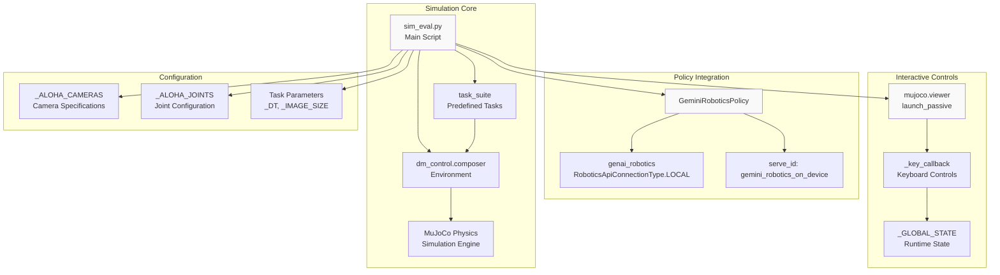
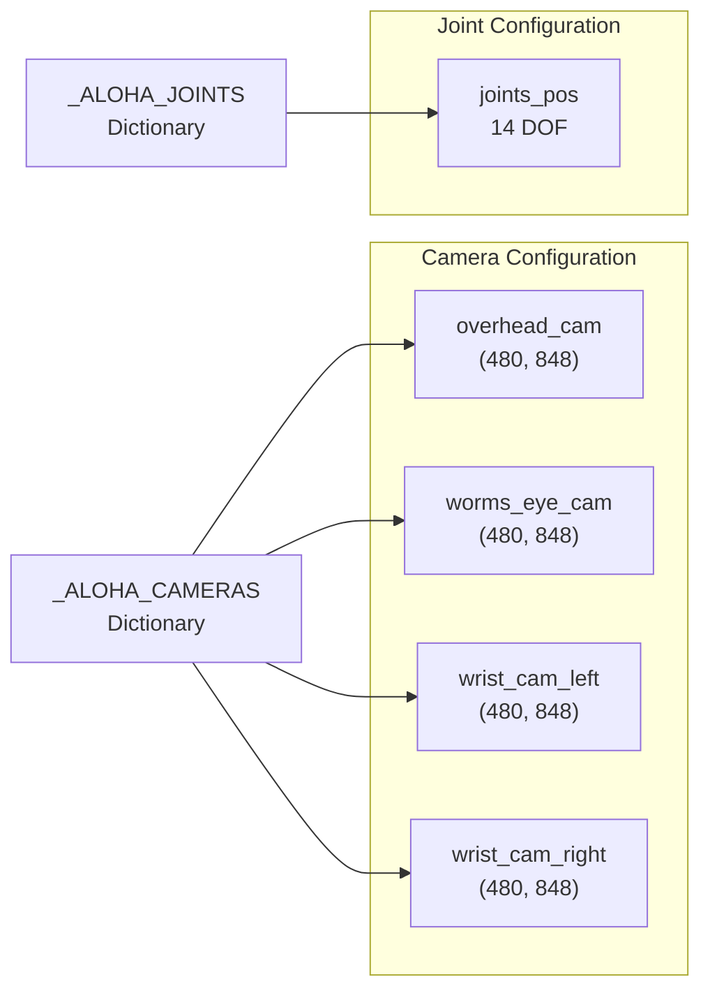
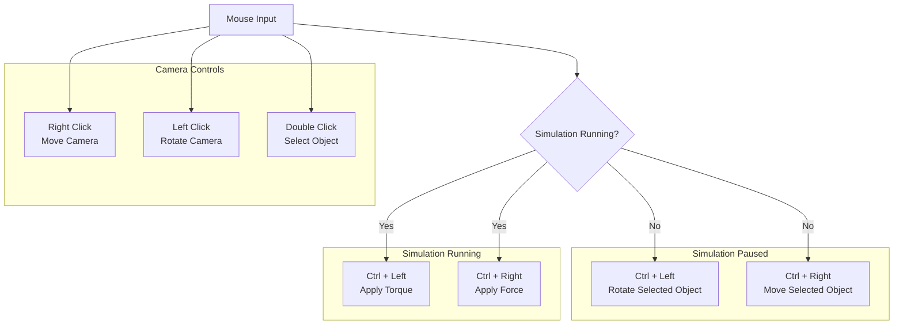
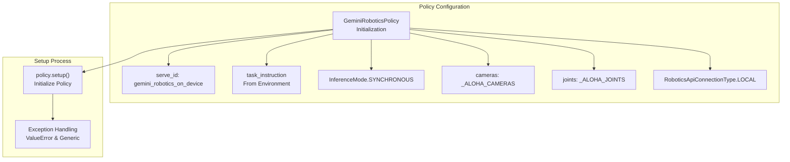
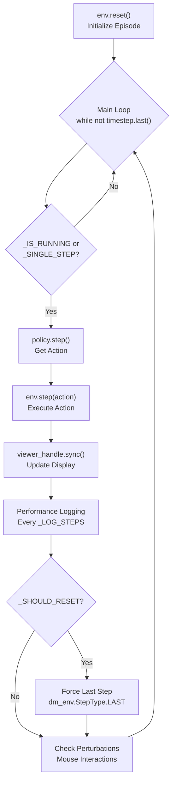

<!-- source: DeepWiki mcp.deepwiki.com · repo google-deepmind/gemini-robotics-sdk · page 4.3 Simulation Evaluation · fetched 2026-10-26 -->

# Simulation Evaluation

<details>
<summary>Relevant source files</summary>

The following files were used as context for generating this wiki page:

- [examples/aloha/sim_eval.py](examples/aloha/sim_eval.py)

</details>


This document covers the interactive simulation evaluation system for Gemini Robotics policies using MuJoCo physics simulation and dm_control. The system provides real-time visualization and interactive control for testing robotic policies in simulated Aloha environments.

For real robot evaluation with physical hardware, see [Policy Evaluation](#4.2). For general environment setup, see [Environment Setup](#4.1).

## Purpose and Architecture

The simulation evaluation system provides an interactive testing environment where users can evaluate Gemini Robotics policies in real-time using keyboard and mouse controls. The system combines MuJoCo physics simulation, dm_control task environments, and the Safari SDK's policy integration to create a comprehensive evaluation platform.



Sources: [examples/aloha/sim_eval.py:1-279]()

## Task Selection and Configuration

The system supports multiple predefined tasks from the task suite, with configurable parameters for camera resolution, control timestep, and joint configurations.

| Configuration | Value | Purpose |
|---------------|-------|---------|
| `_IMAGE_SIZE` | `(480, 848)` | Resolution for all camera feeds |
| `_DT` | `0.02` | Control timestep (50Hz) |
| `_LOG_STEPS` | `100` | Performance logging interval |
| `_SERVE_ID` | `'gemini_robotics_on_device'` | Policy deployment identifier |

### Camera Configuration

The system defines four camera perspectives matching the Aloha robot setup:



Sources: [examples/aloha/sim_eval.py:82-90]()

## Interactive Control System

The simulation provides comprehensive keyboard and mouse controls for real-time interaction with the environment and policy execution.

### Keyboard Controls

| Key | Function | Global State Variable |
|-----|----------|---------------------|
| Space Bar | Play/Pause simulation | `_IS_RUNNING` |
| Backspace | Reset environment | `_SHOULD_RESET` |
| Right Arrow | Single step execution | `_SINGLE_STEP` |
| I | Enter new instruction | `_ASKING_INSTRUCTION` |

### Mouse Controls

The system provides different mouse interaction modes depending on simulation state:



Sources: [examples/aloha/sim_eval.py:15-33](), [examples/aloha/sim_eval.py:247-264]()

## Policy Integration and Execution

The system integrates with `GeminiRoboticsPolicy` for real-time policy evaluation, providing synchronous inference and local API connectivity.

### Policy Initialization

The policy setup involves several key components:



Sources: [examples/aloha/sim_eval.py:144-162]()

### Execution Loop

The main execution loop handles policy stepping, environment updates, and viewer synchronization:



Sources: [examples/aloha/sim_eval.py:186-246]()

## Performance Monitoring

The system provides detailed performance metrics for policy evaluation, tracking inference time, simulation stepping time, and viewer synchronization overhead.

### Timing Metrics

| Metric | Description | Tracked Variable |
|--------|-------------|------------------|
| Inference Time | Policy decision making | `time_inference` |
| Stepping Time | Environment simulation | `time_stepping` |
| Sync Time | Viewer updates | `sync_time` |

The performance logging occurs every `_LOG_STEPS` iterations and reports both per-step averages and cumulative totals:

Sources: [examples/aloha/sim_eval.py:210-229]()

## Usage Workflow

To run simulation evaluation:

1. **Task Selection**: Use the `--task_name` flag to select from available tasks in `task_suite.TASK_FACTORIES`
2. **Instruction Override**: Optionally use `--instruction` to provide custom task instructions
3. **Interactive Control**: Use keyboard controls to pause, reset, and step through simulation
4. **Policy Evaluation**: Monitor real-time policy performance and timing metrics
5. **Environment Interaction**: Use mouse controls to apply perturbations and manipulate objects

### Command Line Usage

```bash
python examples/aloha/sim_eval.py --task_name=HandOverBanana --instruction="Pick up the banana"
```

### Global State Management

The system uses a global state dictionary to coordinate viewer interactions:

| State Variable | Purpose |
|----------------|---------|
| `_IS_RUNNING` | Controls simulation execution |
| `_SHOULD_RESET` | Triggers environment reset |
| `_SINGLE_STEP` | Enables single-step debugging |
| `_ASKING_INSTRUCTION` | Handles instruction input |

Sources: [examples/aloha/sim_eval.py:73-80](), [examples/aloha/sim_eval.py:93-110]()

---

