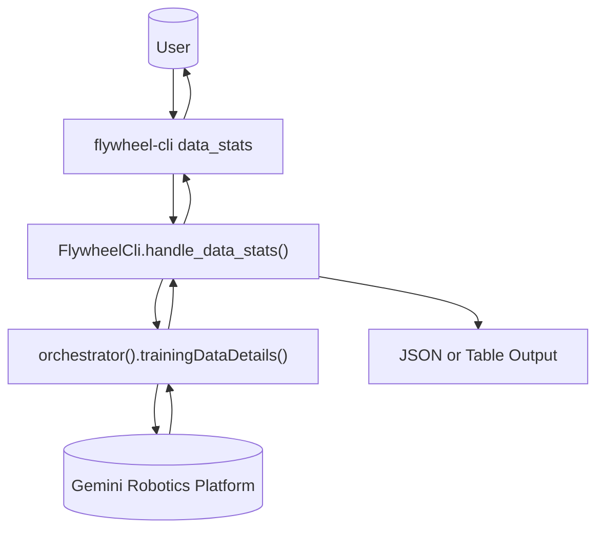
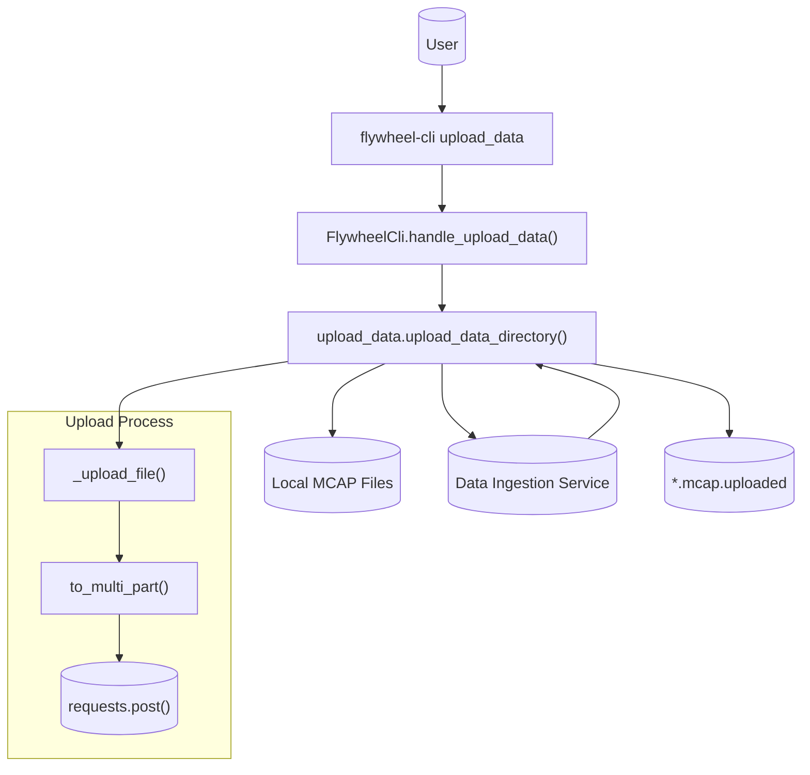
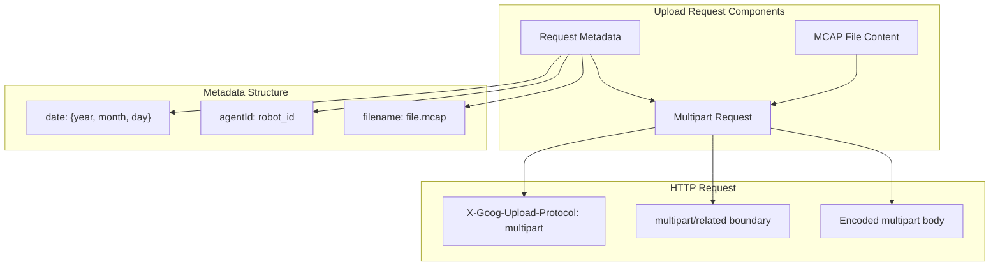

<!-- source: DeepWiki mcp.deepwiki.com · repo google-deepmind/gemini-robotics-sdk · page 5 Data Management · fetched 2026-10-26 -->

# Data Management

<details>
<summary>Relevant source files</summary>

The following files were used as context for generating this wiki page:

- [safari_sdk/flywheel/flywheel_cli.py](safari_sdk/flywheel/flywheel_cli.py)
- [safari_sdk/flywheel/flywheel_cli_test.py](safari_sdk/flywheel/flywheel_cli_test.py)
- [safari_sdk/flywheel/upload_data.py](safari_sdk/flywheel/upload_data.py)
- [safari_sdk/flywheel/upload_data_test.py](safari_sdk/flywheel/upload_data_test.py)

</details>


This page covers the command line interface (CLI) commands for data management operations in the Safari SDK. These commands handle data upload, data statistics querying, and data ingestion workflows through the `flywheel-cli` tool.

For information about the broader data management architecture, data conversion, and logging systems, see [Data Management](#5). For details on uploading data files using scripts, see [Data Upload](#5.3).

## Available Commands

The Safari SDK provides two primary CLI commands for data management:

| Command | Purpose | Required Flags |
|---------|---------|----------------|
| `data_stats` | Display available training data statistics | `--api_key` |
| `upload_data` | Upload MCAP data files to ingestion service | `--api_key`, `--upload_data_robot_id`, `--upload_data_directory` |

## Data Statistics Command

The `data_stats` command queries the platform to show available training data organized by robot ID, task ID, and date ranges. This helps users understand what data is available before starting training jobs.

### Data Statistics Workflow



Sources: [safari_sdk/flywheel/flywheel_cli.py:211-250](), [safari_sdk/flywheel/flywheel_cli_test.py:150-170]()

The `handle_data_stats()` method makes a request to the orchestrator service and formats the response as either JSON (when `--json_output` flag is used) or as a formatted table showing robot ID, task ID, date, count, and success count.

### Data Statistics Output Format

The response includes `taskDates` containing:
- `robotId`: Identifier of the robot or data collector
- `taskId`: Task identifier for the collected data  
- `dates`: Array of collection dates
- `dailyCounts`: Number of data points per date
- `successCounts`: Number of successful executions per date

Sources: [safari_sdk/flywheel/flywheel_cli_test.py:30-40]()

## Data Upload Command

The `upload_data` command uploads MCAP data files from a local directory to the platform's data ingestion service. This is the primary method for getting robot data into the training pipeline.

### Data Upload Workflow



Sources: [safari_sdk/flywheel/flywheel_cli.py:408-414](), [safari_sdk/flywheel/upload_data.py:86-130]()

### Upload Parameters

The upload command requires three key parameters:

| Parameter | Flag | Description |
|-----------|------|-------------|
| API Endpoint | `--upload_data_api_endpoint` | Data ingestion service URL (default: roboticsdeveloper.googleapis.com) |
| Robot ID | `--upload_data_robot_id` | Alphanumeric robot identifier (< 60 characters) |
| Directory | `--upload_data_directory` | Local directory containing MCAP files |

Sources: [safari_sdk/flywheel/flywheel_cli.py:113-130]()

### File Processing

The `upload_data_directory()` function:
1. Walks through the specified directory recursively
2. Identifies files with `.mcap` extension
3. Uploads each file using multipart HTTP requests
4. Renames successfully uploaded files with `.uploaded` suffix
5. Reports upload speed and status for each file

Sources: [safari_sdk/flywheel/upload_data.py:97-129]()

## Data Ingestion API Integration

### Upload Request Structure



Sources: [safari_sdk/flywheel/upload_data.py:39-67](), [safari_sdk/flywheel/upload_data.py:69-83]()

The `_upload_file()` function constructs a multipart request with metadata (date, agent ID, filename) and the binary MCAP file content. The request uses Google's upload protocol with proper content-type headers.

## Command Examples

### View Available Data
```bash
# Show data statistics in table format
flywheel-cli data_stats --api_key=your_key

# Show data statistics in JSON format
flywheel-cli data_stats --api_key=your_key --json_output
```

### Upload Data Files
```bash
# Upload all MCAP files from a directory
flywheel-cli upload_data \
  --api_key=your_key \
  --upload_data_robot_id=aloha_robot_01 \
  --upload_data_directory=/path/to/mcap/files
```

### Custom Endpoint
```bash
# Upload to custom endpoint
flywheel-cli upload_data \
  --api_key=your_key \
  --upload_data_robot_id=test_robot \
  --upload_data_directory=./data \
  --upload_data_api_endpoint=https://custom.endpoint.com/upload
```

Sources: [safari_sdk/flywheel/flywheel_cli.py:138-180]()

---

