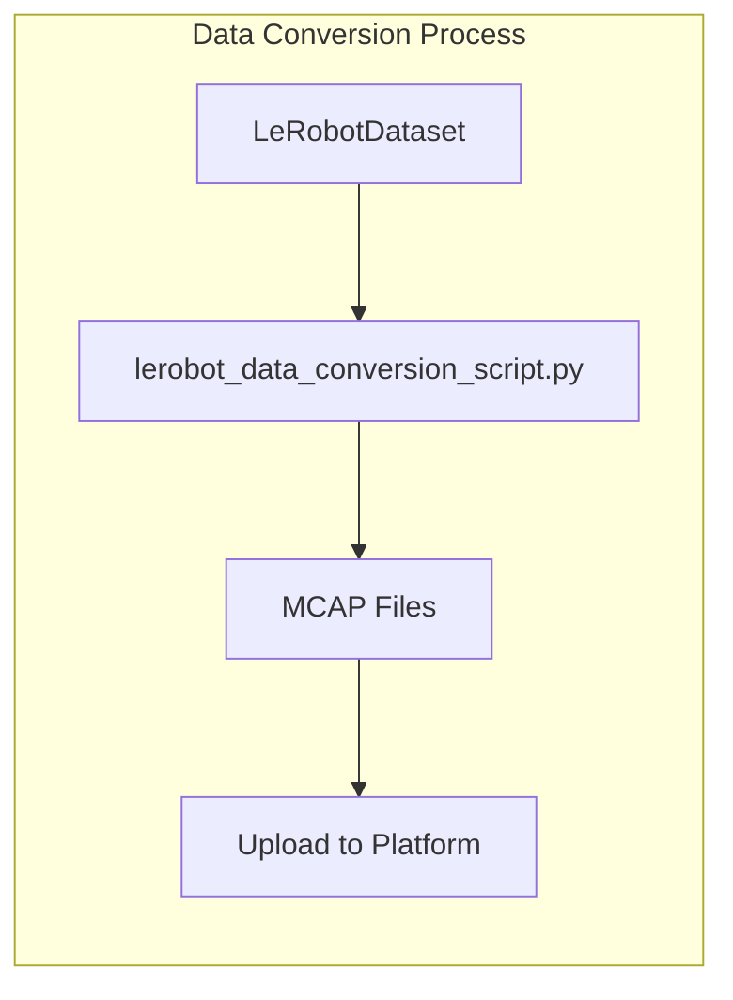
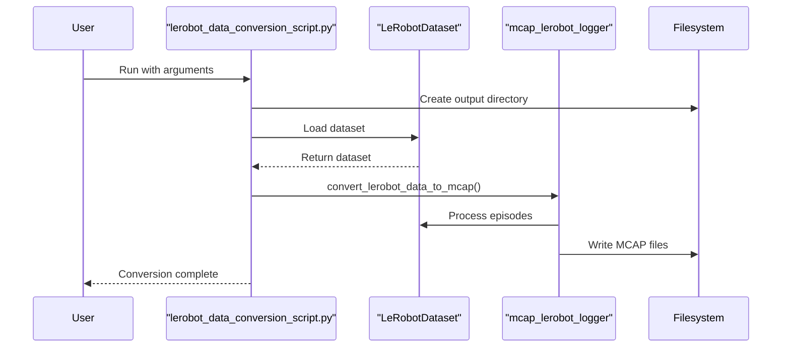
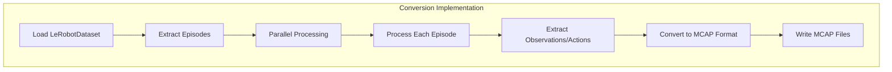
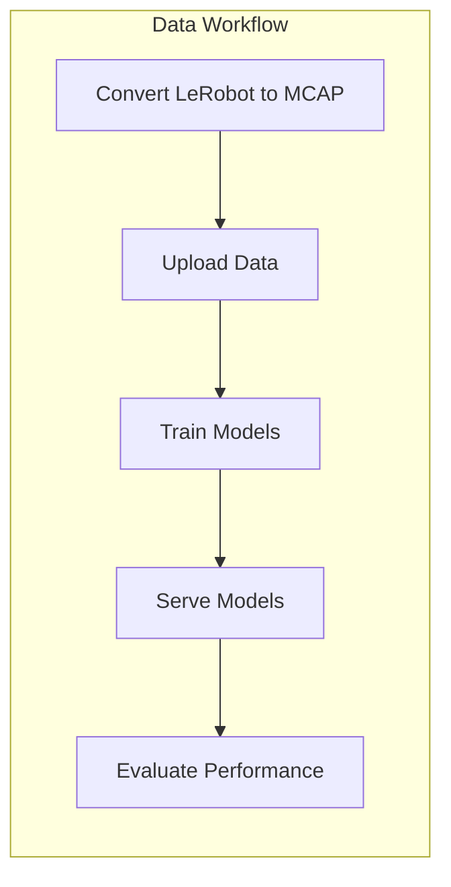

<!-- source: DeepWiki mcp.deepwiki.com · repo google-deepmind/gemini-robotics-sdk · page 5.1 Data Conversion · fetched 2026-10-26 -->

# Data Conversion

<details>
<summary>Relevant source files</summary>

The following files were used as context for generating this wiki page:

- [examples/logging/lerobot_data_conversion_script.py](examples/logging/lerobot_data_conversion_script.py)

</details>


This document explains how to convert LeRobot datasets to MCAP format for use with the Gemini Robotics SDK. The conversion process is essential for preparing existing robot data for training and evaluation with the platform.

For information about the broader data management system, see [Data Management](#5). For details on the logging system and MCAP file handling, see [Logging System](#5.2).

## Overview

The Gemini Robotics SDK uses MCAP (Message Channel Access Protocol) as its standard data format for robot telemetry and training data. However, many existing datasets may be in LeRobot format, which requires conversion before they can be used with the platform.



Sources: [examples/logging/lerobot_data_conversion_script.py:15-15]()

## Conversion Script

The SDK provides a dedicated script for converting LeRobot datasets to MCAP format. This script is located at `examples/logging/lerobot_data_conversion_script.py`.

### Command-Line Arguments

The conversion script accepts several command-line arguments to customize the conversion process:

| Argument | Default | Description |
|----------|---------|-------------|
| `--lerobot_dataset_name` | `lerobot/aloha_static_cups_open` | Name of the LeRobot dataset to load |
| `--task_id` | `lerobot_test_task` | Task ID for the logger, used to identify data for later finetuning |
| `--output_directory` | `/tmp/converted_lerobot_log` | Directory to save MCAP files |
| `--num_episodes` | `0` (all episodes) | Number of episodes to process |
| `--proprio_key` | `state` | The key of the proprioception data in the observation |
| `--max_workers` | `200` | Maximum number of threads for parallel processing and logging |

Sources: [examples/logging/lerobot_data_conversion_script.py:28-61]()

### Conversion Process

The conversion process follows these steps:

1. Load the specified LeRobot dataset
2. Create an output directory for the MCAP files
3. Convert each episode in the dataset to MCAP format
4. Save the MCAP files to the output directory



Sources: [examples/logging/lerobot_data_conversion_script.py:63-88]()

## Implementation Details

The conversion script uses the `mcap_lerobot_logger.convert_lerobot_data_to_mcap()` function from the SDK to perform the actual conversion. This function handles:

1. Reading episodes from the LeRobot dataset
2. Extracting observations, actions, and proprioception data
3. Converting the data to the appropriate MCAP format
4. Writing the MCAP files to disk

The conversion process is parallelized using multiple worker threads to improve performance when processing large datasets.



Sources: [examples/logging/lerobot_data_conversion_script.py:76-86]()

## Usage Example

To convert a LeRobot dataset to MCAP format, run the conversion script with the appropriate arguments:

```bash
python examples/logging/lerobot_data_conversion_script.py \
  --lerobot_dataset_name=lerobot/my_robot_dataset \
  --task_id=my_task \
  --output_directory=/path/to/output \
  --num_episodes=10
```

This command will:
1. Load the dataset named `lerobot/my_robot_dataset`
2. Convert the first 10 episodes to MCAP format
3. Save the MCAP files to `/path/to/output/my_robot_dataset/`
4. Use `my_task` as the task ID for later identification

Sources: [examples/logging/lerobot_data_conversion_script.py:91-92]()

## Next Steps

After converting your LeRobot datasets to MCAP format, you can:

1. Upload the data to the platform using the `flywheel-cli upload_data` command (see [Data Upload](#5.3))
2. Use the data for training models with the `flywheel-cli train` command (see [Training Operations](#3.1))
3. Analyze the data using MCAP tools and the SDK's logging system (see [Logging System](#5.2))



Sources: [examples/logging/lerobot_data_conversion_script.py:15-15]()

---

