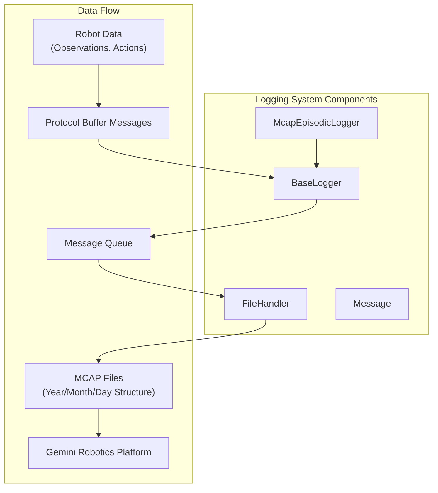
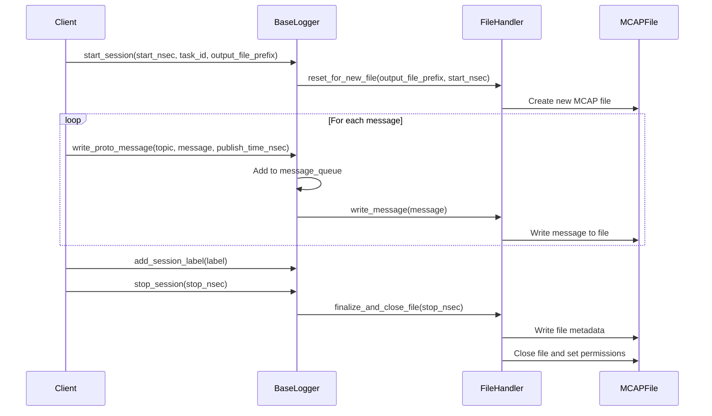
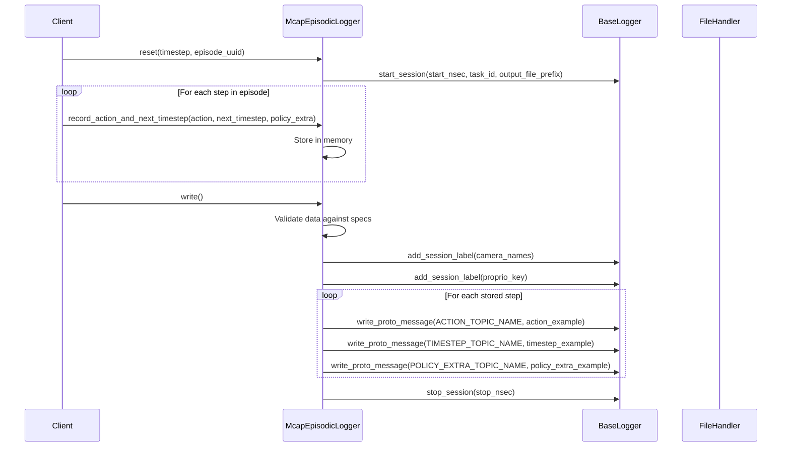
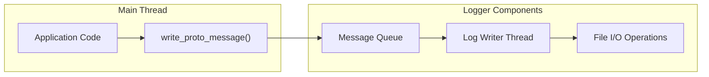
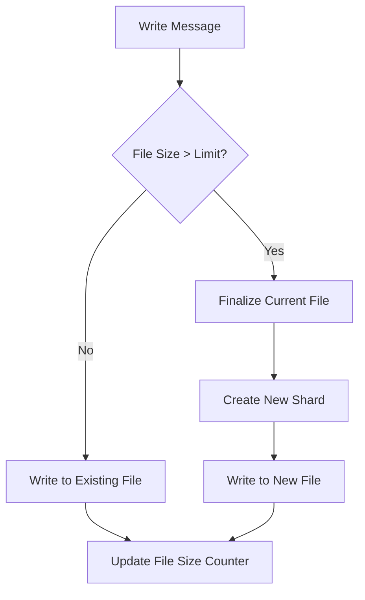
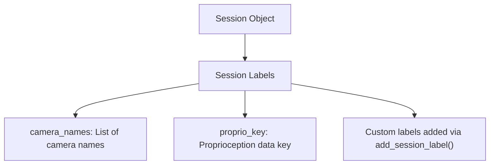

<!-- source: DeepWiki mcp.deepwiki.com · repo google-deepmind/gemini-robotics-sdk · page 5.2 Logging System · fetched 2026-10-26 -->

# Logging System

<details>
<summary>Relevant source files</summary>

The following files were used as context for generating this wiki page:

- [safari_sdk/logging/python/base_logger.py](safari_sdk/logging/python/base_logger.py)
- [safari_sdk/logging/python/constants.py](safari_sdk/logging/python/constants.py)
- [safari_sdk/logging/python/file_handler.py](safari_sdk/logging/python/file_handler.py)
- [safari_sdk/logging/python/mcap_episodic_logger.py](safari_sdk/logging/python/mcap_episodic_logger.py)

</details>


The Safari SDK Logging System provides a robust framework for recording robot data in MCAP (Message Channel Access Protocol) format. This system enables structured logging of robot sessions, episodes, and individual messages, which can later be uploaded to the platform for model training.

For information about data conversion from other formats to MCAP, see [Data Conversion](#5.1).

## Overview

The Logging System is designed to capture robot data in a standardized format that can be efficiently processed by the Gemini Robotics platform. It supports both session-based logging (for capturing complete robot interactions) and episodic logging (for reinforcement learning scenarios).



Sources: [safari_sdk/logging/python/base_logger.py:37-404](), [safari_sdk/logging/python/file_handler.py:42-200](), [safari_sdk/logging/python/mcap_episodic_logger.py:69-542]()

## Core Components

### BaseLogger

The `BaseLogger` class is the foundation of the logging system. It handles the core functionality of writing protocol buffer messages to MCAP files with proper metadata.

Key features:
- Session-based logging with start/stop functionality
- Non-session logging for continuous data capture
- Non-blocking message queue for efficient writing
- Automatic file rotation when size limits are reached

```mermaid
classDiagram
    class "BaseLogger" {
        -agent_id: str
        -output_directory: str
        -required_topics: set[str]
        -all_topics: set[str]
        -file_handler: FileHandler
        -message_queue: Queue
        -log_writer_thread: Thread
        +is_session_started(): bool
        +is_recording(): bool
        +start_session(start_nsec, task_id, output_file_prefix): bool
        +stop_session(stop_nsec): None
        +write_proto_message(topic, message, publish_time_nsec, log_time_nsec): None
        +add_session_label(label): None
        +start_outside_session_logging(start_nsec, output_file_prefix): None
        +stop_outside_session_logging_and_finalize_file(stop_nsec): None
    }
```

Sources: [safari_sdk/logging/python/base_logger.py:37-404]()

### FileHandler

The `FileHandler` manages the actual writing of data to MCAP files, including:
- File creation and rotation
- Topic registration
- Metadata management
- File finalization and permissions setting

```mermaid
classDiagram
    class "FileHandler" {
        -agent_id: str
        -topics: set[str]
        -output_directory: str
        -file_shard_size_limit_bytes: int
        -output_file_prefix: str
        -shard: int
        -file_handle: File
        -mcap_writer: Writer
        -file_shard_bytes: int
        -start_nsec: int
        -stop_nsec: int
        +reset_for_new_file(output_file_prefix, start_nsec): None
        +write_message(message): None
        +finalize_and_close_file(stop_nsec): None
    }
```

Sources: [safari_sdk/logging/python/file_handler.py:42-200]()

### McapEpisodicLogger

The `McapEpisodicLogger` provides a higher-level interface specifically designed for episodic data collection in reinforcement learning scenarios:

- Records complete episodes with timesteps, actions, and policy extras
- Validates data against provided specs
- Converts complex data structures to protocol buffer format
- Handles special data types like images (converting to JPEG)

```mermaid
classDiagram
    class "McapEpisodicLogger" {
        -base_logger: BaseLogger
        -episode_raw_timesteps: list[TimeStep]
        -episode_raw_actions: list[ActionType]
        -episode_raw_policy_extra: list[Mapping]
        -timestep_publish_time_ns: list[int]
        -task_id: str
        -camera_names: list[str]
        -proprio_key: str
        -timestep_spec: TimeStepSpec
        -action_spec: ActionSpec
        -policy_extra_spec: ExtraOutputSpec
        +reset(timestep, episode_uuid): None
        +record_action_and_next_timestep(action, next_timestep, policy_extra): None
        +write(): None
    }
```

Sources: [safari_sdk/logging/python/mcap_episodic_logger.py:69-542]()

## Logging Workflow

### Session-Based Logging

Session-based logging is designed for capturing complete robot interactions with defined start and end points.



Sources: [safari_sdk/logging/python/base_logger.py:123-244](), [safari_sdk/logging/python/file_handler.py:140-200]()

### Episodic Logging

Episodic logging is tailored for reinforcement learning scenarios, where data is organized into discrete episodes with timesteps and actions.



Sources: [safari_sdk/logging/python/mcap_episodic_logger.py:136-277]()

## File Structure and Format

### MCAP File Format

The logging system uses the MCAP (Message Channel Access Protocol) format, which is designed for efficient storage and retrieval of timestamped messages. Each MCAP file contains:

1. Channel schemas (Protocol Buffer message definitions)
2. Timestamped messages organized by topic
3. File and session metadata

### Directory Structure

MCAP files are organized in a year/month/day directory structure for easy management:

```
output_directory/
├── tmp/                           # Temporary storage during writing
└── YYYY/                          # Year
    └── MM/                        # Month
        └── DD/                    # Day
            ├── prefix-shard0.mcap # First file shard
            └── prefix-shard1.mcap # Additional file shard if size limit reached
```

Sources: [safari_sdk/logging/python/file_handler.py:184-200]()

## Reserved Topics

The logging system reserves several topic names for special purposes:

| Topic Name | Purpose |
|------------|---------|
| `/file_metadata` | Contains metadata about the file itself |
| `/session` | Contains session information and labels |
| `/sync` | Used for synchronization messages |
| `/timestep` | Contains environment timestep data |
| `/action` | Contains agent action data |
| `/policy_extra` | Contains additional policy output data |

Sources: [safari_sdk/logging/python/constants.py:18-25](), [safari_sdk/logging/python/file_handler.py:33-39]()

## Advanced Features

### Non-Blocking Message Queue

The logging system uses a non-blocking message queue to prevent logging operations from slowing down the main application:



Sources: [safari_sdk/logging/python/base_logger.py:74-86](), [safari_sdk/logging/python/base_logger.py:340-404]()

### File Rotation

To prevent individual files from becoming too large, the system automatically rotates files when they reach a configurable size limit:



Sources: [safari_sdk/logging/python/file_handler.py:108-138]()

### Session Labels

The logging system allows attaching arbitrary labels to sessions, which can be used for filtering and organization:



Sources: [safari_sdk/logging/python/base_logger.py:282-286](), [safari_sdk/logging/python/mcap_episodic_logger.py:219-236]()

## Usage Examples

### Basic Session Logging

```python
# Create a logger
logger = BaseLogger(
    agent_id="robot1",
    output_directory="/path/to/logs",
    required_topics=["/robot/joint_states", "/robot/camera"],
)

# Start a session
logger.start_session(
    start_nsec=time.time_ns(),
    task_id="pick_and_place",
    output_file_prefix="robot1_session",
)

# Log messages
logger.write_proto_message(
    topic="/robot/joint_states",
    message=joint_state_proto,
    publish_time_nsec=time.time_ns(),
)

# Add session labels
logger.add_session_label(
    label_pb2.LabelMessage(
        key="task_success",
        label_value=struct_pb2.Value(bool_value=True),
    )
)

# Stop the session
logger.stop_session(stop_nsec=time.time_ns())
```

### Episodic Logging for Reinforcement Learning

```python
# Create an episodic logger
logger = McapEpisodicLogger(
    agent_id="rl_agent",
    task_id="manipulation",
    output_directory="/path/to/logs",
    camera_names=["overhead", "wrist"],
    proprio_key="joint_positions",
    timestep_spec=timestep_spec,
    action_spec=action_spec,
    policy_extra_spec=policy_extra_spec,
)

# Start a new episode
logger.reset(initial_timestep)

# Record steps
for _ in range(max_steps):
    action = policy.act(timestep)
    next_timestep, policy_extra = env.step(action)
    logger.record_action_and_next_timestep(
        action=action,
        next_timestep=next_timestep,
        policy_extra=policy_extra,
    )
    
    if next_timestep.last():
        break

# Write the episode to disk
logger.write()
```

## Integration with Platform

The MCAP files generated by the logging system can be uploaded to the Gemini Robotics platform using the `flywheel-cli upload_data` command. For more information on data upload, see [Data Upload](#5.3).

---

