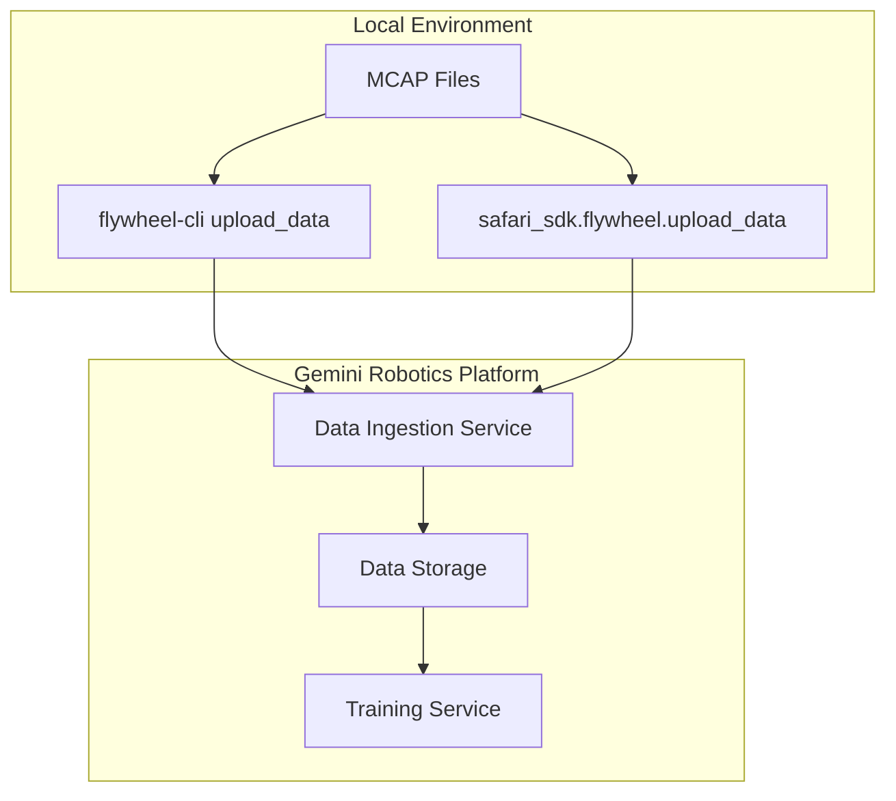
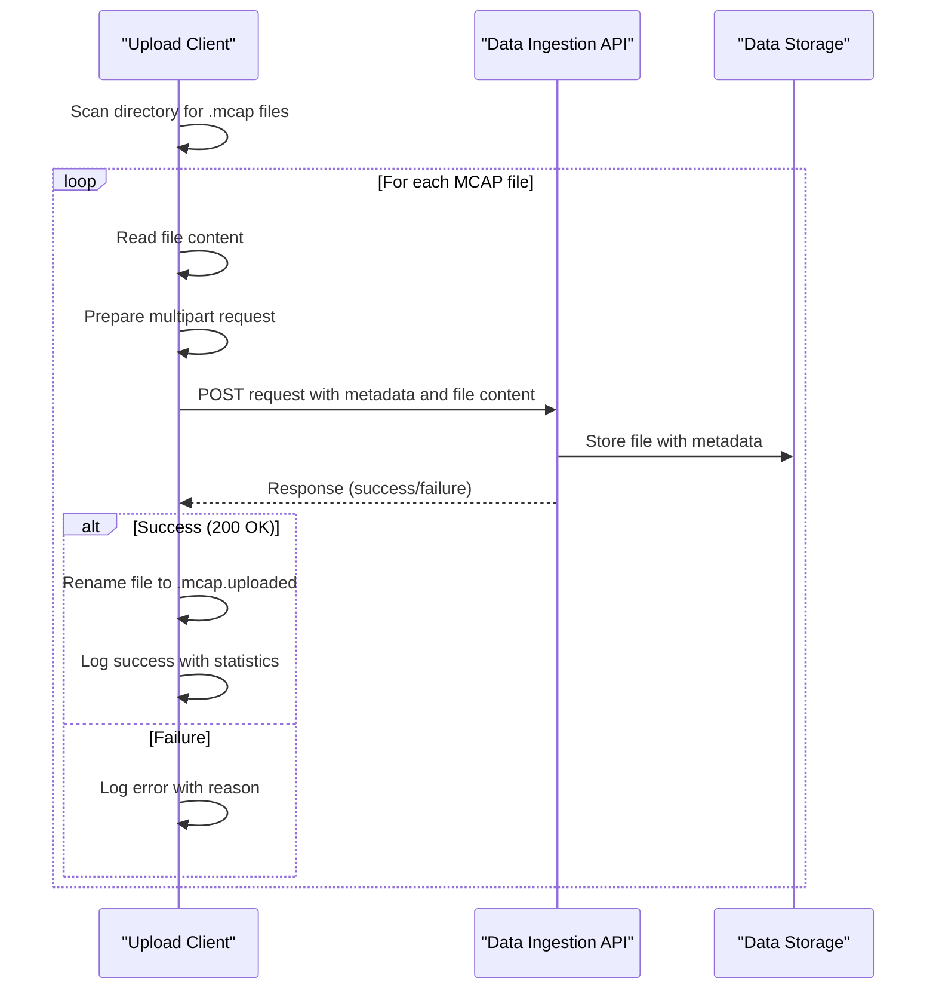

<!-- source: DeepWiki mcp.deepwiki.com · repo google-deepmind/gemini-robotics-sdk · page 5.3 Data Upload · fetched 2026-10-26 -->

# Data Upload

<details>
<summary>Relevant source files</summary>

The following files were used as context for generating this wiki page:

- [examples/logging/sample_data_upload_script.py](examples/logging/sample_data_upload_script.py)
- [safari_sdk/flywheel/upload_data.py](safari_sdk/flywheel/upload_data.py)

</details>


This document explains how to upload robot data to the Gemini Robotics platform using the Safari SDK. The data upload process is a critical step in the robotics model lifecycle, allowing collected MCAP files to be ingested into the platform for training and evaluation purposes.

For information about data conversion from other formats to MCAP, see [Data Conversion](#5.1). For details on the logging system that generates MCAP files, see [Logging System](#5.2).

## Overview

The Safari SDK provides two primary methods for uploading robot data to the platform:

1. Using the `flywheel-cli upload_data` command-line interface
2. Using the programmatic API through the `safari_sdk.flywheel.upload_data` module

Both methods upload MCAP files to the Gemini Robotics data ingestion service, which processes and stores the data for use in model training.



Sources: [safari_sdk/flywheel/upload_data.py:15-37](), [examples/logging/sample_data_upload_script.py:15-19]()

## Prerequisites

Before uploading data, you need:

1. **API Key**: Authentication credentials for the Gemini Robotics platform
2. **MCAP Files**: Robot data in MCAP format
3. **Robot ID**: A unique identifier for the robot that generated the data

The API key should be configured using the authentication system described in [Authentication](#7.1).

Sources: [safari_sdk/flywheel/upload_data.py:93-95](), [examples/logging/sample_data_upload_script.py:44-50]()

## Using the Command-Line Interface

The `flywheel-cli` tool provides a simple command for uploading data:

```
flywheel-cli upload_data --robot_id=<ROBOT_ID> --directory=<PATH_TO_MCAP_FILES>
```

This command will:
1. Scan the specified directory for `.mcap` files
2. Upload each file to the data ingestion service
3. Rename successfully uploaded files with a `.uploaded` extension
4. Display upload progress and statistics

Sources: [safari_sdk/flywheel/upload_data.py:86-129]()

## Using the Programmatic API

For more control over the upload process, you can use the programmatic API:

```python
from safari_sdk.flywheel import upload_data

upload_data.upload_data_directory(
    api_endpoint="https://roboticsdeveloper.googleapis.com/upload/v1/dataIngestion:uploadData",
    data_directory="/path/to/mcap/files",
    robot_id="my-robot-id"
)
```

The `upload_data_directory` function handles authentication, file scanning, and upload operations.

Sources: [safari_sdk/flywheel/upload_data.py:86-129]()

## Data Upload Process

The upload process follows these steps for each MCAP file:



Sources: [safari_sdk/flywheel/upload_data.py:28-83](), [examples/logging/sample_data_upload_script.py:59-114]()

## Request Format

The upload request uses a multipart format with two main components:

1. **Metadata**: JSON object containing:
   - `date`: Current date (year, month, day)
   - `agentId`: Robot identifier
   - `filename`: Name of the MCAP file

2. **File Content**: Binary content of the MCAP file

The request is sent to the data ingestion service endpoint with the API key as a query parameter.

```
POST https://roboticsdeveloper.googleapis.com/upload/v1/dataIngestion:uploadData?key=<API_KEY>
```

Sources: [safari_sdk/flywheel/upload_data.py:39-83](), [examples/logging/sample_data_upload_script.py:70-114]()

## Sample Upload Script

The SDK includes a sample upload script that demonstrates the upload process:

[examples/logging/sample_data_upload_script.py:15-158]()

This script:
1. Takes command-line arguments for API endpoint, agent ID, API key, and data directory
2. Walks through the directory to find MCAP files
3. Uploads each file and tracks progress
4. Renames successfully uploaded files

To use this script:

```
python sample_data_upload_script.py \
  --api_endpoint=https://roboticsdeveloper.googleapis.com/upload/v1/dataIngestion:uploadData \
  --agent_id=my-robot-id \
  --api_key=YOUR_API_KEY \
  --data_dir=/path/to/mcap/files
```

Sources: [examples/logging/sample_data_upload_script.py:15-158]()

## Implementation Details

### Upload Function

The core upload functionality is implemented in the `_upload_file` function:

[safari_sdk/flywheel/upload_data.py:28-83]()

This function:
1. Constructs a multipart request with metadata and file content
2. Sends the request to the data ingestion service
3. Returns the status code and reason from the response

### Directory Upload

The `upload_data_directory` function handles the process of scanning a directory and uploading all MCAP files:

[safari_sdk/flywheel/upload_data.py:86-129]()

This function:
1. Retrieves the API key from the authentication system
2. Walks through the specified directory to find MCAP files
3. Uploads each file using the `_upload_file` function
4. Renames successfully uploaded files and logs progress

Sources: [safari_sdk/flywheel/upload_data.py:28-129]()

## Best Practices

When uploading data to the platform:

1. **Organize files**: Keep MCAP files in a structured directory for easier management
2. **Monitor uploads**: Check the output for any failed uploads and retry if necessary
3. **Preserve originals**: The upload process renames files after successful upload, but consider keeping backups
4. **Batch uploads**: For large datasets, consider uploading in batches to manage network usage

## Troubleshooting

Common issues and solutions:

| Issue | Possible Cause | Solution |
|-------|---------------|----------|
| Authentication error | Invalid or missing API key | Check API key configuration |
| Upload failure | Network issues or service unavailability | Retry upload or check service status |
| File not found | Incorrect directory path | Verify the directory path contains MCAP files |
| Permission denied | Insufficient file permissions | Check file permissions |

If uploads consistently fail, check the response reason for more specific error information.

## Related Documentation

- [Data Conversion](#5.1): Converting data from other formats to MCAP
- [Logging System](#5.2): Understanding the Safari logging architecture
- [Authentication](#7.1): API key management and service authentication
- [Training Operations](#3.1): Using uploaded data for model training

---

