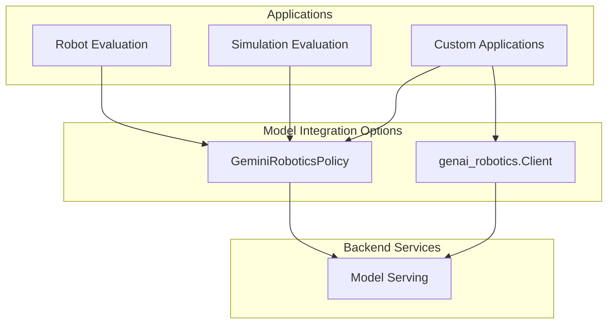
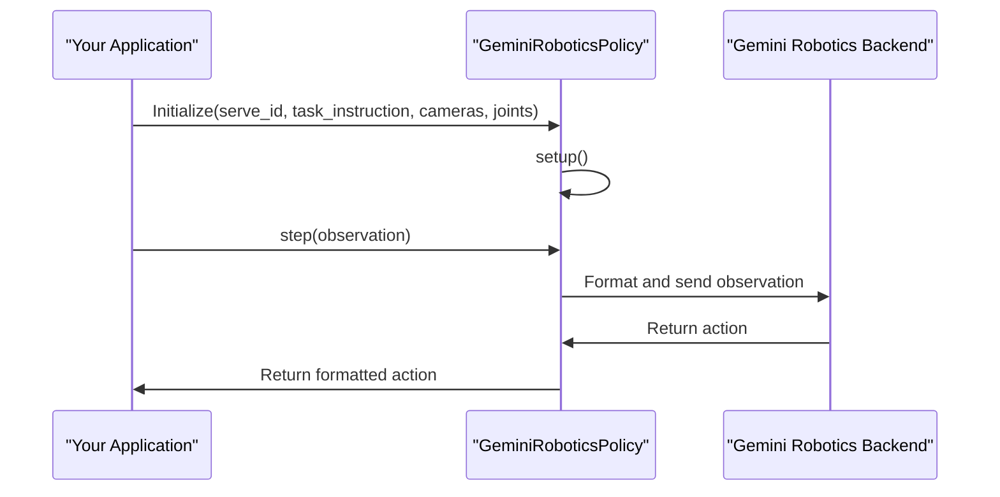
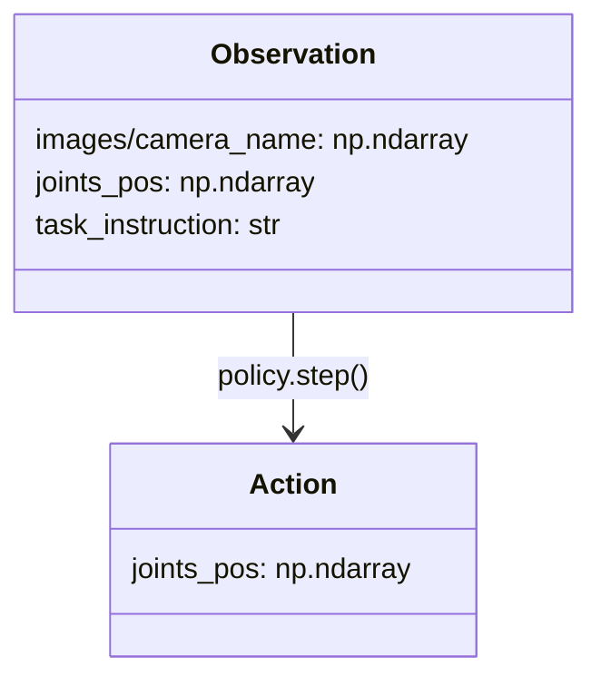
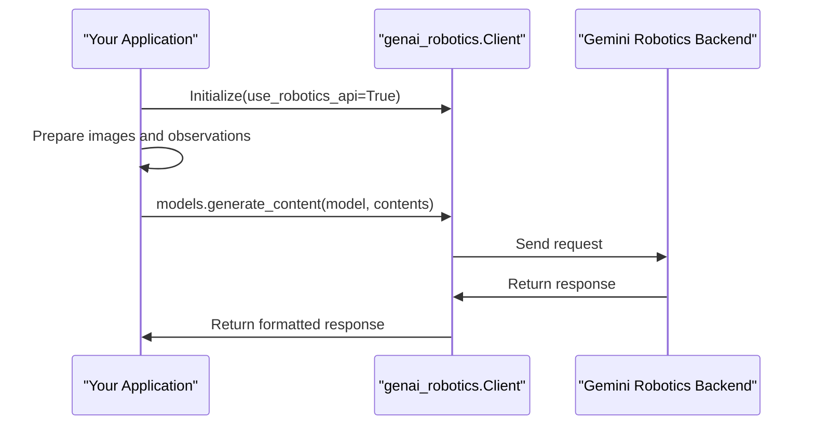
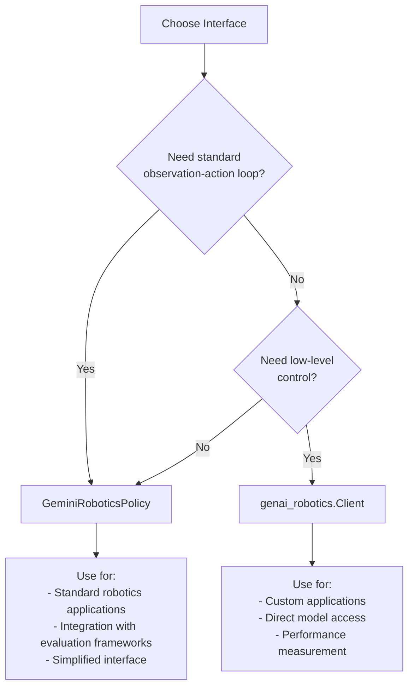

<!-- source: DeepWiki mcp.deepwiki.com · repo google-deepmind/gemini-robotics-sdk · page 6 Model Integration · fetched 2026-10-26 -->

# Model Integration

<details>
<summary>Relevant source files</summary>

The following files were used as context for generating this wiki page:

- [examples/model/gemini_robotics_policy_example.py](examples/model/gemini_robotics_policy_example.py)
- [examples/model/genai_robotics_example.py](examples/model/genai_robotics_example.py)

</details>


This page covers how to integrate and use Gemini Robotics models with your robotics applications. It explains the two primary interfaces for model integration: the high-level `GeminiRoboticsPolicy` class and the lower-level `genai_robotics` client.

For information about training and serving models, see [Command Line Interface](#3).

## Overview

The Gemini Robotics SDK provides two main approaches for integrating with Gemini Robotics models:

1. **GeminiRoboticsPolicy**: A high-level policy interface that follows a standard robotics observation-action loop pattern
2. **genai_robotics Client**: A lower-level client for direct access to model inference capabilities



Sources: [examples/model/gemini_robotics_policy_example.py:15-126](), [examples/model/genai_robotics_example.py:15-98]()

## GeminiRoboticsPolicy

The `GeminiRoboticsPolicy` class provides a standardized interface for interacting with Gemini Robotics models. It follows a typical robotics policy pattern where observations are provided to the model, which then returns actions to control the robot.

### Key Features

- Standardized observation-action interface
- Automatic handling of observation formatting
- Support for different robot configurations
- Integration with evaluation frameworks

### Usage



### Initialization

To use `GeminiRoboticsPolicy`, you need to initialize it with:

1. A `serve_id` for the model you want to use
2. A `task_instruction` describing what the robot should do
3. Camera configuration specifying available cameras and their resolutions
4. Joint configuration specifying available joints and their dimensions

```python
policy = gemini_robotics_policy.GeminiRoboticsPolicy(
    serve_id="your_serve_id",
    task_instruction="Pick up the red block.",
    cameras={"camera1": (480, 640), "camera2": (480, 640)},
    joints={"joint_positions": 6}
)
policy.setup()  # Initialize the policy
```

Sources: [examples/model/gemini_robotics_policy_example.py:80-88]()

### Robot Configurations

The SDK includes predefined configurations for supported robot platforms:

#### Aloha Robot Configuration

```python
_ALOHA_IMAGE_SIZE = (480, 848)
_ALOHA_CAMERAS = {
    "overhead_cam": _ALOHA_IMAGE_SIZE,
    "worms_eye_cam": _ALOHA_IMAGE_SIZE,
    "wrist_cam_left": _ALOHA_IMAGE_SIZE,
    "wrist_cam_right": _ALOHA_IMAGE_SIZE,
}
_ALOHA_JOINTS = {"joints_pos": 14}
```

#### Atari Robot Configuration

```python
_ATARI_STEREOLAB_HEADCAM_IMAGE_SIZE = (1200, 1920)
_ATARI_WRISTCAM_IMAGE_SIZE = (480, 640)
_ATARI_CAMERAS = {
    "stereolab_headcam0": _ATARI_STEREOLAB_HEADCAM_IMAGE_SIZE,
    "left_wrist_cam": _ATARI_WRISTCAM_IMAGE_SIZE,
    "right_wrist_cam": _ATARI_WRISTCAM_IMAGE_SIZE,
}
_ATARI_JOINTS = {
    "left_arm_joint_pos": 7,
    "right_arm_joint_pos": 7,
    "left_hand_command": 6,
    "right_hand_command": 6,
    "neck_joint_pos": 3,
    "torso_joint_pos": 3,
}
```

Sources: [examples/model/gemini_robotics_policy_example.py:44-72]()

### Observation and Action Format

The policy expects observations in a specific format and returns actions in a corresponding format:



Example of creating an observation and getting an action:

```python
# Create observation
observation = {
    "images/overhead_cam": np.zeros((480, 848, 3), dtype=np.uint8),
    "images/worms_eye_cam": np.zeros((480, 848, 3), dtype=np.uint8),
    "images/wrist_cam_left": np.zeros((480, 848, 3), dtype=np.uint8),
    "images/wrist_cam_right": np.zeros((480, 848, 3), dtype=np.uint8),
    "joints_pos": np.zeros(14, dtype=np.float32),
    "task_instruction": "Pick up the red block."
}

# Get action
action = policy.step(observation)
# action will contain joint positions for the robot
```

Sources: [examples/model/gemini_robotics_policy_example.py:97-118]()

### Complete Example

Here's a complete example of using `GeminiRoboticsPolicy`:

```python
from safari_sdk.model import gemini_robotics_policy
import numpy as np

# Initialize policy
policy = gemini_robotics_policy.GeminiRoboticsPolicy(
    serve_id="your_serve_id",
    task_instruction="Pick up the red block.",
    cameras={
        "overhead_cam": (480, 848),
        "worms_eye_cam": (480, 848),
        "wrist_cam_left": (480, 848),
        "wrist_cam_right": (480, 848)
    },
    joints={"joints_pos": 14}
)
policy.setup()

# Create dummy observation
dummy_observation = {}
for key, spec in policy.observation_spec.items():
    if key == "task_instruction":
        dummy_observation[key] = "Pick up the red block."
    else:
        dummy_observation[key] = np.zeros(spec.shape, dtype=spec.dtype.as_numpy_dtype)

# Run policy step
action = policy.step(dummy_observation)
print(action)
```

Sources: [examples/model/gemini_robotics_policy_example.py:75-126]()

## genai_robotics Client

The `genai_robotics.Client` provides a lower-level interface for direct interaction with Gemini Robotics models. This is useful for more advanced use cases or when you need more control over the model interaction.

### Key Features

- Direct access to model inference
- Support for raw image and observation data
- Flexible content formatting
- Performance measurement capabilities

### Usage



### Initialization

To use the `genai_robotics.Client`, initialize it with:

```python
from safari_sdk.model import genai_robotics

client = genai_robotics.Client(use_robotics_api=True)
```

Sources: [examples/model/genai_robotics_example.py:45]()

### Preparing Input Data

The client accepts two main types of input:

1. **Images**: Can be provided as NumPy arrays, TensorFlow tensors, or raw bytes
2. **Observations**: Provided as a JSON string containing task instructions, joint positions, and image references

```python
# Sample image
sample_image = np.zeros((64, 64, 3), dtype=np.uint8)  # Example: 64x64 RGB image

# Sample observations
observations = {
    "images/overhead_cam": 0,  # Index 0 refers to sample_image
    "task_instruction": "Pick up the red block.",
    "joints_pos": [0.1, -0.2, 0.3, -0.4, 0.5, -0.6],
}
observations_json = json.dumps(observations)
```

Sources: [examples/model/genai_robotics_example.py:47-58]()

### Generating Content

To generate content from the model:

```python
response = client.models.generate_content(
    model="your_serve_id",
    contents=[
        sample_image,  # Can be np.array, tf.Tensor, bytes, or types.Part
        observations_json,
    ],
)

# Access the response
print(response.text)
```

Sources: [examples/model/genai_robotics_example.py:62-73]()

### Performance Measurement

The client can be used to measure model performance:

```python
times = []
for _ in range(10):
    start = time.time()
    response = client.models.generate_content(
        model="your_serve_id",
        contents=[sample_image, observations_json],
    )
    end = time.time()
    times.append(end - start)
print("Average time:", np.mean(times))
```

Sources: [examples/model/genai_robotics_example.py:78-94]()

### Complete Example

Here's a complete example of using the `genai_robotics.Client`:

```python
from safari_sdk.model import genai_robotics
import numpy as np
import json

# Initialize client
client = genai_robotics.Client(use_robotics_api=True)

# Prepare sample data
sample_image = np.zeros((64, 64, 3), dtype=np.uint8)
observations = {
    "images/overhead_cam": 0,
    "task_instruction": "Pick up the red block.",
    "joints_pos": [0.1, -0.2, 0.3, -0.4, 0.5, -0.6],
}
observations_json = json.dumps(observations)

# Generate content
response = client.models.generate_content(
    model="your_serve_id",
    contents=[sample_image, observations_json],
)

# Print response
print(response.text)
```

Sources: [examples/model/genai_robotics_example.py:37-98]()

## Choosing Between Interfaces



| Feature | GeminiRoboticsPolicy | genai_robotics.Client |
|---------|----------------------|------------------------|
| Interface | High-level policy | Low-level client |
| Use Case | Standard robotics applications | Custom applications |
| Observation Format | Structured dict | Flexible JSON |
| Action Format | Structured dict | Raw response |
| Integration | Works with evaluation frameworks | Direct model access |
| Complexity | Simpler | More flexible |

Sources: [examples/model/gemini_robotics_policy_example.py:15-126](), [examples/model/genai_robotics_example.py:15-98]()

## Best Practices

1. **Use GeminiRoboticsPolicy** for standard robotics applications that follow an observation-action loop pattern
2. **Use genai_robotics.Client** for more advanced use cases or when you need direct control over model interaction
3. **Validate your serve_id** before using it in production applications
4. **Handle exceptions** appropriately as API calls can fail for various reasons
5. **Test with dummy data** before deploying to real robots to ensure correct integration

Sources: [examples/model/gemini_robotics_policy_example.py:89-94](), [examples/model/genai_robotics_example.py:75-76]()

---

