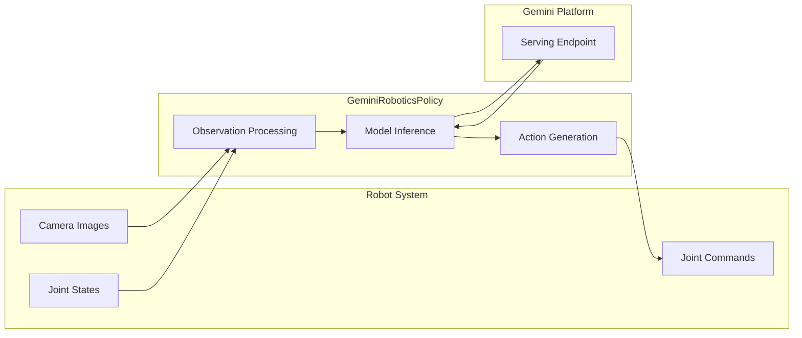
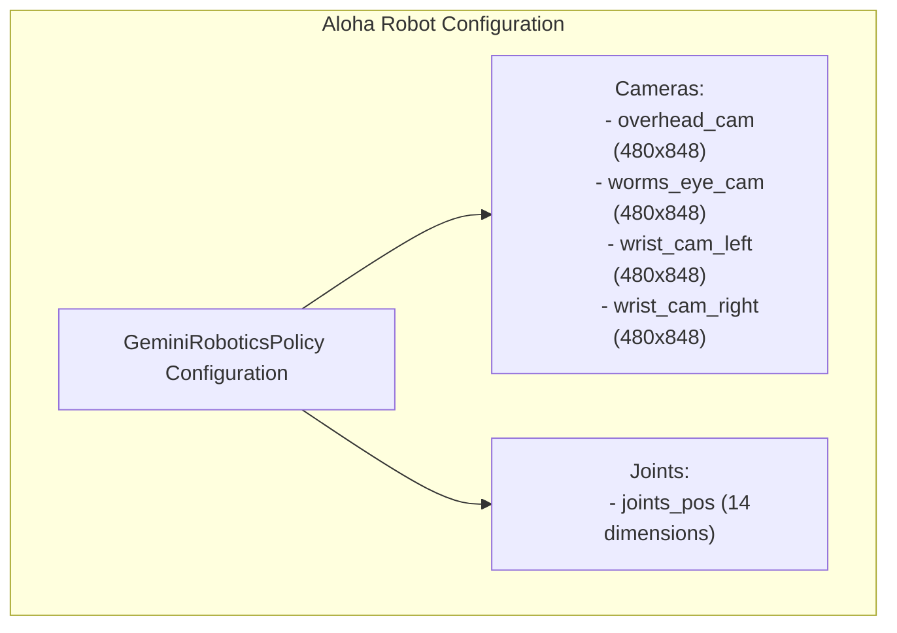
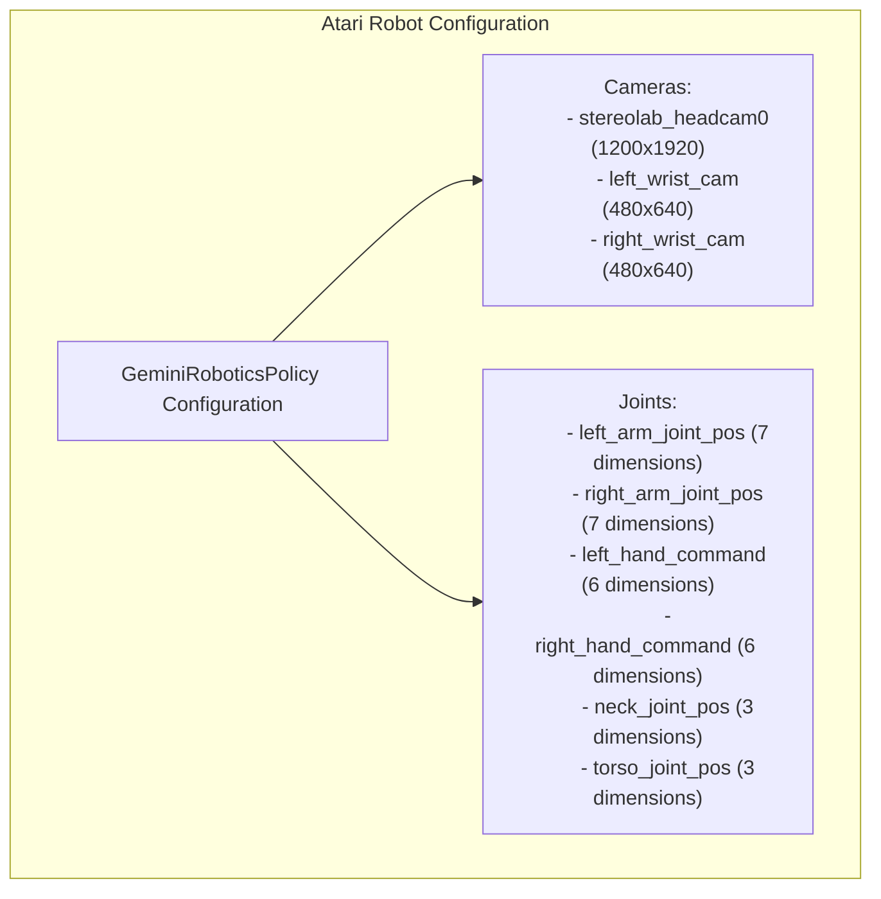
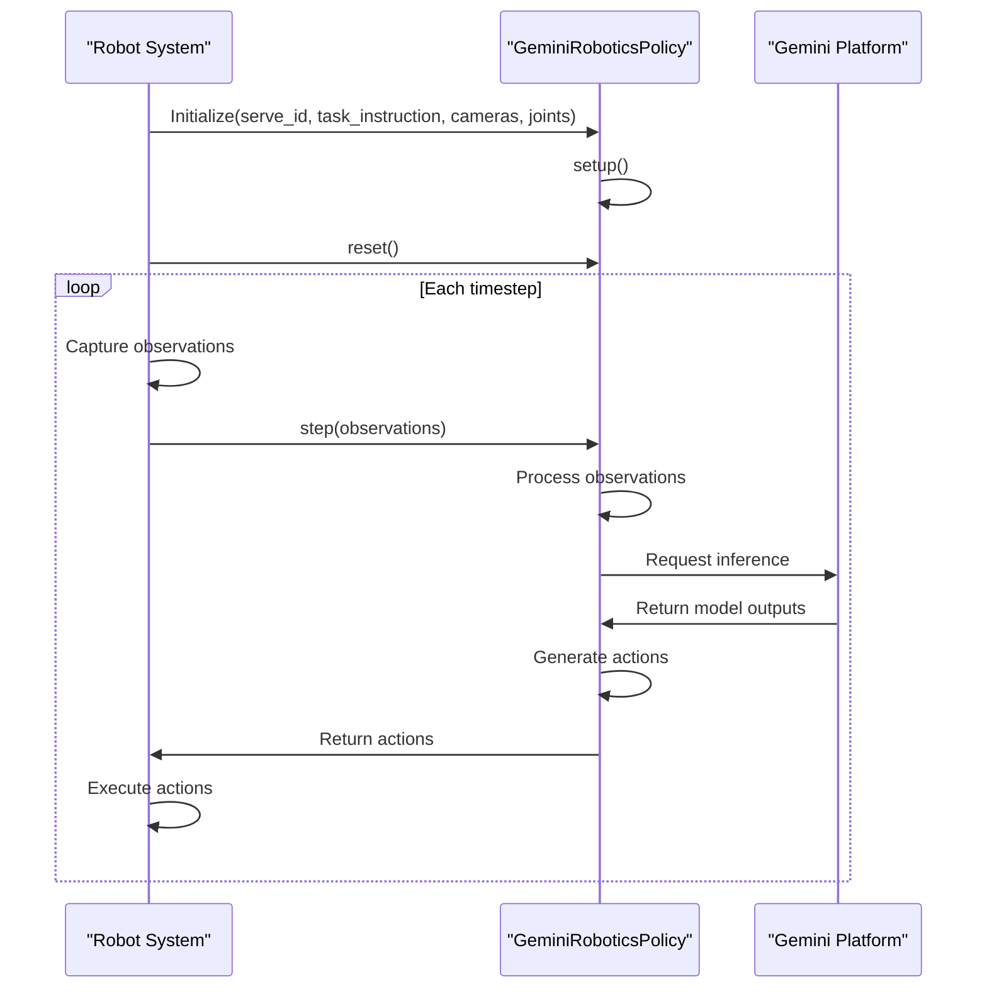

<!-- source: DeepWiki mcp.deepwiki.com · repo google-deepmind/gemini-robotics-sdk · page 6.1 Gemini Robotics Policies · fetched 2026-10-26 -->

# Gemini Robotics Policies

<details>
<summary>Relevant source files</summary>

The following files were used as context for generating this wiki page:

- [examples/model/gemini_robotics_aloha_eval_example.py](examples/model/gemini_robotics_aloha_eval_example.py)
- [examples/model/gemini_robotics_policy_example.py](examples/model/gemini_robotics_policy_example.py)

</details>


This document covers the `GeminiRoboticsPolicy` class, which provides a standardized interface for deploying and using Gemini-powered robot control policies. The policy handles observation processing, model inference, and action generation for robotic systems.

For information about the broader GenAI Robotics API, see [GenAI Robotics API](#6.2).

## Overview

The `GeminiRoboticsPolicy` class serves as a bridge between robot observations (camera images, joint states) and robot actions (joint commands). It encapsulates the complexity of interacting with Gemini models and provides a simple interface for robot control.



Sources: [examples/model/gemini_robotics_policy_example.py:81-86](), [examples/model/gemini_robotics_aloha_eval_example.py:81-86]()

## Key Components

The `GeminiRoboticsPolicy` has several key components:

1. **Configuration**: Specifies the model serving endpoint, task instruction, and observation space
2. **Observation Handling**: Processes camera images and joint states
3. **Action Generation**: Converts model outputs to robot joint commands
4. **State Management**: Maintains policy state between steps

```mermaid
classDiagram
    class GeminiRoboticsPolicy {
        +serve_id: str
        +task_instruction: str
        +cameras: dict
        +joints: dict
        +observation_spec: dict
        +setup()
        +reset()
        +step(observation)
    }

    GeminiRoboticsPolicy --> "ModelClient" : uses
    GeminiRoboticsPolicy --> "ObservationSpec" : defines
    GeminiRoboticsPolicy --> "ActionSpec" : defines
```

Sources: [examples/model/gemini_robotics_policy_example.py:81-86]()

## Initialization and Setup

To use the `GeminiRoboticsPolicy`, you need to:

1. Initialize the policy with a serve ID, task instruction, and observation space
2. Call `setup()` to initialize the policy
3. Call `step()` with observations to get actions

```python
policy = gemini_robotics_policy.GeminiRoboticsPolicy(
    serve_id="your_serve_id",
    task_instruction="Pick up the red block.",
    cameras={"camera1": (480, 640)},
    joints={"joint_positions": 7},
)
policy.setup()  # Initialize the policy
```

Sources: [examples/model/gemini_robotics_policy_example.py:81-87]()

## Observation Space Configuration

The policy requires a specification of the observation space, which includes:

1. **Cameras**: A dictionary mapping camera names to image dimensions
2. **Joints**: A dictionary mapping joint state names to dimensions

### Camera Configuration

The camera configuration specifies the names and dimensions of camera images that will be provided to the policy:

```python
# Example for Aloha robot
cameras = {
    "overhead_cam": (480, 848),
    "worms_eye_cam": (480, 848),
    "wrist_cam_left": (480, 848),
    "wrist_cam_right": (480, 848),
}
```

Sources: [examples/model/gemini_robotics_policy_example.py:45-51](), [examples/model/gemini_robotics_aloha_eval_example.py:50-55]()

### Joint Configuration

The joint configuration specifies the names and dimensions of joint states that will be provided to the policy:

```python
# Example for Aloha robot
joints = {"joints_pos": 14}

# Example for Atari robot
joints = {
    "left_arm_joint_pos": 7,
    "right_arm_joint_pos": 7,
    "left_hand_command": 6,
    "right_hand_command": 6,
    "neck_joint_pos": 3,
    "torso_joint_pos": 3,
}
```

Sources: [examples/model/gemini_robotics_policy_example.py:52-69](), [examples/model/gemini_robotics_aloha_eval_example.py:56]()

## Robot-Specific Configurations

The SDK includes pre-defined configurations for common robot platforms:

### Aloha Robot Configuration



Sources: [examples/model/gemini_robotics_policy_example.py:45-52](), [examples/model/gemini_robotics_aloha_eval_example.py:50-56]()

### Atari Robot Configuration



Sources: [examples/model/gemini_robotics_policy_example.py:55-69]()

## Policy Execution Flow

The policy execution flow involves:

1. **Initialization**: Set up the policy with a serve ID, task instruction, and observation space
2. **Reset**: Reset the policy state at the beginning of an episode
3. **Step**: Process observations and generate actions
4. **Termination**: Clean up resources when done



Sources: [examples/model/gemini_robotics_policy_example.py:113-118](), [examples/model/gemini_robotics_aloha_eval_example.py:88-126]()

## Observation and Action Format

### Observation Format

The policy expects observations in a specific format:

```python
observation = {
    # Camera images as JPEG bytes
    "camera_name1": bytes(...),  # JPEG image bytes
    "camera_name2": bytes(...),  # JPEG image bytes
    
    # Joint states as numpy arrays
    "joint_name1": numpy.array([...]),  # Joint positions
    "joint_name2": numpy.array([...]),  # Joint positions
}
```

Sources: [examples/model/gemini_robotics_aloha_eval_example.py:104-109]()

### Action Format

The policy returns actions as numpy arrays, which can be used to control the robot:

```python
# For Aloha robot
actions = numpy.array([...])  # 14-dimensional array
# First 6 elements: left arm joint targets
# 7th element: left gripper joint target
# Elements 8-13: right arm joint targets
# 14th element: right gripper joint target
```

Sources: [examples/model/gemini_robotics_aloha_eval_example.py:112-116]()

## Example Usage

### Basic Example

```python
# Initialize the policy
policy = gemini_robotics_policy.GeminiRoboticsPolicy(
    serve_id="your_serve_id",
    task_instruction="Pick up the red block.",
    cameras={"camera1": (480, 640)},
    joints={"joint_positions": 7},
)
policy.setup()

# Reset the policy at the beginning of an episode
policy.reset()

# Run the policy
for _ in range(100):
    # Get observations from the robot
    observation = get_robot_observations()
    
    # Get actions from the policy
    action = policy.step(observation)
    
    # Execute actions on the robot
    execute_robot_actions(action)
```

Sources: [examples/model/gemini_robotics_policy_example.py:80-118]()

### Aloha Robot Example

The following example shows how to use the `GeminiRoboticsPolicy` with an Aloha robot:

```python
# Initialize the policy
model_client = gemini_robotics_policy.GeminiRoboticsPolicy(
    serve_id="your_serve_id",
    task_instruction="pick up banana and hand over",
    cameras=_ALOHA_CAMERAS,
    joints=_ALOHA_JOINTS,
)

# Reset the policy
model_client.reset()

# Run the policy
while True:
    # Get observations from the robot
    obs = {
        camera_name: bytes(robot_client.get_image_jpeg(camera_name))
        for camera_name, _ in _ALOHA_CAMERAS.items()
    } | {
        joint_name: robot_client.get_follower_joints_pos()
        for joint_name, _ in _ALOHA_JOINTS.items()
    }
    
    # Get actions from the policy
    gemini_actions = model_client.step(obs)
    
    # Execute actions on the robot
    cmd = aloha_ros_robot_client.robot_client.RobotCommand(
        left_arm_joint_target=gemini_actions[:6],
        right_arm_joint_target=gemini_actions[7:13],
        left_gripper_joint_target=gemini_actions[6:7],
        right_gripper_joint_target=gemini_actions[13:],
    )
    robot_client.step(cmd)
```

Sources: [examples/model/gemini_robotics_aloha_eval_example.py:81-126]()

## Task Instructions

The `GeminiRoboticsPolicy` uses natural language task instructions to guide the robot's behavior. The task instruction is provided during initialization and can be updated during execution:

```python
# Initialize with a task instruction
policy = gemini_robotics_policy.GeminiRoboticsPolicy(
    serve_id="your_serve_id",
    task_instruction="Pick up the red block.",
    cameras=cameras,
    joints=joints,
)

# Update the task instruction
policy._task_instruction = "Place the red block on the blue block."
```

Sources: [examples/model/gemini_robotics_aloha_eval_example.py:36-40](), [examples/model/gemini_robotics_aloha_eval_example.py:98]()

## Error Handling

The `GeminiRoboticsPolicy` can encounter various errors during initialization and execution. It's important to handle these errors appropriately:

```python
try:
    policy = gemini_robotics_policy.GeminiRoboticsPolicy(
        serve_id=serve_id,
        task_instruction=task_instruction,
        cameras=cameras,
        joints=joints,
    )
    policy.setup()
except ValueError as e:
    print(f"Error initializing policy: {e}")
except Exception as e:
    print(f"An unexpected error occurred: {e}")
```

Sources: [examples/model/gemini_robotics_policy_example.py:80-94]()

## Best Practices

1. **Reset at Episode Start**: Always call `reset()` at the beginning of each episode to ensure the policy state is properly initialized.
2. **Error Handling**: Wrap policy initialization and execution in try-except blocks to handle errors gracefully.
3. **Observation Format**: Ensure camera images are provided as JPEG bytes and joint states as numpy arrays.
4. **Task Instructions**: Use clear, concise task instructions that describe the desired behavior.
5. **Timing**: Maintain a consistent control frequency (e.g., 50Hz) for stable robot control.

Sources: [examples/model/gemini_robotics_aloha_eval_example.py:88-126](), [examples/model/gemini_robotics_policy_example.py:80-123]()

---

