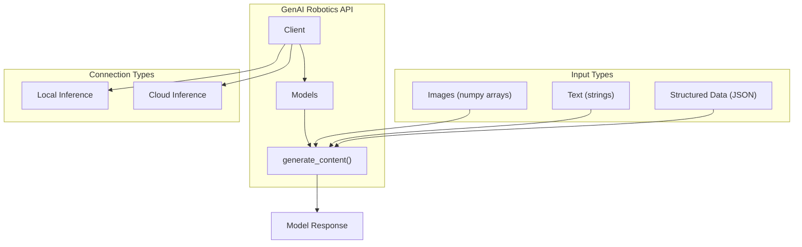
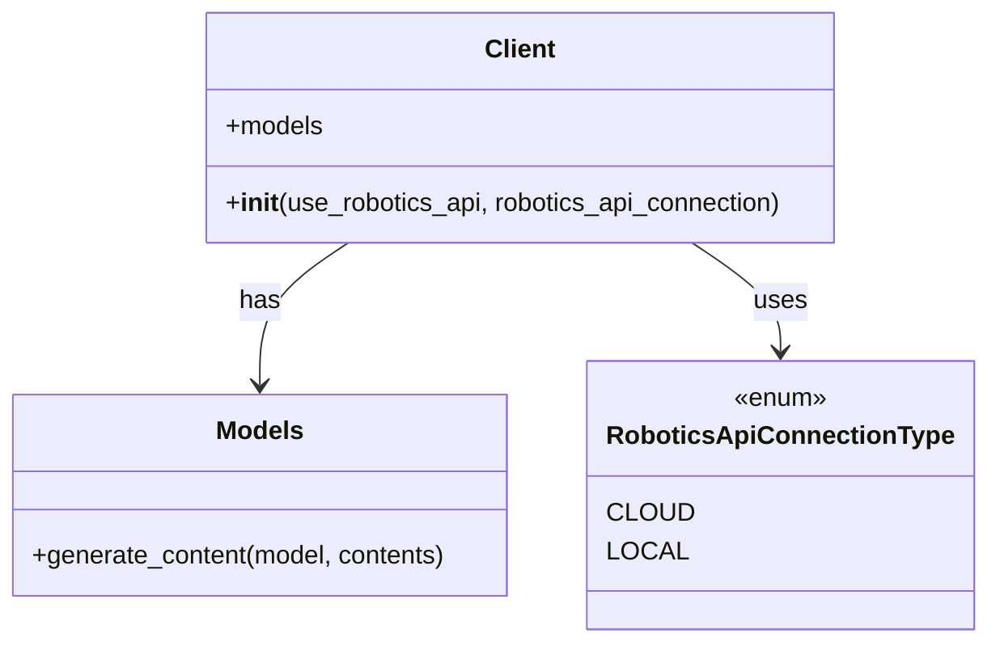
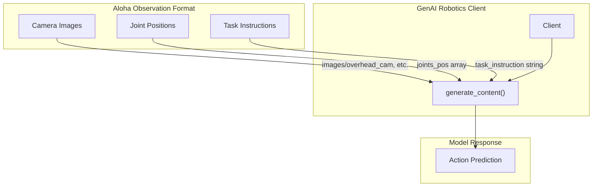
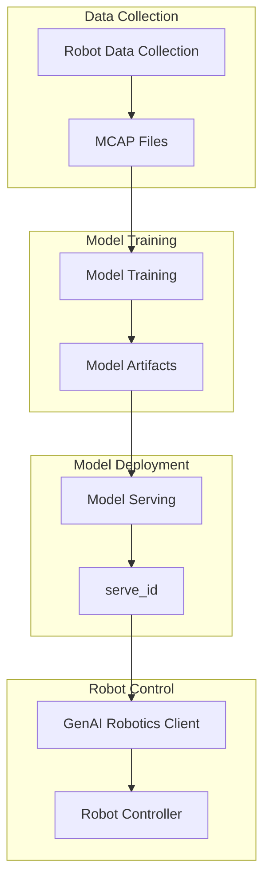

<!-- source: DeepWiki mcp.deepwiki.com · repo google-deepmind/gemini-robotics-sdk · page 6.2 GenAI Robotics API · fetched 2026-10-26 -->

# GenAI Robotics API

<details>
<summary>Relevant source files</summary>

The following files were used as context for generating this wiki page:

- [examples/model/genai_robotics_aloha_example.py](examples/model/genai_robotics_aloha_example.py)
- [examples/model/genai_robotics_example.py](examples/model/genai_robotics_example.py)

</details>


This document covers the GenAI Robotics API client, which provides an interface for interacting with Gemini Robotics models for inference and content generation. The API allows users to send multimodal inputs (images, text, and structured data) to robotics models and receive responses for robot control.

For information about using the higher-level `GeminiRoboticsPolicy` class for robot control, see [Gemini Robotics Policies](#6.1).

## Overview

The GenAI Robotics API provides a client interface for sending multimodal inputs to Gemini Robotics models and receiving responses. It supports both local and cloud-based inference, allowing developers to interact with robotics models through a consistent interface.



Sources: [safari_sdk/model/genai_robotics.py](), [examples/model/genai_robotics_example.py:15-46](), [examples/model/genai_robotics_aloha_example.py:15-58]()

## Client Initialization

The `Client` class is the main entry point for interacting with the GenAI Robotics API. It can be configured to use either local or cloud-based inference.



### Initialization Parameters

| Parameter | Type | Description | Default |
|-----------|------|-------------|---------|
| `use_robotics_api` | boolean | Whether to use the specific Robotics API endpoint | `True` |
| `robotics_api_connection` | RoboticsApiConnectionType | The connection type to use ("local" or "cloud") | "local" |

### Example

```python
from safari_sdk.model import genai_robotics

# Initialize client for local inference
client = genai_robotics.Client(
    use_robotics_api=True,
    robotics_api_connection=genai_robotics.RoboticsApiConnectionType.LOCAL
)

# Initialize client for cloud inference
client = genai_robotics.Client(
    use_robotics_api=True,
    robotics_api_connection=genai_robotics.RoboticsApiConnectionType.CLOUD
)
```

Sources: [examples/model/genai_robotics_example.py:41-45](), [examples/model/genai_robotics_aloha_example.py:49-58]()

## Generating Content

The `generate_content` method is used to send inputs to the model and receive responses. It supports multimodal inputs including images, text, and structured data.

### Method Signature

```
generate_content(model, contents)
```

| Parameter | Type | Description |
|-----------|------|-------------|
| `model` | string | The ID of the model to use (serve_id) |
| `contents` | list | List of content items (images, text, JSON) |

### Input Types

The `contents` parameter accepts a list of different input types:

1. **Images**: Can be provided as:
   - NumPy arrays (`np.ndarray`)
   - TensorFlow tensors (`tf.Tensor`)
   - Raw bytes
   - `types.Part` objects

2. **Text**: Plain strings

3. **Structured Data**: JSON-formatted strings containing observations and other data

### Example Usage

```python
import json
import numpy as np
from safari_sdk.model import genai_robotics

# Initialize client
client = genai_robotics.Client(use_robotics_api=True)

# Prepare sample inputs
sample_image = np.zeros((64, 64, 3), dtype=np.uint8)  # Example image
observations = {
    "images/overhead_cam": 0,  # Index 0 refers to sample_image
    "task_instruction": "Pick up the red block.",
    "joints_pos": [0.1, -0.2, 0.3, -0.4, 0.5, -0.6],
}
observations_json = json.dumps(observations)

# Call the model
response = client.models.generate_content(
    model="your_serve_id",
    contents=[
        sample_image,
        observations_json,
    ],
)

# Process the response
print("Model Response:", response.text)
```

Sources: [examples/model/genai_robotics_example.py:48-76]()

## Aloha Robot Integration

The GenAI Robotics API can be used with the Aloha robot system by providing the appropriate observation format.



### Aloha Observation Format

For Aloha robots, the observation format typically includes:

1. **Camera Images**: Multiple camera views (overhead, wrist cameras, worm's eye)
2. **Joint Positions**: Current joint angles as a float array
3. **Task Instructions**: Natural language description of the task

Example observation structure:

```json
{
  "images/overhead_cam": 0,
  "images/wrist_cam_left": 1,
  "images/wrist_cam_right": 2,
  "images/worms_eye_cam": 3,
  "task_instruction": "make a fox shaped origami",
  "joints_pos": [0.1, 0.2, 0.3, ...]
}
```

Sources: [examples/model/genai_robotics_aloha_example.py:60-72]()

## Performance Considerations

When using the GenAI Robotics API, consider the following performance aspects:

1. **Inference Time**: The time required for model inference can vary based on:
   - Model complexity
   - Input size (especially image dimensions)
   - Connection type (local vs. cloud)
   - Hardware capabilities

2. **Image Dimensions**: Different models may expect specific image dimensions:
   - Gemini Robotics: 480×848 pixels
   - Gemini Robotics Nano: 224×224 pixels

3. **Warm-up Calls**: The first few calls to the model may be slower due to initialization overhead. Consider making a few warm-up calls before timing-critical operations.

Example of measuring inference time:

```python
import time
import numpy as np
from safari_sdk.model import genai_robotics

client = genai_robotics.Client(use_robotics_api=True)

# Prepare inputs
# ...

# Measure inference time over multiple calls
times = []
for _ in range(10):
    start = time.time()
    response = client.models.generate_content(
        model="your_serve_id",
        contents=[...],
    )
    end = time.time()
    times.append(end - start)

# Calculate average (skipping first few calls)
print("Average inference time:", np.mean(times[3:]))
```

Sources: [examples/model/genai_robotics_example.py:78-94](), [examples/model/genai_robotics_aloha_example.py:75-96]()

## Error Handling

When using the GenAI Robotics API, it's important to implement proper error handling to manage potential issues:

```python
try:
    response = client.models.generate_content(
        model="your_serve_id",
        contents=[...],
    )
    print("Model Response:", response.text)
except Exception as e:
    print(f"An error occurred: {e}")
```

Common errors include:
- Invalid model ID
- Incorrect input format
- Network connectivity issues (for cloud inference)
- Authentication failures

Sources: [examples/model/genai_robotics_example.py:63-76]()

## Integration with Robotics Workflows

The GenAI Robotics API is designed to integrate with broader robotics workflows, particularly within the Safari SDK ecosystem.



The GenAI Robotics API typically fits into the workflow as follows:

1. **Data Collection**: Robot data is collected and stored in MCAP format
2. **Model Training**: Data is used to train robotics models
3. **Model Deployment**: Trained models are deployed and assigned a `serve_id`
4. **Robot Control**: The GenAI Robotics client uses the `serve_id` to interact with the deployed model

Sources: [examples/model/genai_robotics_example.py](), [examples/model/genai_robotics_aloha_example.py]()

## Summary

The GenAI Robotics API provides a flexible interface for interacting with Gemini Robotics models. Key features include:

- Support for multimodal inputs (images, text, structured data)
- Local and cloud-based inference options
- Integration with the Aloha robot system
- Performance measurement capabilities

By using this API, developers can leverage Gemini Robotics models for a wide range of robotics applications, from simple control tasks to complex manipulation scenarios.

---

