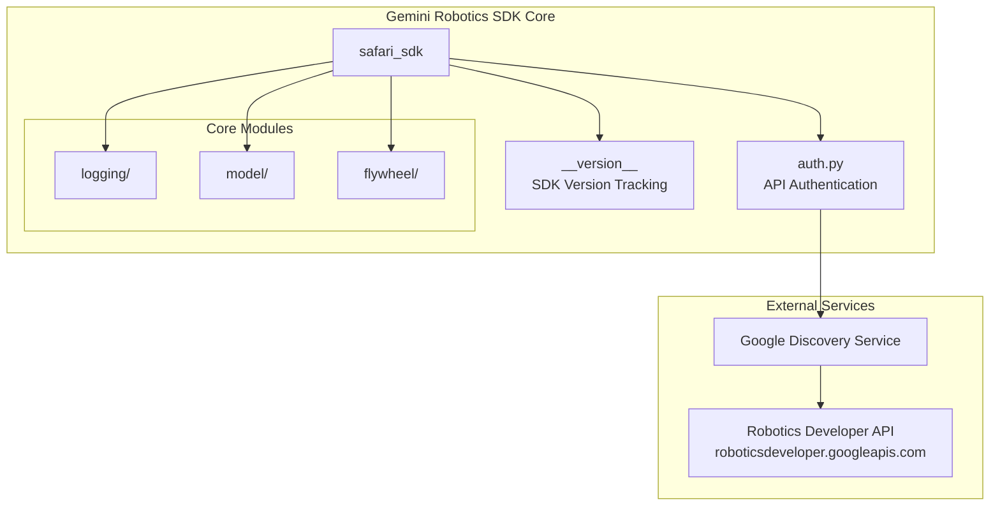
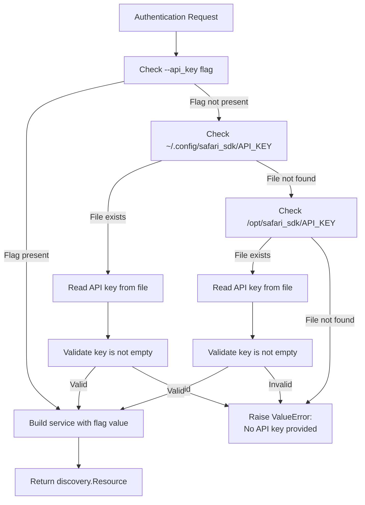
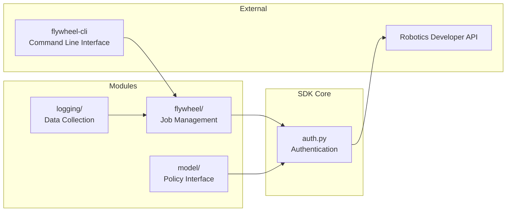
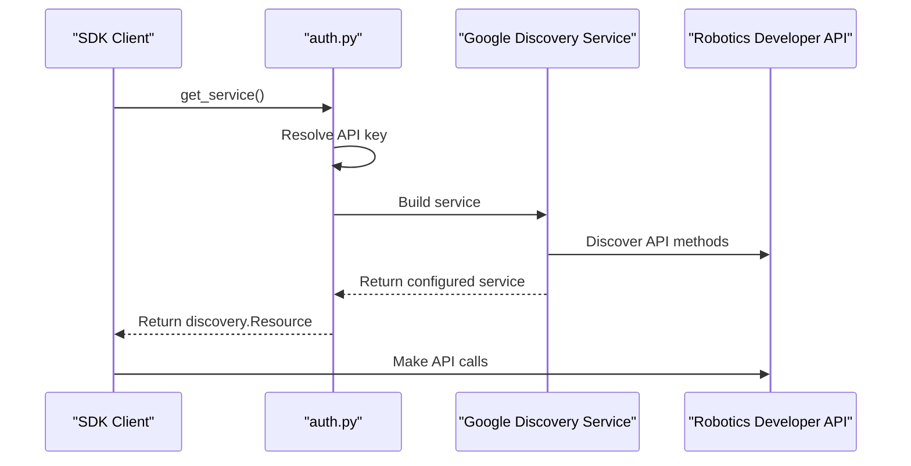

<!-- source: DeepWiki mcp.deepwiki.com · repo google-deepmind/gemini-robotics-sdk · page 7 SDK Core · fetched 2026-10-26 -->

# SDK Core

<details>
<summary>Relevant source files</summary>

The following files were used as context for generating this wiki page:

- [safari_sdk/__init__.py](safari_sdk/__init__.py)
- [safari_sdk/auth.py](safari_sdk/auth.py)
- [safari_sdk/logging/python/__init__.py](safari_sdk/logging/python/__init__.py)

</details>


This page provides an overview of the core components and architecture of the Gemini Robotics SDK. It covers the fundamental structure, authentication mechanisms, and key modules that form the foundation of the SDK.

For information about the Command Line Interface that interacts with these core components, see [Command Line Interface](#3).

## Overview

The Gemini Robotics SDK core provides the foundational infrastructure for interacting with Google DeepMind's robotics models and services. It consists of several key modules that handle authentication, service discovery, and API interactions.



Sources: [safari_sdk/__init__.py:1-20](), [safari_sdk/auth.py:15-37]()

## SDK Version Management

The SDK maintains version information in the `__init__.py` file. The current version is stored as a plain string in the `__version__` variable. This version information is used by the build system and is accessible to client applications.

```
__version__ = "2.5.0"
```

The version string follows semantic versioning principles (MAJOR.MINOR.PATCH) and is read by the CMake build system during package generation.

Sources: [safari_sdk/__init__.py:15-19]()

## Authentication System

The authentication system is a critical component of the SDK core, providing secure access to Google's robotics services.

### Authentication Flow



The SDK provides two main authentication functions:

1. `get_service()`: Returns a fully configured Google API discovery service
2. `get_api_key()`: Returns just the API key for custom usage

### API Key Resolution

The SDK follows a specific order of precedence when resolving which API key to use:

1. Command-line flag: `--api_key="your_api_key"`
2. User configuration file: `$HOME/.config/safari_sdk/API_KEY`
3. System-wide configuration file: `/opt/safari_sdk/API_KEY`

### Service Configuration

When building the service, the SDK uses the following default configuration:

- Service Name: `roboticsdeveloper`
- API Version: `v1`
- Discovery URL: `https://roboticsdeveloper.googleapis.com/$discovery/rest?version=v1`
- HTTP Timeout: 900 seconds (15 minutes)

Sources: [safari_sdk/auth.py:15-132]()

## Core Module Structure

The SDK is organized into several key modules, each handling specific aspects of the robotics workflow:

| Module | Purpose |
|--------|---------|
| `logging` | Handles data collection, recording, and MCAP file management |
| `model` | Provides interfaces for working with Gemini Robotics policies |
| `flywheel` | Manages the lifecycle of training jobs, data upload, and model serving |

### Module Relationships



Sources: [safari_sdk/__init__.py:15-19](), [safari_sdk/auth.py:15-37]()

## Authentication Implementation Details

The authentication module provides a clean interface for obtaining an authenticated service client while handling the complexity of API key resolution.

### Key Functions

- `get_service()`: Main entry point that returns a configured discovery service
- `get_api_key()`: Helper function that returns just the API key
- `_build_service()`: Internal function that constructs the service with the provided key
- `_extract_api_key_from_file()`: Internal function that reads an API key from a file

### Error Handling

The authentication system provides clear error messages when API keys cannot be found or are invalid:

- `"Auth: No API key provided by flag or file."` - When no API key source is available
- `"Auth: No API key provided in file: {file_path}"` - When a file exists but contains no valid key

Sources: [safari_sdk/auth.py:38-132]()

## Integration with Google Services

The SDK core integrates with Google's Discovery API system to provide access to the Robotics Developer API. This integration allows for:

1. Dynamic discovery of available API methods
2. Automatic handling of API versioning
3. Proper authentication with API keys
4. Configurable HTTP timeouts for long-running operations



Sources: [safari_sdk/auth.py:81-90]()

## Summary

The Gemini Robotics SDK Core provides the essential foundation for interacting with Google's robotics services. Through its authentication system and modular architecture, it enables secure and efficient access to training, serving, and data management capabilities.

The core components are designed to be used both directly by developers and through higher-level interfaces like the Command Line Interface. Understanding these core components is essential for effective use of the SDK and for extending its functionality.

Sources: [safari_sdk/__init__.py:1-20](), [safari_sdk/auth.py:15-132]()

---

