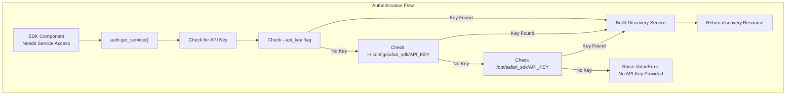
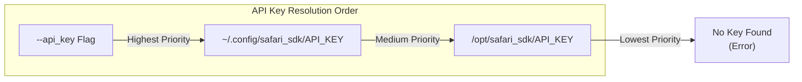
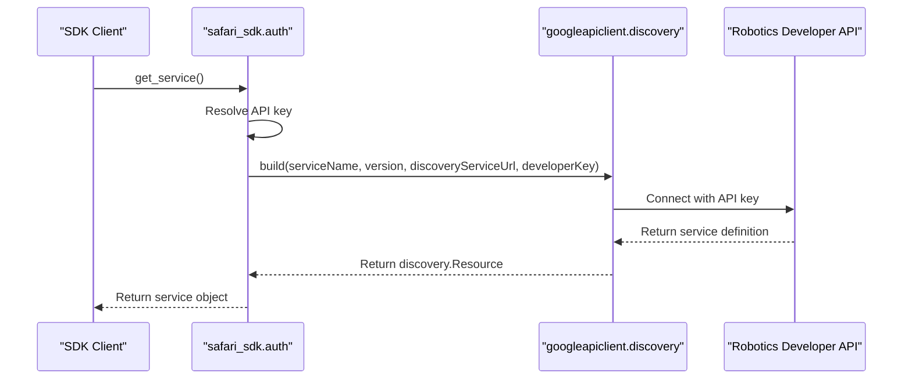
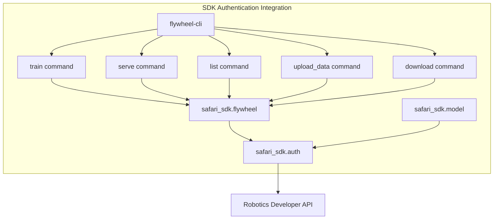

<!-- source: DeepWiki mcp.deepwiki.com · repo google-deepmind/gemini-robotics-sdk · page 7.1 Authentication · fetched 2026-10-26 -->

# Authentication

<details>
<summary>Relevant source files</summary>

The following files were used as context for generating this wiki page:

- [safari_sdk/auth.py](safari_sdk/auth.py)

</details>


This document explains the authentication system used in the Gemini Robotics SDK to connect to backend services. It covers API key management, service connection, and the resolution order for authentication credentials.

For information about using the SDK core components, see [SDK Core](#7).

## Overview

The Gemini Robotics SDK requires authentication to connect to backend services for operations like training models, serving models, and managing data. Authentication is handled through API keys that must be provided when making requests to the robotics developer service.



Sources: [safari_sdk/auth.py:93-117]()

## API Key Management

The SDK supports three methods for providing an API key, with a specific resolution order:

1. Command-line flag: `--api_key="your_api_key"`
2. User-specific configuration file: `$HOME/.config/safari_sdk/API_KEY`
3. System-wide configuration file: `/opt/safari_sdk/API_KEY`

When multiple methods are available, the SDK follows this precedence order, using the first valid API key it finds.



Sources: [safari_sdk/auth.py:47-57](), [safari_sdk/auth.py:93-117]()

### API Key File Format

The API key files should contain only the API key string, with no additional formatting or content. The SDK will strip any leading or trailing whitespace when reading the file.

Example API key file content:
```
YOUR_API_KEY_HERE
```

Sources: [safari_sdk/auth.py:75-78]()

## Service Connection

The authentication module provides functions to establish connections to the Robotics Developer API service using the Google API Client Library.

### Default Service Configuration

The SDK connects to the following service by default:

| Parameter | Value |
|-----------|-------|
| Service Name | `roboticsdeveloper` |
| Version | `v1` |
| Discovery URL | `https://roboticsdeveloper.googleapis.com/$discovery/rest?version=v1` |
| HTTP Timeout | 900 seconds (15 minutes) |

Sources: [safari_sdk/auth.py:60-64](), [safari_sdk/auth.py:81-90]()

### Connection Diagram



Sources: [safari_sdk/auth.py:81-90](), [safari_sdk/auth.py:93-117]()

## Using Authentication in the SDK

### Getting a Service Connection

To establish an authenticated connection to the Robotics Developer API:

```python
from safari_sdk import auth

# This returns a discovery.Resource object
service = auth.get_service()

# Now you can use the service to make API calls
response = service.projects().locations().jobs().list(parent="projects/my-project/locations/us-central1").execute()
```

If no valid API key is found, a `ValueError` will be raised with an appropriate error message.

Sources: [safari_sdk/auth.py:93-117]()

### Retrieving the API Key Directly

If you need to access just the API key without building a service:

```python
from safari_sdk import auth

# Get the API key (returns None if no key is found)
api_key = auth.get_api_key()

if api_key:
    # Use the API key for custom authentication needs
    pass
else:
    # Handle the case where no API key is available
    pass
```

Sources: [safari_sdk/auth.py:120-132]()

## Error Handling

The authentication module provides clear error messages when API keys cannot be found:

| Scenario | Error Message |
|----------|---------------|
| No API key provided | `Auth: No API key provided by flag or file.` |
| Empty API key file | `Auth: No API key provided in file: {file_path}` |

Sources: [safari_sdk/auth.py:67-72](), [safari_sdk/auth.py:114-117]()

## Integration with Other SDK Components

The authentication module is used by various components of the SDK, particularly the Flywheel CLI, to authenticate requests to the backend services.



Sources: [safari_sdk/auth.py:15-37]()

## Best Practices

1. **Store API keys securely**: Place your API key in the recommended file locations rather than hardcoding it in your scripts.
2. **Use command-line flags for temporary usage**: For one-off operations or testing, use the `--api_key` flag.
3. **Set up user-specific configuration**: For development environments, use the `~/.config/safari_sdk/API_KEY` file.
4. **Use system-wide configuration for production**: In production environments, consider using the `/opt/safari_sdk/API_KEY` file.

Sources: [safari_sdk/auth.py:15-37]()

---

