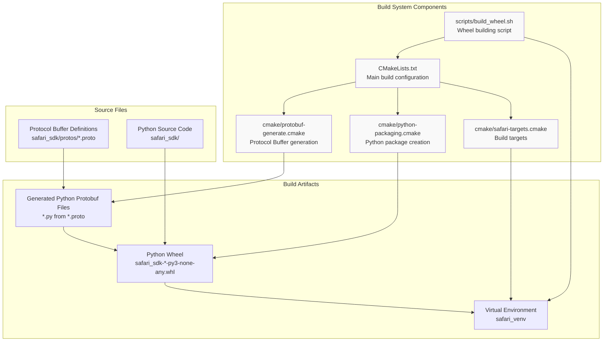
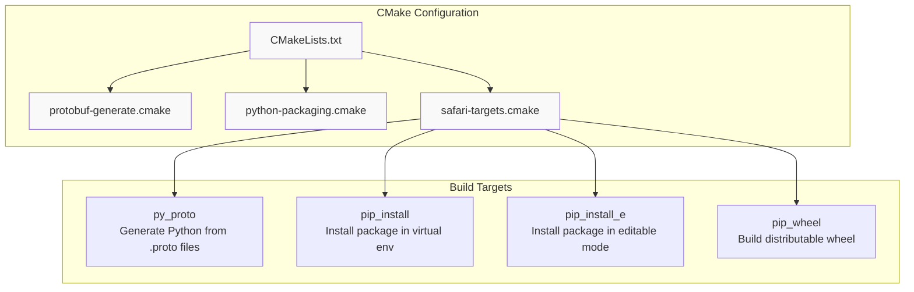
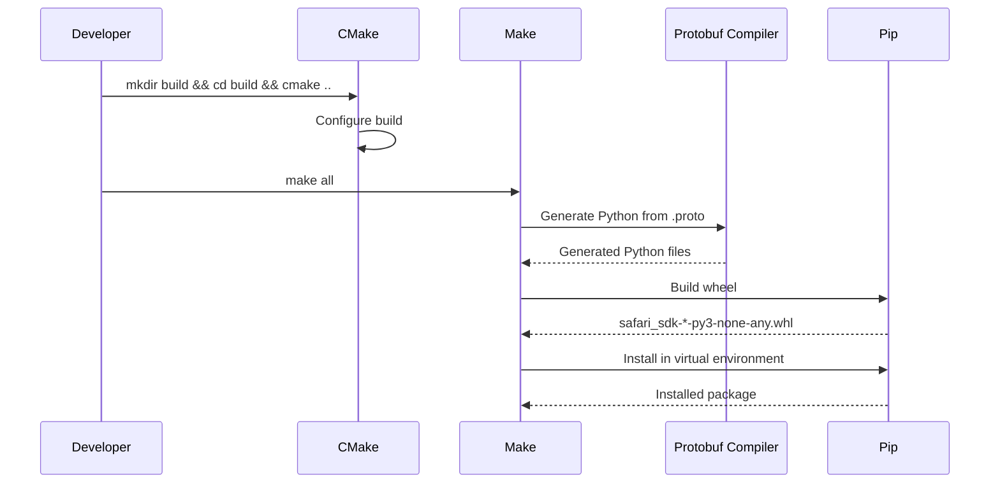

<!-- source: DeepWiki mcp.deepwiki.com · repo google-deepmind/gemini-robotics-sdk · page 8 Build System · fetched 2026-10-26 -->

# Build System

<details>
<summary>Relevant source files</summary>

The following files were used as context for generating this wiki page:

- [CMakeLists.txt](CMakeLists.txt)
- [scripts/build_wheel.sh](scripts/build_wheel.sh)

</details>


This page documents the build system for the Gemini Robotics SDK, covering the CMake configuration, Python packaging, and development workflow. The build system handles protobuf generation, Python package creation, and provides targets for installation and wheel building.

For information about the SDK core components, see [SDK Core](#7).

## Overview

The Gemini Robotics SDK uses CMake as its primary build system. The build system is responsible for:

1. Generating Python code from Protocol Buffer definitions
2. Creating Python packages (both for development and distribution)
3. Building wheels for distribution
4. Setting up virtual environments for testing and development



Sources: [CMakeLists.txt:15-37](), [scripts/build_wheel.sh:16-24]()

## CMake Configuration

The main CMake configuration is defined in `CMakeLists.txt` at the root of the repository. It includes three key modules:

1. `protobuf-generate.cmake` - Handles Protocol Buffer code generation
2. `python-packaging.cmake` - Provides functions for Python package management
3. `safari-targets.cmake` - Defines build targets for the SDK

The minimum required CMake version is 3.16, which is compatible with Ubuntu 22.04 and ROS Noetic.



Sources: [CMakeLists.txt:32-37]()

### Protocol Buffer Generation

The build system automatically generates Python code from Protocol Buffer definitions found in the `safari_sdk/protos` directory. The generated files are placed alongside their corresponding `.proto` files in the source tree.

```
add_custom_target(py_proto ALL
  DEPENDS ${_PB_GENERATED_FILES}
)
```

This creates a build target called `py_proto` that depends on all the generated protobuf files. The target is included in the default `all` target, ensuring that protocol buffers are generated during a standard build.

Sources: [CMakeLists.txt:39-51]()

### Python Package Configuration

The SDK defines a Python package named `safari_sdk` with the following configuration:

```
add_pip_source_package_info(
  TARGET_NAME safari_sdk_source_package
  PACKAGE_NAME safari_sdk
  IMPORT_ROOT_DIR safari_sdk
  DEPENDS ${_PB_GENERATED_FILES}
  EDITABLE_INSTALL_OUTPUT safari_sdk.pth
  PY_FILE_GLOB
)
```

This configuration specifies:
- The package name (`safari_sdk`)
- The import root directory
- Dependencies on generated Protocol Buffer files
- Support for editable installation

Sources: [CMakeLists.txt:53-61]()

## Build Targets

The build system provides several targets for different use cases:

| Target | Description | Command |
|--------|-------------|---------|
| `py_proto` | Generate Python code from Protocol Buffer definitions | `make py_proto` |
| `pip_install` | Install the package in a virtual environment | `make pip_install` |
| `pip_install_e` | Install the package in editable mode | `make pip_install_e` |
| `pip_wheel` | Build a distributable wheel | `make pip_wheel` |
| `all` | Build all targets | `make all` |

The virtual environment is created at `build/safari_venv` and can be activated with:

```bash
source build/safari_venv/bin/activate
```

Sources: [CMakeLists.txt:65-81](), [scripts/build_wheel.sh:26-30]()

## Build Workflow

The typical build workflow involves:

1. Creating a build directory
2. Running CMake to configure the build
3. Building the desired targets



For a simplified workflow, the repository includes a `build_wheel.sh` script that automates the build process and performs a smoke test to verify the installation.

Sources: [CMakeLists.txt:28-30](), [scripts/build_wheel.sh:16-38]()

## Wheel Building and Testing

The `scripts/build_wheel.sh` script provides a convenient way to build and test the SDK:

1. Creates a build directory if it doesn't exist
2. Configures the build with CMake
3. Builds the wheel and installs it in a virtual environment
4. Performs a smoke test to verify the installation
5. Creates a symlink to the latest build at `/tmp/safari_sdk-lastbuild-py3-none-any.whl`

The smoke test verifies:
- The `flywheel-cli` command is available
- Key Python modules can be imported

```
python3 -c "from safari_sdk.logging.python import stream_logger"
python3 -c "from safari_sdk.model import saved_model_policy"
python3 -c "from safari_sdk.logging.python import mcap_episodic_logger"
```

Sources: [scripts/build_wheel.sh:16-41]()

## Development Setup

For development, it's recommended to use the editable installation mode:

```bash
mkdir -p build && cd build
cmake ..
make pip_install_e
source safari_venv/bin/activate
```

This allows you to modify the source code without having to reinstall the package. Changes to Python files will be immediately available, but changes to Protocol Buffer definitions will require rebuilding the `py_proto` target.

Sources: [CMakeLists.txt:65-74]()

## Related Pages

- For information about development setup and contributing, see [Development Setup](#8.2)
- For information about the SDK core components, see [SDK Core](#7)

---

