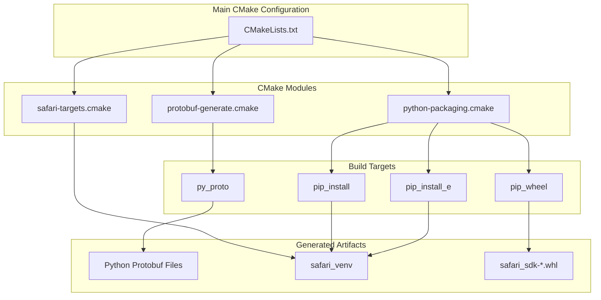
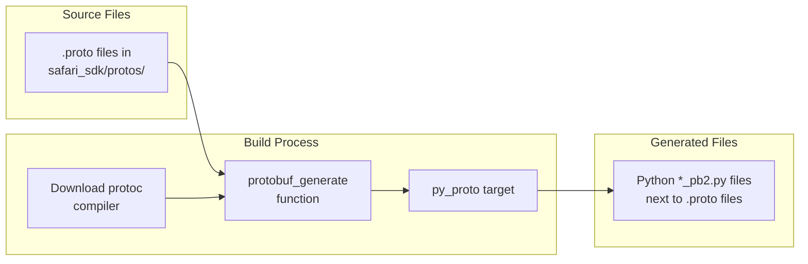
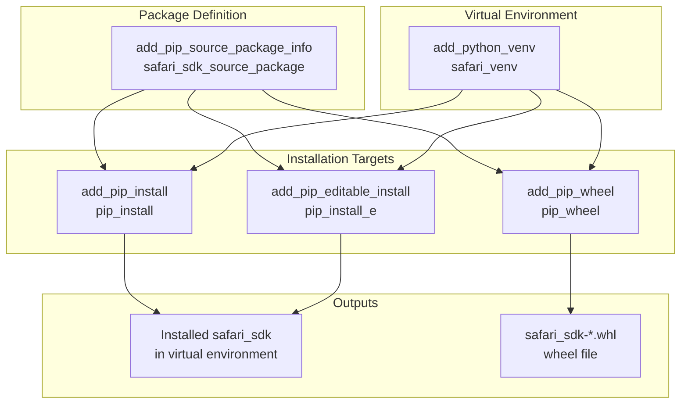
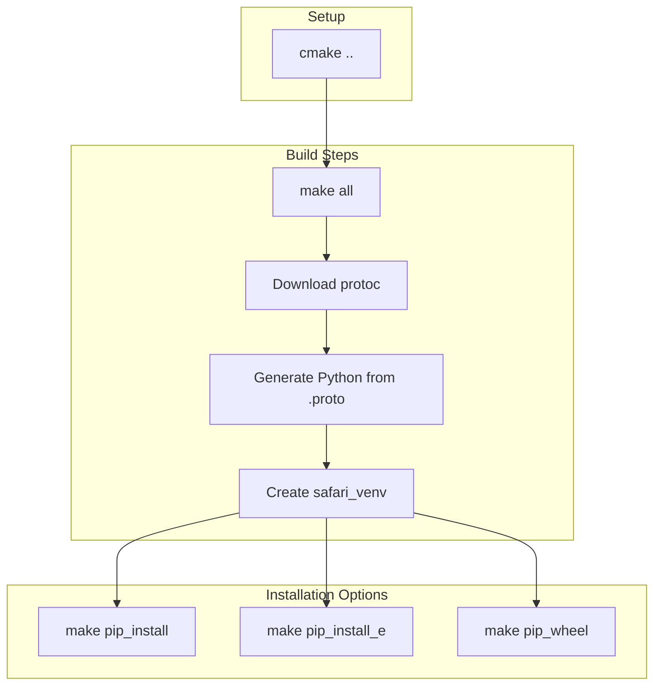

<!-- source: DeepWiki mcp.deepwiki.com · repo google-deepmind/gemini-robotics-sdk · page 8.1 CMake Configuration · fetched 2026-10-26 -->

# CMake Configuration

<details>
<summary>Relevant source files</summary>

The following files were used as context for generating this wiki page:

- [CMakeLists.txt](CMakeLists.txt)
- [cmake/protobuf-generate.cmake](cmake/protobuf-generate.cmake)
- [cmake/python-packaging.cmake](cmake/python-packaging.cmake)
- [cmake/safari-targets.cmake](cmake/safari-targets.cmake)

</details>


This page documents the CMake build system configuration for the Gemini Robotics SDK. It explains how the build system is structured, how Protocol Buffers are generated, and how Python packaging is handled.

For information about setting up a development environment and running tests, see [Development Setup](#8.2).

## Overview

The Gemini Robotics SDK uses CMake as its build system to handle:

1. Protocol Buffer generation from `.proto` files to Python
2. Python package management (installation, editable installation, and wheel building)
3. Virtual environment creation and management

The build system is designed to work on Ubuntu systems (particularly 22.04, which is required by ROS Noetic) and provides a consistent way to build and package the SDK.

Sources: [CMakeLists.txt:15-37]()

## Build System Architecture

The CMake configuration is organized into several modules that handle different aspects of the build process:



Sources: [CMakeLists.txt:35-37](), [cmake/protobuf-generate.cmake:15-28](), [cmake/python-packaging.cmake:15-27](), [cmake/safari-targets.cmake:15-30]()

## Main CMakeLists.txt

The main `CMakeLists.txt` file defines the project and includes the necessary CMake modules:

1. Sets minimum CMake version to 3.16 (compatible with Ubuntu 22.04)
2. Defines the project name as `safari_sdk`
3. Includes the three CMake modules:
   - `protobuf-generate.cmake`: For generating Python code from Protocol Buffer definitions
   - `python-packaging.cmake`: For Python package management
   - `safari-targets.cmake`: For defining reusable targets

The file then defines several targets:
- `py_proto`: Generates Python code from Protocol Buffer definitions
- `safari_sdk_source_package`: Defines the properties of the Python package
- `pip_install`: Installs the package in a virtual environment
- `pip_install_e`: Installs the package in editable mode
- `pip_wheel`: Builds a wheel file for distribution

Sources: [CMakeLists.txt:32-81]()

## Protocol Buffer Generation

The SDK uses Protocol Buffers for data serialization. The CMake configuration automatically generates Python code from `.proto` files:



Key aspects of the Protocol Buffer generation:

1. The system automatically downloads and extracts the Protocol Buffer compiler (protoc v25.4)
2. All `.proto` files in the `safari_sdk/protos/` directory are discovered using `GLOB_RECURSE`
3. The `protobuf_generate` function generates Python code from these files
4. Generated files are placed in the source tree alongside their corresponding `.proto` files
5. The `py_proto` target depends on all generated files, making them part of the default build

Sources: [CMakeLists.txt:39-51](), [cmake/protobuf-generate.cmake:34-219]()

## Python Packaging

The SDK uses CMake to manage Python packaging, including:

1. Creating a virtual environment
2. Installing the package in regular or editable mode
3. Building wheel files for distribution



The Python packaging system provides several functions:

1. `add_pip_source_package_info`: Defines a Python package from source code
2. `add_python_venv`: Creates a Python virtual environment
3. `add_pip_install`: Installs a package in a virtual environment
4. `add_pip_editable_install`: Installs a package in editable mode
5. `add_pip_wheel`: Builds a wheel file for distribution

Sources: [CMakeLists.txt:53-81](), [cmake/python-packaging.cmake:28-721]()

## Package Definition

The SDK defines the `safari_sdk` package with the following properties:

```
add_pip_source_package_info(
  TARGET_NAME safari_sdk_source_package
  PACKAGE_NAME safari_sdk
  IMPORT_ROOT_DIR safari_sdk
  DEPENDS ${_PB_GENERATED_FILES}
  EDITABLE_INSTALL_OUTPUT safari_sdk.pth
  PY_FILE_GLOB
)
```

This definition:
1. Creates a target named `safari_sdk_source_package`
2. Sets the package name to `safari_sdk`
3. Specifies the import root directory as `safari_sdk`
4. Adds dependencies on the generated Protocol Buffer files
5. Specifies the output file for editable installation
6. Automatically includes all Python files in the package via `PY_FILE_GLOB`

Sources: [CMakeLists.txt:54-61]()

## Virtual Environment

The SDK creates a Python virtual environment named `safari_venv` for development and testing:

```
add_python_venv(
  VENV_NAME safari_venv
  OUT_DIR "${SAFARI_VENV_DIR}"
)
```

This virtual environment:
1. Is created in the directory specified by `SAFARI_VENV_DIR` (or defaults to `${CMAKE_BINARY_DIR}/safari_venv`)
2. Contains the Python interpreter and standard library
3. Is used for installing the SDK and its dependencies
4. Provides isolation from the system Python installation

Sources: [cmake/safari-targets.cmake:27-30]()

## Installation Targets

The SDK provides three main installation targets:

1. `pip_install`: Installs the package in regular mode
   ```
   add_pip_install(
     TARGET_NAME pip_install
     VENV_NAME safari_venv
     PACKAGE safari_sdk_source_package
   )
   ```

2. `pip_install_e`: Installs the package in editable mode
   ```
   add_pip_editable_install(
     TARGET_NAME pip_install_e
     VENV_NAME safari_venv
     PACKAGE safari_sdk_source_package
   )
   ```

3. `pip_wheel`: Builds a wheel file for distribution
   ```
   add_pip_wheel(
     TARGET_NAME pip_wheel
     VENV_NAME safari_venv
     PACKAGE safari_sdk_source_package
   )
   ```

Sources: [CMakeLists.txt:65-81]()

## Build Process

The complete build process follows these steps:



To build the SDK:

1. Create a build directory: `mkdir build && cd build`
2. Configure CMake: `cmake ..`
3. Build all targets: `make all`
4. Optionally install the package:
   - Regular installation: `make pip_install`
   - Editable installation: `make pip_install_e`
   - Build wheel: `make pip_wheel`

Sources: [CMakeLists.txt:28-31]()

## CMake Module Details

### protobuf-generate.cmake

This module provides functions for generating Protocol Buffer code:

1. Downloads and extracts the Protocol Buffer compiler (protoc v25.4)
2. Provides the `protobuf_generate` function for generating code from `.proto` files
3. Handles include paths, dependencies, and output file generation

The module is necessary because the version of CMake that comes with Ubuntu 22.04 (required by ROS Noetic) is not compatible with the built-in Protocol Buffer support in newer CMake versions.

Sources: [cmake/protobuf-generate.cmake:15-219]()

### python-packaging.cmake

This module provides functions for Python package management:

1. `add_pip_package_info`: Defines a pip package
2. `add_pip_source_package_info`: Defines a pip package from source code
3. `add_python_venv`: Creates a Python virtual environment
4. `add_pip_install`: Installs a package in a virtual environment
5. `add_pip_editable_install`: Installs a package in editable mode
6. `add_pip_wheel`: Builds a wheel file for distribution

The module also provides helper functions for running commands in virtual environments, extracting package versions, and formatting arguments.

Sources: [cmake/python-packaging.cmake:15-721]()

### safari-targets.cmake

This module defines reusable targets for the SDK:

1. Creates the `safari_venv` virtual environment
2. Provides documentation on accessing Google Cloud repositories

Sources: [cmake/safari-targets.cmake:15-30]()

## Summary

The CMake configuration for the Gemini Robotics SDK provides a comprehensive build system that handles:

1. Protocol Buffer generation from `.proto` files to Python
2. Python package management (installation, editable installation, and wheel building)
3. Virtual environment creation and management

The system is designed to work on Ubuntu systems (particularly 22.04, which is required by ROS Noetic) and provides a consistent way to build and package the SDK.

| Target | Description | Output |
|--------|-------------|--------|
| `all` | Builds all targets | Generated Protocol Buffer files |
| `py_proto` | Generates Python code from Protocol Buffer definitions | Python files next to `.proto` files |
| `pip_install` | Installs the package in regular mode | Installed package in virtual environment |
| `pip_install_e` | Installs the package in editable mode | Editable installation in virtual environment |
| `pip_wheel` | Builds a wheel file for distribution | Wheel file in `dist/` directory |

Sources: [CMakeLists.txt:15-81](), [cmake/protobuf-generate.cmake:15-219](), [cmake/python-packaging.cmake:15-721](), [cmake/safari-targets.cmake:15-30]()

---

